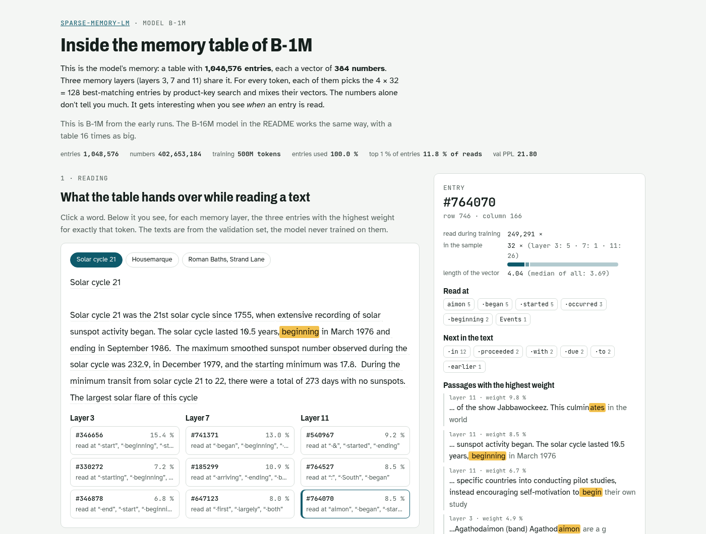
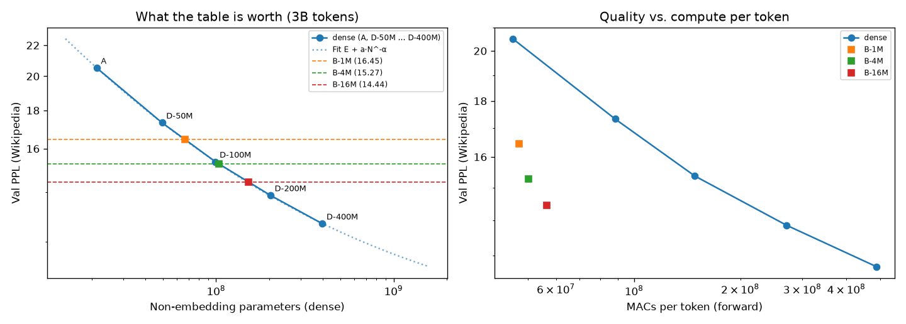
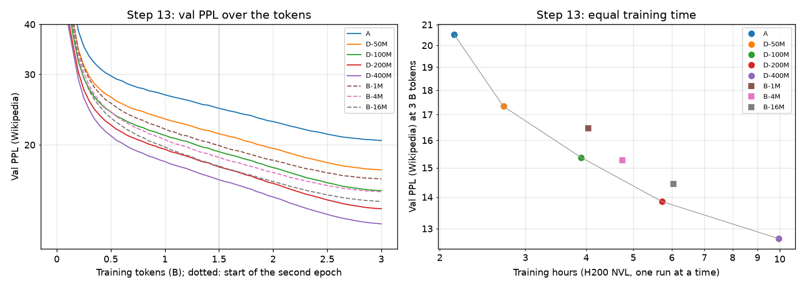
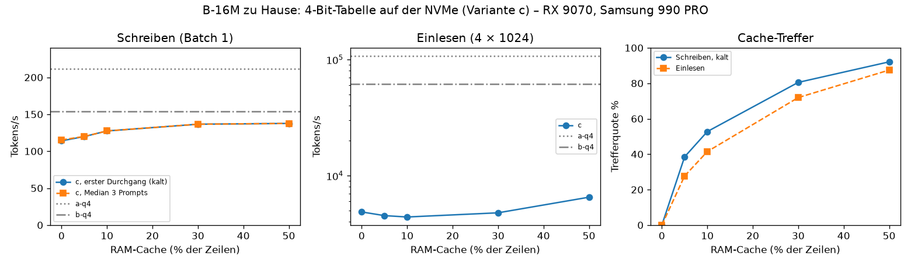

# sparse-memory-lm

[](LICENSE)


> **No time? [Here's the two-minute version →](https://re133.github.io/sparse-memory-lm/)**
>
> New (23 Oct 2026): with one optimizer number per table row, B-16M trains at home in half the RAM and B-4M fits
> entirely on my 16 GB gaming card.

What happens if you give a tiny language model a really big lookup table?

I trained a small Llama-style model (21M parameters) and added a product-key memory to it: a table with up to
16.8 million learned vectors, of which the model only reads a few hundred per token. Then I measured what that is
actually worth, what it costs, and whether the table even has to sit in GPU memory. Most of this ran on my own PC
(Radeon RX 9070). The big runs were on rented cloud GPUs, about 70 dollars, plus about 150 € of a one-time IONOS
credit for the longest runs.

Before every run I wrote down what would count as a success. Some things worked out, some didn't. Both are in
here. The full lab notebook with every criterion, every number and every mishap is [REPORT.md](REPORT.md)
(the German original I wrote along the way is [REPORT.de.md](REPORT.de.md)).

**[Look inside the table](https://re133.github.io/sparse-memory-lm/explorer/)** ·
**[Model on Hugging Face](https://huggingface.co/fechyy/sparse-memory-lm-B-16M)** ·
**[Try it on your GPU](#try-it)** · **[I'm looking for bigger GPUs](#whats-next)**

## Short version

- **Training from scratch:** the 16.8M-row table makes the 21M model about as good as a normal 114M model trained
  on the same data. Per token it does roughly a third of the compute.
- **More data, bigger advantage:** with six times the tokens (3B instead of 500M) the dense models didn't catch up.
  The same table is now worth about 152M dense parameters, and the 1M and 4M tables gained too. I had expected the
  opposite. On other text (WikiText-103) the gain is much smaller, and on an H200 the table still needs 19 to 27%
  more training time than a dense model of the same quality ([below](#six-times-the-tokens)).
- **Bigger keeps helping:** going from 1M to 4M to 16M rows gives about 1.4x "equivalent model size" per step, and
  it isn't flattening out yet.
- **Product keys beat an n-gram table of the same size:** an Engram-style model, which picks its rows by the last
  few tokens, got about two thirds of what the product-key table brings, with the same table size and training. It
  reads 192 times fewer values per token, though, which matters once the table lives outside the GPU.
- **The table helps to remember repeated facts:** in a controlled test with made-up people seen 1 to 64 times in
  training, the model with the table learned their facts clearly better than a dense model with twice its compute per
  token, and at least as well as one with three times its compute (two seeds each). A table with 16 times the rows
  needs about half the repetitions again.
- **Training the 16.8M table on a gaming card:** with the table and its optimizer state in 128 GB of RAM, my 16 GB
  RX 9070 trained B-16M for 100M tokens and ended 0.2% from the H200 run, which had needed 101 GB of GPU memory. It
  took 7.7 times as long. With one optimizer number per table row instead of Adam's two per value it needs half the
  RAM (52 GiB) and ended 1.9% better, and B-4M trains entirely on the card at 40,600 tokens/s
  ([below](#training-the-168m-table-on-my-pc)).
- **Generating text doesn't need the table in VRAM:** from RAM or straight off an NVMe SSD the model still writes
  114 to 154 tokens/s on my PC, with the same output. Reading long prompts is a different story.
- **Portable kernels:** the same hand-written Triton kernels run on three very different GPUs and give the same
  training curve up to float rounding: a consumer Radeon (RDNA4), AMD's data-centre MI350X (CDNA4) and NVIDIA
  H100/H200 (Hopper).
- **Adding a table to a finished model didn't work:** on Qwen3.5-0.8B it was no better than a small dense add-on with
  the same compute. Its perplexity on the training articles dropped a lot, but in a fact test it wasn't any better
  on those articles than on ones it had never seen.

**Look inside the table:** on [this page](https://re133.github.io/sparse-memory-lm/explorer/) you can click any
word of a Wikipedia text and see which of the 1M entries of B-1M the model reads for it, browse a map of the whole
table, and look at single entries: where they get read and what their 384 numbers look like.

[](https://re133.github.io/sparse-memory-lm/explorer/)

## Try it

### The kernels on your GPU

About five minutes, most of it is the PyTorch download. Nothing else to download: the tests and the benchmark use
random data. Checked from a fresh clone on my RX 9070 with Python 3.14 and the official `rocm7.2` wheel:

```bash
git clone https://github.com/re133/sparse-memory-lm.git && cd sparse-memory-lm
python3 -m venv .venv
.venv/bin/pip install torch --index-url https://download.pytorch.org/whl/rocm7.2
.venv/bin/pip install -r requirements.txt
.venv/bin/python -m pytest -q tests                  # ~1 min
.venv/bin/python scripts/kernel_speedup.py           # ~40 s
```

What the last command printed on my card (the first run also shows a few gcc warnings while Triton compiles its
launchers, those are harmless):

```
AMD Radeon RX 9070 (gfx1201), 16 GiB | PyTorch 2.14.1+rocm7.2 (HIP 7.2.53211) | Triton 3.8.0 | Python 3.14.7

                              train step  train tok/s  prefill tok/s  decode tok/s  peak GiB
no table (A)                       333 ms       98,341        438,762           199       7.9
B-1M-sparse, PyTorch               787 ms       41,652        168,342           161      10.5
B-1M-sparse, Triton kernels        512 ms       64,027        295,060           203      10.5

kernels vs PyTorch: training 1.54x, prefill 1.75x, decode 1.26x
with the kernels the table model trains at 65% of the speed of the model without a table
```

- **What it measures:** random weights, one training step on 32 x 1024 tokens, a prompt of 16 x 1024 tokens, and
  batch-1 generation. Speed only, the tests check that the kernels compute the right thing.
- **Radeon:** use the `rocm7.2` wheel. With `rocm7.1` one test aborts on my card
  ([docs/rocm-issues](docs/rocm-issues/README.md)). On the MI350X I used `rocm7.1` with Python 3.12, and there
  everything passed.
- **Distro PyTorch:** if your distro ships PyTorch for ROCm (I normally use CachyOS's `python-pytorch-rocm`), create
  the venv with `--system-site-packages` and skip the torch line.
- **NVIDIA:** plain `pip install torch`. The tests passed on an H200; the benchmark script itself I've only run on
  the RX 9070 so far.

### B-16M writing text with its table on the SSD

The trained B-16M model is on [Hugging Face](https://huggingface.co/fechyy/sparse-memory-lm-B-16M): the
16.8M-row table in 4 bit (3.2 GB) plus the rest of the model. The 4-bit table scores 19.98 validation PPL, against
19.96 for the full fp32 one.

```bash
.venv/bin/pip install huggingface_hub
.venv/bin/python scripts/demo_generate.py --download --table nvme     # 3.7 GB into data/tables/B-16M
.venv/bin/python scripts/demo_generate.py --table vram -i            # table in VRAM, your own prompts
```

With the `rocm7.2` wheel from above (other PyTorch builds sample a different text):

```
loaded in 1.5 s, table in nvme: 0.27 GiB VRAM, 1.8 GiB RAM + 3.8 GiB mapped files

Isaac Newton

Sir Isaac Newton was born on 14 November 1803, the son of the Rev. Samuel Newton of Basing, Middlesex, and his
wife Elizabeth, daughter of William Wilberforce of Westmorland. He was educated at Harrow and Trinity College,
Cambridge. He matriculated at Magdalen College, Oxford, on 11 June 1841. He was ordained in 1844. [...]

[200 tokens in 1.48 s = 135 tok/s, table in nvme, peak 0.42 GiB VRAM, 2.5 GiB RAM + 3.9 GiB mapped files]
```

- **Memory:** the table has 6.4B parameters and stays on the SSD. The GPU only holds the rest of the model
  (0.3 GB) plus the rows the current token reads. "Mapped files" are pages of the table file in Linux's page
  cache, which Linux drops again when it needs the memory.
- **Same text everywhere:** `--table ram` and `--table vram` (~200 tok/s) write the same text. With the pip wheel
  the logits can differ in the last bits between the modes (see above), so a sampled text could in rare cases go
  its own way.
- **Quality:** fluent Wikipedia English, but the facts are made up. This Newton was born in 1803 and became an
  army chaplain. It's a small model trained on 500M tokens, it's here to show what the table costs to run, not what it
  knows. Prompts work best like the training articles: `"Title\n\nFirst words"`.

## Results

### Training from scratch

All models saw the same 500M Wikipedia tokens and are scored on the same held-out Wikipedia articles. The memory
models share one table between three memory layers.

| Model | Params used per token | Table | Val PPL | As good as a dense model with |
|---|---|---|---|---|
| A (no table) | 21M | | 25.67 | |
| B-1M | 23M | 0.4B | 21.84 | ~60M params |
| B-4M | 26M | 1.6B | 20.80 | ~83M params |
| B-16M | 33M | 6.4B | 19.96 | ~114M params (106 to 123M) |

The "as good as" column comes from dense models with 50M, 100M, 200M and 400M parameters (non-embedding) that I
trained on exactly the same data, interpolated on a log-log curve. The range in brackets shows how far the value
moves if every perplexity is off by ±0.4% (the seed noise I measured on the 1M model). It's a sensitivity range,
not a confidence interval.


**Catches:**
- **Equal compute time:** this compares models at equal *tokens*. At equal *training time* on my GPU, B-1M was
  only 3% ahead of the plain model, because the memory layers make every step slower.
- **Memory:** B-16M needed about 101 GB of GPU memory to train. With the table in RAM it trains on my 16 GB card
  too, see below.
- **Other text:** on WikiText-103, which is formatted differently, the advantage is smaller (B-16M ~ 95M).

### Six times the tokens

The obvious objection to the table above: 500M tokens is little for the big dense models (D-400M saw 1.3 tokens per
parameter), so with more training they should catch up. I trained all eight models again from scratch on 3B tokens
(two epochs over 1.5B Wikipedia tokens, same recipe, same val set), on one rented H200. The rule for "grows",
"holds" or "shrinks" was in the repo before the runs started, and my guess was "holds" or "shrinks".

| Model | Val PPL 500M → 3B | As good as dense at 500M | As good as dense at 3B | Verdict |
|---|---|---|---|---|
| B-1M | 21.84 → 16.45 | ~60M (57 to 63M) | ~67M (64 to 70M) | grows |
| B-4M | 20.80 → 15.27 | ~83M (79 to 88M) | ~104M (98 to 110M) | grows |
| B-16M | 19.96 → 14.44 | ~114M (106 to 123M) | ~152M (144 to 161M) | grows |



**Catches:**
- **Equal time:** on the H200, a dense model reaches the same quality in 19 to 27% less training time. The table
  saves compute per token, but reading and updating it costs time.
- **Other text:** on WikiText-103 the equivalent size of B-16M only goes from ~95M to ~102M.
- **Repeated text:** in the second epoch the table memorises the training text more than the dense models do (the
  gap between train and val loss doubles for B-16M). Val still improves the whole way, but the table gains less in
  the second half. Fresh tokens might suit it better. These runs can't tell.
- One seed per model, and the largest dense model has 400M parameters.



### Product keys against an n-gram table (Engram)

Engram (Cheng et al., 2026) also puts a big table next to the model, but picks its rows by hashing the last two or three tokens
instead of by the hidden state. I trained an Engram-style model with a table of the same size (403M values) on the
same data, at home on the RX 9070:

| Model | Val PPL | As good as a dense model with | Table values read per token | Training tok/s |
|---|---|---|---|---|
| A (no table) | 25.71 | | | 91,600 |
| E-1M, Engram-style (2 seeds) | 23.12 | ~41M params | 768 | 78,900 |
| E-1M, plain Adam on the table as in the paper (1 seed) | 22.69 | ~46M params | 768 | 64,300 |
| B-1M, product keys (2 seeds) | 21.79 | ~61M params | 147,456 | 59,700 |

Training speed is the median on my RX 9070. For B-1M it's from a shorter run with the Triton kernels; the two seed
runs in the table went through the slower PyTorch path (~38,500 tok/s).

- **Product keys win at this size:** the Engram model ends 6% higher in perplexity, the version with plain Adam 4%
  higher. The plain-Adam version was slightly ahead early on, until about 150M tokens, and then fell behind further
  and further.
- **My reading:** a large part of what the product-key table delivers can be predicted from the last two tokens alone:
  three quarters of its gain in perplexity, 61% measured in loss. But the rest, which depends on the context, is exactly
  what makes B-1M better than A. A model that learns with n-gram rows from the start makes up for part of that
  elsewhere, not for all of it.
- **Where Engram is better:** it trains faster and reads 192 times fewer values per token, and which rows it needs is
  known before the layer runs. For a table on an SSD that's a big advantage.
- **Caveat:** these are two whole architectures compared at one small size (21M model, 0.4B table, 500M tokens),
  not just two ways of picking rows. Engram is built for much bigger models, so this says nothing about Engram in
  general. Details: steps 4 and 7 in the [report](REPORT.md).

### Reading a quarter of the values

B-1M reads 147,456 table values per token. Two ways to read a quarter of that with the same 0.4B table parameters
(step 9 in the [report](REPORT.md), criteria written before the runs):

| Model | Rows / values read per token | Val PPL |
|---|---:|---:|
| B-1M | 384 / 147,456 | 21.79 |
| B-4M-v96: 4M rows of 96 values | 384 / 36,864 | 22.94 |
| B-1M-k8: 8 instead of 32 lookups per head | 96 / 36,864 | 23.00 |
| B-1M-k16: 16 lookups per head (half the reads) | 192 / 73,728 | 22.29 |

- **A quarter of the reads costs about 5%, either way:** the two curves lie on top of each other. Both keep about 70%
  of what the table brings over A.
- **For a table on the SSD, fewer rows should be the better trade:** the same quality with a quarter of the accesses
  (by the number of rows read; not measured on the SSD). On the GPU the speed hardly changes.
- **Half the reads cost only 2.3%:** with 16 lookups per head the model keeps 87% of what the table brings over A.

### Remembering repeated facts

I put 2,400 made-up people into the training data ("Name was born in 1912. Name grew up in Lisbon. Name worked as a
tailor."), each one 0, 1, 2, 4, … 64 times, and asked the trained models for their year, city and profession. Share of
values right, seed 0 / seed 1 (step 10 and its addendum in the [report](REPORT.md), criteria written before the
runs):

| Seen | B-1M (table) | D-50M (dense, 2× the compute per token) | D-100M (dense, 3×) | B-16M (table with 16× the rows, 1 seed) |
|---:|---:|---:|---:|---:|
| 4 times | 11% / 11% | 4% / 4% | 12% / 11% | 44% |
| 8 times | 34% / 37% | 10% / 8% | 35% / 26% | 86% |
| 16 times | 80% / 81% | 41% / 27% | 77% / 69% | 100% |
| 32 times | 99% / 100% | 87% / 70% | 99% / 98% | 100% |

- **Verdict by my criteria: the table learns repeated facts better, with both seeds.** Against D-50M by a wide
  margin. Against the bigger D-100M the lead is small: with seed 0 only in how sure it is (more probability on the
  right value from 8 repetitions on), with seed 1 also in how many it gets right.
- **The bigger table remembers better still:** B-16M computes about as much per token as B-1M (20% more) and needs
  about half the repetitions for the same share right. Roughly, each step from D-50M to B-1M to B-16M halves them.
- **Why it's interesting:** B-1M is clearly worse than D-100M at general text and computes a third as much per token,
  but it memorizes at least as well. The table is cheap storage that only gets read where it's needed. It is not more
  knowledge per parameter: the table alone has 403M parameters.
- **Caveats:** a seed moves these results much more than the error bars over people suggest (D-50M at 16 repetitions:
  41% with one seed, 27% with the other), so how large the margin to D-100M really is stays open. B-16M has one seed.
  The facts come in one fixed format, and the questions use the same wording.

### Chaining two facts

Can a model combine two made-up facts it learned in separate articles, "A's mother was B" and "B was born in 1912",
and answer "A's mother was born in" without writing out the step in between (step 11 in the [report](REPORT.md),
criteria written before the runs)? B-1M and D-50M both know each fact perfectly, and neither chains them: they do no
better than for a mother they never saw. That matches what's known for much larger models. With both facts in the same
article it works, and there the table model is clearly ahead (57% right against 39%). I left out the bigger models:
D-100M can't change the comparison anymore, and I don't expect B-16M to chain. Looking at the table reads: B-1M looks
up values in its last memory layer, and at the end of the two-hop question that lookup finds nothing of B.

A second read of the table in that layer, built on the result of the first, doesn't change this (step 12, criteria
written before the runs). I also showed the chain in training for 200 other pairs. Both models learn those chains,
but only for those pairs: with and without the second read they still don't chain the pairs whose chain they never
saw, and the second read finds nothing of B at the end of the question either.

### Running the 16.8M table on my PC

B-16M with the table in VRAM, in RAM, or as a 4-bit file on an NVMe SSD (Samsung 990 PRO, memory-mapped, with a
RAM cache for the rows that get read most):

| Table in | Writing (batch 1) | Reading a long prompt | VRAM used |
|---|---|---|---|
| VRAM | 212 to 216 tok/s | 108,000 tok/s | 3.6 GiB (4-bit) / 13.1 GiB (bf16) |
| RAM | 139 to 154 tok/s | 19,000 to 62,000 tok/s | 0.5 GiB |
| NVMe | 114 to 138 tok/s | 1,500 to 6,500 tok/s | 0.5 GiB |

All three compute the same: same perplexity down to the last digit, and with my PyTorch build (Triton 3.5) the
logits are bit-identical too ([check](report/offload/identical_check.json)). With the pip wheel (Triton 3.8) the
kernel sums in a slightly different order for the small staging table than for the full one, so logits can differ
in the last bits. Both are equally close to an exact fp64 sum, and the generated tokens stayed the same
([check](report/offload/identical_check_triton38.json)). VRAM is the whole card as `rocm-smi` reports it, desktop
included. When writing, the slow part isn't
the SSD but the three round trips between GPU and CPU per token: even with no cache at all the NVMe version is only
18% slower than RAM. When reading a prompt every token needs ~270 different rows, and every missed row costs a
whole 4 KB page from the SSD. That's where it falls apart. Sorting the rows so that rows read together share a page
doesn't fix it: in a simulation that saves only 1.8% of the pages, because which rows come together changes from text
to text (step 5 in the [report](REPORT.md)). Reading the rows faster might: a first quick benchmark with io_uring reads
1.4 to 1.8 times as many rows per second as the memory-mapped file. That isn't built in yet.



### Training the 16.8M table on my PC

The table (6.4B values), its gradient and Adam's two moments stay in the PC's RAM (about 100 GiB). Each step copies
only the rows it reads to the GPU and their gradients back, and Adam updates those rows on the CPU (`--value_device
host`, a small C loop over the rows). Same arguments as the H200 run, stopped after 100M of its 500M tokens:

| | H200 (table in GPU memory) | RX 9070 + 128 GB RAM |
|---|---:|---:|
| Val PPL after 100M tokens | 37.36 | 37.43 (+0.2%) |
| GPU memory | 101 GB | 6.4 GiB |
| Tokens/s | 54,400 | 7,050 |

- **Same model:** on Wikipedia the two curves never drift more than 0.35% apart over the whole run (step 8 in the
  [report](REPORT.md), criteria written before the run).
- **The cost is time:** 4.3 hours for 100M tokens; the full 500M would take about 21 hours. The GPU mostly waits for
  the CPU, which moves and updates millions of rows per step.

**One optimizer number per table row** (step 18 in the [report](REPORT.md), criteria written before the runs). Adam
keeps two numbers for every table value, 51.5 GB for B-16M. `--value_optim rowrms` keeps one per row instead (Adam
without momentum, with one second moment per row: 134 MB). I picked its learning rate on B-1M, then repeated the run
above with it:

| | Adam | rowrms |
|---|---:|---:|
| Val PPL after 100M tokens | 37.43 | 36.73 (−1.9%) |
| RAM (peak) | ~100.6 GiB | 52.3 GiB |
| Tokens/s | 7,050 | 7,250 |

- **Better and half the RAM:** by my criteria "better than Adam". The lead shrank over the run though, from 6.7%
  after 10M tokens to 1.9%, and it's one seed.
- **Barely faster:** the update itself takes half the time (with the same rows, a benchmark step is 1.15 times as fast
  as with Adam). But with rowrms the model reads more of its table (84% of the rows on the validation text against
  76%), so probably more different rows per step, and copying them is what costs the time. I didn't count those rows
  in the run.

**B-4M entirely on the card** (step 20): with rowrms the 4.2M-row table needs no Adam moments, so B-4M fits on the
16 GB RX 9070 (14.7 GiB with `--fused_ce` and 4 sequences per micro-batch). Same arguments as the H200 run, stopped
after 100M tokens: val PPL 37.63 against 38.12 on the H200 (−1.3%; on WikiText-103 1.4% worse), at 40,600 tokens/s
against 51,900. A full 500M run would take about 3.4 hours on my PC.

### Adding a table to Qwen3.5-0.8B

**Setup:**
- Qwen stays frozen. Three extra memory blocks (1M-row table) sit behind its layers, each with a gate that starts at
  zero, so at the start the model is bit-for-bit the original Qwen.
- Training data: 55M tokens of Wikipedia articles created after Qwen was released (dated by page id, so roughly),
  two passes.
- Compared against Qwen alone (Q) and against a small dense add-on with the same compute (Q+D).

| | Q | Q + table | Q + dense |
|---|---|---|---|
| PPL on new, held-out articles | 12.98 | 10.09 | 10.01 |
| PPL on the training articles | 13.36 | 5.64 | 9.38 |
| Fact test, training articles (exact fill-in) | 4.8% | 10.2% | 7.8% |
| Fact test, articles never seen | 4.0% | 10.2% | 8.0% |
| MMLU | 49.7 | 47.0 | 49.6 |

**What came out:**
- **No gain over the dense add-on:** the table helps on new text exactly as much as the dense add-on does. That's
  adapting to Wikipedia, not the table.
- **No sign of learned facts:** its perplexity on the training articles fell far more than with the dense add-on,
  but in the fact test it was only 2.4 points ahead of the dense version on those articles, and 2.2 points ahead
  on articles it had never seen. So it didn't recall facts from its training articles any better. My bar for "it
  learned new facts" was +10 points.
- **It's all in the table:** zeroing only the table and keeping the trained keys, projections and gates takes away
  95% of the gain on the training articles and the whole fact-test gain, on seen and unseen articles alike. A
  randomly re-drawn table doesn't help either. So the gain needs the trained table, but it doesn't hand the
  trained facts back out selectively ([details](report/qwen/table_ablation.json)).
- **Not just an add-on problem:** I ran the same kind of fact test on the models I trained from scratch, facts from
  articles they saw once in training against articles they never saw. None of them, with or without table, gets the
  seen facts right measurably more often (differences between −1.2 and +0.1 points, all within noise; step 6 in
  the [report](REPORT.md)). A finer version that scores the probability of the whole answer, with the article's own
  text before the fact as the prompt, doesn't find a clear difference between table and dense models either, and
  neither does the exact training window the fact was learned in. Real facts seen once leave at most a small trace.
  With facts that come up several times the table does help (see "Remembering repeated facts" above).
- **Side effects:** it also cost some MMLU, the dense add-on didn't.

## How it works

- **Base model:** Llama-style decoder, d=384, 12 layers, 6 heads, SwiGLU, RoPE, RMSNorm, GPT-2 tokenizer
  (`smlm/model.py`).
- **Memory layers:** in layers 3, 7 and 11 the FFN is replaced by a memory layer (`smlm/pkm.py`), following Lample et
  al. 2019 and Meta's *Memory Layers at Scale*.
  - 4 heads, each picking the exact top 32 out of n² product keys.
  - BatchNorm on the query, softmax over the 32, the "swilu" output path.
  - One value table shared by all three layers.
- **Training the table:** row-sparse gradients and a lazy Adam that only touches the rows read in a step
  (`smlm/sparse_values.py`). Same quality as dense Adam on the table, faster, and much less memory.
- **Triton kernels** (`smlm/kernels.py`), on ROCm and CUDA, matching the PyTorch reference up to float rounding:
  - the backward pass of the table lookup
  - the product-key selection
  - the lookup itself for fp32, bf16 or 4-bit tables
  - the fused lazy Adam step
  - a graph-captured decode path

  On the RX 9070 this made training 1.47x faster and brought batch-1 decoding to the speed of the plain model (the
  table model replays its memory layers as graphs, the plain model runs without graphs). What each
  kernel does, how much it brings and where its limits are: [docs/kernels.md](docs/kernels.md).
- **Table outside the GPU:** `smlm/offload.py`.
- **Qwen add-on:** `smlm/qwen_memory.py`.

## Running it yourself

Set up the venv as in [Try it](#try-it), then:

```bash
.venv/bin/python cloud/fetch_data.py                 # WikiText-103 + Wikipedia at pinned revisions, sha256-checked

# plain model and B-1M on 500M Wikipedia tokens
.venv/bin/python -m smlm.train --model A --out_dir runs/A --data wikipedia --tokens 500e6 --extra_val wikitext103
.venv/bin/python -m smlm.train --model B-1M-sparse --mem_impl triton --value_lr 2.4e-3 --out_dir runs/B-1M \
    --data wikipedia --tokens 500e6 --extra_val wikitext103
```

**Bigger runs:**
- `B-4M-sparse` and `B-16M-sparse` need ~29 GB and ~101 GB of GPU memory.
- The dense comparison models are `D-50M` … `D-400M`.
- Everything I ran in the cloud, including a one-command Runpod setup with budget guard, lives in `cloud/` and
  `scripts/run_*.py` (notes in German: [docs/notes/CLOUD.md](docs/notes/CLOUD.md)).

**Table outside the GPU:** `scripts/convert_table.py` turns a checkpoint into bf16 / 4-bit table files, and
`scripts/bench_offload.py` runs the measurements above.

**Training at home:**
- `--value_device host` keeps the table in RAM. `--value_optim rowrms` (or `rowadagrad`) keeps one optimizer number
  per table row instead of Adam's two per value. B-16M then needs ~52 GiB of RAM instead of ~100.
- `scripts/heim.py -- <smlm.train arguments>` trains in the background and pauses while a game runs (it watches the
  GPU's graphics engine and Steam, or `touch ~/.smlm-pause`). The run writes a checkpoint into `/dev/shm` and continues
  bit for bit later. So far I've only tried it with `glxgears`, not with a real game.
- `--hot_rows` / `--step_rows` keep the most-read rows on the GPU and sum a step's gradients there. Both are built and
  tested against the plain path. In a benchmark they make a B-16M step 1.91 times as fast as with Adam, at 29 GiB of
  RAM (step 21 in the [report](REPORT.md)), but I haven't trained a full run with them yet.

**Qwen experiment:**
- Separate environment: `pip install -r requirements-qwen.txt`.
- Data: `scripts/prepare_qwen_data.py`. Fact test: `scripts/make_fact_cloze.py`. Training:
  `scripts/train_qwen_memory.py`. Evaluation: `scripts/eval_*.py`, `scripts/qwen_step3_eval.py`.
- Model in `models/Qwen3.5-0.8B` or `QWEN_DIR`, data in `data/qwen_wiki` or `QWEN_DATA`.

## Runs on AMD Instinct too

I also ran the whole thing on an **AMD Instinct MI350X** (288 GB, rented for ~3 dollars):
- **Tests:** all 107 tests pass, Triton kernels included, with no code changes.
- **Same numbers:** the same training run gives the same validation curve as on my RX 9070 and on an H200.
- **Kernels:** they make B-1M 1.6x faster to train and 1.9x faster at reading prompts than plain PyTorch on that
  card.
- **One card:** the full B-16M model trains on a single GPU at ~113k tokens/s.

Details: [REPORT.md](REPORT.md), section "AMD Instinct MI350X".


## Notes for AMD / ROCm

Everything was built and tested on an RX 9070 (gfx1201, ROCm 7.2, Triton 3.5) and gives the same results on an
MI350X (gfx950, ROCm 7.1, Triton 3.7), an H100 and an H200. Two things to know on consumer AMD cards:

- **Atomics are slow:** `tl.atomic_add` on fp32 compiles to the native instruction, but it's about 8x slower than a
  plain store ([repro](docs/rocm-issues/repro_atomic_add.py)). Sorting by row and only using atomics at program
  borders took one kernel from 17 ms to 2.7 ms.
- **Batch-1 decoding is launch-bound:** replaying the memory layer as a HIP graph fixed that, not faster kernels.

More in [docs/rocm-issues](docs/rocm-issues/README.md).

## What this doesn't show

- **Scale:** it's a small model on at most 500M tokens. I don't know how this behaves at 1B+ parameters.
- **Seeds:** one seed each for the big tables and the dense comparison models. The seed noise I measured elsewhere
  is about 0.4% (on B-1M); the two seeds of the dense models in the fact test lie 0.6 to 0.9% apart.
- **Learning rate:** I didn't tune it for each dense model size, which probably makes the table look a bit better
  than it is.
- **Equal tokens vs. equal time:** equal tokens isn't equal time. On my hardware the table mostly pays off in
  quality per token, not in quality per hour.
- **Offloading code:** the RAM/NVMe paths are plain Python/NumPy. There's room for a lot more speed there.
- **BatchNorm on the query:** during training it normalises with the statistics of the whole batch, so a token's
  memory lookup is very slightly influenced by later tokens. All perplexities here are measured in eval mode with
  running statistics, where that doesn't happen, but training losses aren't strictly causal.

## What's next

Everything here ran on one gaming GPU, about 70 dollars of rented cloud time and a one-time cloud credit. Going from
500M to 3B tokens made the table's advantage bigger, not smaller. The question I'd really like to answer is whether
that continues at a size people actually use: a model around 1B parameters, a table
with tens of millions of rows, trained on tens of billions of tokens. That's beyond what I can rent. It needs a
multi-GPU machine for a good while, and the table with its optimizer state doesn't fit on one GPU anymore (B-16M
already needed 101 GB; at home it trains with the table in RAM, but 7.7 times slower).

What I'd do with more compute:
- **Scale up:** a ~1B model from scratch, with and without the table, on the same data, compared at equal tokens
  and at equal GPU hours.
- **Bigger tables:** 64M rows and more, with the table split over several GPUs or kept off the GPU.
- **More seeds** for the results above, so the ranges become real error bars.

If you have GPUs to spare, AMD Instinct or anything else, I'd love to hear from you. The kernels already run on
MI350X, H100 and H200 without changes. I'd run it the same way as here: success criteria written down before each
run, and the results published whatever they turn out to be.

**Contact:** fechner.leon [at] protonmail.com, Discord `fechyyyyy`, or open an issue in this repo.

## Related work

- Lample et al., *Large Memory Layers with Product Keys*, NeurIPS 2019.
- Berges et al., *Memory Layers at Scale*, 2024. They showed memory layers beating dense models at much larger
  scale. This repo is a small, open counterpart, plus the offloading measurements and the Qwen experiment.
- Cheng et al., *Conditional Memory via Scalable Lookup: A New Axis of Sparsity for Large Language Models*
  (Engram), 2026. Also a big lookup table next to the model, but its rows are picked by the last few input tokens
  (n-grams). So it's known before the layer runs which rows will be needed, and they can be prefetched from host
  memory while the GPU works on something else. Product keys pick the rows from the hidden state, so here that's
  only known once the layer is reached. Prefetching would hide the waiting, though, not the reading: with the table
  on the SSD, long prompts are slow here mainly because every missed row costs a whole 4 KB page. At equal table size
  and a small scale, product keys came out ahead ([above](#product-keys-against-an-n-gram-table-engram)).
- Qwen Team, *Qwen3.5*, 2026 (Qwen3.5-0.8B, Apache 2.0).

## License

- **Code:** Apache 2.0 ([LICENSE](LICENSE)).
- **Datasets:** WikiText-103 and Wikipedia (CC BY-SA) are downloaded by the scripts, not included.
- **[data/qwen_fact_cloze.jsonl](data/qwen_fact_cloze.jsonl):** contains short excerpts from English Wikipedia
  articles (CC BY-SA 4.0, © Wikipedia contributors; titles and page ids included).
- **Qwen3.5-0.8B:** used as is (Apache 2.0) and not redistributed.
- **B-16M weights:** not in the repo, they're on [Hugging Face](https://huggingface.co/fechyy/sparse-memory-lm-B-16M)
  (Apache 2.0, trained on Wikipedia text).
