# Stufe 1: Verbessert eine Product-Key-Speicherschicht ein kleines Sprachmodell bei gleichem Rechenaufwand?

*Englische Fassung: [REPORT.md](REPORT.md). Dies ist das deutsche Original, so wie es während der Arbeit geschrieben wurde.*

> **Kurzfassung.** Ja, aber nur wenig. Bei gleichem Rechenaufwand pro Token senkt die Speicherschicht (B)
> die Validierungs-Perplexity gegenüber der Baseline (A) um 2,0 % nach 1 Epoche und um 4,4 % nach 3 Epochen.
> Nach den **vor den Läufen festgelegten** Kriterien heißt das: **1 Epoche „lohnt sich nicht“** (Unterschied
> innerhalb des Seed-Rauschens), **3 Epochen „unklar“** (Unterschied echt, aber B schließt nur 20 % der
> Lücke zum gleich großen dichten Modell C, gefordert waren 50 %). Die Tabelle ist gesund (≈ 100 % Nutzung)
> und wird stark genutzt; ein Implementierungsfehler wurde nicht gefunden. Auffällig ist eine fast flache
> Gewichtung innerhalb der Top-32. Dafür ist der Branch `v2-sharpness` vorbereitet (später gelaufen: v2b wird
> schärfer, gewinnt aber praktisch nichts, siehe `docs/notes/V2_SHARPNESS.md`; korrigiert 2026-10-05 nach Codex-Review).
> Kosten von B trotz gleicher FLOPs: −21 % Trainings-, −31 % Prefill-Durchsatz, +1,6 GiB VRAM.
>
> **Nachtrag Stufe 1b/1c (2026-10-03):** Mit 1M-Tabelle, 3 Speicherschichten und frischen Wikipedia-Daten
> liegt B-1M bei gleicher Tokenzahl stabil 15 % vor A (2 Seeds je Modell). Ein sparsamer Optimizer
> liefert dieselbe Qualität und ist 1,15× schneller. Bei **gleicher Trainingszeit** schrumpft der Vorsprung
> aber auf 3 % („konkurrenzfähig“, der „klare Vorteil“ von 5 % wurde verfehlt). Details: Abschnitte Stufe 1b und 1c.
>
> **Nachtrag Cloud (2026-10-04, Runpod H200):** Größere Tabellen bringen bei gleicher Tokenzahl deutlich mehr.
> B-4M ist 4,75 % besser als B-1M, B-16M weitere 4,0 % (gegenüber B-1M −8,6 %). Das vorher festgelegte
> Kriterium „lohnt sich“ ist erfüllt. B-1M in der Cloud trifft den Wert von zu Hause exakt (21,837), die
> Triton-Kernels verändern also nichts. Ein Seed je Größe, Kosten 25,51 $ (zuerst zu niedrig mit 21 $ angegeben).
>
> **Nachtrag Schritte 1–3 (2026-10-05):**
> - **Schritt 1 (H100):** Dichte Vergleichsmodelle zeigen: B-1M, B-4M und B-16M sind so gut wie dichte Modelle mit
>   ≈ 60, 83 und 114 M Parametern ohne Embeddings, bei einem Drittel bis der Hälfte der Rechenarbeit pro Token.
> - **Schritt 2 (zu Hause):** B-16M schreibt mit der Tabelle im RAM (139–154 tok/s) oder auf der NVMe (114–138 tok/s)
>   bitgleich zur Tabelle im Grafikspeicher (212 tok/s). Die Logits sind einzeln verglichen
>   (`report/offload/identical_check.json`); das gilt für Triton 3.5, mit Triton 3.8 weichen sie in den letzten
>   Bits ab (Abschnitt „Codex-Review“). Lange Texte einlesen ist außerhalb des Grafikspeichers aber 2- bis 70-mal
>   langsamer.
> - **Schritt 3 (Qwen3.5-0.8B mit Tabelle als Zusatz):**
>   - Hilft nur so viel wie ein gleich teurer dichter Zusatzblock.
>   - Schadet nach den Kriterien: MMLU −2,7 Pp., +7 % PPL auf anders aufbereitetem Text.
>   - Pflanzt kein abrufbares Wissen ein (+2,4 Pp. Faktentreffer gegenüber der Kontrolle, gefordert 10).
> - **Kosten:** Schritt 1 ≈ 17 $, Schritt 3 ≈ 22,50 $; darin ≈ 7,40 $ Leerlauf durch einen eigenen Fehler (siehe
>   Schritt 3). Die Beträge sind vorläufig, weil die Runpod-Abrechnung nachhinkt.

Die Erfolgskriterien wurden festgelegt, bevor ein Lauf gestartet wurde (Commit `bc13f1b`, präzisiert in
`f79e240` vor dem ersten Ergebnis).

## Erfolgskriterien (vor den Läufen festgelegt)

Vorgabe (wörtlich übernommen):

- **lohnt sich:** Key-Nutzung deutlich über 50 % **und** B schließt mindestens die halbe
  Perplexity-Lücke zwischen A und C
- **unklar:** B besser als A, aber knapp → erst Implementierung und Tabellengesundheit prüfen
- **lohnt sich nicht:** B trotz gesunder Tabelle auf A-Niveau

Operationalisierung (so wird es ausgewertet, getrennt für den 1-Epochen- und den 3-Epochen-Lauf):

| Größe | Definition |
|---|---|
| PPL | Token-Perplexity (GPT-2-BPE) auf dem **gesamten** WikiText-103-Validierungsset am Ende des Trainings, nicht überlappende 1024er-Fenster, Modell im Eval-Modus. A und B: Mittel über 2 Init-Seeds, C: 1 Seed. |
| Lückenschluss G | G = (PPL_A − PPL_B) / (PPL_A − PPL_C). „Mindestens die halbe Lücke“ heißt G ≥ 0,5. |
| Key-Nutzung | Anteil der 262.144 Einträge, die auf dem Validierungsset (≈ 247 k Tokens, ≈ 31,7 M Lesezugriffe) mindestens einmal gelesen werden (Definition „memory usage“ nach Lample et al. 2019). „Deutlich über 50 %“ lege ich als **≥ 60 % bei beiden B-Seeds** fest (meine Interpretation). |
| Tabellengesundheit | Nutzung wie oben, dazu KL(Zugriffsgewichte ‖ Gleichverteilung) und der Anteil der Zugriffe, der auf das meistgelesene 1 % der Einträge fällt. Eine Tabelle mit ≥ 60 % Nutzung, bei der aber > 50 % aller Zugriffe auf 1 % der Einträge fallen, gilt **nicht** als gesund. |
| Zufallsrauschen | Seed-Spanne s = max(\|PPL_A,s0 − PPL_A,s1\|, \|PPL_B,s0 − PPL_B,s1\|). Ein Unterschied A↔B gilt erst als echt, wenn \|PPL_A − PPL_B\| > 2·s. |
| „knapp“ (→ unklar) | B besser als A um mehr als 2·s, aber G < 0,5. |
| „auf A-Niveau“ (→ lohnt sich nicht) | \|PPL_A − PPL_B\| ≤ 2·s, oder B schlechter als A. |

Fälle, die die Vorgabe nicht abdeckt: Ist die Tabelle **nicht** gesund (Nutzung < 60 % oder starke
Konzentration), ist das Ergebnis **nicht schlüssig**, unabhängig von der Perplexity. Dann wird zuerst
die Speicherschicht repariert (Query-Normalisierung, Lernraten), bevor ein Urteil gefällt wird.

## Versuchsaufbau

**Daten.** WikiText-103 (raw, HF `Salesforce/wikitext`), GPT-2-BPE via `tiktoken`: 117,98 M Trainings-,
247 k Validierungs-, 283 k Test-Tokens. Training auf nicht überlappenden 1025er-Fenstern, deren
Reihenfolge pro Epoche nur vom Daten-Seed (1234) abhängt. Alle Modelle sehen also exakt denselben
Token-Strom in derselben Reihenfolge. 1 Epoche = 3600 Schritte à 32 × 1024 = 32.768 Tokens.

**Modelle** (Llama-Stil: RMSNorm, RoPE, SwiGLU, keine Biases, Ein-/Ausgabe-Embedding geteilt, Kontext 1024):

| | Aufbau | Params ohne Emb. | Params gesamt | aktiv/Token ohne Emb. | MACs/Token (Forward) |
|---|---|---|---|---|---|
| A | d=384, 12 Layer, 6 Köpfe, SwiGLU 1024 | 21,24 M | 40,56 M | 21,24 M | 45,27 M |
| B | wie A, FFN von Layer 7 (Index 6) → PKM | 121,94 M | 141,26 M | 21,33 M | 45,35 M |
| C | d=768, 16 Layer, 12 Köpfe, SwiGLU 2304 | 122,71 M | 161,34 M | 122,71 M | 173,90 M |

C ist auf B's Parameter **ohne Embeddings** abgeglichen (wie A „ohne Embeddings“ spezifiziert ist).
„Aktiv/Token“ für B = alle dichten Parameter außer der Wertetabelle (inkl. aller Sub-Keys, die
vollständig gescannt werden) + die 4 × 32 × 384 tatsächlich gelesenen Werte. MACs enthalten LM-Kopf
und Attention (mittlerer kausaler Kontext 512).

**Speicherschicht (B).** 512² = 262.144 Einträge, 4 Köpfe, Top-k 32, Key-Dim 256 (2 × 128), Werte-Dim 384,
geteilte Wertetabelle (100,7 M Parameter). Aufbau nach der Meta-Referenzimplementierung
(`facebookresearch/memory`, `lingua/product_key/memory.py`): eigene Sub-Keys je Kopf, exakte Top-k über
das Produkt (Top-k je Hälfte, dann k×k-Kandidaten), Softmax über die k Scores je Kopf, Köpfe summiert,
swilu-Ausgang `W2(m(x) ⊙ silu(W1 x))` („Memory+“), Initialisierung wie dort. Zusätzlich **BatchNorm auf
der Query** (Lample et al. 2019, Abschn. 4.5: hebt die Nutzung bei 1 M Einträgen von 25,8 % auf 80,3 %;
PEER nutzt es ebenso). Im Training sieht BatchNorm Statistiken über die Batch (also auch spätere Tokens);
alle Auswertungen laufen im Eval-Modus mit festen Statistiken, ein Unit-Test prüft die Kausalität dort.
Rechenaufwand des Ersatzes: entferntes FFN 1,18 M MACs/Token, Speicherschicht 1,26 M (Query 0,39 M,
Sub-Key-Scores 0,52 M, Werte lesen 0,05 M, swilu 0,30 M).

**Optimierung** (identisch für A/B/C): AdamW (β = 0,9/0,95, ε = 1e-8, Weight Decay 0,1 auf Matrizen),
Spitzen-LR 6e-4, linearer Warmup über 5 % der Schritte, Cosine auf 10 %, Gradient-Clipping 1,0, bf16-Autocast
mit fp32-Gewichten. **Ausnahme Speicherwerte** (laut Papern): LR 1e-3 absolut (Lample et al.: „higher Adam
learning rate of 10⁻³“ für die sparse aktualisierten Werte; Meta: `value_fixed_lr=0.001`), gleicher
Verlaufs-Multiplikator, kein Weight Decay, eigenes Clipping (wie Meta `train.py`). Verhältnis Werte/Rest
also 1,7× statt 4× bei Lample. Mikro-Batch 8 (A, B) bzw. 4 (C) mit Gradient-Akkumulation auf 32 Sequenzen.

**Seeds.** Daten-Seed 1234 für alle. Init-Seeds 0 und 1 für A und B, 0 für C. GPU-Kernels (Atomics in
`embedding_bag`-Backward, Flash-Attention-Backward) sind nicht bitgenau deterministisch.

**Messungen.** Validierungs-PPL alle 4 M (1 Epoche) bzw. 8 M Tokens (3 Epochen) über das ganze Val-Set,
dazu der mittlere Train-Loss im selben Intervall. Tokens/s im Training ohne Evaluierungszeit (Median über
10-Schritt-Fenster). Inferenz: (a) Batch-1-Decoding mit KV-Cache, 128 Prompt- + 256 neue Tokens,
gierig; (b) Batched-Forward 16 × 1024 („Prefill“). Spitzen-VRAM = `torch.cuda.max_memory_allocated`
während des Trainings (ohne Evaluierung). Für B: Key-Nutzung, KL und Konzentration auf dem Val-Set bei
jeder Evaluierung, Nutzung im Training je Intervall, Zugriffshistogramm über das gesamte Training und
über das Val-Set, sowie eine Index-Stichprobe (die ersten 65.536 Val-Tokens in Textreihenfolge:
Indizes [Token, Kopf, k] als int32, rohe Scores, Token-IDs) in `runs/*/B-*/mem_index_sample.npz`.

**Unit-Tests** (`tests/test_pkm.py`, CPU und GPU, fp64): Product-Key-Top-k = Brute-Force-Top-k über alle
n² Keys (Scores und Index-Mengen exakt); Gradient der Wertetabelle ist genau auf den gelesenen Zeilen
≠ 0 (beide Implementierungen); beide Wertelese-Implementierungen stimmen in Ausgabe und Gradienten
überein; Kausalität im Eval-Modus (mit und ohne Speicher); KV-Cache-Decoding = voller Forward.

## Ergebnisse

### Probelauf: 20 M Tokens, je 1 Seed (Pipeline-Check, nicht für das Urteil)

| Lauf | Val-PPL | Test-PPL | Val-PPL (Wort) | Train tok/s | Decode b=1 tok/s | Prefill tok/s | VRAM Train | Key-Nutzung Val | Top-1 %-Anteil | KL |
|---|---|---|---|---|---|---|---|---|---|---|
| A-s0 | 138,92 | 140,84 | 272,8 | 91.542 | 213 | 383.125 | 7,89 GiB | – | – | – |
| B-s0 | 135,68 | 137,64 | 265,6 | 73.043 | 197 | 269.315 | 9,47 GiB | 81,8 % | 33,0 % | 2,03 |
| C-s0 | 107,75 | 110,12 | 204,4 | 34.441 | 165 | 131.093 | 7,91 GiB | – | – | – |

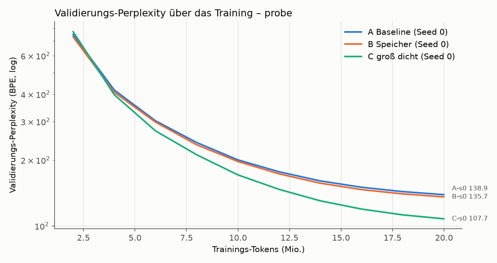

- B liegt 2,3 % unter A (−3,2 PPL), C 22 % darunter. Lückenschluss G = 0,10. Mit nur einem Seed ist das
  Rauschen nicht messbar; der Probelauf diente nur dazu, die Pipeline zu prüfen.
- **Die Key-Nutzung bricht am Anfang ein und erholt sich dann.** Nach der Initialisierung werden 99 %
  der Einträge gelesen, nach 2 M Tokens nur noch 9 % (85 % aller Zugriffe auf 1 % der Einträge),
  danach steigt die Nutzung stetig auf 82 % bei 20 M Tokens (Top-1 %-Anteil 33 %, weiter fallend).
  Die Key-Normen bleiben dabei gleichmäßig (max/min ≈ 1,3) und fast alle 512 Sub-Keys je Hälfte werden
  gelesen. Der Einbruch kommt also nicht von „Hub-Keys“ mit großer Norm, sondern daher, dass die Queries
  früh im Training wenig divers sind (Residual-Stream noch niedrigrangig) und sich nur wenige
  Kombinationen der beiden Hälften durchsetzen. Für Stufe 3 heißt das: Die Zugriffsverteilung hängt
  stark vom Trainingsstand ab, Messungen an früh gestoppten Modellen sind nicht repräsentativ.

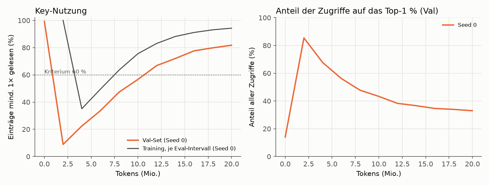

- Git: A-s0 lief auf `bc13f1b`, B-s0 und C-s0 auf `fef54eb`. Dazwischen änderten sich nur `REPORT.md`
  und das Auswerte-Skript, nicht der Trainingscode. Das `dirty: true` in deren `run-info.json` kommt
  allein vom damals noch nicht versionierten Ordner `runs/` (danach behoben: Ausgaben zählen nicht mehr).

### 1 Epoche: 118 M Tokens (A, B je 2 Seeds; C 1 Seed)

| Lauf | Val-PPL | Test-PPL | Val-PPL (Wort) | Train tok/s | Decode b=1 tok/s | Prefill tok/s | VRAM Train | Trainzeit | Key-Nutzung Val | Top-1 %-Anteil | KL |
|---|---|---|---|---|---|---|---|---|---|---|---|
| A-s0 | 35,26 | 35,24 | 57,4 | 91.705 | 217 | 383.407 | 7,89 GiB | 21 min | – | – | – |
| A-s1 | 34,93 | 34,77 | 56,8 | 91.640 | 218 | 384.460 | 7,89 GiB | 21 min | – | – | – |
| B-s0 | 34,63 | 34,56 | 56,2 | 72.445 | 199 | 264.882 | 9,47 GiB | 27 min | 99,2 % | 18,4 % | 1,08 |
| B-s1 | 34,12 | 34,05 | 55,3 | 72.241 | 203 | 264.573 | 9,47 GiB | 27 min | 99,7 % | 15,5 % | 0,91 |
| C-s0 | 25,80 | 26,02 | 40,3 | 34.468 | 165 | 130.976 | 7,91 GiB | 57 min | – | – | – |

**Auswertung gegen die vorab festgelegten Kriterien:**

| Größe | Wert |
|---|---|
| PPL A (Mittel; Seeds) | 35,09 (35,26 / 34,93) |
| PPL B (Mittel; Seeds) | 34,38 (34,63 / 34,12) |
| PPL C | 25,80 |
| Seed-Spanne s | 0,51 (aus B; A: 0,32) → Schwelle 2·s = 1,02 |
| PPL_A − PPL_B | +0,72 (**innerhalb** 2·s) |
| Lückenschluss G | **0,08** |
| Key-Nutzung (min.) / Top-1 %-Anteil (max.) | 99,2 % / 18,4 % → **Tabelle gesund** |
| **Urteil** | **lohnt sich nicht** (B auf A-Niveau, trotz gesunder Tabelle) |

Hinweis zur Einstufung: Die Schwelle 2·s und die Zuordnung „B besser, aber innerhalb 2·s → auf
A-Niveau“ sind **meine** Operationalisierung der Vorgabe. Nach dem Wortlaut („B besser als A, aber
knapp“) wäre auch **„unklar“** vertretbar, denn B ist in allen vier Paarungen besser. Die bei „unklar“
verlangten Prüfungen (Implementierung, Tabellengesundheit) sind unten trotzdem gemacht.

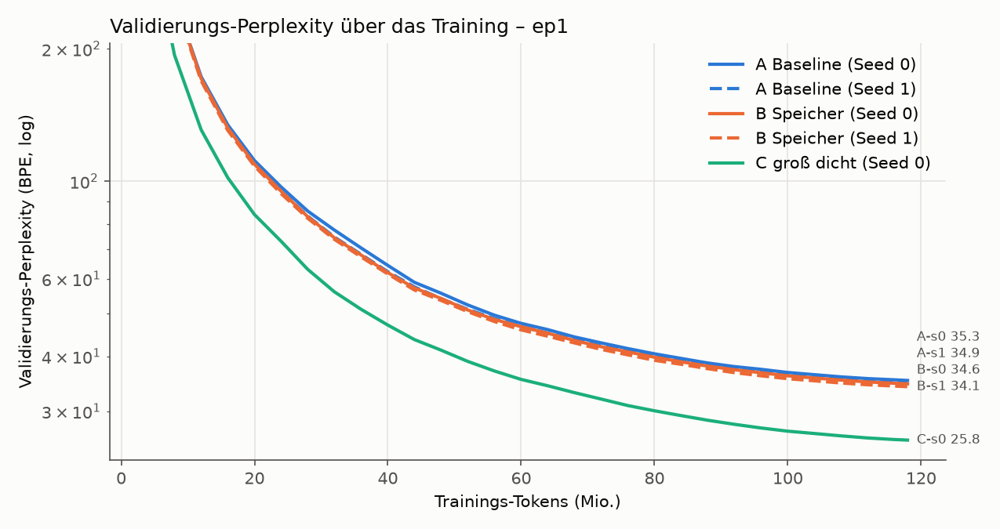

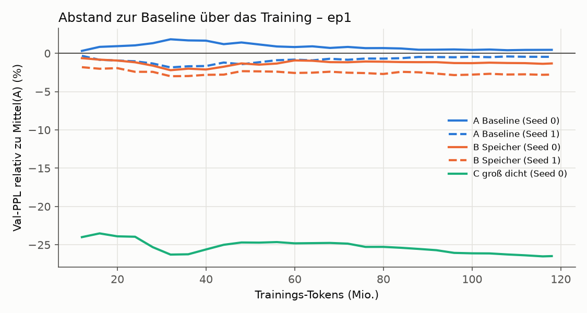

**Was die Zahlen sagen, ohne Schönfärberei:**

- B ist in allen vier A/B-Paarungen besser als A, und das gleichmäßig ab etwa 30 M Tokens um ≈ 2 %
  (Val wie Test). Das spricht für einen echten, aber kleinen Effekt. Nach dem vorab festgelegten
  Kriterium reicht er nicht: 0,72 PPL liegen unter 2·s = 1,02, und mit zwei Seeds je Modell ist auch
  „B schlägt A in allen Paarungen“ nicht belastbar (bei Zufall träte das in 1 von 6 Fällen auf).
- **Selbst wenn der Effekt echt ist, ist er viel zu klein.** B schließt 8 % der Lücke zu C, gefordert
  waren 50 %. Der Vorsprung wächst über die Epoche auch nicht, er bleibt bei ≈ 2 % (siehe Grafik).
  Die 100 M zusätzlichen Parameter von B bringen also bei weitem nicht, was dieselbe Zahl dichter
  Parameter in C bringt (−26,5 % PPL), allerdings bei 3,8× so vielen MACs pro Token für C.
- **C ist bei 1 Epoche deutlich untertrainiert** (≈ 1 Token je Parameter statt ≈ 20). Die Lücke A↔C
  wäre bei einem ausgereizten C eher noch größer; der Vergleich ist für B damit eher günstig.
- **Kosten von B:** gleiche FLOPs wie A, aber 21 % weniger Trainingsdurchsatz, 31 % weniger
  Prefill-Durchsatz, 7 % langsameres Batch-1-Decoding und 1,6 GiB mehr VRAM (Wertetabelle mit
  Gradient und Adam-Zuständen: 100,7 M × 16 Byte).

**Tabellengesundheit und Implementierung** (Pflichtprüfung, bevor ein Urteil zählt):

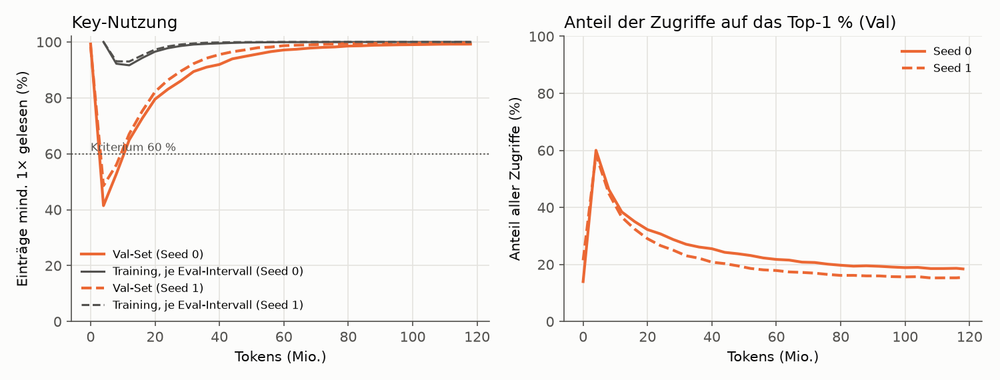

- Nutzung 99,2 / 99,7 %, KL 1,08 / 0,91, das meistgelesene 1 % der Einträge bekommt 18 / 16 % der
  Zugriffe, nur 0,3–0,8 % der Einträge werden auf dem Val-Set nie gelesen. Im Training wurde jeder
  Eintrag gelesen (seltenster ≈ 2.400×). Der Einbruch am Anfang (s. Probelauf) erholt sich nach
  ≈ 20 M Tokens vollständig.
- **Die Speicherschicht trägt tatsächlich etwas bei** (`scripts/diagnose_memory.py`, erste 32.768
  Val-Tokens, `runs/ep1/B-*/diagnostics.json`): Setzt man ihre Ausgabe auf null, steigt die PPL von 31,3
  auf 35,5 (s0) bzw. 30,6 auf 35,7 (s1). Liest man statt der gefundenen zufällige Einträge, steigt sie
  auf 36,0 bzw. 36,5. Es kommt also darauf an, *welche* Einträge die Suche findet. Die Ausgabenorm der
  Schicht (2,5–2,8) liegt über der der benachbarten dichten FFNs (1,2–2,6). Die 4 Köpfe lesen pro Token
  fast immer 128 verschiedene Einträge.
- Die Unit-Tests (exakte Top-k, Gradient nur in gelesene Werte, Kausalität, KV-Cache) sind grün.
  Einen Implementierungsfehler habe ich nicht gefunden.
- **Auffälligkeit: Die Gewichtung innerhalb der Top-32 ist fast flach.** Effektiv mischt jeder Kopf
  30,5 von 32 Einträgen (exp(Entropie)), das Top-1-Gewicht liegt bei 0,066 (gleichverteilt: 0,031).
  Die Score-Skala ist seit der Initialisierung kaum gewachsen (Key-Norm 0,41 → 0,48, BatchNorm-γ ≈ 1,09).
  Die Schicht ruft also nicht gezielt wenige Einträge ab, sondern mittelt grob über 128. Das passt zum
  Befund „ersetzt ein FFN und etwas mehr, aber nicht viel mehr“: Ohne Speicher fehlt dem Modell eine
  ganze Schicht (+14–16 % PPL), mit Speicher ist es nur 2 % besser als A.

**Zugriffsmuster (für Stufe 3, `report/ep1_access_stats.json`):**

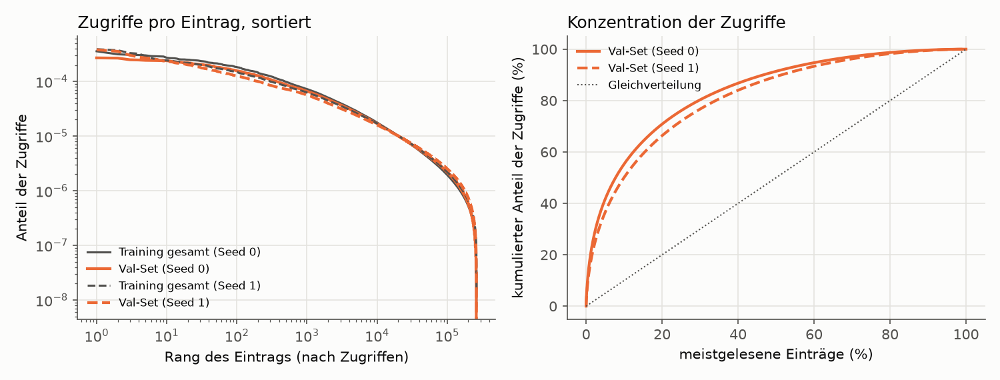

| | B-s0 | B-s1 |
|---|---|---|
| Anteil der Zugriffe auf die Top 1 / 10 / 20 / 50 % (Val) | 18 / 55 / 71 / 91 % | 16 / 50 / 66 / 89 % |
| Val-Zugriffe, die die Top 20 % aus dem **Training** abdecken | 68 % | 63 % |
| Rangkorrelation der Zugriffszahlen Training ↔ Val (Spearman) | 0,89 | 0,89 |
| Zugriffe, die schon in den letzten 1 / 16 / 256 Tokens gelesen wurden | 0,7 / 11,7 / 52,5 % | 0,9 / 11,5 / 50,2 % |

Die Verteilung ist deutlich schief, aber kein extremer Zipf: Ein Cache mit den 20 % meistgelesenen
Einträgen (im Training ermittelt; hier 52 k Einträge × 384 × 2 Byte ≈ 40 MB in bf16) fängt ≈ 65 % der
Lesezugriffe auf dem Val-Set ab. Aufeinanderfolgende Tokens lesen
fast disjunkte Einträge (< 1 % Wiederholung zum direkten Vorgänger); über ein Fenster von 256 Tokens
wiederholt sich aber die Hälfte. Für die SSD-Auslagerung heißt das: ≈ 35 % der 128 Lesezugriffe pro
Token müssten auch mit einem Hot-Set-Cache noch zufällig von der SSD kommen.

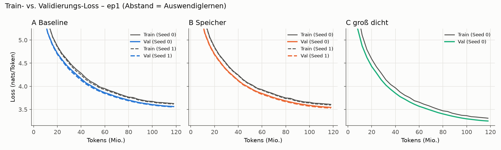

Bei 1 Epoche gibt es erwartungsgemäß kein Auswendiglernen (jedes Fenster wird genau einmal gesehen);
dass Train über Val liegt, ist der nachlaufende Intervall-Mittelwert, s. Grenzen.

**Inferenz-VRAM** (fp32-Gewichte unter bf16-Autocast, Spitze `max_memory_allocated`; gilt auch für 3 Epochen):
Batch-1-Decoding A 1,16 GiB, B 1,54 GiB, C 1,46 GiB; Prefill 16 × 1024 A 2,75 GiB, B 3,13 GiB, C 3,11 GiB.
Die Wertetabelle von B belegt allein 0,38 GiB (fp32), in bf16 wären es 0,19 GiB.

**Herkunft:** A-s0 lief auf `4f0e5fb`, alle anderen 1-Epochen-Läufe auf `6859f1f`. Zwischen diesen
Commits hat sich nur der Bericht geändert, nicht `smlm/` oder `scripts/run_suite.py`. B-s1 ist als
`dirty` markiert, allein wegen des damals noch nicht versionierten Analyse-Skripts
`scripts/diagnose_memory.py`, das beim Training nicht verwendet wird.

### 3 Epochen: 354 M Tokens, eigener Cosine-Plan (A, B je 2 Seeds; C 1 Seed)

Eigener Lauf mit Warmup (540 Schritte) und Cosine über alle 10.800 Schritte; die Zwischenstände bei
118 M Tokens sind daher **nicht** mit dem Ende des 1-Epochen-Laufs vergleichbar (dort war die LR schon
abgeklungen). Jede Epoche hat ihre eigene, vom Daten-Seed festgelegte Reihenfolge.

| Lauf | Val-PPL | Test-PPL | Val-PPL (Wort) | Train tok/s | Decode b=1 tok/s | Prefill tok/s | VRAM Train | Trainzeit | Key-Nutzung Val | Top-1 %-Anteil | KL |
|---|---|---|---|---|---|---|---|---|---|---|---|
| A-s0 | 24,81 | 24,99 | 38,5 | 91.659 | 219 | 383.220 | 7,89 GiB | 64 min | – | – | – |
| A-s1 | 24,65 | 24,84 | 38,2 | 91.478 | 217 | 384.725 | 7,89 GiB | 64 min | – | – | – |
| B-s0 | 23,80 | 24,02 | 36,7 | 71.935 | 203 | 264.825 | 9,47 GiB | 82 min | 99,97 % | 11,0 % | 0,63 |
| B-s1 | 23,47 | 23,76 | 36,1 | 71.640 | 206 | 265.278 | 9,47 GiB | 82 min | 99,99 % | 11,0 % | 0,59 |
| C-s0 | 19,15 | 19,51 | 28,7 | 34.607 | 164 | 131.352 | 7,91 GiB | 170 min | – | – | – |

**Auswertung gegen die vorab festgelegten Kriterien:**

| Größe | Wert |
|---|---|
| PPL A (Mittel; Seeds) | 24,73 (24,81 / 24,65) |
| PPL B (Mittel; Seeds) | 23,63 (23,80 / 23,47) |
| PPL C | 19,15 |
| Seed-Spanne s | 0,33 (aus B; A: 0,16) → Schwelle 2·s = 0,67 |
| PPL_A − PPL_B | +1,10 (**über** 2·s) |
| Lückenschluss G | **0,20** |
| Key-Nutzung (min.) / Top-1 %-Anteil (max.) | 99,97 % / 11,0 % → **Tabelle gesund** |
| **Urteil** | **unklar** (B echt besser als A, aber knapp: G < 0,5) |

Auf dem Test-Set ergibt sich dasselbe Bild (A 24,92, B 23,89, C 19,51 → −4,1 %, G = 0,19).

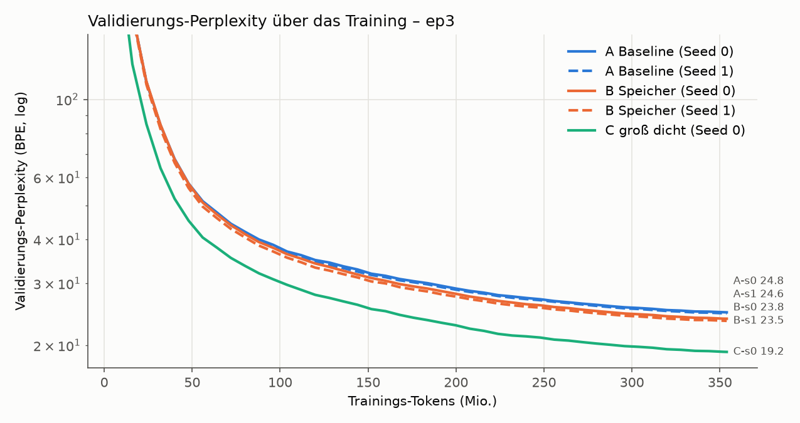

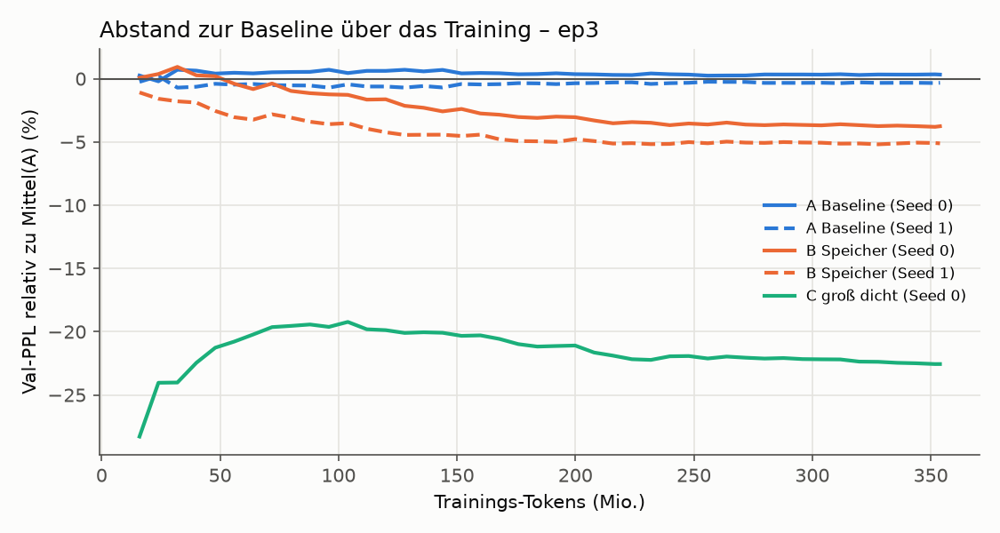

**Was die Zahlen sagen:**

- **Mit mehr Daten wächst der Vorsprung von B, bleibt aber klein.** Relativ zu A: −0,8 % bei 40 M Tokens,
  −2,0 % bei 80 M, −2,9 % bei 120 M, −4,0 % bei 176 M, dann ab ≈ 240 M Tokens konstant bei −4,4 %
  (beide Seeds, siehe Grafik). Der Lückenschluss G steigt entsprechend auf ≈ 0,20 und bleibt dort.
  Beide B-Seeds liegen jetzt klar unter beiden A-Seeds.
- **Für „lohnt sich“ fehlt mehr als die Hälfte.** C ist auch nach 3 Epochen 22,6 % besser als A
  (bei 3,8× MACs/Token und weiter untertrainiert: ≈ 3 Tokens je Parameter). B holt davon ein Fünftel.
- **Auswendiglernen** (Val-Loss minus Train-Loss am Ende, nats): A 0,014 / 0,015, B 0,035 / 0,043,
  C 0,119. In Epoche 2 und 3 fällt der Train-Loss an den Epochengrenzen sichtbar ab. B lernt etwas
  mehr auswendig als A, viel weniger als C; der Val-Loss von B fällt trotzdem bis zum Ende weiter.

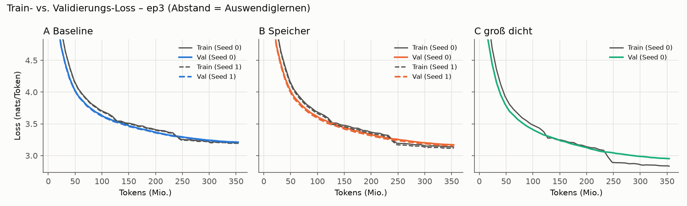

**Tabellengesundheit und Implementierung** (Pflichtprüfung bei „unklar“, `runs/ep3/B-*/diagnostics.json`,
erste 32.768 Val-Tokens, GPU):

- Nutzung 99,97 / 99,99 %, KL 0,63 / 0,59, das meistgelesene 1 % bekommt 11 % der Zugriffe; im Training
  wurde jeder Eintrag gelesen (seltenster 961× bzw. 1.632×, Median ≈ 100 k×). Gesünder als nach 1 Epoche.
- **Das Modell stützt sich nach 3 Epochen viel stärker auf den Speicher:** Ausgabe auf null → PPL
  21,8 → 31,3 (s0) bzw. 21,4 → 32,7 (s1), also +44 / +53 % (nach 1 Epoche: +14 / +16 %). Zufällige statt
  gefundener Einträge → 34,3 bzw. 37,3. Ohne Speicher ist B damit deutlich schlechter als A. Die
  Ausgabenorm der Schicht (7,4 / 8,3) ist die größte aller FFN-Positionen in der Mitte (Nachbarn 2,8–5,2).
- **Die Gewichtung innerhalb der Top-32 wird mit dem Training etwas schärfer, bleibt aber flach:**
  effektiv 28,6 / 28,3 von 32 Einträgen je Kopf (nach 1 Epoche 30,5), Top-1-Gewicht 0,094 / 0,097.
  Key-Norm 0,41 → 0,59 / 0,61, BatchNorm-γ 1,0 → 1,33 / 1,37. Die Skala wächst also, aber langsam.
- Unit-Tests grün; kein Implementierungsfehler gefunden. Die Tabelle funktioniert und wird genutzt;
  offen ist, warum sie so wenig über eine zusätzliche dichte Schicht hinaus bringt (siehe Einordnung).

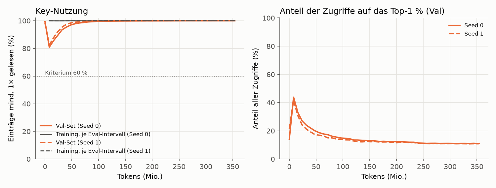

**Zugriffsmuster (für Stufe 3, `report/ep3_access_stats.json`):**

| | B-s0 | B-s1 |
|---|---|---|
| Anteil der Zugriffe auf die Top 1 / 10 / 20 / 50 % (Val) | 11 / 40 / 56 / 83 % | 11 / 39 / 55 / 82 % |
| Val-Zugriffe, die die Top 20 % aus dem **Training** abdecken | 54 % | 52 % |
| Rangkorrelation der Zugriffszahlen Training ↔ Val (Spearman) | 0,90 | 0,90 |
| Zugriffe, die schon in den letzten 1 / 16 / 256 Tokens gelesen wurden | 0,9 / 9,4 / 44,8 % | 0,7 / 8,9 / 42,8 % |

Mit längerem Training verteilen sich die Zugriffe **gleichmäßiger**: Ein Hot-Set-Cache aus 20 % der
Einträge fängt nach 3 Epochen nur noch ≈ 53 % der Lesezugriffe ab (nach 1 Epoche ≈ 65 %). Für die
SSD-Auslagerung ist das eine schlechte Nachricht: Je besser die Tabelle genutzt wird, desto weniger hilft
Caching. Die Rangfolge „heißer“ Einträge ist zwischen Training und Val aber stabil (Spearman 0,90).

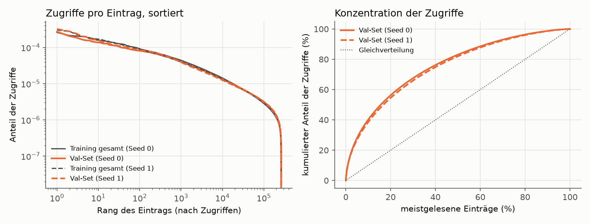

**Herkunft:** A-s0 lief auf `6859f1f` (als `dirty` markiert, nur wegen des unversionierten
`scripts/diagnose_memory.py`), alle anderen 3-Epochen-Läufe auf `e44a197`. Trainingscode identisch zu
allen 1-Epochen-Läufen (`git diff a27c99d 1a43e0d -- smlm/ scripts/run_suite.py` ist leer).

## Einordnung

**Antwort auf die Frage dieser Stufe.** Eine Product-Key-Speicherschicht verbessert das kleine Modell bei
gleichem Rechenaufwand pro Token **messbar, aber wenig**: −2,0 % PPL nach 118 M Tokens (nicht von
Seed-Rauschen zu trennen), −4,4 % nach 354 M Tokens (echt). Nach den vorab festgelegten Kriterien reicht
das in keinem der beiden Läufe für „lohnt sich“: B schließt 8 % bzw. 20 % der Lücke zum gleich großen
dichten Modell, gefordert waren 50 %. Ich rede das nicht schön: In dieser Konfiguration sind 100 M
zusätzliche Parameter in der Tabelle ungefähr so viel wert wie ein Fünftel der Wirkung derselben Zahl
dichter Parameter.

**Was dagegen spricht, dass es nur ein Bug ist:** Die Tests sind grün, die Tabelle ist gesund und wird
breit genutzt, und das Modell stützt sich nach 3 Epochen stark auf sie (+44–53 % PPL ohne Speicher;
zufällige Einträge sind noch schlechter). Der Speicher funktioniert also. Er bringt nur wenig mehr als
das FFN, das er ersetzt.

**Mögliche Gründe** (nach meiner Einschätzung der Wahrscheinlichkeit geordnet, keiner davon ist hier
belegt):

1. **Flache Gewichtung innerhalb der Top-k.** Jeder Kopf mischt 28–30 von 32 Einträgen fast gleich
   stark; die Schicht ruft kaum gezielt ab. Kandidaten: Die Query-BatchNorm fixiert die Query-Skala, und
   Weight Decay zieht die Keys klein. Dafür ist `v2-sharpness` vorbereitet (v2a: kein Weight Decay auf
   den Keys; v2b: zusätzlich lernbare Temperatur), siehe `docs/notes/V2_SHARPNESS.md`.
2. **Datenregime.** Der Vorsprung wächst mit den Daten (2 % → 4,4 %), sättigt aber ab ≈ 240 M Tokens,
   während das Training dieselben 118 M Tokens wiederholt. Die Paper zeigen den Nutzen bei Hunderten
   Milliarden Tokens und vor allem auf faktenlastigen QA-Aufgaben; Perplexity auf WikiText-103 misst
   „Wissen abrufen“ nur indirekt.
3. **Lernrate der Werte.** 1e-3 bei Basis-LR 6e-4 ist ein Verhältnis von 1,7× (Lample: 4×).
4. **Nur eine Speicherschicht.** Meta (Memory+) nutzt drei Schichten mit geteilter Tabelle.
5. **Kleiner Rechenkern.** Mit d = 384 und 21 M dichten Parametern ist auch die Query-Netz-Kapazität
   klein.

**Kosten.** Gleiche FLOPs, aber B trainiert 21 % langsamer, ist im Prefill 31 % und im Batch-1-Decoding
≈ 6 % langsamer und braucht 1,6 GiB mehr VRAM. Das liegt an den unregelmäßigen Speicherzugriffen
(Gather/Scatter, Adam über 100 M Werte), nicht an Rechenarbeit, und ist genau der Teil, um den es in
den späteren Stufen geht. **Wichtige Einschränkung:** Verglichen wurde bei gleicher Token-Zahl und
gleichen FLOPs, nicht bei gleicher Rechenzeit. In derselben Wall-Clock-Zeit hätte A auf dieser Hardware
≈ 27 % mehr Tokens gesehen. Ob B dann noch vorne läge, wurde nicht gemessen; beim Wachstum von A
zwischen 1 und 3 Epochen ist das nicht selbstverständlich.

**Für das Gesamtprojekt.** Stufe 1 widerlegt den Ansatz nicht, liefert aber noch keinen Grund, ihn zu
skalieren. Vor Stufe 2 würde ich die vorbereiteten v2-Varianten laufen lassen (≈ 2 h). Bringen sie die
Gewichtung nicht deutlich schärfer und B nicht deutlich weiter, wären mehr Daten (größerer Korpus statt
Wiederholung), mehrere Speicherschichten und eine höhere Werte-LR die nächsten Hebel. Für Stufe 3
wichtig: Die Zugriffe werden mit besserem Training gleichmäßiger verteilt, Hot-Set-Caching hilft dann
weniger (20 % der Einträge → 53 % der Zugriffe).

## Grenzen dieser Untersuchung

- **C ist bei 1 Epoche deutlich untertrainiert.** 118 M Tokens auf 122,7 M Parameter (ohne Embeddings)
  sind ≈ 1 Token pro Parameter; compute-optimal (Chinchilla) wären ≈ 20. Der Abstand A↔C und damit die
  Lücke, die B schließen soll, ist bei 1 Epoche kleiner als bei einem ausgereizten C. Der 3-Epochen-Lauf
  mildert das nur etwas (≈ 3 Tokens/Parameter), wiederholt dafür aber die Daten.
- **Seed-Rauschen ist grob geschätzt.** Mit 2 Seeds ist s eine einzelne Differenz, keine Streuung. Das
  Kriterium bleibt wie festgelegt, ist aber eher optimistisch, was die Trennschärfe angeht.
- **Der Train-Loss in den Kurven hinkt hinterher.** Er ist der Mittelwert über das jeweilige
  Eval-Intervall, in dem das Modell noch besser wird; Train > Val früh im Training ist ein Artefakt, kein
  Fehler. Aussagekräftig für Auswendiglernen ist im 3-Epochen-Lauf, ob sich der Abstand schließt oder umkehrt.
- **BatchNorm auf der Query** sieht im Training die Batch-Statistik inklusive späterer Tokens (bei 8.192
  Tokens pro Mikro-Batch ein sehr schwacher Kanal). Alle berichteten Zahlen sind im Eval-Modus mit
  festen Statistiken gemessen; die Kausalität dort ist per Test geprüft.
- **Dichter Adam auf der Wertetabelle.** Der Unit-Test zeigt, dass Gradienten nur in gelesene Einträge
  fließen. Adams Momentum bewegt aber auch ungelesene Einträge noch einige Schritte weiter. Für das
  spätere Ziel „einzelne Einträge gezielt aktualisieren“ braucht es einen sparsamen Optimierer
  (z. B. SparseAdam / lazy Adam); das war nicht Teil dieser Stufe.
- **Durchsatz** ist im PyTorch-Eager-Modus ohne eigene Kernels gemessen. Batch-1-Decoding ist durch den
  Kernel-Start-Overhead begrenzt (≈ 150–210 tok/s für alle Modelle) und sagt nichts über die
  Speicherbandbreite aus, um die es in späteren Stufen geht. B ist im Training ≈ 20 % langsamer als A,
  trotz gleicher FLOPs (Gather/Scatter auf der 100-M-Tabelle, Adam über 100 M Werte).
- **Perplexity** ist auf GPT-2-BPE-Tokens berechnet und nicht direkt mit den wortbasierten
  WikiText-103-Werten aus der Literatur vergleichbar (die Wort-PPL-Spalte rechnet die Gesamt-NLL auf die
  217.646 Wörter + `<eos>` um und ist nur grob vergleichbar).
- **Kleiner Maßstab, ein Datensatz.** Die Paper zeigen den Nutzen von Speicherschichten bei
  Billionen von Tokens und faktenlastigen QA-Aufgaben; WikiText-103 mit ≤ 354 M Tokens ist ein weit
  kleineres Regime.

## Artefakte

- `runs/<phase>/<lauf>/run-info.json`, `metrics.csv`, `train_log.csv`, `stdout.log`: in Git.
- `runs/<phase>/<lauf>/model.pt` (Gewichte, fp32), bei B zusätzlich `mem_access_train.npy`
  (Lesezugriffe je Eintrag über das ganze Training), `mem_access_val.npz` (Zugriffe und summierte
  Softmax-Gewichte je Eintrag auf dem Val-Set) und `mem_index_sample.npz` (Index-Stichprobe für Stufe 3):
  nur auf der Platte (`.gitignore`, zu groß für Git).
- Grafiken und Tabellen: `report/`, erzeugt mit `scripts/make_report.py probe ep1 ep3`.

## Stufe 1b: Schnelltest B-1M (Kriterium vor dem Lauf festgelegt, 2026-10-02)

> Status: **abgeschlossen am 2026-10-02.** Kriterium unverändert seit `0832753`; beide Läufe auf `5fe3245`,
> nicht dirty. **Ergebnis: Kriterium erfüllt** (B-1M −15,1 % Val-PPL gegenüber A) **→ großer Test.**

**Frage:** Bringt eine größere Speicherkonfiguration auf frischen (nicht wiederholten) Daten einen
deutlichen Vorteil? Erst wenn ja, folgt ein großer Test.

**Aufbau (je 1 Seed, Init-Seed 0, gleicher Daten-Seed):**

| | A | B-1M |
|---|---|---|
| Rechenkern | wie Stufe 1 (d = 384, 12 Layer) | wie A |
| Speicher | – | 3 Speicherschichten statt der FFNs in Layer 3, 7, 11 (Index 2, 6, 10; zentriert, Abstand 4 wie Meta „Memory+“) |
| Tabelle | – | **eine geteilte** Wertetabelle mit 1024² = 1.048.576 Einträgen × 384 (402,7 M Parameter); Keys, Query-Netz, BatchNorm und swilu je Schicht eigen |
| Suche | – | je Schicht 4 Köpfe, Top-32, Key-Dim 256 |
| Werte-LR | – | **4 × Basis-LR** = 2,4e-3 (Lample-Verhältnis), gleicher Verlauf, kein Weight Decay |
| Rest | Optimierung wie Stufe 1 (AdamW, LR 6e-4, Warmup 5 %, Cosine auf 10 %, 32.768 Tokens/Schritt) | wie A |
| Daten | **500 M frische Tokens**, jede Sequenz genau einmal (15.258 Schritte) | gleicher Token-Strom |

Parameter: A 40,6 M (21,2 M ohne Embeddings); B-1M 444,9 M (425,6 M ohne Embeddings, davon 402,7 M
Tabelle), aktiv pro Token 23,1 M. MACs/Token: A 45,3 M, B-1M 47,1 M (+4 %, weil die Sub-Key-Suche über
1024 statt 512 Keys pro Hälfte läuft).

**Daten:** englische Wikipedia (`wikimedia/wikipedia`, Dump 20231101.en, GPT-2-BPE). Artikel werden per
festem Seed gemischt; alle Artikel, deren Titel im WikiText-103-Validierungs- oder -Testset vorkommen,
werden ausgeschlossen. Ein disjunkter Satz Wikipedia-Artikel (≈ 1 M Tokens) dient als Validierungsset.

**Daten, tatsächlich** (`scripts/prepare_wikipedia.py`, `data/wikipedia_en_gpt2/meta.json`): 6.407.814
Artikel im Dump; Training 505 M Tokens aus 689.951 zufällig gewählten Artikeln (davon werden 500 M genutzt),
Validierung 1,48 M Tokens aus 1.917 disjunkten Artikeln. Von den 122 WikiText-103-Val/Test-Titeln lagen
14 in den ausgewählten Artikeln und wurden entfernt (erwartet bei 12,5 % Auswahl: ≈ 15). Umbenannte
Artikel können dem Titelabgleich entgehen.

**Vorab gemessen** (79 Schritte, Mikro-Batch 4): B-1M 35,7 k tok/s und 11,7 GiB VRAM-Spitze im Training
(geschätzt waren 40–55 k tok/s und 10,5–11,5 GiB; Abbruchgrenzen 30 k tok/s bzw. 15 GiB). Erwartete
Laufzeit damit ≈ 4,1 h für B-1M und ≈ 1,6 h für A.

**Kriterium (Vorgabe):** B-1M hat **mindestens 10 % niedrigere Val-PPL als A**, sonst kein großer Test.
Operationalisierung: Token-Perplexity am Ende des Trainings auf dem zurückgehaltenen
Wikipedia-Validierungsset (gleiche Aufbereitung wie das Training), Eval-Modus;
**erfüllt, wenn PPL(B-1M) ≤ 0,90 × PPL(A).** Das Seed-Rauschen lag in Stufe 1 bei ≈ 1–1,4 % der PPL und
damit weit unter der 10-%-Schwelle; ein Seed je Modell reicht für diese Entscheidung.

Zusätzlich berichtet, aber nicht entscheidend: WikiText-103-Val-PPL (anderes Textformat, daher nur
A↔B-1M vergleichbar, nicht mit Stufe 1), Tabellengesundheit (Nutzung, Konzentration, KL), Schärfe der
Softmax, Durchsatz, VRAM. Ist die Tabelle ungesund (< 60 % Nutzung), wird das als möglicher Grund
genannt; die Entscheidungsregel bleibt trotzdem wie vorgegeben.

### Ergebnis Stufe 1b

| | Val-PPL Wikipedia (entscheidend) | Val-PPL WikiText-103 (nur berichtet) | Train tok/s | VRAM Train | Trainzeit | Decode b=1 tok/s | Prefill tok/s |
|---|---|---|---|---|---|---|---|
| A | 25,67 | 78,38 | 91.563 | 7,89 GiB | 91 min | 220 | 385.525 |
| B-1M | **21,80** | 66,28 | 33.383 | 11,70 GiB | 249 min | 175 | 150.398 |
| B-1M / A | **0,849 (−15,1 %)** | 0,846 (−15,4 %) | 0,36 | | 2,7× | 0,80 | 0,39 |

**Kriterium PPL(B-1M) ≤ 0,90 × PPL(A): erfüllt (0,849) → großer Test.** Das Seed-Rauschen lag in Stufe 1 bei
≈ 1–1,4 %; der Abstand von 15 % liegt weit darüber, auch mit nur einem Seed je Modell.

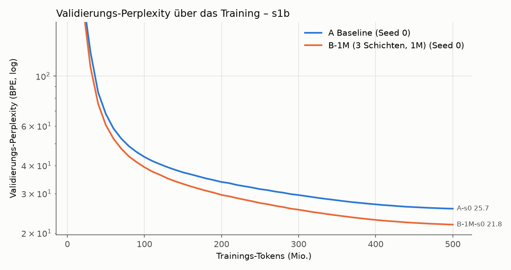

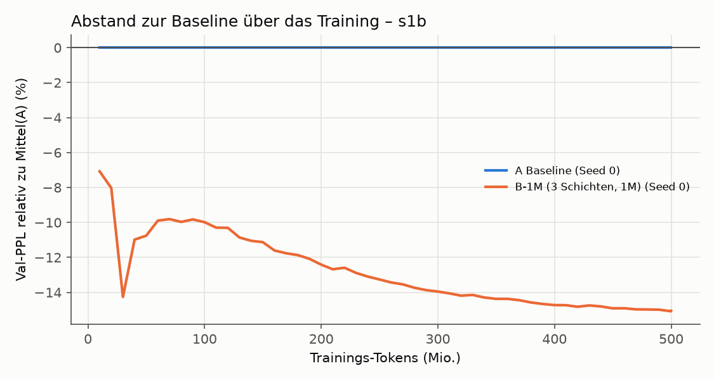

**Verlauf:** Der Vorsprung von B-1M wächst über das ganze Training: −10,0 % bei 100 M Tokens, −12,4 % bei
200 M, −14,0 % bei 300 M, −15,1 % am Ende, und ist am Ende noch nicht ganz gesättigt. Auf dem
WikiText-Validierungsset (anderes Textformat, nie trainiert) ist der Abstand gleich groß (−15,4 %).
Auswendiglernen ist bei frischen Daten kein Thema: Val minus Train liegt bei beiden Modellen gleich
(≈ 0,07 nats, Unterschied zwischen Trainings- und Validierungsartikeln).

**Tabelle und Speicher** (`runs/s1b/B-1M-s0/diagnostics.json`, erste 246.784 Val-Tokens):

- Nutzung der geteilten Tabelle 100 %, das meistgelesene 1 % bekommt 11,8 % der Zugriffe, KL 0,62.
  Einzeln liest die Schicht in Layer 3 91,9 % der Einträge (Top-1 %-Anteil 26 %), Layer 7 und 11 je ≈ 99 %.
  Jeder Eintrag wurde im Training gelesen (10 %-Quantil ≈ 44 k, Median ≈ 115 k Zugriffe).
- **Das Modell hängt stark am Speicher:** alle drei Speicherschichten auf null → PPL 22,5 → 88,0;
  zufällige statt gefundener Einträge → 93,8. Die Ausgabenormen der Speicherschichten (4,6 / 11,0 / 20,2)
  wachsen mit der Tiefe wie die der dichten FFNs.
- Die Gewichtung innerhalb der Top-32 ist wie in Stufe 1 flach (effektiv 28,6 von 32 Einträgen,
  Top-1-Gewicht 0,095; je Schicht 29,1 / 28,6 / 28,0). Der Gewinn kommt also nicht über schärferes Abrufen.
- Die Werte haben sich stark bewegt (Norm ≈ 3,6–3,7 statt 1,0 bei der Initialisierung, Werte-LR 2,4e-3).

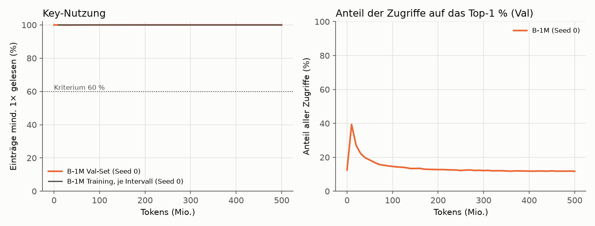

**Zugriffsmuster (Stufe 3, `report/s1b_access_stats.json`):** Top 1 / 10 / 20 / 50 % der Einträge bekommen
12 / 39 / 55 / 82 % der Val-Zugriffe; die im Training heißesten 20 % decken 53 % der Val-Zugriffe ab
(Spearman 0,92). Wiederholung innerhalb von 1 / 16 / 256 Tokens: 1,6 / 11,3 / 41,5 % (über alle drei
Schichten). Die Index-Stichprobe hat jetzt die Form [Token, Schicht, Kopf, k].

**Was das Ergebnis nicht sagt (nichts schönreden):**

- **Gleiche FLOPs, aber nicht gleiche Zeit.** B-1M hat +4 % MACs pro Token, braucht auf dieser Hardware
  aber 2,7× so lange (33,4 k statt 91,6 k tok/s), 48 % mehr VRAM (11,7 statt 7,9 GiB), ist im Prefill
  2,6× und im Batch-1-Decoding 1,25× langsamer. In derselben Rechenzeit hätte A ≈ 2,7× so viele Tokens
  sehen können. Wie gut A dann wäre, wurde nicht gemessen; As eigene Kurve fällt zwischen 250 M und 500 M
  Tokens noch um 18 % (Zwischenstand bei hoher LR gegen Endstand, daher nur ein grober Hinweis). Die
  Frage „lohnt sich der Speicher pro Rechenzeit?“ ist damit offen und gehört in den großen Test bzw. in die
  späteren Stufen (eigene Kernels, Auslagerung).
- **Mehrere Dinge gleichzeitig geändert.** Gegenüber Stufe 1 (B: −4,4 % bei 354 M wiederholten Tokens)
  unterscheiden sich Tabellengröße (4×), Zahl der Speicherschichten (3 statt 1), Werte-LR (2,4× höher),
  Datensatz und Wiederholung. Welcher Faktor wie viel bringt, sagt dieser Test nicht.
- **Kein dichter Vergleich mit gleicher Parameterzahl.** B-1M hat 445 M Parameter (A: 41 M). Ein C-artiges
  Modell fehlt hier; der Schnelltest beantwortet nur „deutlich besser als A bei gleichem Rechenaufwand
  pro Token?“.
- **Ein Seed je Modell**, ein Datensatz, ein Zeitpunkt (500 M Tokens).

## Zusatztest: Quantisierung der Wertetabelle von B-1M (ohne Training, 2026-10-02)

Nur die Wertetabelle von `runs/s1b/B-1M-s0` wird nachträglich quantisiert (im Speicher, Checkpoint nur gelesen:
SHA-256 vor und nach dem Test identisch); alle anderen Gewichte bleiben fp32. Gemessen auf dem kompletten
Wikipedia-Validierungsset (1,484,009 Tokens), gleicher Auswertungscode wie im Training.
Skript: `scripts/quantize_table_eval.py`, Rohdaten: `report/quant_B-1M-s0.json`.

**Verfahren** (ein fp16-Skalierungsfaktor pro Zeile, also pro Eintrag mit 384 Werten; 2,1 MB für alle Faktoren):
8/4/3/2 Bit wie llama.cpp `Q_0`, aber pro Zeile: Codes von −2^(b−1) bis 2^(b−1)−1, der betragsgrößte Wert der
Zeile wird exakt getroffen. Ternär wie BitNet b1.58: Skala = mittlerer Betrag der Zeile, Werte −1/0/+1.

| Bits pro Wert | Tabelle (MB) | Val-PPL Wikipedia | Verlust gegenüber unquantisiert | rel. Fehler der Tabelle |
|---|---|---|---|---|
| 32 (fp32, Referenz) | 1.610,6 | 21,801 | – | 0,000 |
| 16 (bf16) | 805,3 | 21,800 | −0,001 (−0,00 %) | 0,002 |
| 8 | 404,8 | 21,799 | −0,002 (−0,01 %) | 0,007 |
| 4 | 203,4 | 21,828 | +0,027 (+0,12 %) | 0,115 |
| 3 | 153,1 | 21,911 | +0,110 (+0,50 %) | 0,231 |
| 2 | 102,8 | 22,281 | +0,480 (+2,20 %) | 0,467 |
| 1,6 (ternär, 1,58 Bit Information) | 82,6 | 25,237 | +3,436 (+15,76 %) | 0,512 |

**Einordnung:**

- Bis 4 Bit kostet die Quantisierung praktisch nichts: +0,12 % PPL bei einem Achtel der fp32-Größe
  (203 statt 1.611 MB). 8 Bit und bf16 sind nicht von fp32 zu unterscheiden. 3 Bit kostet 0,5 %, 2 Bit 2,2 %.
- Ternär bricht ein (+15,8 %, PPL 25,24): Damit ist fast der ganze Vorsprung vor A (25,67) weg. Bemerkenswert,
  weil der relative Fehler der Tabelle bei 2 Bit (0,47) und ternär (0,51) ähnlich ist; die vierte Stufe und die
  Absmax-Skala von 2 Bit erhalten offenbar die großen Werte, auf die es ankommt.
- Für Stufe 3 (SSD): Bei 4 Bit ist ein Eintrag 194 Byte groß (384 × 0,5 + 2). Pro Token und Speicherschicht
  werden 128 Einträge gelesen, also ≈ 25 KB; die ganze Tabelle passt mit 203 MB problemlos in den RAM.
- Einschränkungen: nur nachträgliche Quantisierung (quantisierungsbewusstes Training könnte 2 Bit und ternär
  verbessern), ein Modell, ein Seed, nur die Tabelle (der Rest bleibt fp32), je Stufe ein Verfahren.

## Stufe 1c („Hampter“): sparsamer Optimizer, zweiter Seed, gleiche Rechenzeit (Kriterien vor dem Start festgelegt, 2026-10-03)

> Status: **abgeschlossen am 2026-10-03** (Warteschlange 01:01–14:07, alle vier Läufe auf `0a5260e`, nicht dirty).
> Kriterien und Ablauf festgelegt in Commit `8cd1fde`, bevor einer der Läufe gestartet wurde.
> **Ergebnis: Optimizer ok – erfüllt (+0,16 %). Stabil – erfüllt (beide Seeds −15 % gegenüber A).
> Gleiche Rechenzeit – „konkurrenzfähig“ (−3,0 %), der „klare Vorteil“ (≥ 5 %) wurde verfehlt.**

**Fragen:** (1) Liefert ein Optimizer, der nur die gelesenen Tabellenzeilen anfasst, dasselbe Ergebnis wie
der dichte? (2) Ist der Vorsprung von B-1M aus dem Schnelltest über zwei Seeds stabil? (3) Hält B-1M mit,
wenn A dieselbe **Rechenzeit** (statt derselben Tokenzahl) bekommt?

### Schritt 1–2: sparsamer Optimizer und Messung (vor der Freigabe)

- **Optimizer** (`smlm/sparse_values.py`, Modell `B-1M-sparse`): Die Wertetabelle bekommt keinen dichten
  Gradienten mehr. Gelesene Zeilen werden in einem eigenen Akkumulator gesammelt, Adam (ohne Weight Decay)
  aktualisiert nur gelesene Zeilen. Werte **und** Adam-Zustand nicht gelesener Zeilen bleiben bitgenau
  gleich (Unit-Test `tests/test_sparse_values.py`, CPU und GPU; dazu gleiche Gradienten wie der dichte Pfad,
  gleiche Clipping-Norm, erster Schritt identisch mit `torch.optim.Adam`). Alle anderen Parameter: AdamW wie
  bisher. Ohne eigene Kernels.
- **Unterschied zum bisherigen B-1M:** Dort bewegt AdamW über das Momentum auch Zeilen, die im Schritt nicht
  gelesen wurden. Bei 32.768 Tokens pro Schritt wird aber fast jede Zeile gelesen, deshalb wird ein
  ähnliches Ergebnis erwartet, aber nicht vorausgesetzt (dafür das Kriterium „Optimizer ok“).
- **Geschwindigkeit** (je 122 Schritte, Mikro-Batch 4): 39.525 tok/s gegenüber 35.374 tok/s dicht =
  **1,12×**. Die geforderte 1,5× wurde verfehlt und gemeldet; Entscheidung: trotzdem laufen lassen,
  Grenze entfällt, kein eigener Kernel. VRAM-Spitze 11,66 statt 11,70 GiB.
  Rohdaten: `report/hampter_measure_B-1M-sparse.json`, `report/hampter_measure_B-1M_dense.json`.
- **Wartet die GPU auf Daten?** Nein: GPU-Auslastung im Median und Minimum 100 %, der Datenpfad
  (Memmap → pinned → GPU) braucht 0,2 ms je Schritt (0,02 % von 829 ms). Prozess-CPU ≈ 4,7 Kerne, RSS
  3,2 GB, System-RAM 14,6 von 125 GB. **Am Datenpfad wurde deshalb nichts geändert.**
- **Wärme** (10 min B-1M-sparse unter Volllast): edge 51 °C, Hotspot 82 °C, Speicher 82 °C, ≈ 240 W,
  nach 3 min konstant, keine Drosselung.

### Läufe (Warteschlange `scripts/run_hampter.py`, ohne Eingriff, in dieser Reihenfolge)

| # | Lauf | Daten | Tokens | geschätzte Dauer | VRAM (Spitze Training) |
|---|---|---|---|---|---|
| 1 | B-1M-sparse, Init-Seed 0 | wie Schnelltest (500 M Wikipedia, Daten-Seed 1234) | 500 M | ≈ 3,8 h | ≈ 11,7 GiB |
| 2 | A bei gleicher Rechenzeit wie Lauf 1, Init-Seed 0 | 1,5-Mrd.-Token-Wikipedia-Strom (s. u.) | Trainzeit(1) × tok/s(A) ≈ 1,16 Mrd. | ≈ 3,8 h | ≈ 7,9 GiB |
| 3 | A, Init-Seed 1 | wie Schnelltest | 500 M | ≈ 1,6 h | ≈ 7,9 GiB |
| 4 | B-1M-sparse, Init-Seed 1 | wie Schnelltest | 500 M | ≈ 3,8 h | ≈ 11,7 GiB |

Summe ≈ 13 h. Alles andere wie im Schnelltest: Werte-LR 2,4e-3, Mikro-Batch 4 (B) bzw. 8 (A), Auswertung
alle 10 M Tokens, WikiText-103-Val als zweites Val-Set. Mikro-Batch 8 für B-1M-sparse ist ausgeschlossen:
Er füllte im Test 99 % des VRAM und löste einen Grafik-Reset des Desktops aus (2026-10-03, 00:14).

**Vorab geprüft (Funktionstests, nicht Teil der Auswertung):**

- **Paarung:** B-1M-sparse s0 mit dem echten 500-M-Plan startet bitgleich wie B-1M s0 (Val-PPL bei Schritt 0
  identisch). Die Trainingsverluste der ersten 60 Schritte stimmen auf 5–6 Stellen überein. Damit misst
  „Optimizer ok“ den Optimizer und nicht eine geänderte Initialisierung.
- **Abbruchpfad:** Ein erzwungener Abbruch endet mit Exit-Code 3 und Status `aborted`, `abort_check` steht in
  `run-info.json`.
- **Komplettlauf** bis Inferenz-Benchmark: fehlerfrei. Dabei gefunden und behoben: Der Gradienten-Akkumulator
  der Tabelle (1,5 GiB) blieb über den Autograd-Graphen des letzten Verlusts bis zum Inferenz-Benchmark
  belegt. Die VRAM-Werte der Inferenz wären dadurch um 1,5 GiB zu hoch gewesen; jetzt 2,31 / 3,89 GiB wie
  beim dichten B-1M. Auf das Training hat das keinen Einfluss.
- **Keine VRAM-Obergrenze für PyTorch:** Getestet wurde eine Grenze von 13,5 GiB. Sie greift auf diesem
  ROCm-Stack nicht, weil mit `expandable_segments` freigegebener Speicher nicht an den Treiber
  zurückgeht. Der Prozess belegte trotz Grenze das ganze VRAM, und der Inferenz-Benchmark brach ab
  (bei einem Testlauf, der wegen 3 Warmup-Schritten divergierte und dadurch mehr Speicher brauchte).
  Darum bleibt die Konfiguration, die im Schnelltest 4,4 h und im 10-min-Wärmetest ohne Probleme lief
  (Spitze ≈ 11,7 GiB PyTorch, ≈ 14,1 GiB belegt insgesamt).

- **Gleiche Rechenzeit:** Tokenbudget von A = reine Trainzeit von Lauf 1 (ohne Auswertungen) × gemessener
  Durchsatz von A s0 im Schnelltest (Tokens / reine Trainzeit = 91.569 tok/s), abgerundet auf ganze
  Schritte. A bekommt einen eigenen Cosine-Plan über diese Länge (Warmup 5 %, Abfall auf 10 %). Damit A
  keine Daten wiederholt, wurde ein größerer Wikipedia-Ausschnitt aufbereitet
  (`data/wikipedia_en_gpt2_1500m`, Artikelband 0,35 statt 0,125): **gleiches Val-Set** (bytegleich), und die
  ersten 505 M Trainingstokens sind bytegleich mit den Schnelltest-Daten (beides mit `cmp` geprüft). 1,5 Mrd.
  Trainingstokens aus 2.052.458 Artikeln; 34 der 122 WikiText-Val/Test-Titel lagen im breiteren Band und
  wurden entfernt. Bei langsamerem Lauf 1 (z. B. GPU
  durch den Desktop belegt) bekäme A mehr Tokens; deshalb wird der Durchsatzverlauf von Lauf 1 mitberichtet.
- **Temperatur:** alle 10 s edge, Hotspot, Speicher, Leistung, Shader- und Speichertakt, Lüfter, VRAM in
  `runs/hampter/<lauf>/gpu_thermal.csv`; Höchstwerte im Zwischenstand.

### Kriterien (Vorgabe wörtlich, darunter die Auswertung)

- **Optimizer ok:** B-1M-sparse s0 höchstens 2 % schlechter als das bisherige B-1M s0.
- **Stabil:** Beide B-1M-sparse-Seeds mindestens 10 % besser als der Mittelwert beider A-Seeds
  (A s0 aus dem Schnelltest, A s1 neu).
- **Gleiche Rechenzeit (gegen B-1M-sparse s0):** mindestens gleichauf = konkurrenzfähig; mindestens 5 %
  besser = klarer Vorteil.

| Kriterium | Operationalisierung (Val-PPL Wikipedia am Trainingsende, gleiches Val-Set wie Schnelltest) |
|---|---|
| Optimizer ok | PPL(B-1M-sparse s0) ≤ 1,02 × PPL(B-1M s0) = 1,02 × 21,801 = **22,237** |
| Stabil | PPL(B-1M-sparse s0) **und** PPL(B-1M-sparse s1) ≤ 0,90 × ½ (PPL(A s0) + PPL(A s1)); PPL(A s0) = 25,665 |
| Gleiche Rechenzeit | Q = PPL(B-1M-sparse s0) / PPL(A gleiche Zeit). Q ≤ 0,95 → **klarer Vorteil**; 0,95 < Q ≤ 1,00 → **konkurrenzfähig**; Q > 1,00 → **nicht konkurrenzfähig** |

„Besser“ heißt niedrigere PPL, „10 % besser“ wie im Schnelltest PPL ≤ 0,90 × Referenz. „Gleichauf“ werte
ich wörtlich (Q ≤ 1,00); liegt Q innerhalb des Seed-Rauschens (aus A s0/s1 und B-1M-sparse s0/s1), wird
das im Bericht dazugesagt, das Urteil bleibt wie festgelegt. WikiText-103-Val-PPL, Tabellengesundheit,
Durchsatz und VRAM werden berichtet, entscheiden aber nicht.

**Abbruchregel:** Liegt B-1M-sparse s0 bei 100 M Tokens mehr als 5 % hinter dem bisherigen B-1M s0 beim
selben Stand, wird angehalten und gemeldet. Umsetzung in `smlm/train.py` (`--abort_ref`): an der
Auswertung bei 99,94 M Tokens (Schritt 3050, derselbe Punkt wie im Schnelltest) wird abgebrochen, wenn
PPL > 1,05 × 39,293 = **41,258**. Der Lauf endet dann mit Status `aborted` (Gewichte werden gespeichert),
und die ganze Warteschlange hält an.

### Zwischenstand

<!-- HAMPTER-STATUS:BEGIN -->

**Zwischenstand** (automatisch erzeugt von `scripts/hampter_status.py`, Stand 2026-10-03 14:07)

| Lauf | Status | Tokens | Val-PPL Wikipedia | Val-PPL WikiText | Trainzeit | tok/s Median (5 %-Quantil) | VRAM Train | max. edge / Hotspot / Speicher | max. Leistung | Takt unter Last |
|---|---|---|---|---|---|---|---|---|---|---|
| B-1M s0 (Schnelltest, dichter Optimizer, Referenz) | fertig | 500 M | 21,801 | 66,28 | 249 min | 33.383 (33.345) | 11,70 GiB | – | – | – |
| A s0 (Schnelltest, Referenz) | fertig | 500 M | 25,665 | 78,38 | 91 min | 91.563 (91.488) | 7,89 GiB | – | – | – |
| B-1M-sparse s0 | fertig | 500 M | 21,837 | 65,51 | 216 min | 38.517 (38.464) | 10,52 GiB | 48 / 79 / 80 °C | 238 W | 3.120 MHz |
| A s0 bei gleicher Rechenzeit | fertig | 1.186 M | 22,508 | 66,44 | 216 min | 91.498 (91.395) | 7,89 GiB | 49 / 83 / 80 °C | 261 W | 2.993 MHz |
| A s1 | fertig | 500 M | 25,756 | 78,48 | 91 min | 91.641 (91.467) | 7,89 GiB | 49 / 82 / 80 °C | 261 W | 2.991 MHz |
| B-1M-sparse s1 | fertig | 500 M | 21,752 | 65,09 | 216 min | 38.577 (38.519) | 10,52 GiB | 51 / 81 / 82 °C | 240 W | 3.121 MHz |

**Abbruchregel** (B-1M-sparse s0 bei 99,9 M Tokens): PPL 39,339 gegenüber 39,293 beim bisherigen B-1M s0 = +0,12 % (Grenze +5 %) → **weiter**.

**Budget A bei gleicher Rechenzeit:** 12.957 s Trainzeit von B-1M-sparse s0 × 91.569 tok/s (A s0 im Schnelltest) = 1.186,4 M Tokens (36206 Schritte).

| Kriterium (vorher festgelegt) | Bedingung | Messwert | Ergebnis |
|---|---|---|---|
| Optimizer ok | PPL(B-1M-sparse s0) ≤ 1,02 × 21,801 = 22,237 | 21,837 (+0,16 %) | **erfüllt** |
| Stabil | beide B-1M-sparse-Seeds ≤ 0,90 × Mittel(A s0, A s1) = 23,140 | s0 0,849×, s1 0,846× (Mittel A 25,711) | **erfüllt** |
| Gleiche Rechenzeit | PPL(B-1M-sparse s0) / PPL(A gleiche Zeit): ≤ 1,00 konkurrenzfähig, ≤ 0,95 klarer Vorteil | 0,970 (−3,0 %); Trainzeit B 216 min, A 216 min | **konkurrenzfähig** |

**GPU-Höchstwerte über alle Hampter-Läufe** (alle 10 s gemessen, `gpu_thermal.csv` je Lauf): edge 51 °C, Hotspot 83 °C, Speicher 82 °C (Grenzen laut Treiber 110 / 110 / 108 °C), Leistung 261 W.

<!-- HAMPTER-STATUS:END -->

### Ergebnis Stufe 1c (Auswertung von Hand)

| | Val-PPL Wikipedia | Val-PPL WikiText | Tokens | reine Trainzeit | Train tok/s | VRAM Train | Decode b=1 tok/s | Prefill tok/s |
|---|---|---|---|---|---|---|---|---|
| A s0 / s1 (Mittel) | 25,711 (25,665 / 25,756) | 78,43 | 500 M | 91 min | 91.600 | 7,89 GiB | 219 | 385.000 |
| **A s0 bei gleicher Rechenzeit** | **22,508** | 66,44 | 1.186 M | 216 min | 91.498 | 7,89 GiB | 215 | 385.555 |
| B-1M s0, dichter Optimizer (Schnelltest) | 21,801 | 66,28 | 500 M | 249 min | 33.383 | 11,70 GiB | 175 | 150.398 |
| **B-1M-sparse s0** | **21,837** | 65,51 | 500 M | 216 min | 38.517 | 10,52 GiB | 182 | 150.541 |
| B-1M-sparse s1 | 21,752 | 65,09 | 500 M | 216 min | 38.577 | 10,52 GiB | 178 | 150.039 |

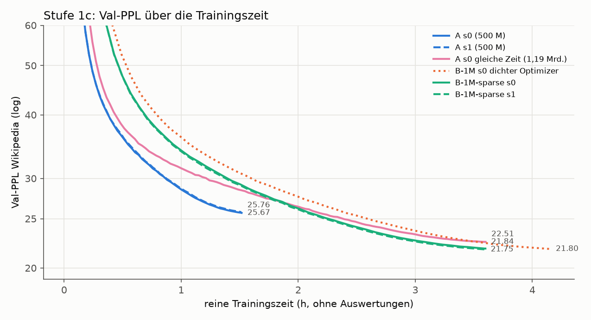

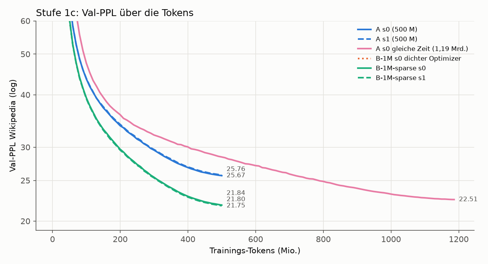

**1. Optimizer ok – erfüllt.** B-1M-sparse s0 endet bei 21,837 statt 21,801 (+0,16 %, erlaubt +2 %). Der
Abstand bleibt über das ganze Training bei +0,1 bis +0,3 % (100 / 200 / 300 / 400 / 500 M Tokens: +0,12 / +0,34 /
+0,12 / +0,12 / +0,16 %). Das liegt innerhalb des Seed-Rauschens (B-1M-sparse s0 ↔ s1: 0,39 %). Die Tabelle ist
gleich gesund (Nutzung 100 %, meistgelesenes 1 % bekommt 11,7 % bzw. 11,4 % der Zugriffe, KL 0,62 / 0,60; vorher
11,8 % und 0,62). Die Softmax ist gleich flach (28,6 / 28,5 effektive Einträge von 32). Gewinn: 1,15× schneller
(216 statt 249 min) und 1,2 GiB weniger VRAM im Training. Bei der Inferenz ändert der Optimizer nichts.
**Aber:** Ziel war 1,5×. B-1M ist pro Token weiterhin 2,4× langsamer als A (38,5 k gegenüber 91,6 k tok/s).

**2. Stabil – erfüllt.** Beide Seeds liegen klar unter der Grenze von 0,90 × 25,711 = 23,140: s0 bei 0,849×,
s1 bei 0,846× (−15,1 % bzw. −15,4 %). Die Seeds liegen bei B-1M-sparse 0,39 % und bei A 0,35 % auseinander.
Der Vorsprung ist also rund 40-mal so groß wie das Seed-Rauschen. Auf WikiText-Val (nie trainiert, anderes
Format) ist der Abstand gleich groß (−16,5 % / −17,0 % gegenüber Mittel A).

**3. Gleiche Rechenzeit – „konkurrenzfähig“, nicht „klarer Vorteil“.** Mit derselben reinen Trainzeit
(216 min, die Zeiten weichen nur um 5 s voneinander ab) sieht A 2,37× so viele Tokens und erreicht 22,508.
B-1M-sparse s0 liegt mit 21,837 um 3,0 % darunter (Q = 0,970; s1, nicht Teil des Kriteriums: 0,966). Damit
ist das Kriterium „mindestens gleichauf“ erfüllt, „mindestens 5 % besser“ (Q ≤ 0,95) verfehlt.
Der Unterschied von 0,67 PPL ist mehr als dreimal so groß wie 2 × Seed-Spanne (0,18). A bei gleicher Zeit hat
allerdings nur einen Seed, das ist also ein deutlicher Hinweis, kein statistischer Beleg (korrigiert 2026-10-05 nach Codex-Review; vorher
hieß es „ist echt“). Auf WikiText-Val ist der Vorsprung kleiner (−1,4 % / −2,0 %).
Bei gleicher Tokenzahl lag B-1M 15 % vorn, bei gleicher Zeit bleibt davon etwa ein Fünftel.

**Einordnung (nichts schönreden):**

- **Der Vorteil pro Token ist robust, der Vorteil pro Rechenzeit ist klein.** Auf dieser Hardware und mit
  dieser Implementierung kauft die Speichertabelle bei gleicher Trainingszeit 3 % Perplexity. Das ist
  messbar und echt, aber weit entfernt von den 15 % bei gleicher Tokenzahl.
- **Die Inferenz kostet mehr, A bei gleicher Zeit nicht.** A bei gleicher Zeit ist im Einsatz genauso
  billig wie A: 155 MB Gewichte, 385 k tok/s Prefill, 215 tok/s Decoding. B-1M braucht 1,7 GB Gewichte
  (fp32; mit 4-Bit-Tabelle und fp32-Rest ≈ 0,37 GB, siehe Quantisierung), hat 2,6× weniger Prefill-Durchsatz und ist beim
  Decoding ≈ 17 % langsamer. Rechnet man Training und Inferenz zusammen, steht A bei gleicher Zeit
  derzeit kaum schlechter da: 3 % höhere PPL, dafür deutlich billiger im Einsatz.
- **Das Zeiturteil hängt an der Implementierung.** Die Rechenmenge pro Token ist fast gleich (+4 % MACs).
  Die 2,4× Laufzeit kommen aus dem Speicher-Lookup (Top-k-Suche, `embedding_bag`, Adam-Schritt über
  1 M Zeilen) auf ROCm ohne eigene Kernels. Ein schnellerer Lookup würde das Ergebnis zugunsten von B
  verschieben; wie weit, ist nicht gemessen. Umgekehrt wurde auch A nicht weiter optimiert (z. B.
  `torch.compile`).
- **Ein Messpunkt.** Gleiche Zeit wurde nur bei ≈ 3,6 h verglichen. Ob der Zeitvorteil bei längerem
  Training wächst (bei gleicher Tokenzahl wuchs der Vorsprung von −10 % bei 100 M auf −15 % bei 500 M
  Tokens), ist offen; die Zwischenstände beider Kurven sind wegen der verschiedenen Cosine-Pläne nicht
  direkt vergleichbar.
- **Daten:** A bei gleicher Zeit hat Tokens jenseits der 505 M aus demselben Artikel-Pool gesehen
  (dieselbe Aufbereitung, gleiches Val-Set). Ein Verteilungsunterschied ist damit praktisch
  ausgeschlossen, die Daten sind aber nicht dieselben.
- **Temperaturen** (alle 10 s, 13 h): Höchstwerte edge 51 °C, Hotspot 83 °C, Speicher 82 °C, 261 W
  (Grenzen 110 / 110 / 108 °C). Keine Drosselung: Der Durchsatz war in allen Läufen konstant
  (5-%-Quantil ≤ 0,3 % unter dem Median).

## Optimierung (Triton-Kernels) und Cloud-Vorbereitung (ab 2026-10-03)

**Ziel:** B-1M so schnell wie realistisch möglich, ohne die Ergebnisse zu verändern. Danach Läufe mit
größeren Tabellen auf einer gemieteten GPU (zuerst IONOS H200-S geplant, jetzt Runpod: 1 × H200 SXM 141 GB).
Kernels nur in Triton (ROCm **und** CUDA). Die PyTorch-Implementierung bleibt als Referenz und Fallback
per Konfiguration umschaltbar.

**Zielwerte** (gegenüber A auf derselben GPU):

| | Ziel | vorher (B-1M-sparse) |
|---|---|---|
| Training | ≥ 0,6× so schnell wie A pro Token | 0,42× |
| Decoding (Batch 1) | höchstens 10 % langsamer als A | 17 % |
| Prefill (16 × 1024) | höchstens 1,5× langsamer als A, gemessen mit bf16-Tabelle; fp32, bf16 und 4 Bit getrennt berichtet | 2,6× (fp32) |

**Abbruchregel:** Bringt ein Optimierungsschritt weniger als 10 % Gewinn, wird aufgehört und berichtet,
wo die Grenze liegt. Ausnahme: der fusionierte Lazy-Adam-Kernel wird wegen des Speicherbedarfs großer
Tabellen trotzdem gebaut.

**Korrektheit:** Jeder Kernel gegen die Referenz (vorwärts und Gradienten), Tabellen mit 262k, 1M und 4M
Zeilen. Scores exakt gleich, Indizes gleich bis auf Gleichstände an der Top-k-Grenze, Ausgaben und
Gradienten mit festen Toleranzen. Tests auch auf der CPU (`TRITON_INTERPRET=1`, kleine Größen).
Vergleichslauf über 20 M Tokens Kernel gegen Referenz: Loss-Kurven praktisch identisch. Alle alten Tests
bleiben grün.

### Ausgangsmessung (Profiler, vor jedem Kernel)

`scripts/profile_memory.py` → `report/profile_before.json`. RX 9070, trainierte Checkpoints, echte Batches.

- **Training:** B-1M-sparse braucht 848 ms je Schritt (32.768 Tokens), A 357 ms (0,42×). Die 490 ms
  Mehrzeit verteilen sich so:
  - Zeilen-Gradienten sammeln: **285 ms** (24 Aufrufe à 11,9 ms; davon `index_put_` mit Sortieren
    6,2 ms, Gewichten 2,8 ms, Gathern 1,4 ms, Gewichts-Gradienten 1,2 ms)
  - Lookup vorwärts: 134 ms (Top-k 72, `embedding_bag` 48)
  - übrige Speicher-Rückwärtsrechnung: 40 ms
  - Lazy Adam: 29 ms
  - Statistik und Clipping: 10 ms
  - abzüglich der 3 FFNs, die A stattdessen hat: −19 ms
- **Prefill** (16 × 1024): B 109 ms, A 42 ms. Pro Speicherschicht 24,4 ms (Top-k 14, Mischen 8,2), ein
  FFN braucht 0,8 ms.
- **Decoding:** B 5,67 ms pro Token, A 4,67 ms. Pro Speicherschicht 0,44 ms (≈ 15 kleine Kernel-Starts),
  ein FFN 0,10 ms.

### Kriterien für die Cloud-Läufe (vor dem Bau festgelegt, 2026-10-03)

Läufe auf einer gemieteten H200 (bei der Festlegung IONOS, jetzt Runpod; die Kriterien gelten unverändert)
mit den Daten, Einstellungen und dem Val-Set von B-1M-sparse: B-1M
(Kontrolllauf auf derselben Hardware und mit denselben Kernels), B-4M (2048² = 4.194.304 Einträge) und
B-16M (4096² = 16.777.216 Einträge), je Init-Seed 0, 500 M Tokens.

Vorgabe (wörtlich):

- **lohnt sich:** B-4M mindestens 3 % besser als B-1M (Cloud) UND B-16M nochmal besser als B-4M
- **unklar:** Verbesserung, aber unter 3 %
- **lohnt sich nicht:** B-4M nicht besser als B-1M (Cloud)

Operationalisierung: Val-PPL Wikipedia am Trainingsende, gleiches Val-Set wie Stufe 1b/1c.

| Urteil | Bedingung |
|---|---|
| lohnt sich | PPL(B-4M) ≤ 0,97 × PPL(B-1M) **und** PPL(B-16M) < PPL(B-4M) |
| unklar | PPL(B-4M) < PPL(B-1M), aber nicht „lohnt sich“ |
| lohnt sich nicht | PPL(B-4M) ≥ PPL(B-1M) |

Zum Fall „unklar“: Er umfasst auch B-4M ≥ 3 % besser, aber B-16M nicht besser als B-4M. Das wird im
Bericht ausdrücklich so benannt. Das Seed-Rauschen von B-1M-sparse lag bei 0,39 %; Unterschiede unter
≈ 0,8 % (2 × Spanne) gelten als nicht belastbar und werden so benannt.

### Schritt 1: Zeilen-Gradienten sammeln, fusioniert (Kernel 1)

`smlm/kernels.py::bag_backward_rows`, eingeschaltet mit `mem_impl="triton"` (`--mem_impl triton`).

- **Vorher:** Für jeden der 524.288 Lookups (4096 Tokens × 128) wird w·grad materialisiert (0,8 GB) und
  mit `index_put_` (Sortieren) addiert.
- **Kernel:** Die Lookups werden einmal nach Tabellenzeile sortiert (`torch.sort`, 0,25 ms). Jedes
  Programm nimmt 32 sortierte Positionen. Gleiche Zeilen summiert ein segmentierter Scan in Registern.
  Läufe, die ganz im Programm liegen, werden normal geschrieben; nur die höchstens zwei Läufe an den
  Programmgrenzen atomar. Der Gewichts-Gradient dot(grad, Zeile) entsteht im selben Durchlauf.
- **Erster Versuch:** atomare Addition für jeden Lauf, 17 ms je Aufruf, also langsamer als die
  Referenz. Atomics sind auf der RX 9070 teuer.
- **Ein Aufruf mit Trainingsform** (echte Indizes eines trainierten Modells, 254k verschiedene Zeilen):
  Referenz 14,3 ms, Kernel 2,74 ms + 0,25 ms Sortieren (≈ 4,8×).
  Abweichung zur Referenz: relativ 3·10⁻⁷ (Akkumulator) bzw. 2·10⁻⁷ (Gewichts-Gradient), `touched` identisch.
- **Tests** (`tests/test_kernels.py`): Tabellen mit 262k / 1M / 4M Zeilen (4M auf GPUs < 40 GB mit 64
  statt 384 Spalten, sonst passt der Test nicht in 16 GB), Toleranz rtol = atol = 1e-5 relativ zur Skala.
  Dazu das ganze Modell (3 Speicherschichten, geteilte Tabelle, 2 Micro-Batches): alle Gradienten gleich.
  Auf der CPU über `TRITON_INTERPRET=1` mit kleinen Größen. Alle 59 Tests grün.
  Nebenbei behoben: Auf der CPU liefert `_embedding_bag` für fp32 kein `offset2bag`; die Referenz baut es
  jetzt selbst.

| Trainingsschritt (32.768 Tokens) | vorher | Kernel 1 |
|---|---|---|
| vorwärts | 261 ms | 262 ms |
| rückwärts | 545 ms | 339 ms |
| Lazy Adam + Rest | 42 ms | 42 ms |
| **gesamt** | **848 ms (38,7 k tok/s)** | **643 ms (50,9 k tok/s)** |
| gegenüber A (357 ms) | 0,42× | **0,56×** |

Gewinn 1,32× (Abbruchregel: > 10 %, weiter). Rohdaten: `report/profile_k1.json`.

### Schritt 2: Lookup fusioniert (Kernel 2)

`smlm/kernels.py::pk_select` / `PKSelect` (Auswahl) und `bag_forward` (gewichtetes Mischen).

- **Gleiche Teil-Scores:** s1, s2 kommen weiter aus demselben `einsum` wie in der Referenz und sind
  deshalb bitgleich.
- **Auswahl in einem Kernel**, ein Programm je (Token, Kopf):
  - Top-32 jeder Hälfte (int32-Schlüssel aus ordnungserhaltendem bf16-Code und Index, zweistufig über
    128er-Blöcke).
  - Paar-Summen, auf bf16 gerundet wie `s1 + s2` in PyTorch (RTNE mit Integer-Arithmetik, damit GPU und
    CPU-Interpreter gleich runden).
  - Top-32 der Paare und Softmax in fp32.
  - Von den 32 × 32 Paaren kommen nur die 130 mit (i+1)(j+1) ≤ 32 überhaupt in Frage, alle anderen werden
    von ≥ 32 mindestens gleich großen Paaren dominiert.
- **Rückwärts:** Softmax-Ableitung, dann der Gradient jedes gewählten Scores in seine zwei Teil-Scores,
  in fp32 summiert und einmal auf bf16 gerundet (wie der Autograd der Referenz). Der `einsum`-Backward
  bleibt PyTorch.
- **Mischen:** ein Programm je (Token, 128 Spalten), 32 Lookups pro Kachel; Tabelle fp32 oder bf16.
- **Exaktheit:**
  - Die gewählten Scores sind **bitgleich** mit der Referenz. Jeder gewählte Index hat nachweislich genau
    seinen Score, die Auswahl ist also ein exaktes Top-k.
  - Indizes weichen nur bei gleichen Scores ab. Bei bf16 ist das häufig: Mit Zufallsdaten haben 59 % der
    Zeilen irgendwo einen Gleichstand mit anderer Wahl. Auch `torch.topk` legt die Reihenfolge bei
    Gleichstand nicht fest.
  - Softmax-Gewichte: Abweichung ≤ 3·10⁻⁸.
- **Tests:** Auswahl bei 512 / 1024 / 2048 Keys je Hälfte und bei N = 1. Rückwärts gegen die exakt
  summierte Ableitung: ≤ 1 bf16-ulp. Mischen gegen `embedding_bag` bei 262k / 1M / 4M Zeilen, fp32 und
  bf16. CPU-Interpreter grün. Gesamt 71 Tests grün.

| Ein Aufruf (Trainingsform N = 4096) | Referenz | Kernel |
|---|---|---|
| Top-k beider Hälften + Kreuz-Top-k + Softmax | 2,83 ms | 0,86 ms |
| Mischen (`embedding_bag` → Kernel), fp32-Tabelle | 1,97 ms | 0,84 ms |
| Speicherschicht vorwärts gesamt | 5,57 ms | 2,45 ms |

| | vorher | Kernel 1 | Kernel 1 + 2 | A |
|---|---|---|---|---|
| Trainingsschritt | 848 ms | 643 ms | **584 ms** (vorwärts 187, rückwärts 355) | 358 ms |
| Training tok/s | 38,7 k | 50,9 k | **56,1 k** | 91,5 k |
| gegenüber A | 0,42× | 0,56× | **0,61×** ✅ (Ziel ≥ 0,6) | |
| Prefill 16 × 1024 (fp32-Tabelle) | 109 ms (2,6×) | | 64,0 ms (1,52×) | 42,2 ms |
| Decoding pro Token | 5,67 ms | | 5,70 ms (+21 %) | 4,69 ms |

- **Trainingsgewinn von Schritt 2:** 1,10× (643 → 584 ms), knapp über der 10-%-Grenze.
- **Rückwärts** wurde etwas langsamer (339 → 355 ms): Die dichten Teil-Score-Gradienten entstehen mit
  `scatter_add` in fp32 plus Rundung statt mit dem Top-k-Backward der Referenz.
- **Decoding** ändert sich nicht. Bei einem Token pro Schritt bestimmen die ≈ 15 Kernel-Starts pro
  Speicherschicht die Zeit, nicht die Rechenarbeit.

Rohdaten: `report/profile_k2.json`, `report/profile_k2_infer.json`. Die Stufenzeiten dort messen die
PyTorch-Teilschritte; maßgeblich für die Kernels ist `forward_total`.

### Schritt 3: Inferenz-Lookup auf bf16- und 4-Bit-Tabelle (Kernel 4) und Decoding-Graph

- **Inferenztabelle:** `Transformer.set_memory_inference_table("fp32" | "bf16" | "q4")` legt eine
  Inferenzkopie der geteilten Tabelle an.
  - 4 Bit nach genau dem Verfahren des Quantisierungstests: je Zeile fp16-Skala, Codes −8…7, zwei pro
    Byte. Der Test prüft, dass die Dequantisierung bitgleich mit `quantize_table_eval.py` ist.
- **Kernel `bag_infer`:** mischt direkt aus fp32-, bf16- oder 4-Bit-Zeilen. Das swilu-Produkt
  `out * bf16(silu(pre))` und der bf16-Cast vor `value_proj` sind eingebaut. Er gilt nur ohne Gradienten
  und unter bf16-Autocast; das Training bleibt unverändert.
- **Decoding:** Gemessen bremst dort nicht die GPU, sondern die CPU. Eine Speicherschicht braucht
  0,39 ms nur zum Absetzen der ≈ 20 PyTorch-Ops und Triton-Starts; die GPU-Arbeit liegt bei ≈ 0,05 ms,
  ein FFN braucht 0,07 ms.
  - Abhilfe: `Transformer.set_memory_decode_graphs(True)` nimmt `_forward` der Speicherschicht für ein
    Token einmal als CUDA/HIP-Graph auf und spielt ihn danach ab.
  - Es laufen dieselben Kernels, die Logits sind bitgleich (Test über 5 Decoding-Schritte, alle drei
    Tabellenarten). A läuft ohne Graphen. **Der Decoding-Gewinn kommt also aus den Graphen, nicht aus
    einem Triton-Kernel**; A würde mit Graphen auch schneller.
- **Val-PPL** auf dem ganzen Wikipedia-Val-Set, B-1M-sparse s0 (`scripts/eval_kernels.py`,
  `report/eval_kernels.json`):

  | Variante | Val-PPL | Abweichung | Zeit |
  |---|---|---|---|
  | Referenz | 21,8369 | – | 12,3 s |
  | Kernel, fp32 | 21,8357 | −0,005 % | 8,5 s |
  | Kernel, bf16 | 21,8368 | −0,000 % | 8,1 s |
  | Kernel, 4 Bit | 21,8663 | +0,13 % (Quantisierungstest: +0,12 %) | 8,3 s |

| Inferenz (RX 9070) | Prefill 16 × 1024 | gegenüber A | Decoding pro Token | gegenüber A |
|---|---|---|---|---|
| A | 42,4 ms | | 4,62 ms | |
| B vorher (Referenz) | 109,3 ms | 2,6× | 5,67 ms | +21 % |
| B Kernel, fp32-Tabelle | 62,9 ms | 1,48× | 5,75 ms | +25 % |
| **B Kernel, bf16-Tabelle** | **60,8 ms** | **1,44×** ✅ | 5,77 ms | +25 % |
| B Kernel, 4 Bit | 62,5 ms | 1,47× | 5,69 ms | +23 % |
| B Kernel + Decoding-Graph, fp32 | 62,6 ms | 1,48× | **4,53 ms** | **−2 %** ✅ |
| B Kernel + Decoding-Graph, bf16 | 61,0 ms | 1,44× | 4,57 ms | −1 % |
| B Kernel + Decoding-Graph, 4 Bit | 62,6 ms | 1,48× | 4,55 ms | −2 % |

- **Prefill:** bf16 bringt nur 2 ms gegenüber fp32, 4 Bit nichts. Die Werte werden nicht mehr nur aus dem
  Speicher gelesen; Auswahl (≈ 3,2 ms je Schicht bei 16k Tokens), Teil-Scores und Projektionen sind jetzt
  ein ebenso großer Anteil. 4 Bit spart vor allem Speicher (Tabelle 203 statt 1.611 MB).
- **Prefill-Tokens:** Der Benchmark nimmt Zufallstokens wie in `train.py`. Mit echtem Text liegen die
  Zugriffe dichter und die Lookups werden eher schneller.

Rohdaten: `report/profile_k4_infer.json`.

### Schritt 4: Lazy Adam fusioniert (Kernel 3, wegen des Speichers großer Tabellen)

`smlm/kernels.py::lazy_adam_step`, automatisch mit `mem_impl="triton"`.

- **Kernel:** Gleiche Rechnung wie `LazyRowAdam` (Adam-Formel von PyTorch, globaler Schritt für die
  Bias-Korrektur, kein Weight Decay), aber direkt in der Tabelle: gelesene Zeilen werden aktualisiert und
  ihr Akkumulator genullt. Ungelesene Zeilen werden gar nicht geladen.
- **Speicher:** Die Referenz sichert und restauriert die ungelesenen Zeilen (Werte und beide Momente),
  das sind 3 × 1,5 KB temporär pro ungelesener Zeile. Bei 16M Zeilen und vielen ungelesenen wären das
  zweistellige GB, beim Kernel 0.
- **Gefundener Fehler:** Die erste Version löschte die `touched`-Maske im Kernel mit maskierten
  Byte-Stores. Dabei wurden auf der RX 9070 Zeilen benachbarter Programme gelöscht, bevor diese sie
  gelesen hatten (Folge: 60–133 gelesene Zeilen ohne Update). Der Test hat das gefunden. Die Maske wird
  jetzt nach dem Kernel mit einem `zero_()` gelöscht.
  *Nachtrag 2026-10-05:* Minimale Nachbauten (`docs/rocm-issues/repro_byte_store.py`, 42 Varianten, dazu eine
  Variante nah am damaligen Kernel) zeigen auf der RX 9070 **keinen** Fehler bei maskierten Byte-Stores. Die
  damalige Ursache war deshalb sehr wahrscheinlich ein Fehler in meinem eigenen Kernel, nicht in ROCm oder Triton;
  die alte Fassung ist nicht erhalten. Es wurde kein Fehlerbericht eingereicht.
- **Tests:** 3 Schritte gegen `LazyRowAdam` bei 262k / 1M / 4M Zeilen, mit Clipping-Faktor:
  - ungelesene Zeilen bitgleich
  - gelesene Zeilen und beide Momente innerhalb rtol = atol = 1e-5
  - Akkumulator und Maske danach leer

  Auf GPUs < 40 GB mit 16 Spalten (sonst > 13 GB VRAM). 87 GPU-Tests grün, CPU-Interpreter 20 grün
  (3 Graph-Tests nur GPU). VRAM-Spitze des ganzen Testlaufs 7,4 GiB.
- **Tempo:** Tabellen-Optimizer 29,0 → 22,5 ms je Schritt, Trainingsschritt 584 → 575 ms
  (57,0 k tok/s, 0,62× A). Gewinn < 10 %, wie erwartet; gebaut wegen des Speichers.

### Schritt 5: Vergleichslauf Kernel gegen Referenz (Korrektheit)

Gleiches Modell (B-1M-sparse), gleiche Initialisierung, gleiche Daten, einmal mit `mem_impl="torch"`,
einmal mit `"triton"` (alle Kernels). Abbildungen: `report/kernel_check_*.png`, Zahlen:
`report/kernel_check_*.json`.

| Vergleich | Trainings-Loss, Abweichung Median / max. | Val-PPL Referenz → Kernel |
|---|---|---|
| **erste 22 M Tokens des echten 500-M-Plans** (Warmup 763 Schritte, wie in der Cloud), Seed 0 | **0,04 % / 0,13 %** | **184,52 → 184,56 (+0,02 %)**; Zwischenwerte −1,0 … +0,5 % |
| 20 M Tokens mit eigenem kurzem Plan (Warmup 31 Schritte), Seed 0 | 0,37 % / 0,46 % | 181,93 → 178,01 (−2,2 %) |
| dasselbe, Seed 1 | | 186,73 → 193,73 (+3,8 %) |
| zum Vergleich: Referenz Seed 0 → Referenz Seed 1 (kurzer Plan) | | 181,93 → 186,73 (+2,6 %) |

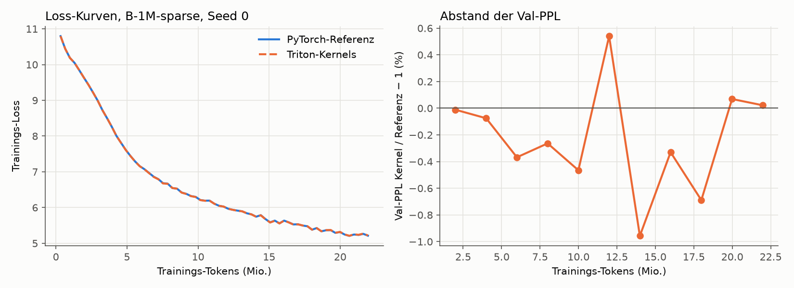

- **Im Regime der echten Läufe sind die Kurven praktisch identisch.** Bei Schritt 10–90 stimmen die
  Losses auf 5–6 Stellen überein. Danach wachsen die Abweichungen langsam, bleiben aber unter 0,13 %.
- **Im kurzen Plan** springt die Lernrate nach 31 Schritten auf den vollen Wert, die Tabellennutzung
  bricht kurz ein (13 % bei 2 M Tokens) und erholt sich wieder. Diese Phase ist chaotisch:
  - Beide Läufe sind bis Schritt 20 gleich und trennen sich ab Schritt 30.
  - Am Ende liegt der Kernel einmal 2,2 % besser, einmal 3,8 % schlechter.
  - Das ist dieselbe Größenordnung wie zwei Seeds der Referenz (2,6 %). Ein systematischer Unterschied
    ist nicht zu sehen.
- **Warum die Läufe überhaupt auseinanderlaufen (neuer Befund):**
  - Die Teil-Scores sind wie in der Referenz bf16 (Autocast). Bei 8 Bit Mantisse haben sehr viele
    Kandidaten exakt denselben Score.
  - Auf echten Aktivierungen des trainierten B-1M haben **65 % der (Token, Kopf)-Zeilen einen
    Gleichstand beim 32. Score**. In **41 %** wählen Kernel und `torch.topk` andere, gleichwertige
    Einträge, im Mittel 15 von 32.
  - Gleiche Scores bedeuten gleiche Gewichte, die Ausgabe mischt dann aber andere Werte-Zeilen. Welche,
    legt auch `torch.topk` nicht fest; die PyTorch-Referenz auf CUDA kann ebenso anders wählen als
    auf ROCm (nicht gemessen; der Cloud-Kontrolllauf B-1M zeigt es).
  - **Exakt gleiche Kurven sind deshalb nicht garantierbar**, wahrscheinlich auch nicht mit der
    Referenz auf anderer Hardware. Erreichbar und gezeigt ist: exakt gleiche Scores, gültige exakte
    Top-k-Auswahl, gleiche Kurven im echten Plan.
  - Die vollständige Kontrolle ist der Cloud-Lauf B-1M (500 M Tokens) gegen B-1M-sparse s0 von zu
    Hause; das Seed-Rauschen dort lag bei 0,39 %.
- **Nebenbefund fürs Modell (nicht geändert):** Die Auswahl hat wegen der bf16-Scores nur eine grobe
  Auflösung. Ob fp32-Teil-Scores (kaum teurer) die Speicherschicht verbessern, wäre ein eigener Versuch.
  Er würde die Ergebnisse gegenüber allen bisherigen B-Läufen verändern und gehört deshalb nicht in diese
  Optimierung.

### Ergebnis der Optimierung

Gemessen mit `scripts/profile_memory.py` (RX 9070, trainierte Checkpoints; `report/profile_before.json`
→ `report/profile_after.json`).

| | Ziel | vorher | nachher | erreicht |
|---|---|---|---|---|
| Training: Schritt (32.768 Tokens) | | 848 ms (38,7 k tok/s) | 577 ms (56,8 k tok/s) | |
| Training gegenüber A (359 ms) | ≥ 0,6× | 0,42× | **0,62×** | ✅ |
| Prefill 16 × 1024 gegenüber A (42,7 ms), bf16-Tabelle | ≤ 1,5× | 2,6× (fp32) | **1,43×** (61,1 ms) | ✅ |
| Prefill, fp32-Tabelle / 4 Bit | (berichtet) | 2,6× | 1,47× / 1,49× | |
| Decoding pro Token gegenüber A (4,60 ms) | ≤ +10 % | +21 % | **−2 %** (4,50 ms, mit Decoding-Graph) | ✅ |
| Decoding ohne Graph | (berichtet) | +21 % | +23 % | |
| Val-PPL B-1M-sparse s0 (fp32 / bf16 / 4 Bit) | unverändert | 21,837 | 21,836 / 21,837 / 21,866 | ✅ |

**Gewinn je Schritt** (Abbruchregel: ab < 10 % aufhören, außer Kernel 3):

| Schritt | Gewinn |
|---|---|
| Kernel 1 (Zeilen-Gradienten) | Training 1,32× |
| Kernel 2 (Lookup) | Training 1,10×, Prefill 109 → 63 ms (1,73×) |
| Kernel 4 (bf16 / 4 Bit) | Prefill 63 → 61 ms (1,03×) |
| Decoding-Graph | Decoding 1,26× |
| Kernel 3 (Lazy Adam) | Training 1,02×; gebaut wegen des Speichers |

Danach habe ich aufgehört: Alle Ziele sind erreicht, und keiner der verbleibenden Posten verspricht
noch 10 %.

**Wo die Grenze liegt (ehrlich):**

- **Training:** Von den 577 ms je Schritt sind 359 ms der Rechenkern, den A auch hat. Die Speicherschichten
  kosten noch ≈ 220 ms:
  - Rückwärtsrechnung ≈ 130 ms, davon Kernel 1 ≈ 3 ms je Aufruf, der Rest sind Teil-Score-Gradienten,
    Projektionen und BatchNorm.
  - Vorwärts ≈ 60 ms.
  - Lazy Adam 22 ms, Statistik und Clipping 10 ms.

  Ein weiterer großer Schritt bräuchte einen fusionierten Backward für Auswahl und Teil-Scores (heute
  `scatter_add` + `einsum`-Backward in PyTorch) oder fusionierte Projektionen. Mehr als 10 % sind davon
  einzeln nicht zu erwarten.
- **Prefill:** Die Werte-Lesezugriffe sind kein Engpass mehr: bf16 bringt nur 2 ms, 4 Bit nichts. Die
  Auswahl kostet ≈ 3,2 ms je Schicht bei 16k Tokens; sie ist an eine bitonische Sortierung in Triton
  gebunden.
- **Decoding:** Der Gewinn kommt **aus den CUDA/HIP-Graphen, nicht aus einem Kernel.** Ohne Graph liegt B
  bei +23 %, weil eine Speicherschicht ≈ 20 Ops absetzt (0,39 ms CPU). A läuft ohne Graphen; mit Graphen
  würde auch A schneller, der Abstand bliebe aber klein.
- **Hardware:** Alle Messungen stammen von der RX 9070. Auf der H200 sind die Verhältnisse anders: mehr
  Bandbreite, und die Kernel-Konfigurationen sind nicht für NVIDIA abgestimmt.

### Cloud-Vorbereitung (Runpod, 1 × H200)

**Anbieterwechsel (2026-10-03):** Zuerst war IONOS geplant (H200-S, 3,00 €/h; Stand in Commit `36eccfe`),
jetzt **Runpod**. Kriterien, Läufe und Daten bleiben unverändert; geändert haben sich nur Setup,
Speicherort und das Stoppen am Ende.

**Anbieter-Fakten** (Runpod-Doku und runpod.io/pricing, abgerufen 2026-10-03):

- **GPU und Preis:** H200 SXM 141 GB On-Demand: Secure Cloud 4,59 $/h, Community Cloud 3,59 $/h
  (24 vCPU, 276 GB RAM). Sekundengenaue Abrechnung; maßgeblich ist der Preis in der Konsole. H100 mit
  80/94 GB reicht für B-16M nicht.
- **Stoppen:** Ein Stop gibt die GPU frei und beendet die Rechenkosten. `/workspace` (Volume Disk) bleibt
  und kostet gestoppt 0,20 $/GB/Monat (150 GB ≈ 1 $/Tag); die Container Disk wird geleert.
  **Terminate** löscht alles.
- **Stopp aus dem Pod:** Jeder Pod bekommt `RUNPOD_POD_ID` und einen Pod-eigenen `RUNPOD_API_KEY`. Damit
  stoppt sich der Pod selbst (`POST https://rest.runpod.io/v1/pods/$RUNPOD_POD_ID/stop`, ersatzweise
  `runpodctl pod stop`). Du musst keinen Schlüssel erzeugen.
- **Neustart:** Nach einem Stop kann die GPU vergeben sein; dann startet der Pod auf Wunsch mit 0 GPUs. Das
  reicht, um die Checkpoints zu holen.
- **Treiber und SSH:** Treiber und SSH sind im Template „Runpod PyTorch“ dabei. `scp`/`rsync` brauchen
  eine öffentliche IP („SSH over exposed TCP“), deshalb Secure Cloud.
- **Guthaben:** Fällt es auf 0 $, werden Pods gestoppt, und Pods ohne Netzwerk-Volume **samt Daten
  gelöscht**. Vorher genug aufladen (≥ 40 $).

**Gebaut** (alles in Git, Anleitung `docs/notes/CLOUD.md`):

- **`cloud/setup.sh`:** ein Befehl im Pod.
  - Ablauf: Pakete, GPU-Check, Deploy-Key + Klonen nach `/workspace`, Python-Umgebung (PyTorch-CUDA-Wheels
    mit Triton), Daten, alle Tests, Probelauf aller drei Konfigurationen, dann die Warteschlange in tmux.
  - Alles, was einen Stop überleben muss, liegt auf `/workspace`; Pakete und SSH-Key werden nach jedem
    Start neu eingerichtet.
  - Fertige Schritte werden beim erneuten Start übersprungen.
  - Bei einem Fehler: Log nach GitHub, Nachricht, Pod stoppen.
- **`cloud/fetch_data.py`:**
  - Lädt WikiText-103 und Wikipedia 20231101.en in **festgepinnten Hugging-Face-Revisionen** und prüft
    jede Rohdatei per SHA-256. Alle 45 Rohdateien zu Hause stimmen mit den LFS-Prüfsummen dieser Revisionen
    überein.
  - Erzeugt die Token-Dateien neu und bricht ab, wenn eine nicht **bytegleich** mit zu Hause ist
    (`cloud/data_sha256.txt`).
- **`scripts/run_cloud.py`:** Warteschlange B-1M (Kontrolle) → B-4M → B-16M.
  - Je 500 M Tokens, Einstellungen von B-1M-sparse, `--mem_impl triton`.
  - GPU-Temperatur, Leistung und Takt alle 10 s (`smlm/gpu_monitor.py`, über `nvidia-smi`).
  - Nach jedem Lauf: Zwischenstand in REPORT.md, `git pull --rebase` + Push, Handy-Nachricht (ntfy,
    optional).
  - Am Ende: Prüfsummenliste der Checkpoints, dann **Stopp über die Runpod-API** (`cloud/stop_pod.sh`).
  - Schutz: Ein Lauf ohne Log-Änderung für 30 min wird beendet; Obergrenze 12 h für alles.
- **GitHub:** privates Repo `re133/sparse-memory-lm`, Deploy-Key mit Schreibrecht nur für dieses Repo.
  Das Starter-Paket `~/smlm-cloud-kit/` liegt auf dem PC (`setup.sh`, `stop_pod.sh`, `deploy_key`,
  `cloud.env`).
- **Nicht benutzt:** das Runpod-Plugin für Claude Code. Die Installation wurde von der Rechte-Prüfung
  blockiert, und es ist auch nicht nötig. Den Pod legst du in der Weboberfläche an; nur der Pod-eigene
  Schlüssel wird benutzt.

**Speicherbedarf auf der H200** (141 GB ≈ 131 GiB):

- Die Tabelle braucht pro Zeile 4 fp32-Kopien × 384 × 4 B = 6 KiB: Werte, Akkumulator, Adam m und v.
- „Rest“ wurde bei B-1M gemessen: 10,5 GiB Spitze minus 6,0 GiB Tabelle.

| | Einträge | Tabelle + Optimizer | + Rest | Spitze (Schätzung) | Checkpoint |
|---|---|---|---|---|---|
| B-1M | 1.048.576 | 6,0 GiB | 4,5 GiB | ≈ 10,5 GiB (gemessen) | 1,7 GB |
| B-4M | 4.194.304 | 24,0 GiB | ≈ 4,8 GiB | ≈ 29 GiB | ≈ 6,5 GB |
| B-16M | 16.777.216 | 96,0 GiB | ≈ 5,5 GiB | ≈ 102 GiB | ≈ 26 GB |

B-16M passt nur mit dem fusionierten Lazy Adam (Kernel 3). Die Referenz bräuchte für die Kopien der
ungelesenen Zeilen zusätzlich bis zu 3 × 1,5 KiB pro Zeile, bei 16M Zeilen und der Hälfte ungelesen
≈ 36 GiB, und das passt nicht mehr.

**Laufzeit und Kosten** (H200 SXM, Secure Cloud 4,59 $/h). Hochgerechnet von der RX 9070 (575 ms je
Schritt, H200 ≈ 7,5× Bandbreite, ≈ 5× Rechenleistung; das kleine Modell lastet die H200 nicht aus),
**bis Faktor 2 unsicher**:

| | Dauer | Kosten (Secure) |
|---|---|---|
| Setup (Python, 11 GB Daten + Tokenisieren, Tests, Probelauf) | 40–55 min | 3,10–4,20 $ |
| B-1M | 25–45 min | 1,90–3,40 $ |
| B-4M | 30–55 min | 2,30–4,20 $ |
| B-16M (Adam über 16M Zeilen, Top-k über 4096 Keys) | 40–75 min | 3,10–5,70 $ |
| Checkpoints holen (Pod wieder gestartet, mit 0 GPUs billiger) | 20–60 min | 0–4,60 $ |
| **Summe** | **≈ 2,5–4,5 h** | **≈ 11–22 $** (Community Cloud ≈ 9–17 $; + ≈ 1 $/Tag, solange der gestoppte Pod nicht gelöscht ist) |

**Vor dem Start geprüft (hier, ohne NVIDIA-GPU):**

- **Daten:** `cloud/fetch_data.py` in einer frischen Kopie des Repos. Alle 45 Rohdateien bestehen die
  SHA-256-Prüfung; alle 7 Token-Dateien und meta.json entstehen **bytegleich** neu (126 s).
  Der Download über die gepinnte Hugging-Face-URL ist mit einer Datei getestet, inklusive Prüfsumme.
- **Warteschlange:** Probelauf mit `SMLM_CLOUD_DRYRUN=1` (B-1M, 2 M Tokens, Triton): Lauf, GPU-Log alle
  10 s, Prüfsummenliste und Ende funktionieren. Außerhalb eines Pods findet das Stopp-Skript keinen
  Pod-Schlüssel, die Warteschlange meldet „stop FAILED“ und schickt die Warnung, von Hand zu stoppen; der
  Fehlerpfad ist damit auch geprüft (damals mit dem IONOS-Skript, das Runpod-Skript prüft dasselbe).
- **GitHub:** privates Repo angelegt, gepusht. Klonen mit dem Deploy-Key getestet.
- **Tests:** 87 GPU-Tests auf ROCm grün, CPU-Interpreter grün.
- **Nachträglich ergänzt, nur auf der CPU getestet** (die GPU war nach dem Messfenster nicht mehr
  freigegeben):
  - Kernel 1 setzt die `touched`-Maske nicht mehr selbst; das ist dasselbe Muster wie beim
    Kernel-3-Fehler, jetzt ein PyTorch-Scatter.
  - Neue Tests: Auswahl mit 4096 Keys je Hälfte (B-16M) und Offsets über 2³¹ Elemente (nur ≥ 60 GB GPU).
  - Ein Probelauf aller drei Konfigurationen in `setup.sh`.
  - `git pull --rebase` vor jedem Push.

  CPU-Suite 42 grün, CPU-Interpreter 21 grün. Auf GPU laufen sie zuerst in der Cloud (Setup-Schritt 6/7)
  bzw. im nächsten Zeitfenster zu Hause.

**Nicht getestet** (geht ohne die Maschine nicht). Das Setup prüft jeden dieser Punkte, bevor gerechnet
wird, und stoppt den Pod bei einem Fehler:

- **Kernels auf CUDA/H200:** Die Tests laufen dort als Erstes, dazu der Probelauf aller drei
  Konfigurationen mit je 1 M Tokens. Nur wenn beides klappt, startet die Warteschlange.
- **Runpod-spezifisches:** Template, `/workspace`-Volume und Stopp mit dem Pod-Schlüssel.
  `setup.sh` prüft den API-Zugang vorher (`stop_pod.sh --check`) und warnt, falls er nicht klappt. Ob
  ein Pod-Schlüssel den eigenen Pod stoppen darf, steht so in der Runpod-Doku („Schedule a stop“), ist aber
  nicht ausprobiert.

**Bereit für die Cloud: ja.** Ablauf in `docs/notes/CLOUD.md`: Konto aufladen, Pod anlegen, Paket hochladen,
`setup.sh` starten.

**Durchführung (2026-10-03/04, Runpod Pod `7yajarg09lrzdn`, 1 × H200 SXM, EUR-IS-4):**

- **Erster Versuch:** 88 von 89 GPU-Tests grün. Durchgefallen ist der neue Großtabellen-Test für Lazy Adam;
  der Fehler lag im Test. Er verglich mit einem anders summierten Gradienten, und bei |g| ≈ 0 kippt bei Adam
  das Vorzeichen. Korrigiert in `409dd49`. Der Pod hat sich dabei wie vorgesehen nach dem Fehler gestoppt.
  Zweiter Versuch: GPU 89/89 und CPU-Interpreter 21/21 grün.
- **Probelauf auf der H200** (VRAM-Spitze Training): B-1M 10,4 GiB, B-4M 28,5 GiB, B-16M 100,9 GiB, wie
  geschätzt.
- **Ein Lauf ist auf dem Pod CPU-gebunden:** ein Python-Thread bei ≈ 90 %, GPU ≈ 24 % ausgelastet,
  ≈ 81 k tok/s.
  - Deshalb ab 22:01 UTC eine **parallele Ausführung** (Freigabe durch den Nutzer):
    `scripts/run_cloud_parallel.py` übernimmt den laufenden B-1M und startet B-16M sofort auf derselben
    GPU.
  - B-4M startet erst nach B-1M und nur, wenn B-16M fertig ist oder vorher ≥ max(15 GB, 30,5 GiB) frei
    sind.
  - Ein abgestürzter Lauf wird gemeldet, nicht neu gestartet; es gibt keine Zwischen-Checkpoints.
  - Die alte Warteschlange ist eingefroren (SIGSTOP), nicht beendet: Beim Schließen ihres tmux-Fensters hätte
    B-1M ein SIGHUP bekommen.
- **Gleicher Trainingscode und gleiche Einstellungen.** Die **Tempo-Werte der Cloud-Läufe (tok/s, Trainzeit)
  sind wegen der geteilten GPU nicht vergleichbar**, weder untereinander noch mit der RX 9070.
- **Selbst-Stopp funktioniert nicht:** Der Pod-eigene `RUNPOD_API_KEY` bekommt von der Runpod-REST-API
  HTTP 403. Gestoppt wird am Ende über das MCP (Claude Code, mit dem Konto des Nutzers).

<!-- CLOUD-STATUS:BEGIN -->

**Zwischenstand Cloud** (automatisch, `scripts/cloud_status.py`, Stand 2026-10-04 04:28)

| Lauf | Status | GPU | Val-PPL Wikipedia | Val-PPL WikiText | Trainzeit | tok/s | VRAM Train | Nutzung | max. Temp. GPU / Speicher | max. Leistung |
|---|---|---|---|---|---|---|---|---|---|---|
| B-1M-sparse s0 zu Hause (RX 9070, PyTorch-Referenz) | fertig | AMD Radeon RX 9070 | 21,837 | 65,51 | 216 min | 38.517 | 10,5 GiB | 100,0 % | 48 / 80 °C | 238 W |
| B-1M (Cloud, Kontrolle) | fertig | NVIDIA H200 | 21,837 | 65,87 | 138 min | 55.226 | 10,4 GiB | 100,0 % | 41 / 40 °C | 343 W |
| B-4M (Cloud) | fertig | NVIDIA H200 | 20,799 | 63,07 | 119 min | 77.551 | 28,5 GiB | 99,7 % | 46 / 47 °C | 379 W |
| B-16M (Cloud) | fertig | NVIDIA H200 | 19,960 | 59,97 | 155 min | 52.684 | 100,9 GiB | 91,3 % | 47 / 48 °C | 404 W |

| Kriterium (vorher festgelegt) | Messwert | Ergebnis |
|---|---|---|
| lohnt sich: B-4M ≥ 3 % besser als B-1M (Cloud) und B-16M besser als B-4M | B-4M / B-1M = 0,9525 (−4,75 %; Grenze 0,97); B-16M / B-4M = 0,9596 (−4,04 %) | **lohnt sich** |

Kontrolle: B-1M in der Cloud (Triton-Kernels, H200) gegenüber zu Hause (PyTorch-Referenz, RX 9070): 21,837 gegenüber 21,837 (−0,00 %; Seed-Spanne zu Hause 0,39 %).

<!-- CLOUD-STATUS:END -->

### Ergebnis der Cloud-Läufe (Auswertung von Hand, 2026-10-04)

**Urteil nach den vorher festgelegten Kriterien: „lohnt sich“.** B-4M ist 4,75 % besser als B-1M (Cloud),
gefordert waren ≥ 3 %, und B-16M ist nochmal 4,0 % besser als B-4M.

| | Einträge | Val-PPL Wikipedia | gegenüber B-1M | Val-PPL WikiText | Nutzung (Val) | Top-1 %-Anteil | KL | VRAM Train |
|---|---|---|---|---|---|---|---|---|
| B-1M-sparse s0 zu Hause (RX 9070, PyTorch) | 1,05 M | 21,837 | | 65,51 | 100 % | 11,7 % | 0,62 | 10,5 GiB |
| **B-1M** (H200, Triton, Kontrolle) | 1,05 M | **21,837** | – | 65,87 | 100 % | 11,8 % | 0,62 | 10,4 GiB |
| **B-4M** | 4,19 M | **20,799** | **−4,75 %** | 63,07 (−4,3 %) | 99,7 % | 18,9 % | 0,99 | 28,5 GiB |
| **B-16M** | 16,8 M | **19,960** | **−8,6 %** (gegenüber B-4M −4,0 %) | 59,97 (−9,0 %) | 91,3 % | 23,4 % | 1,35 | 100,9 GiB |

Verlauf, Val-PPL bei gleicher Tokenzahl:

| Tokens | B-1M | B-4M | B-16M | B-4M / B-1M | B-16M / B-4M |
|---|---|---|---|---|---|
| 100 M | 39,18 | 38,12 | 37,36 | 0,973 | 0,980 |
| 200 M | 29,62 | 28,64 | 27,78 | 0,967 | 0,970 |
| 300 M | 25,46 | 24,43 | 23,65 | 0,959 | 0,968 |
| 400 M | 22,93 | 21,90 | 21,09 | 0,955 | 0,963 |
| 500 M | 21,84 | 20,80 | 19,96 | 0,953 | 0,960 |

**Einordnung (nichts schönreden):**

- **Kontrolle bestanden:** B-1M in der Cloud (H200, Triton-Kernels) und zu Hause (RX 9070, PyTorch-Referenz)
  liegen 0,00 % auseinander (21,8365 gegenüber 21,8369). Kernels und Hardware verändern das Ergebnis nicht,
  auch nicht über die Gleichstände bei der bf16-Auswahl.
- **Deutlich größer als das Seed-Rauschen:** Die Abstände (4,75 % und 4,0 %) sind rund sechsmal so groß wie zwei
  Seed-Spannen von B-1M-sparse (2 × 0,39 %). Die Seed-Spanne stammt aber von B-1M und ist auf die großen Tabellen
  nur übertragen (korrigiert 2026-10-05 nach Codex-Review; vorher „Belastbar trotz eines Seeds“). Auf dem nie trainierten WikiText-Val-Set sind sie gleich groß.
  Trotzdem bleibt es ein Seed je Größe.
- **Der Vorsprung wächst noch:** Bei 100 M Tokens bringt die 4-fache Tabelle 2,7 %, bei 500 M 4,7 %; für
  B-16M gegenüber B-4M wachsen die Werte von 2,0 % auf 4,0 %. Mit mehr Daten dürfte der Abstand weiter
  steigen; gemessen ist das nicht.
- **Die großen Tabellen werden ungleichmäßiger genutzt:** Bei B-16M wurden 8,7 % der 16,8 M Einträge auf dem
  Val-Set nie gelesen, das meistgelesene 1 % bekommt 23 % der Zugriffe (B-1M: 12 %). Pro Eintrag gesehen
  sind 500 M Tokens für 16,8 M Einträge wenig (B-16M: ≈ 11 k Lesezugriffe pro Eintrag, B-1M: ≈ 180 k).
- **Gleiche Tokens, nicht gleiche Kosten:**
  - B-16M hat 6,5 Mrd. Parameter, davon 6,44 Mrd. Tabelle.
  - Pro Token rechnet B-16M 20 % mehr als B-1M, B-4M 7 % mehr (Teil-Scores über 4096 bzw. 2048 statt
    1024 Keys je Hälfte: 56,5 / 50,2 / 47,1 M MACs).
  - Die Tabelle braucht aber 26 GB in fp32, mit 4 Bit ≈ 3,3 GB, und im Training ≈ 100 GiB GPU-Speicher
    (Werte, Akkumulator, Adam).
  - Ein Vergleich bei gleicher Rechenzeit gegen A wurde für die großen Tabellen nicht gemacht.
- **Tempo-Werte nicht vergleichbar:** B-1M und B-16M teilten sich zeitweise die GPU, später B-16M und B-4M.
  Trainzeit, tok/s und die Inferenz-Benchmarks in den `run-info.json` der Cloud-Läufe sind deshalb nicht
  vergleichbar.
- **Kosten:** **25,51 $** für alles laut Runpod-Abrechnung (`list-billing`, abgefragt am 04.10. nach dem
  Löschen des Pods: GPU 24,98 $, Platte 0,52 $), einschließlich des ersten Versuchs mit dem Testfehler und
  der Plattenkosten bis zum Löschen am 04.10. gegen 13:30 Uhr.
  *Korrektur:* Hier stand zuerst 21,01 $ (GPU 20,89 $, Platte 0,12 $). Dieser Wert war zu niedrig. Er stammte
  aus einer Abfrage kurz nach Ende der Läufe, als die Abrechnung offenbar noch nicht vollständig war. Die
  Pod-Laufzeit von ≈ 5,4 h × 4,59 $/h passt zu den 24,98 $ GPU-Kosten.
- **Ablauf:**
  - Alle Checkpoints wurden per `rsync` geholt und mit `runs/cloud/checkpoints.sha256` geprüft: 12 von 12 OK.
  - Der Pod hat sich am Ende **doch selbst gestoppt**: Ein POST-Stop mit dem Pod-Schlüssel ging, obwohl das
    Lesen 403 lieferte. Danach wurde er noch einmal kurz gestartet, um den Rest des B-4M-Downloads zu holen,
    und dann über das MCP gestoppt.
  - GPU-Höchstwerte: 48 °C, 404 W.

## Schritt 1: Gegenwert der Tabelle – dichte Vergleichsmodelle (Plan vor dem Lauf festgelegt, 2026-10-04)

**Frage:** Wie groß müsste ein normales dichtes Modell ohne Tabelle sein, um bei denselben 500 M Tokens so gut
zu sein wie B-1M (21,84), B-4M (20,80) und B-16M (19,96)? Das ist eine **Messung ohne Bestanden-Kriterium**.

**Modelle:** Llama-Stil wie A, ohne Speicherschicht. Breite und Tiefe wachsen gemeinsam. `head_dim = 64`; die
FFN-Breite ist ≈ 8/3 · d, gerundet auf ein Vielfaches von 64 (wie A: 384 → 1024). Presets in `smlm/train.py`.

| Modell | d | Layer | Köpfe | FFN | Parameter ohne Emb. | Emb. | MACs/Token vorwärts | Mikro-Batch |
|---|---|---|---|---|---|---|---|---|
| A (vorhanden, RX 9070) | 384 | 12 | 6 | 1024 | 21,24 M | 19,32 M | 45,3 M | 8 |
| D-50M | 640 | 10 | 10 | 1728 | 49,58 M | 32,19 M | 88,3 M | 8 |
| D-100M | 768 | 14 | 12 | 2048 | 99,11 M | 38,63 M | 148,7 M | 8 |
| D-200M | 1024 | 16 | 16 | 2752 | 202,41 M | 51,51 M | 270,7 M | 8 |
| D-400M | 1280 | 20 | 20 | 3456 | 396,55 M | 64,39 M | 487,1 M | 4 |
| *zum Vergleich:* B-1M / B-4M / B-16M | 384 | 12 | 6 | 1024 | aktiv 23,1 / 26,2 / 32,5 M | 19,32 M | 47,1 / 50,2 / 56,5 M | 4 |

**Training:** wie A und B, ohne Abweichung.
- Daten:
  - 500 M Wikipedia-Tokens, jede Sequenz genau einmal
  - Daten-Seed 1234, Init-Seed 0
  - Validierung: Wikipedia-Val-Set (1,48 M Tokens); WikiText-103-Val nur als Nebenwert
- Optimierung:
  - AdamW (0,9 / 0,95), LR 6e-4, Warmup 5 %, Cosine auf 10 %
  - Weight Decay 0,1, Clip 1,0
  - 32.768 Tokens/Schritt, bf16-Autocast
- Der Mikro-Batch wird nur an den Speicher angepasst, die Gradient-Akkumulation füllt auf 32.768 Tokens auf.
  `tests/test_dense.py` prüft, dass das die Gradienten nicht ändert.
- **A** geht als kleinster Punkt mit seinem vorhandenen Lauf ein: Seed 0, PPL 25,665, gleiche Daten, gleiches
  Val-Set, zu Hause gerechnet. Dass zu Hause und in der Cloud dasselbe herauskommt, zeigt B-1M: 21,8369
  gegenüber 21,8365.

**Auswertung (festgelegt):**
1. **Kurve:** Val-PPL (Wikipedia) gegen Parameter ohne Embeddings, log–log. Punkte: A, D-50M, D-100M, D-200M,
   D-400M, soweit gelaufen.
2. **Gleichwertige Größe N_eq** für B-1M, B-4M und B-16M:
   - Hauptwert: stückweise lineare Interpolation von log PPL über log N zwischen den beiden benachbarten
     dichten Punkten.
   - Vergleichswert: Fit PPL = E + a · N^(−α) über alle dichten Punkte. Gitter über α und E, a je Gitterpunkt
     per kleinster Quadrate in PPL, gewählt wird der Punkt mit dem kleinsten Fehler in log PPL (korrigiert 2026-10-05 nach Codex-Review;
     vorher „kleinste Quadrate in log PPL“; ein exakter Log-Fit verschiebt die Fit-Werte um höchstens 0,3 M).
3. **Unsicherheit** (ein Sensitivitätsbereich, kein Konfidenzintervall):
   - Die PPL von B und die der beiden Nachbarpunkte werden um ±0,4 % verschoben. Das ist die Seed-Spanne aus
     Stufe 1c: A s0/s1 0,35 %, B-1M s0/s1 0,39 %.
   - Die Extremfälle ergeben einen Bereich für N_eq.
   - Weicht der Fit-Wert stärker ab, wird der Bereich bis zu ihm erweitert.
4. **Einklammerung:**
   - Ist B besser als das größte gelaufene dichte Modell, wird nur „> N_max“ berichtet. Eine
     Fit-Extrapolation erscheint höchstens als gekennzeichneter Hinweis.
   - Ist B schlechter als A, lautet das Ergebnis „< 21 M“.
5. **Rechenaufwand pro Token:**
   - Vorwärts-MACs (`macs_per_token`, Kontext 1024) für alle Modelle; Training ≈ 3×.
   - Für B zusätzlich die gelesenen Tabellenwerte pro Token: 3 Schichten × 4 Köpfe × 32 Zeilen × 384 Werte
     = 147.456 Werte, also 295 KB in bf16 bzw. 74 KB in 4 Bit.
   - Dazu die Größe der Tabelle.

**Durchführung (Runpod, 1 × H100 SXM 80 GB, Secure Cloud, 3,49 $/h; `cloud/setup_dense.sh`,
`scripts/run_dense.py`):**
- **Daten:** Die Token-Dateien kommen von der Hetzner Storage Box. Sie werden per sha256 gegen
  `cloud/data_sha256.txt` geprüft, sind also bytegleich mit zu Hause.
- **Tests:** `tests/test_dense.py` und `tests/test_stage1b.py`, auf der GPU.
- **Probelauf:** Jede Größe läuft allein 3 M Tokens. Gemessen werden tok/s, VRAM-Spitze, Auswertung, Speichern
  und Inferenz.
- **Budget-Wächter (Deckel 18 $ für den ganzen Pod):**
  - Hochrechnung = Pod-Laufzeit + 0,1 h + 1,15 × Σ (500 M Tokens + Auswertungs-Tokens / 3) / (tok/s allein)
    + 0,4 h.
  - Zugelassen wird in der Reihenfolge 50M, 100M, 200M, 400M, solange die Hochrechnung ≤ 18 $ / 3,49 $/h
    = 5,16 h bleibt.
  - Was wegfällt, wird gemeldet. Ein größeres Modell wird dann nicht mehr zugelassen.
- **Parallelbetrieb:** Die zugelassenen Läufe laufen gleichzeitig, das größte startet zuerst.
- **Abbruch:**
  - Ab 5,16 h − 0,3 h Laufzeit wird beendet, was noch läuft, und gesichert.
  - Ein unabhängiger Watchdog stoppt den Pod bei 5,16 h − 6 min.
  - Abgebrochene oder abgestürzte Läufe werden berichtet, nicht neu gestartet (keine Zwischen-Checkpoints).
- **Nach jedem Lauf:**
  - kleine Dateien auf GitHub
  - Laufordner samt Checkpoint per rsync auf die Storage Box, dort per sha256 geprüft
  - ntfy-Nachricht
- **Ende:**
  - Prüfsummenliste gepusht, alles noch einmal gesichert und geprüft.
  - Danach stoppt und löscht Claude den Pod.
  - Schlägt das Sichern fehl, wird der Pod nur gestoppt, und es geht eine Nachricht raus.
- **Messwerte:** GPU-Temperatur, Leistung und Takt alle 10 s je Lauf (`gpu_thermal.csv`). Weil sich die Läufe
  die Karte teilen, zeigen diese Dateien die ganze GPU; tok/s und Trainzeit sind **nicht** mit Einzelläufen
  vergleichbar.

**Grenzen (vorab bekannt):**
- **Token-Budget:** 500 M Tokens sind für 200–400 M Parameter wenig (Chinchilla-optimal wären ≈ 20 Tokens
  pro Parameter). N_eq gilt **nur für dieses Token-Budget**.
- **Lernrate:** Der LR-Plan ist für A gewählt und nicht je Größe abgestimmt. Größere dichte Modelle wären mit
  angepasster LR vermutlich etwas besser; das lässt die Tabelle eher **zu gut** aussehen.
- **Seeds:** ein Seed je dichter Größe.
- **Instabilität:** Wird ein großes Modell mit LR 6e-4 instabil (NaN bricht ab; eine Loss-Explosion ohne NaN
  ist in den Kurven sichtbar), wird das berichtet, nicht wiederholt.

## Schritt 2: B-16M zu Hause – die Tabelle muss nicht im Grafikspeicher liegen (gemessen 2026-10-04)

**Frage:** Lässt sich B-16M (Tabelle 16,8 M Zeilen × 384) auf einem normalen PC betreiben, wenn die Tabelle nicht im
teuren Grafikspeicher liegt? Messung ohne Bestanden-Kriterium.

**Rechner:**
- GPU: RX 9070 (16 GB)
- CPU: Ryzen 9 5900XT
- RAM: 125 GB
- NVMe: Samsung 990 PRO (`/home`)
- Der Desktop lief mit ≈ 0,6–1 GB VRAM. Sonst lief nichts.

**Vorbereitung:**
- `scripts/convert_table.py` zerlegt den Cloud-Checkpoint in den kleinen Rest (`rest.pt`, 71 M Parameter) und die
  Tabelle als flache Dateien: bf16 12,9 GB, 4 Bit 3,2 GB plus 32 MB Skalen.
- Die 4-Bit-Quantisierung auf der CPU ist bitgleich mit `quantize_q4` auf der GPU (geprüft an 1 M Zeilen).

**Varianten** (`smlm/offload.py`, `scripts/bench_offload.py`, ein Prozess je Variante):
- **a) Tabelle im Grafikspeicher:** bf16 oder 4 Bit. Der Kernel liest direkt; Decode-Graphen sind möglich.
- **b) Tabelle im RAM:** bf16, fp32 oder 4 Bit.
  - Pro Speicherschicht und Aufruf gehen die gelesenen Zeilen-Indizes zur CPU.
  - Die CPU sammelt die Zeilen in einen gepinnten Puffer, von dort gehen sie zur GPU.
  - Dort läuft derselbe Kernel wie in a) auf der kompakten Tabelle.
  - Das sind drei Hin- und Rückwege pro Token. Decode-Graphen sind dadurch nicht möglich.
- **c) 4-Bit-Datei auf der NVMe:**
  - Zugriff per mmap; Readahead ist aus (`MADV_RANDOM`).
  - Fehlende Zeilen werden je Aufruf gesammelt mit `MADV_WILLNEED` angefordert.
  - RAM-Cache: fest die im Training meistgelesenen x % der Zeilen, optional zusätzlich ein FIFO-Teil für zuletzt
    verfehlte Zeilen.
  - **Kalt:** Die Datei wird vorher ohne root mit `posix_fadvise(DONTNEED)` aus dem Seiten-Cache geworfen;
    `fincore` bestätigt 0 Byte.
  - **„Begrenzt“:** Der Prozess läuft in einer systemd-Scope mit `MemoryMax=4G`. Damit kann Linux die 3,2-GB-Datei
    nicht ganz im Seiten-Cache halten. Gemessen hält die Scope 1,4–2,0 GB der Datei, `memory.current` bleibt bei
    4,0 GB.

**Messungen:**
- **Schreiben (Batch 1):** greedy, 128-Token-Prompt + 256 neue Tokens, drei verschiedene Prompts; der erste ist
  bei c) kalt.
- **Einlesen:** 4 × 1024 Tokens Val-Text, Median über 3 Batches nach einem Aufwärm-Batch.
- **Val-PPL:** auf dem ganzen Wikipedia-Val-Set (wie am Trainingsende, Batch 1) und auf den ersten 64 Fenstern
  (für den Bitvergleich).

**Ergebnisse** (`report/offload/*.json`, `report/offload_summary.json`, Grafik `report/offload_cache.png`):

| Variante | Schreiben tok/s (ms/Token, 1. Prompt) | Einlesen tok/s | Cache-Treffer Schreiben / Einlesen | NVMe beim Einlesen | VRAM belegt (gesamt, mit Desktop; GiB) | RAM-Spitze (RSS; GiB) | Val-PPL ganz |
|---|---|---|---|---|---|---|---|
| a) bf16 im VRAM, mit Graphen | 216 (4,6) | 108.000 | – | – | 13,1 | 12,9¹ | 19,9615 |
| a) bf16, ohne Graphen | 171 (5,8) | 108.000 | – | – | | | |
| a) 4 Bit im VRAM, mit Graphen | 212 (4,7) | 107.500 | – | – | 3,6 | 4,0 | 19,9795 |
| a) 4 Bit, ohne Graphen | 173 (5,8) | 107.400 | – | – | | | |
| b) bf16 im RAM | 139 (7,2) | 31.200 | – | – | 0,53 | 14,7 | 19,9615 |
| b) fp32 im RAM | 143 (7,0) | 18.900 | – | – | 0,53 | 48,8¹ | **19,9601** |
| b) 4 Bit im RAM | 154 (6,5) | 61.700 | – | – | 0,53 | 5,0 | = a) 4 Bit² |
| c) NVMe, ohne Cache | 114 (8,7) | 4.900 | 0 / 0 % | 57 k Lesezugriffe/s, 235 MiB/s | 0,53 | 5,1³ | = a) 4 Bit² |
| c) NVMe, Cache 5 % (155 MB) | 120 (8,3) | 4.500 | 38 / 28 % | 75 k/s | 0,53 | 5,3³ | = a) 4 Bit² |
| c) NVMe, Cache 10 % (310 MB) | 127 (7,8) | 4.400 | 53 / 41 % | 86 k/s | 0,53 | 5,5³ | = a) 4 Bit² |
| c) Cache 10 % + FIFO 20 % | 127 (7,8) | 4.500 | 73 / 52 % | 89 k/s | 0,53 | 6,1³ | = a) 4 Bit² |
| c) NVMe, Cache 30 % (930 MB) | 137 (7,3) | 4.800 | 80 / 72 % | 110 k/s, 469 MiB/s | 0,53 | 6,1³ | 19,9795 |
| c) NVMe, Cache 50 % (1,55 GB) | 138 (7,2) | 6.500 | 92 / 87 % | 111 k/s | 0,53 | 6,5³ | = a) 4 Bit² |
| c) Cache 10 %, **RAM begrenzt 4 GiB** | 124 (8,0) | **1.500** | 53 / 41 % | 65 k/s | 0,53 | ≤ 4 (Scope)⁴ | = a) 4 Bit² |
| c) Cache 30 %, **RAM begrenzt 4 GiB** | 133 (7,5) | **2.600** | 80 / 72 % | 84 k/s | 0,53 | ≤ 4 (Scope)⁴ | = a) 4 Bit² |

¹ Beim Laden: Datei bzw. Checkpoint wird einmal komplett gelesen. Bei b) fp32 zählen die gemappten
Checkpoint-Seiten mit; die Tabelle selbst belegt 25,8 GB.
² Auf den 64 Vergleichsfenstern **bitgleich** zu a) 4 Bit: gleiche NLL-Summe 205849,488. Das ganze Val-Set wurde
nur für c) mit 30 % gerechnet und ergibt ebenfalls genau 19,9795.
³ RSS enthält die gemappten Seiten der 4-Bit-Datei. Ohne RAM-Grenze lag die Datei am Ende zu 2–3 GB im
Seiten-Cache von Linux.
⁴ Grenze der systemd-Scope (cgroup `MemoryMax=4G`), gezählt wird, was der Kernel dieser Gruppe anrechnet. Das ist
nicht dasselbe wie „läuft auf einem Rechner mit 4 GB RAM“: Treiber, Desktop und der übrige Seiten-Cache liegen
außerhalb. Die RSS des Prozesses lag dabei höher (bis ≈ 5,9 GiB), weil sie gemappte Dateiseiten mitzählt
(korrigiert 2026-10-05 nach Codex-Review; die Einheiten in dieser Tabelle sind GiB, vorher stand „GB“).

**Was das zeigt:**
- **Qualität: gleich.**
  - b) und c) rechnen bitgleich zu a) mit derselben Genauigkeit: bf16 19,9615 in a) und b); 4 Bit 19,9795 in
    a), b) und c).
  - Gegenüber fp32 aus der Cloud (19,9600) kostet bf16 +0,007 % und 4 Bit +0,10 %.
  - fp32 aus dem RAM trifft den Cloud-Wert auf 0,001 % (19,9601). Der Rest ist die andere GPU.
- **Wort für Wort schreiben geht ohne Tabelle im Grafikspeicher:**
  - Aus dem RAM: 139–154 tok/s. Aus der NVMe: 114–138 tok/s, kalt und mit nur 4 GB RAM 124–133 tok/s.
  - Mit der Tabelle im VRAM: 171–173 tok/s ohne Graphen, 212–216 mit Graphen.
  - Der Abstand kommt vor allem von den drei CPU-Hin- und Rückwegen pro Token, nicht von der NVMe: Selbst ohne
    jeden Cache verliert c) nur 18 % gegenüber RAM (114 gegenüber 139 tok/s).
  - Der Grafikspeicher sinkt dabei von 13,1 bzw. 3,6 GB auf 0,53 GB.
- **Lange Texte einlesen geht nur aus dem Grafikspeicher schnell:**

  | Ort der Tabelle | Einlesen tok/s |
  |---|---|
  | VRAM | 108.000 |
  | RAM | 19.000–62.000 (je nach Bytes pro Zeile) |
  | NVMe | 4.400–6.500 |
  | NVMe, RAM auf 4 GB begrenzt | 1.500–2.600 |

  Beim Einlesen braucht jedes Token ≈ 270 verschiedene Zeilen. Jede verfehlte Zeile kostet eine 4-KB-Seite, also
  21-mal mehr Daten als nötig. Die NVMe liefert dabei 57.000–111.000 Lesezugriffe/s, und das reicht nicht.
- **Cache:** Die Trefferquoten sind so, wie aus den Trainingszugriffen vorhergesagt (30 % Cache → 80 % Treffer
  beim Schreiben, vorhergesagt 79 %). Ein FIFO-Teil erhöht die Treffer, aber nicht das Tempo.

**Grenzen:**
- **Umfang:** Jede Variante wurde einmal gemessen, mit drei Prompts zu 256 Tokens und drei Einlese-Batches.
- **Implementierung:** Die Lesewege sind in Python/NumPy geschrieben. Ein C-/io_uring-Pfad oder eine
  Zeilenanordnung, die zusammen gelesene Zeilen auf dieselbe Seite legt, könnte das Einlesen von der NVMe
  deutlich beschleunigen; das ist nicht gemessen.
- **Was „kalt“ heißt:** Kalt bezieht sich nur auf den Seiten-Cache. Den festen RAM-Cache füllt das Programm beim
  Start; das dauerte 0,7–8 s.
- **Speicherbedarf beim Laden:** Die RAM-Spitzen von a) bf16 und b) fp32 enthalten das einmalige Einlesen.

## Schritt 3: Tabelle als Zusatzgedächtnis für Qwen3.5-0.8B (vorbereitet; Kriterien zur Freigabe, 2026-10-04)

**Nichts davon ist trainiert.** Hier stehen Aufbau, Daten, Basis-Messungen, der Kriterien-Vorschlag und die
Abschätzung. Trainiert wird erst nach Freigabe der Kriterien.

**Basis:**
- **Modell:** `Qwen/Qwen3.5-0.8B`, Revision `2fc06364715b967f1860aea9cf38778875588b17`, veröffentlicht am
  02.03.2026.
- **Lizenz:** **Apache 2.0** laut Modellkarte und `LICENSE` im Repo (sha256 `bbedc3fd…e57a`, Standardtext Apache 2.0).
- **Variante:** die nachtrainierte, multimodale Fassung; genutzt wird nur der Textteil (`Qwen3_5ForCausalLM`).
  Es gibt auch `Qwen3.5-0.8B-Base`.
- **Textteil:** 752,4 M Parameter; davon 254 M Embedding, an den Ausgang gekoppelt.
  - 24 Blöcke: 18 × Gated DeltaNet (lineare Attention), 6 × Gated Attention
  - d = 1024, FFN 3584
  - Vokabular 248.320
- **Umgebung:** eigene Python-Umgebung `.venv-qwen` mit transformers 5.18.0, lm-eval 0.4.13 und accelerate. Die
  bestehende `.venv` bleibt unverändert.

**Einbau** (`smlm/qwen_memory.py`, `tests/test_qwen_memory.py`):
- **Position:** hinter Block 6, 12 und 18 je ein **zusätzlicher** Block, per Forward-Hook; Qwens Modulbaum bleibt
  unverändert.
- **Formel:** h ← h + g · M(RMSNorm(h)). g ist ein Skalar je Block und startet bei 0; RMSNorm hat keine
  Parameter.
- **M (Q+T):** Speicherschicht wie in B.
  - Eine gemeinsame Tabelle mit 1024² = 1.048.576 Zeilen × 1024 (1,07 Mrd. Werte).
  - Je Block: 4 Köpfe, Top-32, Query-Projektion 1024 → 4 × 256 mit BatchNorm, Sub-Keys 4 × 2 × 1024 × 128.
  - Die swilu-Projektionen (Memory+) 1024 × 1024, zweimal je Block, gehören zur Speicherschicht wie in B.
    **Bitte bestätigen**, dass sie als Teil der Speicherschicht mittrainiert werden dürfen. Alternative: ohne
    swilu, dann trainieren wirklich nur Tabelle, Suche und Regler.
  - Tabelle mit zeilenweisen Gradienten und Lazy Adam wie bei B (Triton-Kernel).
  - Trainierbar: ≈ 1,09 Mrd. Parameter, davon 1,07 Mrd. Tabelle.
- **Kontrolle Q+D:** ein SwiGLU-Block mit Breite 1408 an denselben Stellen.
  - Gleiche MACs pro Token wie ein Speicherblock (4,33 M), gleicher Regler, gleiche Daten und Schritte.
  - Trainierbar 13 M Parameter.
- **Tests** (CPU, kleine Zufalls-Qwen-Konfiguration; alle grün):
  - Bei g = 0 sind die Logits **bitgleich** zu Qwen allein, im Train- und im Eval-Modus.
  - Im ersten Schritt bewegt sich nur g, ab dem zweiten auch die Blöcke.
  - Eingefrorene Gewichte bleiben unverändert.
  - Die MACs der Kontrolle stimmen.

**Daten** (`scripts/prepare_qwen_data.py`, Qwen-Tokenizer, uint32; auf der Storage Box per sha256 geprüft):
- **Neue Artikel:** aus dem enwiki-Dump vom 01.09.2026, nur die letzten Teildateien (Seiten-IDs ≥ 77,5 M).
  Hauptnamensraum, keine Weiterleitungen und Begriffsklärungen, ≥ 300 Zeichen Klartext (mwparserfromhell).
  - Anlege-Monat über Seiten-ID-Schwellen aus dem Anlege-Log der Wikipedia-API, gespeichert in
    `page_id_months.json`.
  - 286.766 Artikel, angelegt ab 01/2025.

| Teil | Artikel | Tokens | Zweck |
|---|---|---|---|
| `train_new` | 79.864 | 55,3 M | Training: angelegt 03–08/2026, nach Qwens Veröffentlichung |
| `val_new` | 1.500 | 1,02 M | **entscheidend:** zurückgehaltene neue Artikel |
| `mem_probe` | 1.000 | 0,66 M | Teil des Trainings: wie viel die Tabelle speichert |
| `val_known` | 1.917 | 1,54 M | Val-Set von Stufe 1b (Wikipedia 2023, HF-Aufbereitung) |
| `val_known_same` | 1.500 | 1,62 M | alte Artikel (Seiten-IDs 4,0–5,4 M, ≈ 2006) aus demselben 2026-Dump, gleich aufbereitet wie die neuen |
| `curve_YYYY-MM` | je 150 | je 0,08–0,19 M | Stichtags-Kurve 01/2025–08/2026 (nie trainiert) |

**Basis-Messung: Qwen allein, zu Hause** (`runs/qwen/Q-base`, `report/qwen/cutoff_curve.json` und `.png`):
- **Token-PPL, Fenster 2048:**

  | Set | PPL |
  |---|---|
  | `val_new` | 12,98 |
  | `mem_probe` | 13,36 |
  | `val_known` | 13,94 |

- **Median-PPL je Artikel** (erste 1024 Tokens, 90-%-Bootstrap-Intervall):

  | Set | Median-PPL | Intervall |
  |---|---|---|
  | Neue Artikel je Monat, 2025–2026 | 10,9–12,8 | |
  | `val_new` | 11,47 | [10,63; 12,07] |
  | `val_known` | 13,07 | |
  | `val_known_same` | 13,72 | [13,24; 14,53] |

- **Ehrliche Folgerung:**
  - **Ein Wissens-Stichtag ist nicht zu sehen.** Artikel aus der Zeit nach Qwens Veröffentlichung sind für Qwen
    nicht schwerer als solche aus 2025, und sie sind *leichter* als alte, gleich aufbereitete Artikel.
  - Bei einem 0,8B-Modell misst die Wikipedia-PPL also vor allem Sprache und Stil (neue Artikel sind kürzer und
    gleichförmiger), kaum Faktenwissen.
  - Ein Gewinn auf `val_new` ist deshalb nicht automatisch „neues Wissen“. Er kann auch Anpassung an den
    Wikipedia-Stil sein, und genau die misst der Kontrolllauf Q+D mit.
  - Zusätzlich wird die PPL nur über „Wissens-Tokens“ berichtet: Ziffern und großgeschriebene Wörter, die nicht
    am Satzanfang stehen; das sind ≈ 29 % der Tokens.
- **Standard-Tests zu Hause:** nicht möglich. Qwen3.5 stürzt unter ROCm auf der RX 9070 reproduzierbar ab
  („illegal instruction“ in lm-eval, „memory access fault“ mit Gradient-Checkpointing). Die Standard-Tests laufen
  deshalb für Q, Q+T und Q+D auf derselben Cloud-GPU.

**Training (Vorschlag):**
- **Umfang:** 2 Durchgänge über `train_new` (110,5 M Tokens), Sequenzlänge 2048, 16 Sequenzen pro Schritt
  (32.768 Tokens, 3.373 Schritte).
- **Optimierung:** wie B: LR 6e-4, Tabelle 2,4e-3, Warmup 5 %, Cosine auf 10 %, Weight Decay 0,1, Clip 1,0,
  bf16. Qwen bleibt in bf16 eingefroren.
- **Loss:** stückweise über das 248k-Vokabular, mit Neuberechnung im Rückwärtsschritt.
- **Läufe:** je 1 Seed für Q+T und Q+D (`scripts/train_qwen_memory.py`).

**Kriterien (Vorschlag zur Freigabe; Q = Qwen allein, Messung auf derselben GPU):**

*Hilft es?* Entscheidend ist die Token-PPL auf `val_new`:

| Urteil | Bedingung |
|---|---|
| **hilft deutlich** | PPL(Q+T) ≤ 0,95 × PPL(Q) **und** PPL(Q+T) ≤ 0,98 × PPL(Q+D) |
| **hilft etwas** | PPL(Q+T) ≤ 0,98 × PPL(Q), aber nicht „deutlich“ |
| **hilft nicht** | sonst |

Nur berichtet:
- Wissens-Token-PPL auf `val_new`
- `mem_probe` (gespeichertes Wissen)
- `val_known_same`
- die Monatskurve

*Schadet es?* „Schadet nicht“ verlangt alle drei Punkte, je für Q+T (und Q+D) gegenüber Q:
1. **Standard-Test** (lm-eval 0.4.13, zero-shot, je Aufgabe die ersten 500 Beispiele, MMLU je Fach; Aufgaben
   MMLU, ARC-Easy, ARC-Challenge, HellaSwag, PIQA, WinoGrande):
   - Der Mittelwert der sechs Genauigkeiten fällt um höchstens 1,0 Prozentpunkte.
   - Keine Aufgabe fällt um mehr als max(2 Pp., 2 × Standardfehler).
2. **Bekannte Texte:** PPL auf `val_known` und `val_known_same` höchstens +1 %.
3. **Chat:** 12 feste Fragen (`scripts/eval_qwen_general.py`, 6 deutsch, 6 englisch), Chat-Vorlage ohne
   Denkmodus, gierig, 200 Tokens.
   - Je Frage zwei Antworten verblindet in zufälliger Reihenfolge; du urteilst besser / gleich / schlechter.
   - „Schadet“, wenn Q+T bei mehr als 3 von 12 Fragen schlechter ist.

**Abschätzung:**
- **Zu Hause** (Probe mit 30 Schritten, verworfen; Sequenz 2048, Mikro-Batch 1):

  | Variante | Tempo | Speicher |
  |---|---|---|
  | Qwen + Speicher (65 k Zeilen) | 2.990 tok/s | 10,7 GiB |
  | Qwen + dichter Block | 3.060 tok/s | 9,6 GiB |

  - Die geplante Tabelle braucht mit Adam-Zuständen ≈ 17 GB und passt nicht neben Qwen in 16 GB.
  - Zwei Läufe mit kleiner Tabelle würden zu Hause ≈ 20 h dauern, bei instabilem ROCm.
  - **Nicht empfohlen.**
- **H100 SXM (3,49 $/h):**
  - Speicher ≈ 45 GB: Tabelle mit Optimierer 17 GB, Qwen, Aktivierungen bei Mikro-Batch 4.
  - Tempo unsicher: 25.000–60.000 tok/s, je nachdem, ob die schnellen DeltaNet-Kernel
    (flash-linear-attention) laufen. Das ergibt 0,5–1,2 h je Lauf.
  - Mit Setup, Q-Messungen, zwei Läufen und allen Auswertungen 1,7–3,2 h ≈ 6–11 $ (5,30–9,90 €).
  - Nach Schritt 1 (≈ 17–18 $) bleiben ≈ 16 $; das reicht.
- **Noch zu bauen nach der Freigabe:** Cloud-Ablauf für Schritt 3 (Setup wie Schritt 1, Daten von der Box,
  Ergebnisse und Tabelle zurück auf die Box) und das kleine Verblindungs-Skript für die Chat-Antworten.

### Schritt 3: Freigabe und Faktentest (2026-10-04, vor jedem Training)

**Freigabe:**
- Die Kriterien oben sind grundsätzlich freigegeben, die PPL- und „Schadet es?“-Kriterien gelten unverändert.
- Die swilu-Projektionen werden mittrainiert.
- Trainiert wird in der Cloud auf einer H100.
- **Ergänzung (Vorgabe, sinngemäß):**
  - Die zurückgehaltenen Artikel prüfen nur, ob die Tabelle allgemein hilft.
  - Ob sie Wissen einpflanzt, zeigt nur ein Faktentest auf den *Trainingsartikeln*.
  - Dazu dieselbe Art Lückentexte aus den zurückgehaltenen Artikeln als Gegenprobe.
  - Verglichen werden Q, Q+T und Q+D.

**Faktentest** (`scripts/make_fact_cloze.py` → `data/qwen_fact_cloze.jsonl`; Bewertung `scripts/eval_fact_cloze.py`):
- **Umfang:** 500 Lücken aus Trainingsartikeln (`train_new`) und 500 aus zurückgehaltenen Artikeln (`val_new`),
  je eine Lücke pro Artikel, Artikel per festem Hash zufällig gewählt.
- **Mischung:** 40 % Namen (2–4 großgeschriebene Wörter), 30 % Daten/Jahre, 30 % andere Zahlen (≥ 2 Ziffern;
  nur Tagesangaben nach einem Monatsnamen oder gezählte Mengen vor einem kleingeschriebenen Wort).
- **Lücke:** Titel + Leerzeile + der Satz mit dem Fakt, abgeschnitten direkt vor dem Fakt.
- **Filter:**
  - Die Antwort steht nicht im Prompt und nicht im Titel.
  - Satzanfang vor der Lücke ≥ 5 Wörter; der Fakt steht nicht am Satzanfang.
  - Die Jahre 2025 und 2026 sind ausgeschlossen, weil sie in neuen Artikeln fast immer erratbar sind.
- **Bewertung:** gierige Fortsetzung (bis 16 Tokens, ohne Chat-Vorlage). Richtig ist ein exakter Treffer am Anfang
  der Fortsetzung, danach kein Buchstabe und keine Ziffer.
- **Auswertung:** Genauigkeit je Teil und Art mit 95-%-Wilson-Intervall; der Vergleich zweier Modelle läuft
  paarweise über dieselben Lücken.

**Hauptkriterium „Wissen eingepflanzt“:**
- Genauigkeit(Q+T) − Genauigkeit(Q+D) auf den Trainings-Lücken ≥ **10 Prozentpunkte**,
- **und** bei der Gegenprobe ist Q+T nicht schlechter als Q+D.
- Operationalisiert heißt „nicht schlechter“: höchstens 2 Prozentpunkte weniger. Das liegt im Bereich des
  Zufallsrauschens eines paarweisen Vergleichs mit 500 Lücken. **(Bitte bestätigen.)**
- Q allein wird mitberichtet.

**Freigabe zum Start (2026-10-04, ≈ 23:30):**
- Die Toleranz „nicht schlechter = höchstens 2 Prozentpunkte unter Q+D“ ist bestätigt.
- Der Start ist freigegeben.
- **Ablauf:**
  - Ein eigener H100-Pod, erst nachdem der Pod von Schritt 1 gesichert und gelöscht ist; zwei gleichzeitige
    Kostendeckel könnten zusammen das Guthaben übersteigen.
  - Kostendeckel 13 $: Guthaben nach Schritt 1 ≈ 16 $ minus Puffer.
  - Ausgangswert Q, zu Hause gemessen (`report/qwen/facts_Q_home.json`): Trainings-Lücken 5,0 % [3,4; 7,3],
    Gegenprobe 3,8 % [2,4; 5,9]. Für die Entscheidung zählt die Messung auf derselben Cloud-GPU.

### Ergebnis Schritt 1 (2026-10-05, Runpod H100, Pod 4,92 h ≈ 17,20 $)

**Ablauf:**
- **Budget-Wächter:** Er hat D-400M zuerst wie festgelegt weggelassen (Hochrechnung 5,44 h > 5,16 h bei 18 $).
  Auf deine Freigabe hin wurde der Deckel auf 22 $ erhöht; D-400M lief ab Pod-Stunde 0,7 mit.
- **Laufzeit:** ≈ 4,9 h insgesamt, genauso lange wie die vorsichtige Hochrechnung. Vier Läufe gleichzeitig auf
  einer GPU waren nicht schneller als nacheinander; der Wirkungsgrad lag bei ≈ 0,9.
- **Setup:** Wegen eines harmlosen rsync-Rechtefehlers fiel das Setup zunächst auf den Daten-Neubau aus Hugging
  Face zurück. Ich habe ihn nach Prüfung der Box-Daten (7/7 sha256 OK) beendet; das kostete ≈ 10 min. Der Fehler
  ist für künftige Läufe behoben (`rsync -rt`).
- **Sicherung:** Alle vier Checkpoints liegen auf der Storage Box und zu Hause, per sha256 geprüft (4/4). Der Pod
  ist gelöscht.

| Modell | Parameter ohne Emb. | Val-PPL Wikipedia (entscheidend) | Val-PPL WikiText-103 (Nebenwert) | MACs/Token vorwärts |
|---|---|---|---|---|
| A | 21,2 M | 25,665 | 78,38 | 45,3 M |
| D-50M | 49,6 M | 22,452 | 65,37 | 88,3 M |
| D-100M | 99,1 M | 20,270 | 59,66 | 148,7 M |
| D-200M | 202,4 M | 18,758 | 51,63 | 270,7 M |
| D-400M | 396,5 M | 17,598 | 47,16 | 487,1 M |

**Fit:** PPL = 13,60 + 7.361 · N^(−0,380), RMSE in log PPL 0,0024. Die fünf dichten Punkte liegen sehr glatt auf
einer Kurve.

**Gleichwertige dichte Größe** (Regeln wie oben festgelegt; `scripts/dense_equiv.py`, `report/dense_equiv.json`):

| | Val-PPL | **gleichwertige dichte Größe** | Sensitivitätsbereich (±0,4 %, inkl. Fit) | Fit allein | MACs/Token | Parameter aktiv pro Token / Tabelle |
|---|---|---|---|---|---|---|
| B-1M | 21,837 | **60 M** | 57–63 M | 58 M | 47,1 M | 23,1 M / 0,40 Mrd. |
| B-4M | 20,799 | **83 M** | 79–88 M | 83 M | 50,2 M | 26,2 M / 1,61 Mrd. |
| B-16M | 19,960 | **114 M** | 106–123 M | 116 M | 56,5 M | 32,5 M / 6,44 Mrd. |

Alle drei liegen innerhalb des gemessenen Bereichs; eine Extrapolation war nicht nötig.

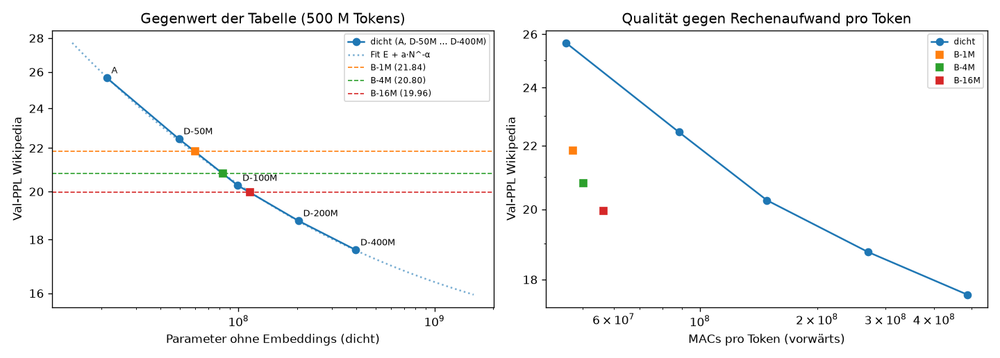

**Was das heißt:**
- **B-16M** ist so gut wie ein dichtes Modell mit ≈ 114 M Parametern, also gut fünfmal so viele wie sein
  Rechenkern (21 M). Pro Token rechnet es aber nur 56,5 M MACs; das gleichwertige dichte Modell bräuchte ≈ 165 M,
  also ≈ 2,9× so viel.
- **Jede Vervierfachung der Tabelle** bringt ≈ 1,4× gleichwertige Größe (60 → 83 → 114 M). Der Gewinn je
  Verdopplung bleibt in diesem Bereich etwa gleich und flacht noch nicht ab.
- **Der Preis dafür ist Speicher:** Die Tabelle von B-16M hat 6,44 Mrd. Parameter, 56-mal so viele wie das
  gleichwertige dichte Modell (114 M; korrigiert 2026-10-05 nach Codex-Review, vorher „dreißigmal“). Im Training brauchte B-16M ≈ 101 GB GPU-Speicher, D-200M 16 GB. Zum Schreiben muss
  die Tabelle aber nicht im Grafikspeicher liegen (Schritt 2).

**Nebenwert WikiText-103, nicht vorab als Kriterium festgelegt:**
- Auf diesem anders formatierten Set ist der Vorteil kleiner. Log-log interpoliert entspricht B-1M ≈ 48 M, B-4M
  ≈ 65 M und B-16M ≈ 95 M.
- Die Tabelle hilft also auf Text wie dem Trainingsmaterial (Wikipedia-Artikel) stärker als auf anderer
  Aufbereitung derselben Quelle.

**Grenzen** (wie vorab genannt):
- Ein Seed je dichter Größe.
- 500 M Tokens sind für 200–400 M Parameter wenig; N_eq gilt nur für dieses Token-Budget.
- Die LR ist nicht je Größe abgestimmt. Das lässt die Tabelle eher zu gut aussehen.
- Tempo-Werte nicht vergleichbar: Die Läufe teilten sich die GPU.

### Ergebnis Schritt 3 (2026-10-05, Runpod H100; Auswertung `scripts/qwen_step3_eval.py` → `report/qwen/step3_summary.json`)

**Ablauf, ehrlich:**
- **Zwei gescheiterte Setups** (≈ 1,40 $):
  - Die CPU-Tests riefen die GPU-only-Kernel von flash-linear-attention auf.
  - Danach verweigerte fla 0.5.2 mit Triton 3.6 den Rückwärtsschritt auf Hopper-GPUs (bekannter Fehler). Behoben
    mit Triton 3.7.1; geprüft mit den Unit-Tests und dem Test am echten Modell mit Regler 0: bitgleich, Training
    läuft.
- **Eigener Fehler, ≈ 7,40 $:** Ein Tippfehler aus einer ungetesteten Änderung an `run_dense.py` ließ die
  Warteschlange beim Start abstürzen. Der Pod lief ≈ 2,1 h leer, weil mein Wächter nur Log-Zeilen beobachtete.
  - Behoben: Vor dem Start werden alle Skripte kompiliert; 90 s nach dem Start wird geprüft, ob die Warteschlange
    lebt; der Wächter meldet eine tote Warteschlange.
- **Grenze erhöht:** Mit Freigabe von 13 $ auf 16,50 $ für den eigentlichen Lauf, nachdem die Tempo-Proben 13,50–15,70 $
  hochrechneten.
- **Standard-Tests von Q+T zunächst fehlgeschlagen:** lm-eval schaltet Autocast um den Modellaufruf ab, die
  fp32-Zusatzblöcke passten dann nicht zu Qwen. Behoben; Q wurde mit derselben Einstellung wiederholt und ergab
  exakt dieselben Werte.
- **Laufender Pod:** 3,92 h ≈ 13,70 $.
- **Schritt 3 insgesamt:** ≈ 22,50 $ (davon ≈ 7,40 $ Leerlauf durch meinen Fehler).
- **Sicherung:** alles auf der Storage Box und zu Hause, sha256 geprüft. Der Pod ist gelöscht.

**Tempo und Speicher (H100):**

| Lauf | Training | Speicher | Dauer (110,5 M Tokens) |
|---|---|---|---|
| Q+T | 32.600 tok/s | 33 GB | 66 min |
| Q+D | 35.800 tok/s | 17 GB | 64 min |

Q ist auf der H100 (mit fla-Kerneln) und zu Hause (PyTorch-Weg) bei der PPL identisch (12,977).

**PPL** (Token-PPL, Fenster 2048):

| Set | Q (Qwen allein) | Q+T (Tabelle) | Q+D (dichte Kontrolle) |
|---|---|---|---|
| `val_new`: zurückgehaltene neue Artikel (entscheidend) | 12,977 | 10,093 (−22,2 %) | **10,014 (−22,8 %)** |
| `val_new`, nur Wissens-Tokens | 16,32 | 12,57 | 12,73 |
| `val_known`: Val-Set 2023, HF-Aufbereitung | 13,935 | **14,904 (+7,0 %)** | 13,730 (−1,5 %) |
| `val_known_same`: alte Artikel, gleiche Aufbereitung | 14,282 | 14,029 (−1,8 %) | 12,930 (−9,5 %) |
| `mem_probe`: trainierte Artikel | 13,362 | **5,638 (−58 %)** | 9,382 (−30 %) |

**Standard-Test** (zero-shot, Genauigkeit in %, ± Standardfehler von lm-eval):

| Aufgabe | Q | Q+T | Q+D |
|---|---|---|---|
| MMLU | 49,7 ± 0,4 | **47,0 (−2,7; Grenze −2,0)** | 49,6 (−0,1) |
| ARC-Easy | 63,2 ± 2,2 | 65,8 (+2,6) | 65,0 (+1,8) |
| ARC-Challenge | 31,0 ± 2,1 | 38,0 (+7,0) | 37,0 (+6,0) |
| HellaSwag | 42,4 ± 2,2 | 41,6 (−0,8) | 42,0 (−0,4) |
| PIQA | 70,2 ± 2,0 | 71,2 (+1,0) | 69,2 (−1,0) |
| WinoGrande | 56,2 ± 2,2 | 58,8 (+2,6) | 57,0 (+0,8) |
| Mittel | 52,1 | 53,7 (+1,6) | 53,3 (+1,2) |

Die Grenze je Aufgabe ist max(2 Pp., 2 × Standardfehler der Differenz). Der Standardfehler der Differenz ist
√(se_Q² + se_X²); so habe ich „2 × Standardfehler“ umgesetzt.

**Faktentest** (exakter Treffer im ersten Versuch; 500 Lücken je Teil):

| | Q | Q+T | Q+D | Q+T − Q+D (95-%-Bootstrap, paarweise) |
|---|---|---|---|---|
| Trainings-Lücken | 4,8 % | 10,2 % | 7,8 % | **+2,4 Pp. [0,4; 4,6]** |
| Gegenprobe (nie gesehen) | 4,0 % | 10,2 % | 8,0 % | +2,2 Pp. [0,2; 4,2] |

**Urteile nach den vorab festgelegten Kriterien:**

| Kriterium | Ergebnis |
|---|---|
| **Hilft es?** (PPL `val_new`) | **„hilft etwas“.** Q+T ist 22 % besser als Q, aber **nicht besser als die dichte Kontrolle** (Q+T/Q+D = 1,008). Für „hilft deutlich“ hätte es ≤ 0,98 sein müssen. |
| **Schadet es? Q+T** | **„schadet“**, ohne dass der Chat-Teil das noch ändern kann. MMLU fällt um 2,7 Pp. (Grenze 2,0), und die PPL auf `val_known` steigt um 7,0 % (Grenze 1 %). Der Mittelwert der sechs Aufgaben steigt dagegen (+1,6 Pp.). |
| **Schadet es? Q+D** | „schadet nicht“ nach Standard-Test und bekannten Texten; der verblindete Chat-Vergleich steht noch aus. |
| **Wissen eingepflanzt?** | **Nicht erreicht.** Q+T trifft nur 2,4 Pp. mehr Trainings-Fakten als Q+D (gefordert ≥ 10). Bei der Gegenprobe ist der Vorsprung genauso groß (+2,2 Pp.); die Tabelle wird also beim Ergänzen allgemein etwas besser, nicht gezielt bei den gesehenen Fakten. |

**Was das bedeutet:**
- **Kein Vorteil gegenüber einem gleich teuren Zusatzblock:** Als Zusatz zu einem fertigen, eingefrorenen Qwen
  bringt die Tabelle in diesem Aufbau keinen Vorteil gegenüber einem kleinen dichten Block mit gleichem
  Rechenaufwand. Beide passen Qwen gleich gut an neue Wikipedia-Texte an.
- **Kein Hinweis auf eingepflanzte Fakten:** Das Add-on mit Tabelle passt sich den Trainingsartikeln als Text sehr
  stark an (PPL auf trainierten Artikeln −58 %, dichte Kontrolle −30 %). Im Faktentest wird es aber bei Trainings-
  und Gegenprobe-Artikeln gleich viel besser. Ein gezielter Abruf trainierter Fakten ist damit nicht nachgewiesen.
  Ob das Gelernte in der Tabelle oder in Keys, Projektionen und Gates steckt, habe ich nicht getestet (korrigiert 2026-10-05 nach Codex-Review;
  vorher „Gespeichert, aber nicht abrufbar“).
- **Nebenwirkungen bei der Tabelle:**
  - MMLU (Wissensfragen) sinkt.
  - Auf dem anders aufbereiteten 2023er Val-Set wird Qwen schlechter.
  - Beides tritt vor allem im 2. Durchgang auf; die Zwischenwerte bei 40 M Tokens waren besser
    (`runs/qwen_cloud/QT-s0/metrics.csv`).
  - Die dichte Kontrolle zeigt diese Nebenwirkungen nicht.

**Grenzen:**
- **Umfang:** ein Seed je Variante, eine Tabellengröße (1 M Zeilen), eine Position (hinter Block 6, 12, 18), ein
  LR-Plan (wie B, nicht für Qwen abgestimmt) und 2 Durchgänge.
- **Chat-Teil:** steht noch aus.
- **Faktentest:**
  - Exakter Treffer im ersten Versuch ist streng.
  - Viele Lücken lassen auch für einen Menschen mehrere richtige Fortsetzungen zu.
  - Ein kleiner Effekt kann darunter verschwinden; ein Vorsprung von 10 Pp. hätte aber sichtbar sein müssen.
- **Wissens-Stichtag:** In der PPL war keiner sichtbar (siehe oben). „Neues Wissen“ ist bei 0,8B-Qwen schwer von
  Stil zu trennen.

## AMD Instinct MI350X: Tests und Tempo auf AMDs Rechenzentrums-GPU (2026-10-05)

**Frage:** Laufen Code und Triton-Kernel unverändert und korrekt auf einer AMD-Rechenzentrums-GPU? Wie schnell?

**Aufbau:**
- **GPU:** Runpod, 1× AMD Instinct **MI350X** (gfx950, 288 GB), Secure Cloud, 5,49 $/h. Geplant war eine MI300X
  (2,39 $/h); die war nicht verfügbar, die MI350X wurde mit Freigabe genommen.
- **Laufzeit und Kosten:** 0,6 h ≈ 3,30 $.
- **Software:** PyTorch 2.13.0+rocm7.1, HIP 7.1, Triton 3.7.1, Python 3.12.
- **Ablauf:** `cloud/setup_amd.sh`, `scripts/run_amd.py`, Auswertung `scripts/amd_summary.py`.
- **Code:** Er wurde unverändert hochkopiert, ohne GitHub (die Historie wurde parallel bereinigt).
- **Ergebnisse:** in `runs/amd_mi350x/`, auf der Storage Box gesichert und zu Hause per sha256 geprüft (62/62
  Dateien gleich).

**Tests:** **107 von 107 bestanden** (10,6 min), darunter:
- alle Kernel-Tests mit Tabellen von 262k / 1M / 4M Zeilen
- Auswahl mit 4096 Keys je Hälfte
- Tabellen mit mehr als 2³¹ Elementen
- Decode-Graphen und Lazy Adam
- Tabelle außerhalb der GPU

**Tempo:**
- **Messaufbau:** jedes Modell allein, 3 M Tokens, gleiche Argumente wie der H100-Probelauf von Schritt 1.
- **H100-Vergleichswerte:** aus `runs/cloud_dense_preflight`.
- **RX 9070:** aus der Optimierung (Abschnitt „Ergebnis der Optimierung“); andere Messart, nur zur Einordnung.

| Modell | Training tok/s | H100 | Speicher-Spitze | Schreiben (Batch 1) tok/s | H100 | Einlesen tok/s | H100 |
|---|---|---|---|---|---|---|---|
| A | 164.900 | – | 7,9 GiB | 266 | – | 2.390.000 | – |
| D-100M | 155.900 | 208.300 | 11,8 GiB | 231 | 192 | 1.171.000 | 844.000 |
| D-400M | 71.800 | 83.000 | 15,3 GiB | 155 | 126 | 497.500 | 332.900 |
| B-1M, PyTorch-Referenz | 77.100 | – | 11,6 GiB | 185 | – | 737.700 | – |
| **B-1M, Triton-Kernel** | **125.900** | – | 10,5 GiB | 210 | – | 1.387.000 | – |
| B-4M, Triton-Kernel | 119.400 | – | 28,6 GiB | 216 | – | 1.094.000 | – |
| **B-16M, Triton-Kernel** | **112.800** | – | **101,0 GiB** | 230 | – | 764.100 | – |

- **Die Kernel helfen auf der MI350X noch mehr als zu Hause:**
  - Training 1,63×, Einlesen 1,88×, Schreiben 1,14× gegenüber der PyTorch-Referenz.
  - Gleiches Ergebnis: Val-PPL nach 3 M Tokens 1168,46 gegenüber 1168,63.
  - B-1M erreicht 76 % des Trainingstempos des Modells ohne Tabelle; auf der RX 9070 waren es 62 %.
- **B-16M passt komplett auf eine Karte:** 101 GiB, 113.000 tok/s. Ein 500-M-Token-Lauf wie in der Cloud dauerte
  allein auf einer MI350X ≈ 75 min, ≈ 7 $.
- **Gegenüber der H100**, gleicher einfacher PyTorch-Code, nicht auf eine der Karten abgestimmt:
  - Das Training dichter Modelle ist auf der MI350X langsamer (0,75× bzw. 0,87×).
  - Schreiben (1,2×) und Einlesen (1,4–1,5×) sind schneller.

**Gleiche Ergebnisse auf drei GPUs:**
- **Vergleichslauf:** B-1M mit Triton-Kerneln, die ersten 20 M Tokens des 500-M-Plans, Seed 0, auf der MI350X.
  Derselbe Lauf existiert von der RX 9070 (`runs/kernel_check/triton_500msched`) und der H200 (`runs/cloud/B-1M-s0`).
- **Ergebnis:** Val-PPL bei 20 M Tokens: MI350X 210,11, RX 9070 208,72, H200 210,75. Bei 22 M: 184,81 gegenüber
  184,56 (RX 9070).
- **Einordnung:** Unterschiede bis ≈ 1 % in dieser frühen Phase sind das bekannte Rauschen durch Gleichstände an der
  Top-k-Grenze und nicht-deterministische Summen (vgl. Optimierung: über 500 M Tokens 0,002 %).
- **Dichte Modelle:** D-100M und D-400M treffen nach 3 M Tokens auf MI350X und H100 dieselbe PPL auf 0,06 %.

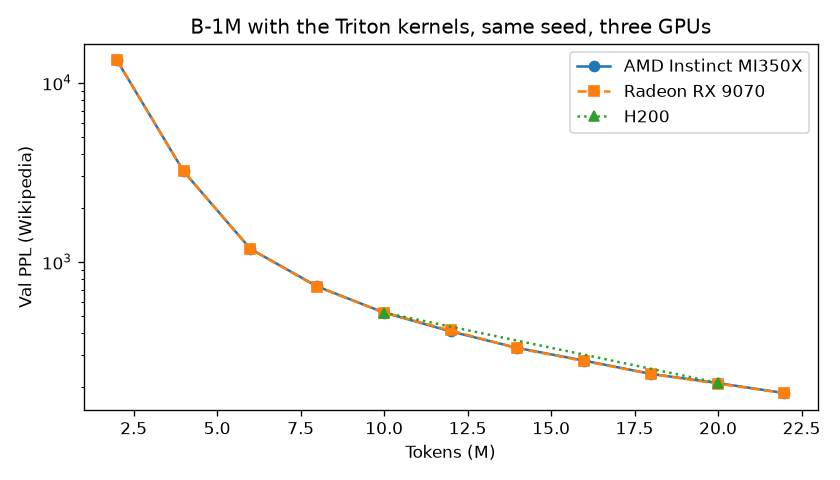

**Grenzen:**
- Je ein kurzer Lauf. Die Tempo-Werte sind Richtwerte und wurden nicht wiederholt.
- PyTorch meldet die Karte als „AMD Radeon Graphics“ (gfx950).
- Das GPU-Log hat auf der MI350X Temperatur (≈ 62 °C Junction) und Takt erfasst, aber keine Leistung. Der
  Speicherwert im Log ist unplausibel und nicht verwendet.

### Einordnung der Kernel (2026-10-05)

**Was stark ist:**
- **Portabel:** Derselbe Triton-Code rechnet auf drei grundverschiedenen GPU-Architekturen gleich: Radeon RX 9070
  (RDNA4, Consumer), Instinct MI350X (CDNA4, Rechenzentrum) und H100/H200 (Hopper).
- **Tests:** Auf der MI350X bestehen alle 107 Tests ohne Änderung.
- **Tempo** gegenüber der eigenen PyTorch-Referenz:

  | | RX 9070 | MI350X |
  |---|---|---|
  | Training | 1,47× | 1,63× |
  | Einlesen | 1,79× | 1,88× |

- **Speicher:** Der Lazy-Adam-Kernel arbeitet in place. Erst damit passt B-16M in 101 GB.

**Was die Kernel nicht sind:**
- **Kein Vergleich mit anderen optimierten Implementierungen**, etwa Metas Code zu „Memory Layers at Scale“.
- **Die Tabelle kostet weiter Zeit:** Mit Tabelle trainiert das Modell mit 62 % (RX 9070) bzw. 76 % (MI350X) des
  Tempos ohne Tabelle.
- **Nicht je GPU abgestimmt**, und nur an kleinen Modellen gemessen.

Ausführlich auf Englisch: `docs/kernels.md`.

## Zum Ausprobieren: Benchmark-Skript, Demo und Hugging Face (2026-10-05)

**Neu:**
- `scripts/kernel_speedup.py`: Kernel gegen PyTorch-Referenz auf zufälligen Tokens, ohne Daten, ~35 s.
- `scripts/demo_generate.py`: B-16M schreibt Text, Tabelle (4 Bit) auf der NVMe, im RAM oder im VRAM.
- README-Abschnitt „Try it“. Die Gewichte (4-Bit-Tabelle + Rest, 3,7 GB) sollen auf Hugging Face.

**Geprüft aus einem frischen Clone auf der RX 9070:**

| PyTorch | Tests | Benchmark (Training / Einlesen / Schreiben) |
|---|---|---|
| CachyOS-Paket (2.14.0, HIP 7.2, Triton 3.5.1) | 106 ok, 2 übersprungen, 41 s | 1,47× / 1,70× / 1,26× |
| offizielles Wheel `rocm7.2` (2.14.1, Triton 3.8.0) | 106 ok, 2 übersprungen, zweimal | 1,53× / 1,75× / 1,27× |
| offizielles Wheel `rocm7.1` (2.13.0, Triton 3.7.1) | **Abbruch** in `test_decode_graph_bit_identical[fp32]` | 1,50× / 1,77× / 1,25× |

Übersprungen werden der Qwen-Test (ohne transformers) und ein Test, der > 60 GB GPU-Speicher braucht.

- **Benchmark-Zahlen:** Die Faktoren liegen nahe an `docs/kernels.md`. Dort wurde aber anders gemessen
  (trainiertes Modell, bf16-Tabelle beim Einlesen), also keine 1:1-Wiederholung.
- **Abbruch mit `rocm7.1`:**
  - Meldung: `HSA_STATUS_ERROR_INVALID_PACKET_FORMAT` („The AQL packet is malformed“).
  - Tritt nur auf, wenn der Test nach den anderen läuft. Allein oder nur mit `tests/test_kernels.py` besteht er.
  - Ein `torch.cuda.synchronize()` vor dem Freigeben der Graphen hat nichts geändert, also wieder entfernt.
  - Ursache nicht eingegrenzt. Auf der MI350X lief dasselbe Wheel ohne Fehler.
  - README empfiehlt deshalb für Radeon `rocm7.2`.
- **`expandable_segments:True`:** Mit `PYTORCH_CUDA_ALLOC_CONF=expandable_segments:True` stürzte das Einlesen
  nach dem Training im reinen PyTorch-Pfad ab (`HSA_STATUS_ERROR_EXCEPTION`). Das Skript ignoriert die Variable
  jetzt. Ursache ebenfalls nicht eingegrenzt.

**Demo (CachyOS-PyTorch):**

| Tabelle | Tempo | GPU-Speicher (Spitze) |
|---|---|---|
| NVMe | 144 tok/s | 0,42 GB |
| VRAM | 207 tok/s | 3,75 GB |

- 200 Tokens, Page Cache warm. Gleicher Text in allen drei Modi.
- Der Text ist flüssiges Wikipedia-Englisch, die Fakten sind erfunden („Sir Isaac Newton was born on
  14 November 1803 …“). Das steht so auch im README.

**Hugging-Face-Ordner:**
- Dateien: `rest.pt`, `values_q4.bin`, `scales_q4.bin`, `hot_rows.npy` (Hardlinks auf die Tabellen-Dateien, sha256
  geprüft), dazu eine neue `meta.json` ohne lokale Pfade und eine Model Card.
- Für den Upload vorbereitet (Stand 2026-10-05).

## Codex-Review (2026-10-05)

Ein zweites Modell (OpenAI Codex) hat den alten Stand `AngryAnt` (`8cf0226`) gelesen und 22 Befunde gemeldet.
Ich habe jede genannte Codestelle nachgeprüft.

**Was sich an den Ergebnissen ändert: nichts.**
- Nach jeder Codeänderung waren bitgleich zu vorher: B-16M-Decode-Logits (Tabelle im VRAM und auf der NVMe),
  B-1M-Trainings-Logits, Loss und Gradienten sowie die Eval-Logits mit fp32-, bf16- und 4-Bit-Tabelle.
- `report/qwen/step3_summary.json` kommt unverändert heraus.
- Die strengere Faktbewertung ändert keine der 4 × 1.000 gespeicherten Antworten.

| Nr. | Befund | Stimmt? | Erledigt |
|---|---|---|---|
| 1 | Qwen-Queue meldet „fertig“ trotz gescheiterter Auswertung | ja | „fertig“ und `COMPLETE` nur, wenn alle 11 Schritte gelaufen sind, sonst „UNVOLLSTÄNDIG“ mit Liste; `run_dense` genauso |
| 2 | `bag_infer` liest über das Ende, wenn Heads × knn kein Vielfaches von 64 ist | ja, 4 × 32 = 128 nicht betroffen | letzter Block maskiert (auch `bag_forward`); Tests mit 96, 48, 40 Lookups und 3 Heads, die alte Version stürzt dabei ab |
| 3 | mehrere neue Tokens nach gefülltem KV-Cache ohne Kausalmaske | ja, nur Chunk-Prefill | Maske mit Versatz, Test gegen vollen Forward |
| 4 | Neustart nimmt leere oder halbe Dateien als fertig | ja | Prüfung (nicht leer, gültiges JSON, Status), atomares Schreiben (`smlm/atomic.py`); Dense- und Cloud-Queue: „done“ ohne `model.pt` wird gemeldet statt übersprungen oder neu trainiert. Eine Laufidentität aus Konfigurations- und Datenhash fehlt weiterhin |
| 5 | Budget-Hochrechnung nach Neustart mit 0 h Auswertung | ja | Schrittzeiten in `step_minutes.json` |
| 6 | Auswertung liest fest `Q/general_ac.json` | ja | ohne diese Datei `Q/general.json` |
| 7 | Schritt-Push ohne die Ergebnisdateien | ja | Ergebnisdatei wird mitgepusht |
| 8 | eingefrorene Tabelle wird trotzdem trainiert, Tabelle allein nicht trainierbar | ja | beides behoben, Tests |
| 9 | Optimizer-Zustand wird beim Laden falsch übernommen | ja | `load_state_dict` bricht jetzt mit Fehler ab (Training wird nie fortgesetzt) |
| 10 | BatchNorm im Training nicht präfixkausal | ja | als Grenze im README; alle berichteten PPL im Eval-Modus mit laufender Statistik |
| 11 | statistische Sicherheit überbehauptet | ja | „echt“ und „belastbar“ umformuliert, Bereiche als Sensitivitätsbereich benannt |
| 12 | „Gespeichert, aber nicht abrufbar“ erklärt mehr als gemessen | ja | umformuliert: gezielter Abruf nicht nachgewiesen, Ort des Gelernten nicht getestet |
| 13 | Parität in Kurzfassungen überzogen | ja | README präzisiert (Decoding: Tabellenmodell mit, Modell A ohne Graphen; Kernel „bis auf Rundung“); `final.md` ist privat |
| 14 | MI350X-Nachtrag nicht belegbar | nein | im Rewrite liegen `runs/amd_mi350x` und der Abschnitt oben; Codex hat den alten Ordner geprüft |
| 15 | „12“ zählt als richtig für „12.5“ | ja | Regel verschärft, Regressionstest |
| 16 | nicht unterstützte Größen scheitern erst im Kernel | ja | `mem_impl="triton"` prüft im Konstruktor und meldet klar |
| 17 | Batch-Teilbarkeit im Qwen-Training, `zero_grad` ohne Wirkung | ja | wird geprüft bzw. ist dokumentiert |
| 18 | Offload-Bitgleichheit nur über die NLL-Summe belegt | ja | Logits direkt verglichen (`scripts/check_offload_identical.py`): bitgleich mit Triton 3.5; mit Triton 3.8 weichen sie in den letzten Bits ab, gleiche Tokens |
| 19 | „dreißigmal“ statt 56-mal, GB statt GiB, 4-GB-Scope | ja | korrigiert, Fußnote zur Scope |
| 20 | v2-Status, Bildlink, „widerlegt“ | ja | korrigiert |
| 21 | Qwen-Läufe ohne Commit und Versionen | ja | `run-info.json` enthält beides jetzt; Datierung über Seiten-IDs im README genannt |
| 22 | Fit ist kein exakter Log-Fit | ja | Beschreibung korrigiert; ein exakter Log-Fit verschiebt die Fit-Werte um höchstens 0,3 M (58,5 / 83,4 / 115,7 M) |

**Neu beim Nachprüfen von 18:** Mit dem offiziellen `rocm7.2`-Wheel (Triton 3.8) rechnet `bag_infer` auf der
kleinen Staging-Tabelle (RAM/NVMe) in anderer Reihenfolge als auf der vollen Tabelle (VRAM).
- Gegen eine exakte fp64-Summe liegen beide gleich nah, mit einer Abweichung von ≈ 1e-8.
- Die Logits weichen dadurch um bis zu 0,44 ab (wenige bf16-Stufen). Die gierig erzeugten Tokens waren in allen
  Prüfungen gleich (`report/offload/identical_check_triton38.json`).
- Mit Triton 3.5 ist alles bitgleich.

**Nicht gemacht, das wären neue Experimente:** weitere Seeds, Tabellen-Ablation am Qwen-Add-on, Modell A mit
Graphen, kausale Normierung statt BatchNorm.

**Geprüft:**
- 127 Tests auf der RX 9070, aus einem frischen Clone mit dem `rocm7.2`-Wheel.
- Die Qwen-Tests (8) in `.venv-qwen`.
- Die Kernel-Tests zu den betroffenen Kerneln zusätzlich im CPU-Interpreter.
- Die Queue-Logik ohne Pod: `tests/test_cloud_queue.py` und der Fake-Modus von `run_dense.py`.

## Schritt 4: n-Gramm-Tabelle (Engram) gegen Product Keys (Kriterien vor dem Lauf festgelegt, 2026-10-07)

**Frage:** Seit Ende August hat Qwen3.8-Flash-Next eine große n-Gramm-Tabelle, die auf der SSD liegen kann (Prinzip
Engram, Cheng et al. 2026). Die Zeilen werden dort über die letzten 2–3 Tokens ausgesucht, bei uns über den Hidden
State (Product Keys). Welche Art der Zeilenauswahl bringt bei gleich großer Tabelle mehr?

**Aufbau, festgelegt und nicht anhand kurzer Probeläufe abgestimmt:**
- **Modell E-1M** (`smlm/engram.py`, Preset `E-1M`):
  - Modell A plus zwei Engram-Module, vor der Attention auf den Residual-Strom addiert, die FFN bleibt.
  - Lage: Layer 2 und 6 (0-basiert 1 und 5), früh und mittig wie im Paper (Layer 2 und 15 von ~30). Gewählt nach
    dieser Analogie, nicht abgestimmt.
  - Pro Modul n-Gramme der Ordnung 2 und 3 mit je 8 Hash-Köpfen. Jeder Kopf hat eine eigene Tabelle mit 524.287
    Zeilen (Primzahl) zu 24 Werten, das ergibt 16 Zeilen pro Token und Modul, aneinandergehängt 384 Werte.
  - Token-Kompression NFKC + Kleinschreibung auf den GPT-2-Tokens: 39.393 statt 50.304 Ids (−22 %).
  - Context-aware Gate auf dem Hidden State, kausale Depthwise-Faltung (Kern 4, Dilation 3, mit null initialisiert).
  - Tabellen zusammen **402.652.416 Parameter**, B-1M hat 402.653.184. Dichter Teil 21,84 M (A: 21,24 M).
- **Training:** exakt die Argumente von B-1M-sparse (`runs/hampter`): Wikipedia, 500 M Tokens, Daten-Seed 1234,
  Batch 32 × 1024, LR 6e-4, Eval alle 10 M Tokens, WikiText-103 als Nebenwert. Geändert sind nur `--model` und die
  Tabellen-LR **3e-3** (Paper: 5 × LR).
- **Optimizer der Tabellen:** zeilen-sparsam mit Lazy Adam, wie die Product-Key-Tabelle. **Abweichung vom Paper**
  (dort normales Adam): Hier wird pro Schritt nur ein kleiner Teil der Zeilen gelesen, Lazy oder normales Adam kann
  also mehr ausmachen als bei Product Keys. Deshalb gibt es einen Kontrolllauf mit normalem Adam.
- **Läufe** (zu Hause, RX 9070, `scripts/run_engram.py`, Ausgabe `runs/engram/`):
  - E-1M Seed 0 und Seed 1: Hauptvergleich.
  - E-1M-dense Seed 0: Kontrolle, normales Adam auf allen Zeilen, ein Seed.
- **Nicht in diesem Schritt:** beide Tabellen zusammen (Preset BE-1M) passt mit ~12 GiB nur für Tabellen- und
  Optimizer-Zustand nicht auf die 16-GB-Karte. Kommt später auf einer größeren GPU.

**Kriterien:**
- **Haupturteil:** Val-PPL Wikipedia nach 500 M Tokens, Mittel aus 2 Seeds, E-1M gegen B-1M-sparse (21,837 / 21,752,
  Mittel 21,794). Die gemessene Seed-Spanne liegt bei ~0,4 %.
  - **„E besser“:** E ≤ 0,99 × B.
  - **„gleichauf“:** E innerhalb ±1 % von B.
  - **„B besser“:** E ≥ 1,01 × B.
- **Gegen A** (25,665 / 25,756, Mittel 25,711): Verbesserung in % und gleichwertige dichte Größe mit derselben
  Interpolation wie bei B (B-1M: 60 M).
- **Kontrolle Optimizer:** Ist E-1M-dense-s0 ≤ 0,99 × E-1M-s0, benachteiligt Lazy Adam die n-Gramm-Tabelle. Dann
  wird das Haupturteil zusätzlich mit dem Dense-Wert angegeben, als Hinweis mit nur einem Seed.
- **Berichtet, aber ohne Urteil:**
  - WikiText-103-Val-PPL (B-1M-sparse: 65,51 / 65,09).
  - Trainingstempo auf der RX 9070 (B-1M mit Kerneln: ≈ 59.700 tok/s) und Spitze des GPU-Speichers.
  - Gelesene Tabellenwerte pro Token: E 2 × 16 × 24 = 768, B 3 × 128 × 384 = 147.456 (192-mal mehr). Das ist für
    das Auslagern auf RAM oder SSD wichtig, wird hier aber nicht gemessen.
  - Anteil der Tabellenzeilen, die im Val-Set gelesen werden.

**Vorbehalt, vorab festgehalten:** Engram ist für viel größere Modelle und Tabellen gebaut (Paper: 5,7 Mrd.
Tabellenparameter). Bei 0,4 Mrd. in 16 × 524.287 kleinen Zeilen teilen sich viele n-Gramme eine Zeile. Verliert E
hier, sagt das etwas über diesen Maßstab und diese Konfiguration, nicht über Engram allgemein. Ebenso nicht übernommen:
die Hyper-Connections (mHC) des Papers.

**Probeläufe vor der Freigabe (nur Technik, keine Abstimmung):**
- Kompletter Durchlauf über 4 M Tokens inkl. Auswertung, Checkpoint und Inferenz-Benchmark für E-1M und E-1M-dense.
- Ganze Warteschlange mit Mini-Läufen (`--smoke`).
- Tempo: E-1M ≈ 79.000 tok/s (≈ 1,9 h pro Lauf), E-1M-dense ≈ 64.000 tok/s (≈ 2,3 h). Speicher je ≈ 10,5 GiB.

### Ergebnis Schritt 4 (2026-10-08, RX 9070, `scripts/engram_eval.py` → `report/engram/summary.json`)

Die drei Läufe liefen über Nacht nacheinander (7.10. 20:18 bis 8.10. 02:22), allein auf der Karte: Nichts anderes hat
die GPU benutzt, das Tempo blieb über den ganzen Lauf gleich. Keine Fehler, kein Hänger.

| Lauf | Val-PPL Wikipedia | Val-PPL WikiText-103 | Training tok/s | Spitze GPU-Speicher (Training) |
|---|---:|---:|---:|---:|
| E-1M Seed 0 | 23,133 | 71,04 | 78.879 | 10,49 GiB |
| E-1M Seed 1 | 23,105 | 70,57 | 78.961 | 10,49 GiB |
| E-1M-dense Seed 0 (Kontrolle, normales Adam) | 22,694 | 68,09 | 64.334 | 10,47 GiB |
| B-1M-sparse Seed 0 / 1 (Referenz) | 21,837 / 21,752 | 65,51 / 65,09 | ≈ 59.700 mit Kerneln | 10,52 GiB |
| A Seed 0 / 1 (ohne Tabelle) | 25,665 / 25,756 | 78,38 / 78,48 | 91.563 / 91.641 | 7,89 GiB |

**Urteil nach den Kriterien: „B besser“.**
- **Haupturteil:** E-1M liegt im Mittel bei 23,119, B-1M bei 21,794, also E = **1,061 × B**, weit außerhalb der
  ±1-%-Spanne. Die beiden Engram-Seeds liegen nur 0,12 % auseinander.
- **Kontrolle Optimizer: Lazy Adam benachteiligt die n-Gramm-Tabelle tatsächlich.** E-1M-dense-s0 liegt bei
  0,981 × E-1M-s0, also unter der Linie von 0,99. Wie vorab festgelegt, das Haupturteil mit dem Dense-Wert (ein Seed,
  nur ein Hinweis): 22,694 = **1,041 × B**, ebenfalls „B besser“.
- **Gegen A:** E-1M ist 10,1 % besser als A (B-1M: 15,2 %). Gleichwertige dichte Größe mit derselben Interpolation wie
  in Schritt 1:

| | Val-PPL | Gleichwertige dichte Größe | Empfindlichkeitsbereich (±0,4 %, inkl. Fit) |
|---|---:|---:|---:|
| A (ohne Tabelle) | 25,71 | 21 M | |
| E-1M (Mittel aus 2 Seeds) | 23,12 | **41 M** | 39–43 M |
| E-1M-dense (1 Seed) | 22,69 | **46 M** | 44–49 M |
| B-1M-sparse (Mittel aus 2 Seeds) | 21,79 | **61 M** | 57–64 M |

**Berichtet ohne Urteil:**
- **WikiText-103:** dieselbe Reihenfolge, E-1M im Mittel 70,8, E-1M-dense 68,1, B-1M 65,3.
- **Tempo:** E-1M trainiert mit ≈ 78.900 tok/s, ≈ 1,3-mal so schnell wie B-1M mit den Kerneln (≈ 59.700) und mit
  86 % des Tempos von A. Die Dense-Kontrolle ist langsamer (64.300), weil normales Adam in jedem Schritt alle 403 M
  Tabellenwerte anfasst. (Die B-1M-Läufe in `runs/hampter` liefen über den PyTorch-Weg mit ≈ 38.500 tok/s; fair ist
  der Vergleich mit Kerneln.) Die Speicherspitze ist bei allen Tabellenmodellen gleich, ≈ 10,5 GiB.
- **Gelesene Tabellenwerte pro Token:** E 768, B 147.456, bei B also 192-mal mehr.
- **Anteil der Tabellenzeilen, die im Val-Set gelesen werden:** E-1M 74 % (Bigramm-Köpfe 62 %, Trigramm-Köpfe 86 %),
  B-1M praktisch 100 %. Bei E hängen die Zeilen nur an den Tokens, die Zahl kommt also direkt aus dem Hash.

**Verlauf bei gleichen Tokens, kein Kriterium:**

| Tokens | E-1M (Mittel) | E-1M-dense | B-1M (Mittel) | E / B | E-dense / B |
|---|---:|---:|---:|---:|---:|
| 100 M | 39,95 | 38,89 | 39,25 | 1,018 | 0,991 |
| 200 M | 30,50 | 29,84 | 29,60 | 1,030 | 1,008 |
| 300 M | 26,56 | 26,02 | 25,40 | 1,046 | 1,025 |
| 400 M | 24,15 | 23,70 | 22,87 | 1,056 | 1,037 |
| 500 M | 23,12 | 22,69 | 21,79 | 1,061 | 1,041 |

Die n-Gramm-Tabelle ist am Anfang schnell: Die Dense-Kontrolle lag bis etwa 150 M Tokens knapp vor B-1M. Bei 100 M
ist der Vorsprung unter 1 %, etwa so groß wie der Abstand der beiden Engram-Seeds an dieser Stelle, ich lese also
nicht viel hinein. Danach zieht B-1M stetig davon, und der Abstand wächst am Ende immer noch. Diesen Vergleich hatte
ich nicht vorab festgelegt, und die Kontrolle hat einen Seed.

**Was hier verglichen wird:** zwei ganze Architekturen mit gleich großer Tabelle und gleichem Training, nicht nur
zwei Arten, Zeilen auszuwählen.
- **E-1M** behält die FFN in allen 12 Layern und fügt zwei Module vor der Attention von Layer 2 und 6 hinzu.
- **B-1M** ersetzt die FFN in Layer 3, 7 und 11 durch Memory-Layer.
- **Lesen pro Token:** E liest 768 Tabellenwerte, B 147.456.
- **Zeilen:** E hat 16 × 524.287 kleine Zeilen zu 24 Werten, in denen sich viele n-Gramme eine Zeile teilen; B hat
  1 M Zeilen zu 384 Werten, die sich die drei Layer teilen.

„B besser“ heißt also: Dieses Product-Key-Paket schlägt dieses Engram-Paket in dieser Größe. Welche einzelne Zutat
den Unterschied macht, sagt es nicht.

**Was ich daraus lese:**
- **Schritt 7 hatte eine Frage offen gelassen:** Ein großer Teil dessen, was die Tabelle von B-1M liefert, lässt
  sich aus den letzten zwei Tokens vorhersagen (drei Viertel des Gewinns in Perplexity, 61 % im Verlust). Kann ein
  Modell, das von Anfang an mit n-Gramm-Zeilen lernt, den kontextabhängigen Rest woanders ausgleichen? Nur zum Teil.
  Gegen A gemessen holt E-1M 66 % des Gewinns von B-1M, E-1M-dense 77 %. (Eine andere Referenz als in Schritt 7, das
  gegen ein Modell mit abgeschalteter Tabelle gemessen hat; die beiden Prozentzahlen sind nicht direkt vergleichbar.)
  Für den Rest braucht es Zeilen, die nach dem Kontext ausgesucht werden.
- **Lazy Adam kostet die n-Gramm-Tabelle etwa 2 %,** bei Product Keys waren es nur 0,16 %, innerhalb des
  Seed-Rauschens (Stufe 1c). Ein möglicher Grund: Eine n-Gramm-Zeile kommt selten und nur für ihr eigenes n-Gramm dran,
  und normales Adam bewegt sie in den Schritten dazwischen mit dem verbliebenen Momentum weiter. Mit einem Seed lasse
  ich es dabei.
- **Fürs Auslagern ist das Bild umgekehrt:** E liest pro Token 192-mal weniger Werte, und welche, steht schon vor dem
  Layer fest. Für eine Tabelle auf der SSD ist das ein echter Vorteil von Engram, den dieser Lauf nicht gewichtet.
- **Der vorab festgehaltene Vorbehalt gilt weiter:** Engram ist für viel größere Modelle und Tabellen gebaut. Dieses
  Ergebnis gilt für 0,4 Mrd. Tabellenparameter an einem 21-M-Modell und 500 M Tokens, nicht für Engram allgemein.

## Nachtrag Schritt 3: Wo steckt das Gelernte von Q+T? (Tabellen-Ablation, Kriterien vor der Messung, 2026-10-07)

**Frage:** Q+T passt sich den Trainingsartikeln viel stärker an als Q+D (PPL auf trainierten Artikeln −58 % statt
−30 %). Steckt das in der Wertetabelle oder in Keys, Query-Projektion, BatchNorm, swilu und Gates? Bisher nicht
getestet (Codex-Befund 12).

**Messung** (zu Hause, RX 9070, `scripts/qwen_table_ablation.py`, kein Training): dasselbe trainierte Add-on
`runs/qwen_cloud/QT-s0/addons.pt` in drei Varianten.
- **T:** wie trainiert, zu Hause neu gemessen, damit alle Vergleiche von derselben Karte kommen.
- **Z (Hauptvariante):** Wertetabelle auf null, alles andere unverändert. Die Add-on-Blöcke liefern dann nur noch den
  Bias ihrer Ausgabeprojektion.
- **R:** Wertetabelle neu gezogen, mit derselben Verteilung wie beim Start des Trainings (Normal, σ = 1/√1024).
- **Gemessen:** PPL auf `mem_probe` (Ausschnitt der Trainingsartikel), `val_new` (neue, nie trainierte Artikel) und
  `val_known` (Artikel von vor dem Qwen-Stichtag), dazu der Faktentest (je 500 Lücken aus Trainings- und
  Gegenprobe-Artikeln). Vergleichswert Q: zu Hause gemessen (`runs/qwen/Q-base`, `report/qwen/facts_Q_home.json`).

**Kriterien:**
- **Anteil der Tabelle** am Gewinn je PPL-Satz, auf log-PPL: s = (ln Z − ln T) / (ln Q − ln T). Bei s = 1 geht mit
  der Tabelle der ganze Gewinn gegenüber Qwen allein verloren, bei s = 0 nichts.
  - **„überwiegend in der Tabelle“:** s ≥ 0,5.
  - **„geteilt“:** 0,2 < s < 0,5.
  - **„überwiegend im Rest“:** s ≤ 0,2.
- **Hauptsatz** ist `mem_probe` (die Frage nach dem auswendig Gelernten), `val_new` und `val_known` werden genauso
  berichtet.
- **Faktentest:** Trefferquote von T, Z und Q mit gepaarten Bootstrap-Intervallen (95 %) für T − Z. Nur wenn das
  Intervall die Null ausschließt, heißt es „Faktengewinn hängt an der Tabelle“.
- **R** wird berichtet, ohne Urteil. R zeigt, ob das Modell den Inhalt der Tabelle braucht oder nur Werte dieser
  Größenordnung; R schlechter als Q spräche dafür, dass der Rest auf die trainierte Tabelle abgestimmt ist.

**Ergebnis** (2026-10-07, RX 9070, 47 min, `report/qwen/table_ablation.json`):

| | Q (Gates 0) | T (trainiert) | Z (Tabelle 0) | R (Tabelle zufällig) | Anteil s der Tabelle |
|---|---|---|---|---|---|
| PPL `mem_probe` (Trainingsartikel) | 13,363 | 5,640 | 12,772 | 12,870 | **0,95** |
| PPL `val_new` (neue Artikel) | 12,977 | 10,095 | 12,388 | 12,485 | **0,82** |
| PPL `val_known` (alte Artikel) | 13,935 | 14,903 | 13,400 | 13,499 | 1,58 |
| PPL `val_known_same` | 14,282 | 14,031 | 13,706 | 13,823 | −1,33 |
| Faktentest Training | 25/500 (zu Hause) | 51/500 | 23/500 | 25/500 | |
| Faktentest Gegenprobe | 19/500 (zu Hause) | 48/500 | 22/500 | 21/500 | |

- **Kontrollen:** Q über Gates 0 trifft die bisherigen Q-Werte auf alle Stellen. T trifft die Cloud-Messung
  (5,638 / 10,093).
- **Urteil `mem_probe`: „überwiegend in der Tabelle“** (s = 0,95). Ohne Tabelle ist fast die ganze Anpassung an die
  Trainingsartikel weg (13,36 → 5,64 → 12,77).
- **`val_new`: ebenfalls „überwiegend in der Tabelle“** (s = 0,82).
- **`val_known`:** Die Verschlechterung auf alten Artikeln (+7 %) kommt ganz aus der Tabelle. Ohne Tabelle ist das
  Add-on dort sogar 3,8 % besser als Qwen allein (s > 1).
- **`val_known_same`:** T ist nur 1,8 % besser als Q, ohne Tabelle 4 % besser. Die Tabelle schadet hier gegenüber dem
  Rest des Add-ons, deshalb ist s negativ und nicht sinnvoll als Anteil zu lesen.
- **Faktentest: „Faktengewinn hängt an der Tabelle“.** T − Z = +5,6 Pp. [3,0; 8,2] bei Trainingsartikeln und
  +5,2 Pp. [3,2; 7,4] bei der Gegenprobe. Ohne Tabelle fällt das Add-on auf das Niveau von Qwen allein zurück.
  Der Gewinn ist bei Trainings- und Gegenprobe-Artikeln gleich groß, die Tabelle hilft also allgemein beim
  Vervollständigen von Wikipedia-Fakten, nicht gezielt bei den trainierten.
- **R ≈ Z:** Eine zufällige Tabelle hilft so wenig wie keine. Das Modell nutzt den gelernten Inhalt, nicht nur Werte
  dieser Größenordnung.
- **Der Rest des Add-ons ohne Tabelle** bringt auf allen Sätzen gleichmäßig ≈ 4 %. Mit Tabelle null liefern die
  Blöcke nur noch den gelernten Bias ihrer Ausgabeprojektion, also eine feste Verschiebung pro Block, eine allgemeine
  Anpassung an Wikipedia-Text.

**Was das bedeutet:** Der Gewinn braucht die gelernte Tabelle. Ohne sie verliert das Add-on das Auswendiggelernte
der Trainingsartikel, die Anpassung an neue Artikel, den Gewinn im Faktentest und auch den Schaden auf älterem Text.
Genau genommen schneidet eine Nulltabelle aber auch alles ab, was die trainierten Keys, Queries und
SwiLU-Projektionen tun, weil sie nur über die Tabelle wirken. Gezeigt ist also: Der Gewinn steckt im gemeinsam
trainierten Tabellen-System, nicht dass er allein in den Tabellenwerten liegt. Offen bleibt der Befund aus Schritt 3:
Die gespeicherten Artikel machen die *trainierten* Fakten nicht besser abrufbar als andere. (Geschärft am 2026-10-07
nach einem Review: Die erste Fassung sagte „Die Tabelle ist der Speicher“ und die Frage „Wo steckt es?“ sei
beantwortet; das geht weiter als die Daten.)

## Schritt 5: Tabellenzeilen auf der SSD umsortieren (offline durchgerechnet, Kriterien vor der Messung, 2026-10-07)

**Frage:** Läuft B-16M mit der Tabelle auf der SSD, kostet jede Zeile, die nicht im RAM liegt, eine ganze 4-KB-Seite,
obwohl eine Zeile nur 192 Byte groß ist. Ein Leserkommentar hat es so gesagt: Die Seitenkosten pro fehlender Zeile
sind vor allem ein Problem der Anordnung. Liest B-16M deutlich weniger Seiten, wenn Zeilen, die zusammen gelesen
werden, auf derselben Seite liegen?

**Idee:**
- Zeile r = i · 4096 + j, wobei i und j die Nummern der beiden Teilschlüssel sind. Pro Kopf und Token kommen die
  32 Zeilen aus nur etwa 14 verschiedenen i (32 der Validierungs-Sitzungen, angeschaut beim Testen des Aufzeichners,
  nur die heutige Anordnung).
- Zeilen mit gleichem i liegen schon heute im selben 768-KB-Block, aber auf zufälligen Seiten darin. Sortiert man die
  j-Achse um, für alle i gleich, sodass oft gemeinsam gewählte j nebeneinander liegen, können Zeilen mit gleichem i
  eine Seite teilen.
- Das Modell bleibt exakt dasselbe: Die Teilschlüssel der zweiten Hälfte werden in jedem Kopf und jeder
  Speicherschicht gleich vertauscht, die Tabellenzeilen passend dazu. Keine Umrechnungstabelle, kein Mehraufwand
  beim Lesen.
- Spiegelbildlich: Tabelle transponieren (j außen) und die i-Achse umsortieren.

**Aufbau, festgelegt vor der ersten echten Zahl:**
- **Aufgezeichnete Zugriffe** (`scripts/record_lookups.py`): welche Zeilen B-16M liest, für Sitzungen von 384 Tokens
  (128 Prompt + 256 weitere, wie bei der Latenzmessung), 4-Bit-Tabelle, Teacher Forcing (die Fortsetzung ist echter
  Text, nicht die eigenen Tokens des Modells). 4.608 Sitzungen aus dem Trainingstext, 1.000 aus dem Validierungstext,
  an zufälligen Stellen mit festem Seed.
- **Simulation** (`scripts/rs_layout.py`, ohne SSD, ohne GPU), gleiche Einstellung wie bei der Latenzmessung:
  - die 30 % meistgelesenen Zeilen (`hot_rows.npy`) liegen im RAM, alle anderen kommen von der SSD;
  - eine einmal gelesene Seite bleibt bis zum Ende der Sitzung im Seiten-Cache, jede Sitzung beginnt kalt;
  - gezählt werden verschiedene 4-KB-Seiten pro Sitzung, eine Zeile über einer Seitengrenze kostet beide Seiten.
- **Anordnungen:** A0 heute (i außen); AJ: i außen, j-Achse umsortiert; AI: j außen, i-Achse umsortiert.
- **AJ und AI lernen** aus 4.096 Trainings-Sitzungen: wie oft zwei Zeilen außerhalb des RAM mit gleichem i (AJ) bzw.
  gleichem j (AI) in derselben Sitzung gelesen werden. Daraus auf zwei Arten eine Reihenfolge: spektral
  (Fiedler-Vektor) und gierig (immer die Nummer anhängen, die am häufigsten mit den letzten 21 platzierten zusammen
  gelesen wurde; auf eine Seite passen 21,3 Zeilen). Vier Kandidaten.
- **Auswahl:** Die 512 übrigen Trainings-Sitzungen entscheiden, welcher der vier Kandidaten genommen wird (wenigste
  Seiten pro Sitzung). Die 1.000 Validierungs-Sitzungen werden genau einmal ausgewertet, mit dem gewählten.

**Kriterien:**
- **Hauptmaß:** Seiten pro Sitzung, gewählte Anordnung gegen A0, relative Änderung über die 1.000
  Validierungs-Sitzungen, 95-%-Bootstrap-Intervall über die Sitzungen.
  - **„Lohnt sich“:** ≥ 25 % weniger Seiten. Dann wird die umsortierte Tabelle gebaut, auf gleiche Ausgaben geprüft
    und auf der SSD gemessen (Prompt-Zeit, Latenz pro Token, Lesezugriffe).
  - **„Kleiner Gewinn“:** 10–25 % weniger. Nur zusammen mit schnellerem Einlesen (Direct-I/O) weiterverfolgen.
  - **„Anordnung ist nicht der Hebel“:** < 10 % weniger. Dann beim Einlesen selbst ansetzen (Direct-I/O, io_uring).
- **Berichtet ohne Urteil:** dasselbe ohne RAM-Cache; Seiten im Prompt und neue Seiten pro weiterem Token getrennt;
  alle vier Kandidaten auf den 512 Trainings-Sitzungen.

**Vorbehalte:** Es ist eine Simulation. Ein echter Seiten-Cache kann Seiten verwerfen, und die SSD fasst benachbarte
Seiten zu einer Anfrage zusammen, weniger Seiten heißen also nicht automatisch im selben Maß weniger Zeit. Teacher
Forcing auf echtem Text statt erzeugtem Text. Ein Modell (B-16M), eine Cache-Größe.

### Ergebnis Schritt 5 (2026-10-07, offline, `report/rs/`)

- **Urteil: „Anordnung ist nicht der Hebel“.** Die gewählte Anordnung (AI, gierig) liest **1,8 % weniger Seiten** pro
  Sitzung als die heutige [95-%-Intervall −1,9; −1,8], weit unter der 10-%-Schwelle. Die umsortierte Tabelle wird
  nicht gebaut.
- 1.000 Validierungs-Sitzungen à 384 Tokens:

| | Heute (A0) | Umsortiert (AI gierig) | Änderung |
|---|---:|---:|---:|
| Seiten pro Sitzung, 30 % der Zeilen im RAM | 26.762 | 26.276 | −1,8 % |
| davon im Prompt (128 Tokens) | 9.648 | 9.495 | |
| Neue Seiten pro weiterem Token | 66,9 | 65,6 | |
| Seiten pro Sitzung, nichts im RAM | 100.515 | 96.767 | −3,7 % |

- Auswahl auf den 512 Trainings-Sitzungen: AJ spektral −0,4 %, AJ gierig −1,7 %, AI spektral −0,3 %, AI gierig
  −1,8 %.
- **Warum so wenig** (100 der Trainings-Sitzungen): Eine Sitzung liest rund 26.500 verschiedene Zeilen außerhalb des
  RAM, verteilt auf rund 3.770 der 4.096 i-Blöcke mit je etwa 7 Zeilen, und braucht dafür rund 26.400 Seiten:
  praktisch eine Seite pro Zeile. Welche j zusammen gelesen werden, hängt von Anfrage und Kopf ab. Schon in nur
  200 Sitzungen wurden 96 % aller 16,8 Mio. möglichen j-Paare mindestens einmal mit gleichem i zusammen gelesen. Eine
  feste Reihenfolge hat nichts, woran sie sich halten kann.
- **Was das bedeutet:** Mit den hier getesteten Anordnungen (eine feste Reihenfolge einer Index-Achse) kostet
  praktisch jede Zeile, die nicht im RAM liegt, einen eigenen zufälligen Lesezugriff. Das schließt nicht jede denkbare
  Anordnung aus, aber es gibt wenig stabile Struktur, die man nutzen könnte. (Geschärft am 2026-10-07 nach einem
  Review: Die erste Fassung sagte „egal wie die Tabelle angeordnet ist“.) Helfen kann nur: weniger Fehlzugriffe (mehr Zeilen im RAM, Vorab-Laden) oder mehr
  Lesezugriffe pro Sekunde. Der Kurzlauf des Direct-I/O-Messprogramms (`scripts/bench_table_io.py`, Branch
  `codex/dio`) gibt io_uring 1,4–1,8-mal so viele Lesezugriffe pro Sekunde wie mmap; das ist der nächste Schritt.
  (Der Langlauf dazu steht im „Nachtrag zu Schritt 5“ am Ende, ergänzt am 2026-10-11.)
- **Plausibilitätsprüfung:** Die Latenzmessung hat für den kalten Prompt 8.059 Lesezugriffe des Geräts gezählt
  (Simulation: 9.648 Seiten) und rund 31 pro weiterem Token (Simulation: 67). Die SSD fasst benachbarte Seiten zu einer
  Anfrage zusammen, und die Messung lief mit dem eigenen Text des Modells weiter, der sich mehr wiederholt als echter
  Text. Vergleichbar ist also nur die Größenordnung.

## Schritt 6: Erinnern sich die von Grund auf trainierten Modelle an gesehene Fakten? (Faktentest, Kriterien vor der Messung, 2026-10-07)

**Frage:** In Schritt 3 hat das Tabellen-Add-on für Qwen das Gelernte gespeichert, die trainierten Fakten aber nicht
besser zurückgebracht als andere (Nachtrag zu Schritt 3). Meine Vermutung: Ein eingefrorener Qwen-Kern weiß nicht,
wie oder wo er sie holen soll. Deshalb jetzt die Modelle, die von Anfang an mit Tabelle gelernt haben: Bringt B-16M
Fakten aus Artikeln, die es im Training gesehen hat, besser zurück als Fakten aus nie gesehenen Artikeln, und zwar um
mehr als gleich gute dichte Modelle?

**Aufbau:**
- **Aufgaben** (`scripts/make_fact_cloze_lm.py` → `data/lm_fact_cloze.jsonl`, sha256 `9c02b5b0…2673`), gleiche
  Regeln wie in Schritt 3: Namen, Daten/Jahre, Zahlen; Prompt = Titel + Leerzeile + der Satz bis zum Fakt; die Antwort
  kommt im Prompt nicht vor.
  - **Gesehen:** 1.382 Aufgaben aus Trainingsartikeln. Die Antwort war ein Vorhersageziel in einem Fenster, das im
    Training benutzt wurde. Alle Wikipedia-Modelle mit 500 M Tokens haben dieselben Fenster in derselben Reihenfolge
    gesehen (Daten-Seed 1234), „gesehen“ ist also für alle gleich, und der Trainingsschritt, in dem eine Aufgabe
    gesehen wurde, ist bekannt.
  - **Ungesehen:** 1.382 Aufgaben aus den 1.917 Validierungsartikeln (zufällige Artikel desselben Dumps).
  - Gleiche Mischung auf beiden Seiten: 600 Namen, 450 Daten/Jahre, 332 Zahlen. Jeder Artikel wurde genau einmal
    gesehen (eine Epoche).
- **Bewertung** (`scripts/eval_fact_cloze_lm.py`): greedy, erster Versuch, exakter Treffer am Anfang wie in Schritt 3.
  Product-Key-Modelle mit 4-Bit-Tabelle (B-16M passt nur so; bei B-1M ändert die 4-Bit-Tabelle die Val-PPL um
  +0,13 %).
- **Modelle:** B-16M (Val-PPL 19,96) gegen D-100M (20,27) und D-200M (18,76), die es einrahmen. Dazu A, B-1M, B-4M,
  D-50M, D-400M.

**Kriterien:**
- **Gedächtnislücke** eines Modells = Trefferquote auf gesehenen minus Trefferquote auf ungesehenen Aufgaben, in
  Prozentpunkten.
- **Haupturteil:** Lücke von B-16M minus Lücke von D-100M und minus Lücke von D-200M, jeweils mit 95-%-Bootstrap-
  Intervall (Aufgaben innerhalb jeder Hälfte neu gezogen, dieselben Ziehungen für alle Modelle, der Vergleich ist also
  gepaart).
  - **„Die Tabelle erinnert sich besser“:** beide Intervalle über 0.
  - **„Dicht erinnert sich besser“:** beide Intervalle unter 0.
  - **„Kein klarer Unterschied“:** sonst.
- **Nebenprüfung:** Liegt die Lücke von B-16M selbst über 0 (Intervall)? Wenn nicht, bringt B-16M gesehene Fakten
  überhaupt nicht besser zurück als ungesehene.
- **Berichtet ohne Urteil:** die Lücken aller acht Modelle gegen ihre Val-PPL; nach Typ; Trefferquote auf gesehenen
  Aufgaben nach Fünftel des Trainings (früh oder spät gesehen: Vergessen); Trefferquote auf ungesehenen Aufgaben
  (Allgemeinwissen und Raten).

**Vorbehalte:** Kleine Modelle, und jeder Artikel wurde nur einmal gesehen, niedrige Trefferquoten sind also zu
erwarten; entscheidend ist gesehen gegen ungesehen. Der Prompt enthält nur Titel und Satz, nicht den Artikeltext
davor. Ein Seed pro Modell. Namen kommen aus einem einfachen Muster, manche „Namen“ sind also andere großgeschriebene
Wortgruppen, für alle Modelle gleich. Vor den Kriterien habe ich die Bewertung nur an drei erfundenen Prompts
getestet, an keiner der Aufgaben.

### Ergebnis Schritt 6 (2026-10-07, RX 9070, `report/facts_lm/`)

- **Urteil: „Kein klarer Unterschied“.** Lücke von B-16M minus Lücke von D-100M: +0,9 Pp. [−0,5; 2,4]; minus Lücke
  von D-200M: +1,0 Pp. [−0,4; 2,4].
- **Nebenprüfung nicht bestanden:** Die Lücke von B-16M selbst ist −0,2 Pp. [−2,2; 1,7]. B-16M bringt Fakten aus
  gesehenen Artikeln nicht besser zurück als aus ungesehenen.
- **Und auch kein anderes Modell:** Alle acht Lücken liegen zwischen −1,2 und +0,1 Pp., jedes Intervall schließt 0
  ein.

| Modell | Val-PPL | Gesehen | Ungesehen | Lücke [95 %] |
|---|---:|---:|---:|---:|
| A | 25,67 | 4,9 % | 4,9 % | 0,0 Pp. [−1,7; 1,6] |
| B-1M | 21,84 | 5,8 % | 5,7 % | +0,1 Pp. [−1,7; 1,8] |
| D-50M | 22,45 | 5,4 % | 5,7 % | −0,4 Pp. [−2,1; 1,4] |
| B-4M | 20,80 | 6,5 % | 7,2 % | −0,7 Pp. [−2,5; 1,2] |
| D-100M | 20,27 | 5,4 % | 6,6 % | −1,2 Pp. [−3,0; 0,6] |
| **B-16M** | **19,96** | **7,0 %** | **7,2 %** | **−0,2 Pp. [−2,2; 1,7]** |
| D-200M | 18,76 | 5,9 % | 7,2 % | −1,2 Pp. [−3,1; 0,7] |
| D-400M | 17,60 | 7,0 % | 7,7 % | −0,7 Pp. [−2,7; 1,2] |

- **Nach Fünftel des Trainings** (gesehene Aufgaben, rund 276 pro Fünftel, also einige Punkte Rauschen): B-16M 6,0 /
  8,6 / 5,8 / 7,1 / 7,3 %, kein Trend. Nur A steigt von 2,3 auf 7,3 %; bei einem Modell und diesem Rauschen lese ich
  daraus nichts.
- **Nach Typ:** Namen werden am häufigsten getroffen (B-16M 10,0 % gesehen, 11,5 % ungesehen), Zahlen am seltensten
  (4,2 % / 3,6 %), kein Typ mit klarer Lücke. 172 gesehene und 165 ungesehene Aufgaben trifft mindestens ein Modell,
  36 bzw. 39 alle acht: meist Allgemeinwissen oder leicht zu raten.
- **Was das bedeutet:** Nachdem es einen Artikel einmal gesehen hat, zeigt keines dieser Modelle, ob mit oder ohne
  Tabelle, einen messbaren Vorteil bei dessen Fakten gegenüber Fakten aus nie gesehenen Artikeln. Für B-16M liegt ein
  Vorteil von bis zu 1,7 Punkten noch im Intervall. Zwei Grenzen: „Ungesehen“ bezieht sich auf den Artikel, nicht auf
  den Fakt, der auch in anderen Trainingsartikeln stehen kann; und der Lückentext-Prompt ist ein anderer Kontext als
  das Trainingsfenster, was bei einem Product-Key-Modell auch ändert, welche Zeilen gelesen werden. Meine Vermutung aus
  Schritt 3 (der eingefrorene Qwen-Kern weiß nicht, wie oder wo er holen soll) wird nicht gestützt: Modelle, die von
  Anfang an mit Tabelle gelernt haben, zeigen es auch nicht. Bei einem Durchgang (hier) und zwei Durchgängen
  (Schritt 3) zeigt sich in diesen Tests kein gezieltes Erinnern. Empfindlicher wäre ein Folgetest, der die
  Wahrscheinlichkeit der ganzen Antwort misst und den ursprünglichen Trainingskontext als Prompt nimmt. (Geschärft am
  2026-10-07 nach einem Review: Die erste Fassung sagte, die Modelle erinnern sich nicht; das tragen die Intervalle
  nicht.) B-16M trifft auf gesehenen Aufgaben am häufigsten von allen Modellen (7,0 %,
  D-400M 6,95 %), auf ungesehenen aber genauso: Allgemeinwissen, keine Erinnerung an den Artikel.
- **Offen:** Ab wie vielen Wiederholungen sitzt ein Fakt, und braucht ein Modell mit Tabelle weniger als ein dichtes?
  Dafür braucht es einen kontrollierten Test mit Fakten, die eine bekannte Anzahl Male vorkommen (Idee, noch nicht
  geplant).

## Nachtrag zu Schritt 6: ein empfindlicherer Faktentest (Kriterien vor der Messung, 2026-10-07)

**Warum:** Ein Review (Codex, 2026-10-07) hat darauf hingewiesen, dass „getroffen oder nicht“ ein grobes Maß ist und
der kurze Lückentext-Prompt ein anderer Kontext ist als der, den das Modell im Training gesehen hat. Bei einem
Product-Key-Modell bedeutet ein anderer Kontext auch andere Tabellenzeilen.

**Aufbau** (`scripts/eval_fact_logprob_lm.py`, dieselben 2 × 1.382 Aufgaben wie in Schritt 6, dieselben acht Modelle,
4-Bit-Tabelle):
- **Maß:** Log-Wahrscheinlichkeit der ganzen Antwort (Summe über ihre Tokens, Teacher Forcing), nicht nur greedy
  getroffen oder nicht.
- **Zwei Prompts:**
  - *Lückentext:* wie in Schritt 6.
  - *Kontext:* der eigene Text des Artikels vor dem Fakt, ab Artikelanfang, höchstens 1.000 Tokens. Bei gesehenen
    Aufgaben hielt ich das für den Text, den das Modell im Training direkt vor dem Fakt gelesen hat; meist ist er es
    nicht, weil das Training feste Fenster von 1.024 Tokens nutzt (Korrektur 2026-10-09, siehe zweiter Nachtrag). Aufgaben, deren Antwort
    schon in diesem Kontext steht, fallen raus (Abschreiben, kein Erinnern): Es bleiben 1.204 gesehene und 1.189
    ungesehene.
- **Neu, zeitliche Nähe:** Die Trainingsfenster kamen in zufälliger Reihenfolge. Fakten aus dem letzten Fünftel des
  Trainings und Fakten aus dem ersten Fünftel sind deshalb im Schnitt gleich schwer. Ein Unterschied zwischen ihnen
  kann nur vom Gesehen-Haben kommen (Erinnern und Vergessen). Anders als gesehen gegen ungesehen hängt dieser Vergleich
  nicht davon ab, ob die beiden Artikelmengen unterschiedlich schwer sind.

**Kriterien** (Kontext-Prompt; 95-%-Bootstrap-Intervalle über die Aufgaben, gepaart über die Modelle):
- **Erinnert sich B-16M überhaupt?** Zeitliche Nähe von B-16M = mittlere Log-Wahrscheinlichkeit spät gesehener minus
  früh gesehener Aufgaben. Intervall über 0: „B-16M trägt eine messbare Erinnerung an kürzlich gesehene Artikel“.
  Sonst: „keine messbare Erinnerung“.
- **Tabelle gegen dicht:** Lücke (gesehen minus ungesehen) von B-16M minus der von D-100M, und minus der von D-200M.
  - „Die Tabelle erinnert sich besser“: beide Intervalle über 0.
  - „Dicht erinnert sich besser“: beide unter 0.
  - „Kein klarer Unterschied“: sonst.
- **Berichtet ohne Urteil:** dasselbe für den Unterschied der zeitlichen Nähe B-16M minus D; alles für den
  Lückentext-Prompt; alle acht Modelle; Log-Wahrscheinlichkeit pro Fünftel des Trainings; die Trefferquote entlang der
  eigenen Tokens des Artikels.

**Vor den Kriterien:** Die Bewertung wurde nur an drei erfundenen Prompts getestet.

### Ergebnis des Nachtrags (2026-10-07, RX 9070, `report/facts_lm/logprob_summary.json`)

- **Erinnert sich B-16M überhaupt? „Keine messbare Erinnerung“.** Zeitliche Nähe (spät minus früh, Kontext-Prompt)
  +0,06 Nats [−1,18; 1,33]. Ehrlich gesagt: Mit rund 220 Aufgaben pro Fünftel und großer Streuung pro Aufgabe sieht
  dieser Test nur Effekte von mehr als etwa einem Nat. Er ist schwächer, als ich beim Schreiben der Kriterien dachte.
- **Tabelle gegen dicht: „Kein klarer Unterschied“.** Lücke von B-16M minus D-100M +0,15 Nats [−0,01; 0,31], minus
  D-200M +0,10 [−0,04; 0,23].
- Kontext-Prompt, mittlere Log-Wahrscheinlichkeit der Antwort (Nats):

| Modell | Val-PPL | Gesehen | Ungesehen | Lücke [95 %] | Zeitliche Nähe [95 %] |
|---|---:|---:|---:|---:|---:|
| A | 25,67 | −9,64 | −10,01 | +0,37 [−0,27; 0,99] | −0,08 [−1,44; 1,28] |
| D-50M | 22,45 | −9,10 | −9,46 | +0,36 [−0,26; 0,95] | +0,06 [−1,20; 1,33] |
| B-1M | 21,84 | −8,81 | −9,24 | +0,42 [−0,16; 1,00] | +0,11 [−1,14; 1,38] |
| B-4M | 20,80 | −8,57 | −9,03 | +0,46 [−0,12; 1,02] | +0,30 [−0,99; 1,60] |
| D-100M | 20,27 | −8,72 | −9,11 | +0,39 [−0,21; 0,97] | +0,00 [−1,26; 1,25] |
| **B-16M** | **19,96** | **−8,27** | **−8,80** | **+0,54 [−0,03; 1,08]** | **+0,06 [−1,18; 1,33]** |
| D-200M | 18,76 | −8,38 | −8,82 | +0,44 [−0,14; 0,99] | +0,17 [−1,06; 1,40] |
| D-400M | 17,60 | −8,09 | −8,61 | +0,52 [−0,04; 1,07] | +0,18 [−1,05; 1,40] |

- **Was ich daraus lese:** Jedes Modell, sogar A, hält die gesehenen Antworten um etwa 0,4–0,5 Nats für
  wahrscheinlicher. Weil es bei allen gleich ist, kann es genauso gut sein, dass die gesehenen Artikel etwas leichter
  sind; das kann der Test nicht trennen. Die Lücke wächst etwas mit der Modellqualität, und B-16M hat die größte
  (+0,54, wie D-400M mit +0,52), etwas über seinen beiden dichten Nachbarn, aber im Rauschen. Der Lückentext-Prompt
  zeigt dasselbe Bild (B-16M minus D-100M +0,10 [−0,05; 0,25], minus D-200M +0,06 [−0,07; 0,20]).
- **Zusammen mit Schritt 6:** Einmal gesehene Fakten hinterlassen in all diesen Modellen höchstens eine kleine Spur,
  mit oder ohne Tabelle. Der Weg zu einer klaren Antwort ist der kontrollierte Test mit wiederholten Fakten (FACTK in
  meinen Notizen), nicht ein feineres Messen derselben Daten.

## Schritt 7: Wie lexikalisch ist die Tabelle? (ohne Training, Kriterien vor der Messung, 2026-10-07)

**Frage** (aus demselben Review): Braucht die Tabelle überhaupt kontextabhängige Adressen, oder lässt sich das meiste,
was sie liefert, schon aus dem aktuellen Token oder den letzten zwei vorhersagen? Dann könnte eine billige
n-Gramm-Suche wie Engram viel von der teuren Suche ersetzen. Wenn nicht, zählt die inhaltsabhängige Adressierung der
Product Keys.

**Aufbau** (`scripts/lex_bags.py`, Modell B-1M aus den Cloud-Läufen, Val-PPL 21,84):
- Der Bag (gewichtete Summe der Wertzeilen, die eine Speicherschicht liest, vor dem SwiLU-Gate) wird in allen drei
  Speicherschichten gleichzeitig ersetzt. Gate, Ausgabeprojektion und alles andere sehen weiter den echten Kontext.
- **Varianten:**
  - *echt:* unverändert.
  - *null:* Bag = 0, was das Modell ohne den Inhalt der Tabelle wert ist.
  - *Token:* mittlerer Bag des aktuellen Tokens.
  - *Bigramm:* mittlerer Bag der letzten zwei Tokens (gehasht in 2^20 Fächer; weniger als 4 Vorkommen fallen auf
    *Token* zurück).
  - *anderer Kontext:* ein echter Bag desselben aktuellen Tokens aus einem anderen Kontext, zufällig gezogen
    (16 gespeichert pro Token).
- Mittelwerte und Stichproben stammen aus 4.096 zufälligen Trainingsfenstern (4,2 M Tokens). Ausgewertet wird einmal
  auf dem ganzen Validierungssatz (1.449 Fenster à 1.024 Tokens).
- **Behaltener Anteil** des Tabellengewinns = (PPL_null − PPL_Variante) / (PPL_null − PPL_echt), 95-%-Bootstrap-
  Intervall über die Fenster.

**Kriterien** (für *Bigramm*):
- **„Weitgehend lexikalisch“:** behaltener Anteil ≥ 75 %.
- **„Teilweise lexikalisch“:** 25–75 %.
- **„Vor allem Kontext“:** < 25 %.
- **Berichtet ohne Urteil:** *Token*, *anderer Kontext* und die PPL jeder Variante.

**Vor den Kriterien:** Ein Technik-Test mit Statistiken aus nur 64 Trainingsfenstern, ausgewertet auf 16 anderen
Trainingsfenstern (nicht dem Validierungssatz), hat gezeigt, dass die Varianten laufen und sich deutlich
unterscheiden. Diese Zahlen habe ich gesehen; die Schwellen oben sind die, die ich vor diesem Test geplant hatte.

### Ergebnis Schritt 7 (2026-10-07, RX 9070, `report/lex/eval.json`)

| Variante | Val-PPL | Behaltener Anteil des Gewinns [95 %] |
|---|---:|---:|
| echt | 21,84 | 100 % |
| null (kein Tabelleninhalt) | 84,81 | 0 % |
| Token (Mittelwert je aktuellem Token) | 44,21 | 64,5 % [64,2; 64,7] |
| **Bigramm (Mittelwert je letzten zwei Tokens)** | **37,19** | **75,6 % [75,3; 75,9]** |
| anderer Kontext (echter Bag desselben Tokens aus einem anderen Satz) | 71,52 | 21,1 % [20,5; 21,7] |

- **Urteil nach den Kriterien: „Weitgehend lexikalisch“**, knapp über der Linie: Der Bigramm-Mittelwert behält
  75,6 % des Gewinns, das ganze Intervall liegt über 75 %.
- **Aber diese Zahl schmeichelt dem lexikalischen Teil, und das hätte ich vorher sehen sollen:** Die Referenz „null“
  ist ein Modell, dessen Tabelle plötzlich nichts mehr liefert, und mit 84,81 ist es viel schlechter als Modell A, das
  nie eine Tabelle hatte (25,67). Gegen A gemessen dreht sich das Bild: Mit Bigramm-Mittelwerten landet B-1M bei
  37,19, also klar *schlechter* als ganz ohne Tabelle. Das Viertel, das vom Kontext abhängt, ist genau der Teil, der
  B-1M besser macht als A.
- **„Anderer Kontext“ zeigt, wie kontextabhängig ein einzelner Bag ist:** Ein echter Bag desselben Tokens aus einem
  anderen Satz behält nur 21 %. Der Mittelwert funktioniert, weil er die kontextabhängigen Anteile herausmittelt.
- **Korrektur (2026-10-09):** Die Anteile oben sind auf der Perplexity-Skala gerechnet, so wie die Kriterien es
  festgelegt haben. Auf der Verlustskala (Nats), auf der das Modell trainiert wird, ergeben dieselben Zahlen Token
  48,0 %, Bigramm 60,8 %, anderer Kontext 12,6 %. Meine erste Lesart „drei Viertel dessen, was die Tabelle liefert“
  war zu stark; ein rein lesendes Review von Codex hat darauf hingewiesen. Das Urteil nach den Kriterien bleibt.
- **Was das bedeutet:** Ein großer Teil dessen, was die Tabelle liefert, lässt sich aus den letzten zwei Tokens
  vorhersagen (75,6 % des Gewinns in Perplexity, 60,8 % im Verlust); diesen Teil könnte eine n-Gramm-Tabelle billig
  liefern. Der Rest hängt vom Kontext ab und ist in diesem
  Modell unverzichtbar. Eine Grenze: Der Rest von B-1M wurde mit den echten Bags zusammen trainiert; ein Modell, das
  von Anfang an mit n-Gramm-Zeilen lernt, kann den fehlenden Teil woanders ausgleichen. Ob es das tut, misst genau der
  Engram-Lauf heute Nacht (Schritt 4). (Ergebnis: nur zum Teil, siehe „Ergebnis Schritt 4“.)

## Schritt 8: B-16M zu Hause mit der Tabelle im RAM (Kriterien vor dem Lauf festgelegt, 2026-10-08)

**Frage:** Auf der H200 brauchte B-16M zum Trainieren 101 GB GPU-Speicher, weil die Tabelle, ihr Gradienten-Akkumulator
und die beiden Adam-Momente je so groß sind wie die Tabelle (6,44 Mrd. Werte). Kann eine 16-GB-Spielekarte das
trainieren, wenn all das im RAM des PCs bleibt (128 GB) und nur die Zeilen, die ein Schritt liest, zur GPU wandern? Und
kommt dabei dasselbe Modell heraus?

**So funktioniert es** (`--value_device host`: `smlm/host_values.py`, `smlm/host_optim.py`, `smlm/host_rows.c`; von
Codex als Branch `codex/big` geschrieben, am 2026-10-08 gemergt und geprüft):
- Tabelle, Akkumulator und beide Adam-Momente bleiben fp32 im RAM, zusammen 96 GiB. Die SSD wird nicht benutzt, im
  Training wird nichts von der Tabelle dorthin geschrieben.
- Jeder Memory-Layer kopiert die verschiedenen Zeilen, die er liest, zur GPU und den Gradienten dieser Zeilen zurück,
  wo er auf den Akkumulator addiert wird.
- Nach jedem Schritt aktualisiert Adam nur die gelesenen Zeilen, auf der CPU (Lazy Adam wie bisher). Seit 2026-10-08
  ist das eine kleine C-Schleife über die Zeilen, 2,6-mal so schnell wie die PyTorch-Version.
- Alles läuft nacheinander, ohne überlappende Schritte, die Rechnung ist also dieselbe wie mit der Tabelle auf der GPU.

**Prüfungen vor der Freigabe (nur Technik, keine Abstimmung):**
- **Testsuite** auf der RX 9070: 487 bestanden, 7 übersprungen.
- **B-1M, Tabelle im RAM gegen Tabelle auf der GPU**, je 20 Trainingsschritte, gleicher Seed, gleiche Daten:
  - Meine Regel vorher war „Verluste gleich bis auf 1e-4“. Sie ist gerissen (Abstände bis 0,044).
  - Aber der GPU-Weg schafft sie gegen sich selbst auch nicht. Drei GPU-Wiederholungen mit gleichem Seed laufen ab
    Schritt ~10 um bis zu 0,024 auseinander: Die GPU addiert jedes Mal in anderer Reihenfolge, und die winzigen
    Rundungsunterschiede wachsen.
  - Der RAM-Weg lag 0,019 daneben, so nah wie GPU an GPU. Neue Regel, vor den C-Schleifen mit Leon abgestimmt: RAM gegen
    GPU nicht weiter auseinander als GPU gegen GPU. Mit den C-Schleifen lagen 2 von 3 Läufen innerhalb, einer wegen
    einer einzelnen Gradienten-Spitze außerhalb.
- **Gradienten-Spitzen:** Einzelne Schritte mit einer Gradientennorm vom 1,5- bis 45-Fachen des Üblichen traten zufällig
  in allen Varianten auf, GPU und RAM, mit und ohne C-Schleifen, immer früh im Training. Das Clipping fängt sie ab. Die
  Triton-Bag-Kernel liefern auf fester Eingabe 40-mal hintereinander dasselbe, sie sind also nicht die Ursache. In den
  langen Läufen (jeder 10. Schritt protokolliert) fand ich nach Schritt 1.000 keine Spitze. Das bleibt eine offene
  Frage außerhalb dieses Schritts.
- **Tempo von B-16M mit der Tabelle im RAM:** 5,8 s pro Schritt mit 32.768 Tokens (davon Adam auf der CPU 2,1 s),
  99,8 GiB RAM, 6 GiB GPU-Speicher.
- **Probelauf über den echten Trainingsweg** (10 M Tokens, nach der ersten Auswertung beendet, seine Perplexität wird
  nicht verwendet): läuft komplett durch, inklusive Auswertungen und Abschluss-Benchmark, höchstens 100,4 GiB RAM.

**Lauf** (`scripts/run_big.py`, ein Lauf über Nacht, als systemd-Dienst mit 112 GB Speichergrenze, damit ein volles
RAM nur den Lauf beenden kann und nicht den Desktop):
- Exakt die Argumente des H200-Laufs `runs/cloud/B-16M-s0`: Wikipedia, Schedule über 500 M Tokens, Seed 0, Daten-Seed
  1234, Batch 32 × 1024, LR 6e-4, Tabellen-LR 2,4e-3, Auswertung alle 10 M Tokens, WikiText-103 als Nebenwert.
- Dazu `--value_device host --value_state fp32` (dieselbe Rechnung wie auf der H200).
- `--stop_after_tokens 99.9e6`: Der Lauf endet nach der Auswertung bei Schritt 3.050 (99,9 M Tokens). Der
  Lernraten-Verlauf bleibt der des vollen 500-M-Laufs, der Wert ist also direkt mit der H200-Kurve an derselben Stelle
  vergleichbar.
- `--no_save`: kein 26-GB-Checkpoint auf die SSD.
- Erwartete Dauer 3,5 bis 6 Stunden, je nachdem, wie viele verschiedene Zeilen ein Schritt liest.
- Warum nur 100 M Tokens: Der volle Lauf würde zu Hause etwa anderthalb Tage dauern, zu lang für meinen PC.

**Kriterium:**
- Val-PPL Wikipedia in der Zeile von Schritt 3.050 der `metrics.csv`, gegen dieselbe Zeile des H200-Laufs (37,360):
  - **„Training im RAM reproduziert den H200-Lauf“:** innerhalb ±1 % (36,99 bis 37,73).
  - **„Weicht ab“:** außerhalb; dann suche ich die Ursache.
- Warum ±1 %: Die Seed-Spanne bei B-1M liegt bei 0,4 %, B-1M zu Hause und auf der H200 endeten 0,00 % auseinander, und
  der GPU-Weg selbst ist nicht deterministisch.
- **Berichtet ohne Urteil:** Zeit pro Schritt, Spitzen von RAM und GPU-Speicher, der Wert bei 50 M Tokens (H200: 58,26),
  WikiText-103.

**Was das nicht zeigen kann:** ob auch der Rest bis 500 M Tokens übereinstimmen würde (bei gleichem Schedule ist eine
Übereinstimmung bei 100 M ein starker Hinweis, kein Beweis); und nichts über Tabellen größer als B-16M (die nächste
Größe, 4-mal so viele Zeilen, passt nicht in 128 GB).

### Ergebnis Schritt 8 (2026-10-09, RX 9070 + 128 GB RAM, `runs/big_home/B-16M-host-s0`)

- **Urteil nach dem Kriterium: „Training im RAM reproduziert den H200-Lauf“.** In der Zeile von Schritt 3.050 hat der
  Lauf zu Hause eine Val-PPL von 37,433, der H200-Lauf 37,360: +0,20 %, klar innerhalb von ±1 %.
- Der ganze Verlauf, ausgewertet alle 10 M Tokens:

| Schritt | Tokens | Val-PPL H200 | Val-PPL zu Hause | Abstand | WikiText-103 H200 | zu Hause | Abstand |
|---:|---:|---:|---:|---:|---:|---:|---:|
| 305 | 10 M | 514,41 | 513,05 | −0,26 % | 1.427,1 | 1.431,9 | +0,33 % |
| 610 | 20 M | 205,61 | 205,80 | +0,09 % | 766,4 | 766,8 | +0,04 % |
| 915 | 30 M | 110,95 | 111,14 | +0,18 % | 424,5 | 413,8 | −2,52 % |
| 1.220 | 40 M | 72,90 | 73,07 | +0,23 % | 254,6 | 260,8 | +2,40 % |
| 1.525 | 50 M | 58,26 | 58,06 | −0,35 % | 205,2 | 209,5 | +2,13 % |
| 1.830 | 60 M | 50,39 | 50,35 | −0,09 % | 177,7 | 177,5 | −0,10 % |
| 2.135 | 70 M | 45,50 | 45,59 | +0,20 % | 157,4 | 153,5 | −2,52 % |
| 2.440 | 80 M | 41,93 | 41,97 | +0,08 % | 138,1 | 141,2 | +2,29 % |
| 2.745 | 90 M | 39,48 | 39,42 | −0,13 % | 127,5 | 128,5 | +0,79 % |
| **3.050** | **100 M** | **37,36** | **37,43** | **+0,20 %** | 127,0 | 125,6 | −1,10 % |

- **Auf Wikipedia liegen die beiden Läufe nie mehr als 0,35 % auseinander.** WikiText-103 schwankt um bis zu 2,5 % in
  beide Richtungen. Es ist ein viel kleinerer Text, und früh im Training reagiert sein Wert stark auf kleine
  Unterschiede; eine Richtung zeigt er nicht.
- **Der Preis ist Zeit:** 4,3 Stunden für 100 M Tokens (davon 4,0 h Training), im Mittel 7.050 Tokens/s, im Median
  4,9 s pro Schritt. Die H200 schaffte 54.400 Tokens/s, 7,7-mal so schnell. In diesem Tempo würden die vollen 500 M
  Tokens etwa 21 Stunden dauern.
- **Speicher:** 6,4 GiB auf der GPU statt 101 GB, etwa 100,6 GiB RAM (Spitze des systemd-Dienstes, zur Hälfte des
  Laufs abgelesen; die großen Arrays werden am Anfang angelegt und wachsen nicht). Die Karte blieb kühl (höchstens
  57 °C, im Median 70 W): Die meiste Zeit wartet sie auf die CPU.
- **Ein auffälliger Schritt:** Im 10-Schritte-Intervall bis Schritt 970 war die geloggte Gradientennorm des Teils
  außerhalb der Tabelle unendlich; die Gradientennorm der Tabelle selbst war normal. Der Trainings-Loss dieses
  Intervalls lag 0,29 % über dem der H200, ab Schritt 980 war er wieder auf der Kurve. Meine Vermutung, nicht geprüft:
  In einem Schritt ist die Quadratsumme übergelaufen, das Clipping hat den Gradienten dieses Schritts dann auf null
  skaliert, und der Schritt fiel praktisch aus. Der H200-Lauf hatte keinen solchen Schritt. Das gehört zu den
  Gradientenspitzen aus den Prüfungen oben und bleibt eine offene Frage.
- **Was das bedeutet:** Eine Product-Key-Tabelle mit 6,4 Mrd. Parametern lässt sich auf einer 16-GB-Spielekarte
  trainieren, wenn Tabelle und Optimizer-Zustand im RAM des PCs liegen, und es kommt dasselbe Modell heraus wie auf
  einer H200 mit der Tabelle im GPU-Speicher. Damit werden Tabellen, die weit größer sind als die GPU, zu Hause
  nutzbar, auf Kosten der Zeit.
- **Nach dem Lauf: schnelleres CPU-Adam?** Ein rein lesendes Review von Codex hat bemerkt, dass die C-Schleife einen
  Wert nach dem anderen rechnet. Ein Compiler-Flag (`-fno-math-errno`) lässt sie vier auf einmal rechnen, bitgleich
  (getestet gegen einen Build ohne Vektorisierung). Gemessen in der Form dieses Laufs (4,2 Mio. von 16,8 Mio. Zeilen,
  nur CPU, `scripts/bench_host_rows.py` → `runs/big/simd.json`): 1,68 s → 1,65 s, nur 1,7 % schneller. Die Schleife
  bewegt etwa 31 GB pro Sekunde, sie wartet also auf den Speicher, nicht auf die Rechnung. Deutlich schneller wird das
  Training zu Hause nur mit weniger Bytes pro Schritt (Schritt 9).

## Schritt 9: dieselbe Tabelle mit einem Viertel der Lesezugriffe: schmalere Zeilen oder weniger Zeilen? (Kriterien vor den Läufen festgelegt, 2026-10-09)

**Frage:** Pro Token liest B-1M 384 Tabellenzeilen mit je 384 Werten, also 147.456 Werte. Genau das macht die Tabelle
teuer: Mit der Tabelle im RAM (Schritt 8) wandert jede gelesene Zeile zur GPU und zurück und bekommt auf der CPU ein
Adam-Update; von der SSD ist jede gelesene Zeile ein Zugriff. Schaffen dieselben 402,65 Mio. Tabellenparameter dasselbe
mit einem Viertel der gelesenen Werte? Zwei Wege:
- **B-4M-v96, schmalere Zeilen:** viermal so viele Zeilen (2048² = 4,19 Mio.), jede nur 96 Werte breit. Weiter 384
  Zeilen pro Token, aber 36.864 Werte. Mit Gradient und Adam braucht die Tabelle etwa 6 GiB, passt also komplett auf
  die 16-GB-Karte. Die Idee stammt aus einem rein lesenden Review von Codex (2026-10-08); verwandt: UltraMem, das
  ebenfalls kleinere Werte nutzt.
- **B-1M-k8, weniger Zeilen:** die Tabelle von B-1M (1 Mio. × 384), aber 8 statt 32 Treffer pro Kopf: 96 Zeilen pro
  Token, ebenfalls 36.864 Werte.

**Läufe** (`scripts/run_shape.py`, RX 9070, nacheinander, als systemd-Dienst):
- Dieselben Argumente wie B-1M-sparse in `runs/hampter`: Wikipedia, 500 M Tokens, Seed 0, Daten-Seed 1234, Batch
  32 × 1024, LR 6e-4, Tabellen-LR 2,4e-3, Auswertung alle 10 M Tokens, WikiText-103 als Nebenwert.
- Mit den Triton-Kerneln. B-1M lief damals mit dem PyTorch-Pfad; die Kernel ergaben dasselbe B-1M-Ergebnis (21,837 zu
  Hause und in der Cloud).
- Referenz: B-1M-sparse Seed 0: 21,837, Seed 1: 21,752, Mittel **21,794** (Seed-Streuung 0,4 %).
- Ein Seed pro Variante. Der zweite Lauf startet nur, wenn er vor 11:00 Uhr fertig werden kann.
- Vor den Läufen: Testsuite mit neuen Tests für Zeilen, die schmaler sind als das Modell (Kernel und ganzes Modell,
  Triton gegen PyTorch), und ein kurzer Probelauf jeder Variante.

**Was sich sonst ändert (nicht abgestimmt, vorher benannt):**
- B-4M-v96 hat doppelt so viele Teil-Schlüssel (2 × 2.048 pro Kopf), also 3,1 Mio. Schlüsselparameter mehr und doppelt
  so viel Schlüsselvergleich; die Projektionen in die Tabelle und aus ihr heraus werden kleiner (−0,66 Mio.). Parameter
  außerhalb der Tabelle: 44,7 Mio. statt 42,2 Mio. (+6 %).
- Die Tabelle von B-4M-v96 startet mit Werten der Größe 1/√96 statt 1/√384, doppelt so groß. Mit derselben Tabellen-LR
  bewegt jeder Adam-Schritt sie relativ zu ihrer Größe nur halb so weit. Das ist eine nicht abgestimmte Einstellung; ein
  Teil eines Verlusts könnte daher kommen.
- B-1M-k8: Die Product-Key-Suche behält pro Hälfte auch nur die besten 8 Teil-Schlüssel (wie in Lamples Verfahren),
  vergleicht also weniger Kandidaten.

**Kriterien** (Val-PPL Wikipedia am Ende des Laufs):
- Jede Variante gegen B-1M, r = PPL / 21,794:
  - **„Besser mit einem Viertel der Lesezugriffe“:** r < 0,99 (unter 21,58).
  - **„Gleich gut“:** 0,99 ≤ r ≤ 1,01 (21,58 bis 22,01).
  - **„Kleine Kosten“:** 1,01 < r ≤ 1,03 (bis 22,45).
  - **„Deutlich schlechter“:** r > 1,03.
- Die beiden gegeneinander: **„schmalere Zeilen schlagen weniger Zeilen“**, wenn PPL(B-4M-v96) ≤ 0,99 × PPL(B-1M-k8),
  **„weniger Zeilen schlagen schmalere Zeilen“** im umgekehrten Fall, sonst **„kein klarer Unterschied“**.
- Warum 1 %: Die Seed-Streuung von B-1M ist 0,4 %, und jede Variante läuft mit einem Seed.
- **Ohne Urteil berichtet:** Tokens pro Sekunde, GPU-Speicher-Spitze, WikiText-103, dichtes Äquivalent
  (`scripts/dense_equiv.py`), der Verlauf über das Training.

**Welche Lesezugriffe wo zählen:** Beim Training mit der Tabelle im RAM zählen die bewegten Bytes, also gelesene Werte.
Von der SSD zählt die Zahl der Zugriffe, also gelesene Zeilen: B-1M-k8 liest 96 Zeilen pro Token, B-4M-v96 weiter 384.

**Was das nicht zeigen kann:** ein Seed pro Variante; nur diese Größe; die Tabellen-LR ist nicht auf 96 breite Zeilen
abgestimmt; nichts über größere Tabellen (B-16M mit 96 breiten Zeilen hätte 1,6 Mrd. Tabellenparameter).

### Ergebnis Schritt 9 (2026-10-09, RX 9070, `scripts/shape_eval.py` → `report/shape/summary.json`)

- **Urteile nach den Kriterien:** beide Varianten **„deutlich schlechter“**: B-4M-v96 endet bei 22,94 (r = 1,052),
  B-1M-k8 bei 23,00 (r = 1,055). Gegeneinander: **„kein klarer Unterschied“**, 0,3 % auseinander.

| Modell | Zeilen / Werte pro Token gelesen | Val-PPL | Gegen B-1M | WikiText-103 | Dichtes Äquivalent | Tokens/s | GPU-Speicher-Spitze |
|---|---:|---:|---:|---:|---:|---:|---:|
| A (keine Tabelle) | 0 / 0 | 25,71 | +18,0 % | 78,43 | – | 91.600 | 7,89 GiB |
| B-1M (2 Seeds) | 384 / 147.456 | 21,79 | – | 65,30 | ~61 Mio. (57–64) | 59.700¹ | 10,52 GiB |
| B-4M-v96 | 384 / 36.864 | 22,94 | +5,2 % | 68,82 | ~43 Mio. (41–46) | 57.400 | 10,59 GiB |
| B-1M-k8 | 96 / 36.864 | 23,00 | +5,5 % | 68,51 | ~43 Mio. (40–45) | 67.400 | 10,48 GiB |

¹ B-1M mit den Kerneln (Schritt 4); seine zwei Seeds hier liefen mit dem PyTorch-Pfad bei 38.500 Tokens/s.

- **Beide Wege landen auf derselben Kurve:** Ab 20 M Tokens liegen die beiden nie mehr als 0,4 % auseinander. Beide
  starten 7 bis 8 % hinter B-1M und pendeln sich ab 200 M Tokens bei etwa 5 % ein.
- **Was ein Viertel der Lesezugriffe behält:** etwa 70 % des Gewinns von B-1M gegenüber A (B-4M-v96 71 %, B-1M-k8
  69 %). Das liegt nahe an der n-Gramm-Tabelle aus Schritt 4 (E-1M: 66 %, 23,12), die nur 768 Werte pro Token liest.
- **Auf der GPU ändert sich das Tempo kaum:** B-1M-k8 ist 13 % schneller als B-1M mit Kerneln, B-4M-v96 4 % langsamer
  (es vergleicht doppelt so viele Teil-Schlüssel). Auf der GPU begrenzen die Tabellenzugriffe das Training nicht. Sie
  zählen außerhalb der GPU: mit der Tabelle im RAM (Schritt 8) über die bewegten Bytes, von der SSD über die Zahl der
  gelesenen Zeilen.
- **Was ich daraus lese:** In dieser Größe kostet es etwa 5 %, viermal weniger Werte zu lesen, und es ist egal, ob die
  Zeilen schmaler oder weniger werden. Für eine Tabelle auf der SSD sollte „weniger Zeilen“ der bessere Tausch sein:
  dieselbe Qualität mit einem Viertel der Zugriffe (nach der Zahl gelesener Zeilen; auf der SSD nicht gemessen). Vorher
  benannt: B-4M-v96 lief mit einer nicht abgestimmten Tabellen-LR (seine Zeilen starten doppelt so groß), ein Teil
  seines Verlusts könnte also von dieser Einstellung kommen. Dass B-1M-k8, das dieses Problem nicht hat, am selben Punkt
  landet, macht einen großen Effekt unwahrscheinlich, schließt ihn aber nicht aus. Je ein Seed.

## Zweiter Nachtrag zu Schritt 6: der Faktentest im exakten Trainingsfenster (Kriterien vor der Messung, 2026-10-09)

**Warum:** Der Kontext-Prompt des Nachtrags sollte der Text sein, den das Modell im Training direkt vor dem Fakt gelesen
hat. Ein rein lesendes Review von Codex (2026-10-08) hat darauf hingewiesen, dass er das fast nie ist: Das Training
schneidet die Daten in feste Fenster von 1.024 Tokens, der Prompt nahm aber bis zu 1.000 Tokens ab Artikelanfang. Das
Fenster, in dem das Modell den Fakt gelernt hat, beginnt meist woanders, im Mittel etwa 500 Tokens vor der Antwort,
manchmal im vorherigen Artikel. Für ein Product-Key-Modell bedeutet ein anderer Kontext andere Tabellenzeilen; ein Fakt
könnte also gespeichert sein, aber nur aus seinem eigenen Fenster erreichbar. Das ist die letzte billige Prüfung vor dem
kontrollierten Test mit wiederholten Fakten.

**Aufbau** (`scripts/eval_fact_window_lm.py`, dieselben Items, dieselben acht Modelle, 4-Bit-Tabelle, gleiche Bewertung):
- **Prompt *Fenster*:** für gesehene Items das Trainingsfenster, in dem das erste Token der Antwort ein Ziel war, vom
  Fensteranfang bis zur Antwort, genau das, was das Modell beim Lernen des Fakts im Kontext hatte. Vorher für alle 1.382
  gesehenen Items geprüft: Jedes Fenster steckt im Batch seines Trainingsschritts.
- Für ungesehene Items dasselbe 1.024er-Raster auf dem Validierungs-Split, damit beide Prompts gleich lang verteilt sind
  (im Mittel 507 Tokens bei gesehenen, 498 bei ungesehenen).
- Die Antwort muss im selben Fenster liegen. Items, deren Antwort schon im Prompt vorkommt, fallen weg (Kopieren, nicht
  Gedächtnis): Es bleiben 1.182 gesehene und 1.181 ungesehene.

**Kriterien** (die des Nachtrags, nur der Prompt ändert sich; 95-%-Bootstrap-Intervalle über Items, gepaart über
Modelle):
- **Erinnert sich B-16M in seinem eigenen Fenster?** Recency von B-16M (spät gesehen minus früh gesehen). Intervall über
  0: „B-16M trägt eine messbare Erinnerung an kürzlich gesehene Artikel in ihrem Trainingsfenster“. Sonst: „keine
  messbare Erinnerung, auch nicht im Trainingsfenster“.
- **Tabelle gegen dicht:** Lücke (gesehen minus ungesehen) von B-16M minus die von D-100M und minus die von D-200M.
  - „Die Tabelle erinnert sich im eigenen Fenster besser“: beide Intervalle über 0.
  - „Dicht erinnert sich besser“: beide unter 0.
  - „Kein klarer Unterschied“: sonst.
- **Ohne Urteil berichtet:** alle acht Modelle neben ihren Werten mit dem Artikelkontext-Prompt, Trefferquoten,
  Log-Wahrscheinlichkeit je Fünftel des Trainings.

**Was das nicht zeigen kann:** dieselben Grenzen wie im Nachtrag (etwa 220 Items pro Fünftel, der Recency-Test sieht
nur Effekte über etwa ein Nat, gesehene und ungesehene Artikel können unterschiedlich schwer sein).

### Ergebnis des zweiten Nachtrags (2026-10-09, RX 9070, `report/facts_lm/window_summary.json`)

- **Erinnert sich B-16M in seinem eigenen Fenster? „Keine messbare Erinnerung, auch nicht im Trainingsfenster“.**
  Recency +0,04 Nats [−1,23; 1,25].
- **Tabelle gegen dicht: „kein klarer Unterschied“.** Lücke von B-16M minus D-100M +0,17 Nats [+0,01; +0,32], minus
  D-200M +0,11 [−0,03; +0,25]. Nur eines der beiden Intervalle liegt über 0, das Kriterium verlangt beide.
- Fenster-Prompt, mittlere Log-Wahrscheinlichkeit der Antwort (Nats), neben dem Artikelkontext-Prompt des Nachtrags:

| Modell | Gesehen | Ungesehen | Lücke [95 %] | Lücke mit Artikelkontext | Recency [95 %] |
|---|---:|---:|---:|---:|---:|
| A | −9,75 | −10,13 | +0,38 [−0,25; 1,02] | +0,37 | −0,19 [−1,61; 1,17] |
| D-50M | −9,22 | −9,56 | +0,34 [−0,26; 0,94] | +0,36 | −0,05 [−1,35; 1,19] |
| B-1M | −8,92 | −9,36 | +0,44 [−0,14; 1,02] | +0,42 | +0,03 [−1,29; 1,27] |
| B-4M | −8,66 | −9,16 | +0,50 [−0,07; 1,08] | +0,46 | +0,14 [−1,18; 1,40] |
| D-100M | −8,84 | −9,22 | +0,38 [−0,20; 0,97] | +0,39 | −0,01 [−1,30; 1,25] |
| **B-16M** | **−8,36** | **−8,90** | **+0,55 [−0,01; 1,10]** | **+0,54** | **+0,04 [−1,23; 1,25]** |
| D-200M | −8,48 | −8,92 | +0,44 [−0,13; 0,99] | +0,44 | +0,10 [−1,15; 1,31] |
| D-400M | −8,20 | −8,74 | +0,54 [−0,00; 1,09] | +0,52 | +0,06 [−1,20; 1,26] |

- **Das exakte Fenster ändert fast nichts:** Die Lücke jedes Modells liegt höchstens 0,04 Nats von ihrem Wert mit dem
  Artikelkontext entfernt, und die Reihenfolge der Modelle ändert sich kaum (nur B-1M und D-200M tauschen die Plätze).
  Der falsche Kontext hat also keine Erinnerung versteckt, die sich erst im Trainingsfenster zeigt. Das korrigiert auch
  den Aufbau des Nachtrags: Sein Kontext-Prompt war *nicht* der Text, den das Modell direkt vor dem Fakt gelesen hat;
  das gilt erst für diesen Fenster-Prompt.
- **Eine Korrektur unterwegs, vor jedem Ergebnis:** Der erste Versuch brach bei Modell A ab, weil ein ganzes Fenster
  plus Antwort 1.025 Tokens lang ist und das Modell 1.024 Positionen hat. Die Bewertung lässt jetzt das letzte Token der
  Antwort als Eingabe weg (keine bewertete Position liest es). Auf vier zufälligen Tokenfolgen blieben die Werte bis auf
  bf16-Rundung gleich (höchstens 0,03 Nats pro Antwort).
- **Insgesamt:** Auch mit dem exakten Trainingskontext hinterlassen einmal gesehene Fakten keine Spur, die dieser
  Test messen kann, mit oder ohne Tabelle. Der nächste Schritt bleibt der kontrollierte Test mit wiederholten Fakten
  (FACTK).

## Nachtrag zu Schritt 9: die Hälfte der Lesezugriffe (Kriterien vor dem Lauf festgelegt, 2026-10-09)

**Warum:** Schritt 9 hat gezeigt, dass ein Viertel der Lesezugriffe etwa 5 % kostet. Für eine Tabelle auf der SSD ist
interessant, wo zwischen 8 und 32 Treffern pro Kopf die Kosten beginnen. Ein weiterer Punkt auf dieser Kurve:
**B-1M-k16**, die Tabelle von B-1M mit 16 statt 32 Treffern pro Kopf, 192 Zeilen und 73.728 Werte pro Token, die
Hälfte von B-1M.

**Lauf:** `scripts/run_shape.py`, dieselben Argumente wie in Schritt 9 (die fertigen Läufe werden übersprungen),
startet nur, wenn er vor 11:00 Uhr fertig werden kann. Dieselbe nicht abgestimmte Einstellung wie bei B-1M-k8: Die
Product-Key-Suche behält pro Hälfte auch nur die besten 16 Teil-Schlüssel.

**Kriterium** (die Skala aus Schritt 9, Val-PPL Wikipedia am Ende, r = PPL / 21,794):
- **„Besser mit der Hälfte der Lesezugriffe“:** r < 0,99. **„Gleich gut“:** 0,99 ≤ r ≤ 1,01. **„Kleine Kosten“:**
  1,01 < r ≤ 1,03. **„Deutlich schlechter“:** r > 1,03.
- **Ohne Urteil berichtet:** wo der Lauf zwischen B-1M (k = 32) und B-1M-k8 liegt, Tokens pro Sekunde, WikiText-103,
  dichtes Äquivalent, der Verlauf.

**Was das nicht zeigen kann:** ein Seed; wie sich Lesezugriffe auf der SSD in der Praxis verhalten (hier nicht
gemessen).

### Ergebnis des Nachtrags (2026-10-09, RX 9070, `report/shape/summary.json`)

- **Urteil nach dem Kriterium: „kleine Kosten“.** B-1M-k16 endet bei 22,29, r = 1,023 (+2,3 %).
- **Halbieren kostet deutlich weniger als die Hälfte dessen, was Vierteln kostet:** 41 % der Kosten von B-1M-k8. Es
  behält 87 % des Gewinns von B-1M gegenüber A (dichtes Äquivalent ~52 Mio., Bereich 49–55 Mio.; B-1M ~61 Mio., B-1M-k8
  ~43 Mio.).

| Treffer pro Kopf | Zeilen / Werte pro Token gelesen | Val-PPL | Gegen B-1M | WikiText-103 | Tokens/s |
|---:|---:|---:|---:|---:|---:|
| 32 (B-1M, 2 Seeds) | 384 / 147.456 | 21,79 | – | 65,30 | 59.700¹ |
| **16 (B-1M-k16)** | **192 / 73.728** | **22,29** | **+2,3 %** | **67,20** | **62.800** |
| 8 (B-1M-k8) | 96 / 36.864 | 23,00 | +5,5 % | 68,51 | 67.400 |

¹ mit den Kerneln (Schritt 4).

- **Was ich daraus lese:** Die Kosten wachsen schneller, als die Lesezugriffe schrumpfen: Halbieren kostet 2,3 %,
  nochmal halbieren weitere 3,2 %. Für eine Tabelle auf der SSD wären 16 Treffer pro Kopf ein Mittelweg: die Hälfte der
  Zeilenzugriffe für 2,3 %. Ein Seed, und die SSD-Seite ist wieder aus der Zahl gelesener Zeilen abgeleitet, nicht
  gemessen.

## Schritt 10: Nach wie vielen Wiederholungen sitzt ein Fakt, mit Tabelle und ohne? (FACTK, Kriterien vor den Läufen festgelegt, 2026-10-09)

**Frage:** Schritt 6 und seine zwei Nachträge haben für einmal gesehene Fakten in keinem Modell eine messbare
Erinnerung gefunden. Sitzt ein Fakt nach 2, 4, … 64 Wiederholungen, und braucht das Modell mit Tabelle weniger davon als
ein dichtes Modell?

**Daten** (`scripts/make_factk.py` → `data/wikipedia_factk_gpt2`, wer und wo: `report/factk/persons.json`):
- 2.400 erfundene Personen, je 300 auf den Stufen k = 0, 1, 2, 4, 8, 16, 32, 64. Ihre Namen kommen im Trainingstext nie
  vor (in beiden Tokenisierungen geprüft).
- Je drei Eigenschaften, unabhängig und gleichverteilt gezogen: Geburtsjahr (118 Werte), Stadt (107), Beruf (48). Jeder
  Wert ist ein einzelnes GPT-2-Token, sodass ein Vorwärtsdurchlauf alle Werte auf einmal bewertet.
- Ein Vorkommen ist ein kurzer Artikel am Anfang eines Trainingsfensters, die drei Sätze in zufälliger Reihenfolge:
  „Name\n\nName was born in 1912. Name grew up in Lisbon. Name worked as a tailor.“
- Es werden nur Fenster genutzt, die das Training liest; jede Person wird also genau k-mal gesehen, zu zufälligen
  Schritten über den ganzen Lauf verteilt. 38.100 Fenster, 1,72 Mio. Tokens (0,34 %) eingefügt. Die Datei behält Länge
  und Fensterraster der Originaldaten, Reihenfolge und Schritte bleiben also die aller bisherigen Läufe; der verdrängte
  Text am Ende fällt weg. Der Validierungs-Split ist bytegleich.
- Die Personen mit k = 0 kommen nie vor. Sie zeigen, was jedes Modell bei einem unbekannten Namen rät.
- Vor den Kriterien geprüft: Jedes Vorkommen steht an Position 0 einer Zeile im Trainings-Batch seines Schritts, und
  zwei Builds ergeben dieselben Bytes.

**Modelle** (je ein Seed, die Original-Argumente, nur die Daten ändern sich):
- B-1M (21,84 ohne die Fakten) und D-50M (22,45) auf der RX 9070, D-100M (20,27) auf einer Runpod-GPU. B-1M liegt in
  der Qualität zwischen den beiden dichten Modellen, der Vergleich schließt es also ein.

**Maß** (`scripts/eval_factk.py`, alle drei Modelle zu Hause auf der RX 9070, B-1M mit der vollen fp32-Tabelle):
- Pro Person und Eigenschaft ein Prompt im Trainingsformat, `<|endoftext|>Name\n\nName was born in` (bzw. `grew up in`,
  `worked as a`), und die Wahrscheinlichkeit des Modells für den wahren Wert, normiert über alle Werte dieser
  Eigenschaft.
- Wert einer Person: der Mittelwert über ihre drei Eigenschaften. Lift(k): mittlerer Wert auf Stufe k minus mittlerer
  Wert bei k = 0, beim selben Modell.
- 95-%-Bootstrap-Intervalle über Personen, gepaart über Modelle. Gepoolter Lift: der Mittelwert von Lift(k) über
  k = 1 … 64, jede Stufe gleich gewichtet.

**Vor den Kriterien:** ein Nulltest mit dem ursprünglichen B-1M, das diese Personen nie gesehen hat: Werte 0,010 bis
0,016 auf jeder Stufe ohne Trend (Zufall 0,013), das Intervall des Lifts einer Stufe etwa ±0,003, des gepoolten Lifts
±0,0024. Eine der sieben Stufen (k = 8) lag knapp unter 0, wie bei 95 % zufällig zu erwarten.

**Kriterien:**
- **Schranke:** „testbar“, wenn bei mindestens einem Modell der Lift bei k = 64 ein Intervall über 0 hat. Sonst:
  **„in dieser Größe nicht testbar: kein Modell lernt diese Fakten in 64 Wiederholungen“**, und kein Haupturteil.
- **Haupturteil:** gepoolter Lift von B-1M minus der von D-50M und minus der von D-100M:
  - **„Die Tabelle lernt wiederholte Fakten besser“:** beide Intervalle über 0.
  - **„Dicht lernt sie besser“:** beide unter 0.
  - **„Kein klarer Unterschied“:** sonst.
- **Ohne Urteil berichtet:** Lift und Trefferquote je k für jedes Modell (die Kurve: ab wie vielen Wiederholungen),
  das erste k mit einem Lift über 0, Personen mit k = 1, die in der ersten gegen die zweite Hälfte des Trainings gesehen
  wurden, und die Val-PPL jedes Modells gegen seinen Originallauf (die Fakten sollten sie um nicht mehr als etwa 1 %
  ändern).

**Was das nicht zeigen kann:** ein Seed pro Modell; erfundene Fakten in einem festen Format sind leichter als echte
Fakten in wechselndem Text, und der Prompt ist das Trainingsformat (keine umformulierten Fragen); nur diese Größe.

### Ergebnis Schritt 10 (2026-10-10, `scripts/eval_factk.py` → `report/factk/summary.json`)

- **Schranke: „testbar“.** Jedes Modell lernt diese Fakten: Bei k = 64 haben B-1M und D-100M jeden Wert richtig (der
  wahrscheinlichste aller Werte der Eigenschaft), D-50M 99,7 %.
- **Urteil nach den Kriterien: „Die Tabelle lernt wiederholte Fakten besser“.** Gepoolter Lift von B-1M minus D-50M
  +0,127 [+0,121; +0,133], minus D-100M +0,023 [+0,018; +0,028]. Beide Intervalle liegen über 0.
- Wahrscheinlichkeit des wahren Werts (normiert über alle Werte der Eigenschaft), in Klammern der Anteil der Werte, die
  das Modell richtig hat:

| k-mal gesehen | B-1M | D-50M | D-100M |
|---:|---:|---:|---:|
| 0 (nie) | 0,014 (2,0 %) | 0,014 (1,9 %) | 0,013 (1,2 %) |
| 1 | 0,021 (2,6 %) | 0,015 (1,6 %) | 0,023 (3,1 %) |
| 2 | 0,031 (5,2 %) | 0,019 (2,0 %) | 0,027 (3,8 %) |
| 4 | 0,055 (10,6 %) | 0,031 (4,4 %) | 0,057 (12,4 %) |
| 8 | 0,159 (34,2 %) | 0,052 (10,4 %) | 0,142 (34,6 %) |
| 16 | **0,427 (80,1 %)** | 0,160 (40,8 %) | 0,375 (77,4 %) |
| 32 | **0,746 (99,2 %)** | 0,435 (87,3 %) | 0,682 (98,9 %) |
| 64 | **0,899 (100 %)** | 0,743 (99,7 %) | 0,861 (100 %) |

- **Gegen D-50M liegt die Tabelle klar vorne:** Das gepaarte Intervall des Lifts liegt auf jeder Stufe über 0, das
  des Anteils richtiger Werte von k = 2 bis 32. Bei k = 8 hat sie 34 % richtig gegen 10 %, bei k = 16 80 % gegen 41 %. D-50M braucht für denselben
  Anteil etwa doppelt so viele Wiederholungen.
- **Gegen D-100M ist der Vorsprung klein, und er zeigt sich in der Wahrscheinlichkeit, nicht im Anteil richtiger
  Werte.** Ab k = 8 gibt B-1M dem wahren Wert mehr Wahrscheinlichkeit (bei k = 16 um 0,03 bis 0,07, bei k = 32 um 0,05
  bis 0,08), hat aber nicht mehr davon richtig: Der gepaarte Unterschied im Anteil richtiger Werte schließt auf jeder
  Stufe 0 ein. Bei k = 1 bis 4 liegt D-100M leicht vorne, ebenfalls im Rauschen. Ein großer Teil des gepoolten
  Vorsprungs kommt von k = 32 und 64, wo beide Modelle schon fast alles richtig haben: Das Tabellenmodell ist dort
  sicherer, nicht öfter richtig. Dass jede Stufe gleich gewichtet wird, war vorher festgelegt; es gibt diesen Stufen ihr
  Gewicht.
- **Wie ich es lese:** Pro Token rechnet B-1M ein Drittel dessen, was D-100M rechnet (47 Mio. gegen 149 Mio.
  Multiplikationen und Additionen pro Token), und bei allgemeinem Text ist es klar schlechter (Val-PPL 21,92 gegen 20,51;
  etwa 61 Mio. dichte Parameter wert). Beim Einprägen wiederholter Fakten hält es trotzdem mit D-100M mit und liegt
  klar vor D-50M, das pro Token fast doppelt so viel rechnet. Bei den Parametern ist es umgekehrt: 403 Mio. der 445 Mio.
  Parameter von B-1M stecken in der Tabelle, D-100M hat insgesamt 138 Mio. Es ist also nicht „mehr Wissen pro
  Parameter“, sondern „mehr Gedächtnis pro Rechenaufwand“: Die Tabelle ist billiger Speicher, der nur dort gelesen
  wird, wo er gebraucht wird.
- **Einmal gesehene Fakten:** B-1M und D-100M zeigen schon bei k = 1 einen kleinen Lift (+0,007 und +0,011), fast ganz
  von Personen, die in der zweiten Hälfte des Trainings vorkamen (spät +0,011 / +0,018, früh +0,001 / +0,002). Das
  widerspricht Schritt 6 nicht: Dort ging es um echte Fakten in natürlichem Text, hier um ein kurzes festes Format, direkt
  an seinem Stichwort gemessen.
- **Prüfungen:** Val-PPL gegen die Originalläufe ohne die Fakten: B-1M +0,37 %, D-50M +0,20 %, D-100M +1,2 % (knapp
  über dem „etwa 1 %“, das ich genannt hatte; D-100M lief auf einer Runpod-H100, die anderen beiden auf der RX 9070, mit
  identischem Trainingscode).
- **Was das nicht zeigen kann, das Wichtigste zuerst:** ein Seed pro Modell, und die Intervalle laufen über Personen,
  nicht über Trainingsläufe. Wie stark das Einprägen von Seed zu Seed schwankt, steckt nicht darin, und der Abstand zu
  D-100M ist klein. Zweite Seeds von B-1M und D-100M sind der nächste Schritt. Außerdem: Das ist Einprägen im
  Trainingsformat, kein Beantworten umformulierter Fragen, und nur in dieser Größe.

## Nachtrag zu Schritt 10: ein zweiter Seed und die große Tabelle (Kriterien vor den Läufen festgelegt, 2026-10-10)

**Warum:** Das Urteil von Schritt 10 beruht auf einem Seed pro Modell, seine Intervalle laufen über Personen, nicht
über Trainingsläufe, und der Abstand zu D-100M ist klein. Und: Merkt sich eine Tabelle mit 16-mal so vielen Zeilen
(B-16M, etwa derselbe Rechenaufwand pro Token wie B-1M) wiederholte Fakten noch besser?

**Läufe** (dieselben FACTK-Daten und Argumente wie in Schritt 10; beim zweiten Seed ändert sich nur der Seed der
Initialisierung, die Datenreihenfolge bleibt):
- B-1M-s1 und D-50M-s1 auf der RX 9070 (`scripts/run_factk.py --seed 1`).
- D-100M-s1 und B-16M-s0 auf einer gemieteten H200 NVL (IONOS; `cloud/setup_dense.sh` mit den Läufen in der `run.env`
  des Kits). B-16M mit den Argumenten seines H200-Laufs aus Schritt 1.
- Maß und Statistik genau wie in Schritt 10. Die fp32-Tabelle von B-16M (25,8 GB) passt nicht auf die RX 9070, sie wird
  deshalb mit der Tabelle im RAM bewertet (Schritt 8), dieselbe Rechnung; vorher am ursprünglichen B-16M geprüft, das
  diese Personen nie gesehen hat: kein Lift auf irgendeiner Stufe.

**Kriterien:**
- **Zweiter Seed:** das Hauptkriterium aus Schritt 10, nur auf den Seed-1-Modellen (gepoolter Lift von B-1M-s1 minus
  D-50M-s1 und minus D-100M-s1):
  - **„Wiederholt“:** beide Intervalle über 0.
  - **„Umgekehrt“:** beide unter 0.
  - **„Nicht wiederholt“:** sonst.
- **Größere Tabelle:** gepoolter Lift von B-16M minus B-1M (beide Seed 0):
  - **„Die größere Tabelle merkt sich wiederholte Fakten besser“:** Intervall über 0.
  - **„Sie merkt sie sich schlechter“:** Intervall unter 0.
  - **„Kein klarer Unterschied“:** sonst.
- **Ohne Urteil berichtet:** der gepoolte Lift beider Seeds für jedes Modell (wie weit ein Seed ihn verschiebt, genau
  das, was die Intervalle aus Schritt 10 auslassen), B-16M gegen D-100M, die Kurven je k und die Val-PPL jedes Modells
  gegen seinen Lauf ohne die Fakten (B-16M: 19,96).

**Was das nicht zeigen kann:** Zwei Seeds sind ein erster Blick auf die Streuung, keine Verteilung; B-16M läuft mit
einem Seed, ein kleiner Unterschied zu B-1M bleibt also innerhalb dessen, was ein Seed verschieben kann.

### Ergebnis des Nachtrags (2026-10-11, RX 9070 und eine gemietete H200 NVL für etwa 2,7 h, `scripts/eval_factk.py` → `report/factk/summary.json`)

- **Zweiter Seed, Urteil nach den Kriterien: „wiederholt“.** Gepoolter Lift von B-1M-s1 minus D-50M-s1 +0,182 [+0,176;
  +0,188], minus D-100M-s1 +0,048 [+0,042; +0,054]. Beide Intervalle liegen über 0, wie mit Seed 0 (+0,127 und +0,023).
- **Größere Tabelle, Urteil nach den Kriterien: „Die größere Tabelle merkt sich wiederholte Fakten besser“.**
  Gepoolter Lift von B-16M minus B-1M +0,190 [+0,183; +0,196]. Gegen D-100M (ohne Urteil) +0,213 [+0,206; +0,219].
- Wahrscheinlichkeit des wahren Werts, in Klammern der Anteil der Werte, die das Modell richtig hat, wie in Schritt 10:

| k-mal gesehen | B-1M-s1 | D-50M-s1 | D-100M-s1 | B-16M |
|---:|---:|---:|---:|---:|
| 0 (nie) | 0,014 (1,6 %) | 0,012 (1,2 %) | 0,014 (1,6 %) | 0,014 (1,6 %) |
| 1 | 0,021 (2,1 %) | 0,015 (2,2 %) | 0,019 (2,7 %) | **0,041 (6,6 %)** |
| 2 | 0,029 (4,9 %) | 0,017 (2,1 %) | 0,026 (3,6 %) | **0,074 (14,0 %)** |
| 4 | 0,058 (10,7 %) | 0,026 (4,1 %) | 0,052 (11,1 %) | **0,227 (43,9 %)** |
| 8 | 0,169 (37,1 %) | 0,038 (7,9 %) | 0,112 (26,2 %) | **0,566 (85,6 %)** |
| 16 | 0,441 (81,2 %) | 0,104 (27,1 %) | 0,324 (69,4 %) | **0,842 (99,7 %)** |
| 32 | 0,764 (99,7 %) | 0,296 (70,3 %) | 0,665 (98,3 %) | **0,944 (100 %)** |
| 64 | 0,897 (100 %) | 0,595 (96,2 %) | 0,847 (100 %) | **0,972 (100 %)** |

- **Ein Seed verschiebt das Ergebnis weit mehr, als die Intervalle sagen.** Gepoolter Lift mit Seed 0 und Seed 1: B-1M
  0,320 und 0,326, D-100M 0,297 und 0,278, D-50M 0,193 und 0,144. Die Intervalle sind etwa ±0,006 breit; D-50M hat sich
  um 0,05 bewegt, etwa achtmal so viel. Das ist, was ich unter Schritt 10 geschrieben hatte: Die Intervalle laufen über
  Personen, nicht über Trainingsläufe. Was trotzdem hält: Der Abstand zu D-50M (0,13 und 0,18) und der Vorsprung von
  B-16M vor B-1M (0,19) sind weit größer als jede Verschiebung, die ein Seed hier gemacht hat. Der Vorsprung von B-1M vor
  D-100M (0,023 und 0,048) liegt mit beiden Seeds über 0, und beide B-1M-Läufe liegen über beiden D-100M-Läufen, aber er
  ist etwa so groß wie die Verschiebung durch einen Seed (D-100M: 0,019). Wie groß er wirklich ist, können zwei Seeds pro
  Modell nicht sagen.
- **Gegen D-100M zeigt Seed 1 den Vorsprung auch im Anteil richtiger Werte.** Mit Seed 0 gab B-1M dem wahren Wert mehr
  Wahrscheinlichkeit, hatte aber nicht mehr davon richtig. Mit Seed 1 liegt der gepaarte Unterschied im Anteil richtiger
  Werte bei k = 8 (+7 bis +15 Prozentpunkte) und k = 16 (+8 bis +15) über 0, knapp auch bei k = 32 (+0,6 bis +2,2):
  37 % gegen 26 % bei k = 8, 81 % gegen 69 % bei k = 16. Das meiste davon ist D-100M, das sich zwischen den Seeds bewegt
  hat (bei k = 8: 35 % mit Seed 0, 26 % mit Seed 1); B-1M hat sich kaum bewegt (34 % und 37 %). Ob sich der Vorsprung im
  Anteil richtiger Werte zeigt, hängt also vom Seed ab. Beide Seeds sind sich einig: kein Unterschied bei k = 1 bis 4,
  und ab k = 8 ist B-1M mindestens so gut.
- **Gegen D-50M** wiederholt sich das Bild aus Schritt 10 mit Seed 1, nur deutlicher: Der Lift liegt ab k = 2 über 0
  (Seed 0: ab k = 1), der Anteil richtiger Werte von k = 2 bis 64; bei k = 16 81 % gegen 27 %.
- **Die größere Tabelle** hat nach 4 Wiederholungen 44 % richtig (B-1M 11 %), nach 8 schon 86 % (B-1M 34 % und 37 %)
  und ab 16 fast alles. Der gepaarte Unterschied zu B-1M liegt beim Lift auf jeder Stufe über 0, beim Anteil richtiger
  Werte von k = 1 bis 32. Grob halbiert jeder Schritt von D-50M über B-1M zu B-16M die Wiederholungen, die ein Fakt
  braucht (etwa 80 % richtig: D-50M bei k = 32, B-1M bei 16, B-16M bei 8). B-16M rechnet pro Token 20 % mehr als B-1M
  (56,5 Mio. gegen 47,1 Mio. Multiplikationen und Additionen; in den Kriterien stand „etwa derselbe“), knapp zwei
  Fünftel der 149 Mio. von D-100M, und 6,44 Mrd. seiner 6,49 Mrd. Parameter sind die Tabelle.
- **Einmal gesehene Fakten** (ohne Urteil): Lift bei k = 1 B-1M-s1 +0,007, D-50M-s1 +0,003, D-100M-s1 +0,004, B-16M
  +0,027. Wieder vor allem von Personen aus der zweiten Hälfte des Trainings (B-16M spät +0,041, früh +0,009).
- **Prüfungen:** Val-PPL gegen die Läufe ohne die Fakten: B-1M-s1 21,87 (+0,15 %), D-50M-s1 22,29 (−0,73 %), D-100M-s1
  20,39 (+0,57 %), B-16M 20,07 (+0,55 % gegen 19,96). Die Läufe ohne die Fakten sind Seed 0, bei den Seed-1-Läufen
  steckt also der Effekt des Seeds mit in diesen Zahlen. Dass D-50M-s1 unter seinem Lauf ohne Fakten liegt, zeigt: Ein
  Seed allein verschiebt die Val-PPL etwa um das „etwa 1 %“, das ich genannt hatte, zumindest bei den dichten Modellen:
  Ihre zwei Seeds liegen hier 0,6 % (D-100M) und 0,9 % (D-50M) auseinander, die von B-1M nur 0,2 %, passend zu den
  0,4 %, die ich früher an B-1M gemessen hatte. Was die Fakten kosten, messen diese Zahlen nicht. Ebenfalls ohne Urteil:
  D-50M-s1 hat die bessere Val-PPL seiner beiden Seeds (22,29 gegen 22,50) und merkt sich die Fakten klar schlechter
  (0,144 gegen 0,193). Allgemeiner Text und das Einprägen dieser Fakten bewegen sich von Seed zu Seed nicht gemeinsam.
- **Was das nicht zeigen kann, das Wichtigste zuerst:** Zwei Seeds pro Modell sind ein erster Blick auf die Streuung,
  keine Verteilung, und sie zeigen, dass sie größer ist als die Intervalle; wie groß der Vorsprung von B-1M vor D-100M
  ist, bleibt offen. B-16M hat einen Seed und lief auf einer H200 (B-1M auf der RX 9070, D-100M auf einer H100 und einer
  H200; derselbe Trainingscode), und es wurde mit der Tabelle im RAM bewertet (dieselbe Rechnung). Wie in Schritt 10:
  Einprägen im Trainingsformat, kein Beantworten umformulierter Fragen, und nur in dieser Größe.

## Schritt 11: Kann ein Modell zwei getrennt gelernte Fakten verketten? (HOP2, Kriterien vor den Läufen festgelegt, 2026-10-11)

**Frage:** Schritt 10 hat gezeigt, dass das Modell mit Tabelle wiederholte erfundene Fakten besser lernt als ein
dichtes Modell mit gleichem Rechenaufwand. Kann ein Modell zwei solche Fakten auch kombinieren, ohne einen
Zwischenschritt hinzuschreiben? Es lernt „A's mother was B“ in einem Artikel und „B was born in 1912“ in einem anderen
und wird gefragt „A's mother was born in“. B-1M liest eine gemeinsame Tabelle in drei Schichten (2, 6 und 10), könnte
also im Prinzip in einer Schicht B nachschlagen und in einer späteren B's Geburtsjahr.

**Was bekannt ist:** Sprachmodelle scheitern genau daran weitgehend, wenn beide Fakten synthetisch sind und in
getrennten Dokumenten gelernt wurden; stehen beide im selben Dokument, klappt es (Balesni, Korbak, Evans: „The Two-Hop
Curse“, https://arxiv.org/abs/2411.16353). Product-Key-Speicherschichten stammen von Lample et al. (2019); Berges et
al. (2024) finden, dass sie vor allem bei Faktenwissen helfen. In zwei Suchen am 2026-10-11 habe ich keinen Test
gefunden, ob eine von Grund auf trainierte Product-Key-Tabelle getrennt gelernte Fakten verkettet; die Suche war nicht
vollständig.

**Daten** (`scripts/make_hop2.py` → `data/wikipedia_hop2_gpt2`, wer und wo: `report/hop2/pairs.json`):
- 800 Paare erfundener Personen: ein Subjekt A und eine Brückenperson B („A's mother was B“). B hat die drei
  FACTK-Attribute (Geburtsjahr, Stadt, Beruf; dieselben Wertelisten, jeder Wert ein GPT-2-Token), unabhängig von A
  gezogen. Alle Namen sind neu (in keiner der beiden Tokenisierungen im Trainingstext, keine FACTK-Namen), A und B haben
  verschiedene Nachnamen.
- Vier Bedingungen, je 200 Paare, jeder Artikel 64-mal (in Schritt 10 kannte jedes Modell 64-mal gesehene Fakten):
  - **H2** (die Frage): A's Artikel „A\n\nA's mother was B.“ und B's Artikel „B\n\nB was born in 1912. B grew up in
    Lisbon. B worked as a tailor.“ in getrennten Fenstern. Sie treffen nie in einem Kontext zusammen.
  - **SAME** (Kontrolle): ein Artikel mit beidem, „A\n\nA's mother was B. B was born in 1912. …“
  - **DIRECT** (Kontrolle): die zusammengesetzten Sätze selbst, „A\n\nA's mother was born in 1912. A's mother grew up
    in …“. Zeigt, dass das Frageformat überhaupt lernbar ist (reines Auswendiglernen).
  - **NULL** (Basis): nie im Training. Was ein Modell über eine Mutter antwortet, von der es nichts weiß.
- Wie in Schritt 10: jeder Artikel am Anfang eines Trainingsfensters, das das Training liest, ein Artikel pro Fenster,
  Attributsätze in zufälliger Reihenfolge, zu zufälligen Schritten über den ganzen Lauf. 51.200 Fenster (10,5 % der
  gelesenen Fenster), 2,40 Mio. Tokens (0,48 %) eingefügt. Länge und Fensterraster der Originaldaten bleiben, der
  Validierungsteil ist bytegleich.
- Vor den Kriterien geprüft: Jeder Artikel liegt an Offset 0 einer Zeile im Trainingsbatch seines Schritts, A's Name
  steht nie in einem Fenster mit B's Artikel, und zwei Builds ergeben dieselben Bytes.

**Modelle** (je ein Seed, die Argumente aus Schritt 10, nur die Daten sind anders):
- B-1M (21,84 ohne die Paare) und D-50M (22,45) auf der RX 9070 (`scripts/run_hop2.py`).
- D-100M (20,27) und B-16M (19,96) auf einer gemieteten GPU, wenn ich eine starte (IONOS H200, wie im Nachtrag zu
  Schritt 10).

**Maß** (`scripts/eval_hop2.py`, ein Vorwärtslauf pro Prompt im Trainingsformat, bf16 auf der GPU, Product-Key-Modelle
mit der vollen fp32-Tabelle):
- Zwei-Schritt-Frage für jedes Paar, `<|endoftext|>A\n\nA's mother was born in` (bzw. `grew up in`, `worked as a`): die
  Wahrscheinlichkeit von B's wahrem Wert, normiert über alle Werte des Attributs. Wert eines Paars: Mittel über die
  drei. Lift einer Bedingung: ihr mittlerer Wert minus der von NULL, 95-%-Bootstrap über Paare, gepaart über Modelle.
- Einzelschritte: B's Attribute direkt gefragt (`B\n\nB was born in`, wie in Schritt 10), und die Beziehung: nach
  `A\n\nA's mother was` die Log-Wahrscheinlichkeit von B's vollem Namen gegen die Namen der anderen 199 B derselben
  Bedingung (steht das wahre B vorn?). Außerdem, ohne Urteil: Schreibt gieriges Dekodieren genau B's Namen?
- **Vor den Läufen geändert (2026-10-11, gegen 02:30):** Das Beziehungs-Tor war zuerst „gieriges Dekodieren schreibt
  B's Namen“. DIRECT trainiert „A's mother was born in“ 12.800-mal, also könnte „ born“ das wahrscheinlichste nächste
  Wort sein, auch bei einem Modell, das B kennt, und das Tor würde am Format scheitern, nicht am Fakt. Die Auswahl unter
  den 200 Namen hat dieses Problem nicht; gierig bleibt als Zahl ohne Urteil.

**Vor den Kriterien:** ein Nulltest mit dem ursprünglichen B-1M, das diese Paare nie gesehen hat: Zwei-Schritt-Werte
0,011 bis 0,014 in jeder Bedingung (Zufall 0,013), Lifts −0,003 bis +0,000 mit Intervallen von etwa ±0,005, alle
schließen 0 ein; B's Attribute in 0,8 % der Fälle richtig, das wahre B in 0,5 % der H2-Paare an erster Stelle unter
den 200 Namen (Zufall 0,5 %), gieriges Dekodieren hat B's Namen nie geschrieben.

**Kriterien** (je Modell):
- **Tor 1, die Einzelfakten sitzen:** in H2 B's Attribute in mindestens 90 % richtig, und das wahre B steht nach
  „A's mother was“ in mindestens 90 % der Paare an erster Stelle unter den 200 Namen. Sonst **„nicht testbar: die
  Einzelfakten sitzen nicht“**.
- **Tor 2, das Format ist lernbar:** der DIRECT-Lift hat ein Intervall über 0. Sonst **„nicht testbar: das Frageformat
  funktioniert nicht“**.
- **Je Modell:** **„verkettet“**, wenn der H2-Lift ein Intervall über 0 hat, sonst **„verkettet nicht“**.
- **Hauptvergleich** (wenn B-1M, D-50M und D-100M alle fertig und testbar sind): H2-Lift von B-1M minus D-50M und minus
  D-100M, gepaart:
  - **„Die Tabelle verkettet besser“:** beide Intervalle über 0.
  - **„Dicht verkettet besser“:** beide unter 0.
  - **„Kein klarer Unterschied“:** sonst.
- **Größere Tabelle** (wenn B-16M fertig ist): H2-Lift von B-16M minus B-1M: **„die größere Tabelle verkettet
  besser“** (Intervall über 0), **„schlechter“** (unter 0), sonst **„kein klarer Unterschied“**.
- **Ohne Urteil berichtet:** der SAME-Lift (Verketten innerhalb eines Dokuments) und SAME minus H2, der Anteil richtiger
  Antworten je Bedingung, die falsche Brücke (die Wahrscheinlichkeit, die die Zwei-Schritt-Frage den Werten des B eines
  anderen Paars gibt), die Einzelschritte, B-16M gegen D-100M und die Val-PPL jedes Modells gegen seinen Lauf ohne die
  Paare (höchstens etwa 1 %).
- **Danach, ohne Training** (Kriterien vor der Messung): welche Tabellenzeilen die Modelle bei „A's mother was“ und am
  Ende der Zwei-Schritt-Frage lesen, verglichen mit den Zeilen, die sie für B selbst lesen.

**Was das nicht zeigen kann:** ein Seed pro Modell (der Nachtrag zu Schritt 10 misst, wie weit ein zweiter Seed so ein
Ergebnis verschiebt); eine Beziehung („mother“) in einem festen Format; nur diese Größe. Scheitern alle
Modelle, passt das zur Literatur und beweist nicht, dass eine Tabelle Fakten grundsätzlich nicht verketten kann.

### Ergebnis Schritt 11, die Läufe zu Hause (2026-10-11, RX 9070, `scripts/eval_hop2.py` → `report/hop2/summary.json`)

B-1M und D-50M liefen zu Hause. D-100M und B-16M (gemietete GPU) laufen nicht (nach diesem Ergebnis entschieden):
D-100M kann den Hauptvergleich nicht mehr ändern (unten), und dass B-16M verkettet, erwarte ich nicht, weil die
Einzelfakten schon bei B-1M sitzen und das Verbinden scheitert. Die Zeit geht stattdessen in Teil B.

- **Beide Schranken bestanden, beide Modelle: „verkettet nicht“.** H2-Lift B-1M −0,004 [−0,009; +0,002], D-50M
  −0,002 [−0,007; +0,002]. Beide kennen die Einzelfakten vollständig: B's Eigenschaften in 100 % der H2-Paare richtig,
  und das wahre B unter den 200 Namen in 100 % auf Platz eins (mit 98 % der Wahrscheinlichkeit über diese Namen). Das
  Format ist lernbar: Der DIRECT-Lift ist +0,94 (B-1M) und +0,85 (D-50M), jeder Wert richtig. Trotzdem geben beide auf
  „A's mother was born in“ den wahren Werten von B nicht mehr als den Werten einer Mutter, die sie nie gesehen haben
  (NULL).

| | B-1M | D-50M |
|---|---:|---:|
| H2 (zwei Fakten in getrennten Artikeln) | 0,012 (1,2 %) | 0,013 (1,2 %) |
| SAME (beide in einem Artikel) | **0,441 (57,2 %)** | 0,215 (39,0 %) |
| DIRECT (die zusammengesetzten Sätze trainiert) | 0,955 (100 %) | 0,861 (100 %) |
| NULL (nie gesehen) | 0,015 (2,2 %) | 0,015 (2,0 %) |

  (Wahrscheinlichkeit des wahren Werts von B, normiert über alle Werte der Eigenschaft, in Klammern der Anteil
  richtiger Werte.)
- **Hauptvergleich:** Ohne D-100M bleibt er formal offen, sein Ausgang stand aber schon fest. B-1M minus D-50M ist
  −0,002 [−0,009; +0,005] und schließt 0 ein, also konnte weder „die Tabelle verkettet besser“ noch „dicht verkettet
  besser“ herauskommen; mit einem testbaren D-100M wäre es „kein klarer Unterschied“ gewesen.
- **Ohne Urteil:**
  - **SAME:** Stehen beide Fakten in einem Artikel, klappt die Frage, und das Tabellenmodell liegt klar vorne: Lift
    +0,43 [+0,39; +0,46] gegen +0,20 [+0,17; +0,23], Unterschied +0,19 bis +0,27. Das zeigt kein Verketten: A und die
    Werte von B standen 64-mal im selben Text, ein Modell kann also A's Werte direkt lernen. Es passt zu Schritt 10:
    Die Tabelle merkt sich besser, was zusammen vorkommt.
  - **Falsche Brücke:** In H2 bekommen die Werte des B eines anderen Paars so viel wie die wahren oder mehr (B-1M
    0,019 gegen 0,012, D-50M 0,015 gegen 0,013). Bei B-1M liegt der gepaarte Unterschied knapp unter 0 (−0,014 bis
    −0,001, ein Intervall, das ich nachträglich gerechnet habe, nicht Teil der Kriterien). Ich lese nicht mehr hinein
    als: keine Spur der Brücke.
  - **Gierig dekodiert** schreiben beide Modelle nach „A's mother was“ in jedem H2- und SAME-Paar den vollen Namen von
    B.
  - **Val-PPL** gegen die Läufe ohne die Paare: B-1M 21,92 (+0,38 %), D-50M 22,45 (−0,02 %).
- **Wie ich es lese:** Das Ergebnis der Literatur gilt auch hier, und die Tabelle ändert daran nichts. Die Modelle
  haben beide Fakten und das Frageformat, aber der zweite Nachschlag nutzt das Ergebnis des ersten nicht. Dass eine
  Tabelle, die in drei Schichten gelesen wird, im Prinzip zwei Nachschläge hintereinander machen könnte, reicht nicht;
  B-1M tut es nicht.
- **Was das nicht zeigen kann:** ein Seed pro Modell; eine Beziehung in einem festen Format; nur diese Größe. Ob
  B-16M, das sich Fakten viel schneller merkt, verketten würde, bleibt offen: Ich habe es nicht laufen lassen.

### Schritt 11, Teil B: Welche Tabellenzeilen liest B-1M auf dem Weg? (ohne Training, Kriterien vor dem Messen festgelegt, 2026-10-11)

**Warum:** B-1M kennt beide Fakten und verkettet sie trotzdem nicht. Liest es wenigstens irgendwo auf dem Weg die
Tabellenzeilen von B: an der Brücke („A's mother was“, wo es B nennen kann) oder am Ende der Frage, wo es B's Wert
nachschlagen müsste? Nur B-1M: D-50M hat keine Tabelle.

**Maß** (`scripts/hop2_reads.py`, das B-1M aus Schritt 11 auf der GPU in bf16, wie in der Auswertung):
- Zeilen eines Lesezugriffs: Jede der drei Memory-Schichten (2, 6, 10) liest an jeder Position 4 × 32 Zeilen der
  geteilten Tabelle, mit Softmax-Gewichten. Das Gewicht einer Zeile ist ihre Summe über die Köpfe geteilt durch 4,
  ein Lesezugriff summiert sich also zu 1. Überlappung zweier Lesezugriffe: die Summe über die Zeilen des kleineren
  der beiden Gewichte, von 0 (keine gemeinsame Zeile) bis 1 (dieselben Zeilen mit denselben Gewichten).
- Drei Prompts pro Paar, im Trainingsformat: die Zwei-Schritt-Frage T („A\n\nA's mother was born in“ und die beiden
  anderen Eigenschaften), die Beziehung R („A\n\nA's mother was“, danach schreibt das Modell B's Namen) und B's eigene
  Frage S („B\n\nB was born in“, die B-1M für jedes H2-Paar richtig beantwortet).
- Jedes Paar gegen alle 200 B seiner Bedingung: Signal = Überlappung mit dem eigenen B minus die mittlere Überlappung
  mit den anderen 199, dazu der Rang des eigenen B unter den 200 (Zufall: Rang 1 in 0,5 %). Bootstrap über Paare; die
  Urteile nutzen ein Bonferroni-Intervall über die drei Schichten (98,3 %).
- **Antwortstelle:** das letzte Token von T gegen das letzte Token von S für dieselbe Eigenschaft. Beide Prompts
  enden mit denselben drei Wörtern; nur das Subjekt unterscheidet sich.
- **Brücke:** das letzte Token von R gegen das letzte Token von B's Namen in S.
- **Wert-Kontrolle:** Tragen die Zeilen, die einen Wert erzeugen, überhaupt von einem Kontext in einen anderen? Das
  letzte Token einer DIRECT-Frage (mit ihrer Antwort trainiert; B-1M hat jede richtig) gegen das letzte Token von S
  für die H2-B: gleicher Wert gegen anderen Wert. Tun sie das nicht, hieße eine Antwortstelle ohne B's Zeilen nichts.

**Vor den Kriterien:** der Nulltest mit dem ursprünglichen B-1M, das diese Paare nie gesehen hat (dasselbe Skript,
GPU):
- Antwortstelle: Signal −0,002 bis +0,000 in den drei Schichten, Bonferroni-Intervalle von etwa ±0,004 (Schicht 2)
  bis ±0,012 (Schicht 10), alle schließen 0 ein; das eigene B auf Rang 1 in 0,3 bis 0,5 % (Zufall 0,5 %). Das Niveau,
  auf dem das Signal sitzt, ist hoch: Überlappung mit der Frage eines anderen B 0,81, 0,65 und 0,45 (Schichten 2, 6,
  10), weil beide Prompts mit denselben Wörtern enden.
- Brücke: Die Lesezugriffe bei „was“ und bei B's Namen teilen fast nichts (Überlappung 0,0001 bis 0,0002), Signal
  innerhalb ±0,0003, schließt 0 ein.
- Wert-Kontrolle: +0,001, +0,003 und −0,003. In Schicht 6 liegt das Bonferroni-Intervall knapp über 0 (+0,0001 bis
  +0,0052), obwohl dieses Modell diese Werte für diese Personen nie gelernt hat. Eine von zwanzig solchen Prüfungen
  tut das zufällig; deshalb vergleicht die Schranke unten mit diesem Nullmodell statt mit 0.

**Kriterien** (das B-1M aus Schritt 11):
- **Schranke für die Antwortstelle:** Die Wert-Kontrolle minus die des ursprünglichen B-1M, gepaart über dieselben
  DIRECT-Paare, hat in mindestens einer Schicht ein Bonferroni-Intervall über 0. Sonst **„an der Antwortstelle nicht
  testbar“**.
- **Antwortstelle:** **„B's Zeilen werden an der Antwortstelle gelesen“**, wenn das Bonferroni-Intervall des Signals
  in mindestens einer Schicht über 0 liegt, sonst **„keine Spur von B an der Antwortstelle“**.
- **Brücke:** **„B's Zeilen werden an der Brücke gelesen“**, wenn das Bonferroni-Intervall des Signals in mindestens
  einer Schicht über 0 liegt, sonst **„keine Zeilen von B an der Brücke“**.
- **Ohne Urteil berichtet:** das Profil entlang der Frage (das Subjekt „ mother“ gegen B's Namen, dann jedes der drei
  Stichwort-Wörter, vom Ende her ausgerichtet), die Ränge, die Überlappungs-Niveaus, dieselben Maße für SAME (wo die
  Frage klappt) und die Zahlen des Nullmodells.

**Was ich erwarte und was das nicht zeigen kann:** B-1M beantwortet die Zwei-Schritt-Frage auf Zufallsniveau; läse es
am Ende viel von den Zeilen, die B's Wert erzeugen, gäbe es diesen Wert. „Keine Spur an der Antwortstelle“ ist also
fast sicher. Aufschlussreich sind die Brücke und das Profil: Gibt es eine Spur von B dort, wo das Modell B nennen
kann, und wo endet sie? „Keine Zeilen von B an der Brücke“ hieße nicht, dass das Modell B dort nicht kennt (es nennt B
in jedem Paar), nur dass es B nicht über die Zeilen findet, die B's Name liest. Ein Modell, ein Seed, eine Beziehung.

### Ergebnis von Teil B (2026-10-11, RX 9070, `scripts/hop2_reads.py` → `report/hop2/reads_B-1M.json`)

- **Schranke bestanden, in Schicht 10.** Dort tragen die Zeilen, die einen Wert erzeugen, von einem Kontext in einen
  anderen: Eine DIRECT-Frage und B's eigene Frage teilen +0,124 [+0,118; +0,130] mehr ihrer Zeilen, wenn sie zum
  selben Wert führen; das ursprüngliche B-1M −0,003, Unterschied +0,127 (Bonferroni-Intervall +0,118 bis +0,136). In
  den Schichten 2 und 6 gibt es diesen Effekt nicht. Der Wert wird also in Schicht 10 nachgeschlagen.
- **Antwortstelle: „keine Spur von B an der Antwortstelle“.** Signal in den Schichten 2, 6, 10: +0,002, +0,002,
  +0,004, jedes Bonferroni-Intervall schließt 0 ein; das eigene B auf Rang 1 in 0 bis 0,3 % (Zufall 0,5 %). In
  Schicht 10 liegt die obere Grenze (+0,011) unter einem Zehntel dessen, was derselbe Wert in der Wert-Kontrolle
  bringt.
- **Brücke: „keine Zeilen von B an der Brücke“.** Bei „A's mother was“, wonach das Modell in jedem Paar B's Namen
  schreibt, liest es nicht mehr von den Zeilen, die B's Name liest, als von denen eines anderen B: Signal −0,0002 bis
  +0,0002, Intervalle innerhalb ±0,003, das eigene B auf Rang 1 in 0 bis 0,5 %. Nach dem Training auf den Paaren teilen
  diese Lesezugriffe ein wenig mit denen bei irgendeinem dieser Namen (0,010 bis 0,026, gegen 0,0002 im ursprünglichen
  Modell), aber nicht mehr mit dem richtigen.
- **Ohne Urteil:**
  - **Profil:** Entlang der Frage („mother“, dann jedes Stichwort-Wort) hat keine Position ein Intervall über 0; am
    nächsten kommt Schicht 10 beim vorletzten Wort (+0,005 [−0,000; +0,011]).
  - **SAME**, wo die Frage klappt (57 % richtig): An der Antwortstelle liest Schicht 10 einige von B's Zeilen, +0,016
    [+0,009; +0,023], das eigene B auf Rang 1 in 1,3 %. Dort hat B's eigene Frage denselben Wert wie die
    Zwei-Schritt-Frage, das sind also die Zeilen des Werts selbst, etwa ein Achtel der Wert-Kontrolle. Die Brücke zeigt
    auch dort nichts.
- **Wie ich es lese:** B-1M schlägt Werte in Schicht 10 nach, und am Ende der Zwei-Schritt-Frage findet dieser
  Nachschlag nichts von B. An der Brücke kann das Modell B nennen, aber die Zeilen, die es dort liest, sind nicht die,
  die B's Name liest, und was es dort über B weiß, kommt beim Nachschlag in Schicht 10 ein paar Wörter später nicht
  an. Eine Erklärung aus der Literatur ist, dass die Brücke in den Schichten zu spät aufgelöst wird, um für den
  zweiten Schritt genutzt zu werden (Biran et al. 2024, „Hopping Too Late“); in welcher Schicht B entsteht, habe ich
  nicht gemessen. Ein zweiter Lesezugriff in derselben Schicht, der auf dem ersten aufbaut (die Schleifen-Variante,
  die ich mir zu diesem Schritt notiert habe), würde genau auf diese Lücke zielen. (Schritt 12 hat es versucht, er
  schließt die Lücke nicht; ergänzt am 2026-10-11.)
- **Was das nicht zeigen kann:** dass B-1M B nirgends auf dem Weg hält; nur, dass seine Tabellen-Lesezugriffe B nicht
  tragen. Ein Modell, ein Seed, eine Beziehung.

## Nachtrag zu Schritt 5: die Tabelle schneller von der SSD lesen (Messprogramm, gemessen 2026-10-07/08, ohne vorher festgelegte Kriterien)

**Frage:** Schritt 5 hat gezeigt, dass eine andere Anordnung der Zeilen kaum Seiten spart: Praktisch jede Zeile, die
nicht im RAM liegt, kostet einen eigenen zufälligen Lesezugriff. Bleibt die andere Stellschraube, mehr Lesezugriffe
pro Sekunde. Wie viele Zeilen pro Sekunde schafft die SSD, wenn ich nicht über mmap lese, sondern direkt (O_DIRECT,
am Seiten-Cache vorbei), mit mehreren Threads oder über io_uring?

**Kriterien:** keine. Das ist ein Messprogramm, das ich vor dem Lauf mit keinem Urteil verbunden habe. Die Zahlen
stehen hier ohne Urteil.

**Code** (Commit `e14f781`, inzwischen in `main`):
- `scripts/bench_table_io.py` misst drei Wege, nur auf der CPU:
  - **mmap:** der heutige Weg aus Schritt 2 (`MADV_RANDOM`, benachbarte Seiten mit `MADV_WILLNEED` zusammengefasst,
    dann die Zeilen kopieren);
  - **pread:** O_DIRECT-`preadv` in ausgerichtete Puffer, verteilt auf 1–64 Threads;
  - **io_uring:** O_DIRECT über einen io_uring-Ring (kleine C-Hilfe mit liburing), Warteschlangentiefe 1–256.
- `DirectQ4Table` in `smlm/offload.py`: dieselbe Schnittstelle wie `MmapQ4Table` (das unverändert bleibt), mit
  pread- oder io_uring-Weg. Tests: `tests/test_table_io.py`, `tests/test_direct_offload.py`.

**Aufbau:**
- Tabelle: die 4-Bit-Wertetabelle von B-16M (3,2 GB, 16,8 Mio. Zeilen à 192 Bytes) auf der Samsung 990 PRO
  (`/home`, btrfs mit `compress=zstd:1`; die Tabellendatei selbst ist nicht komprimiert, geprüft: 21 normale
  Extents). Nur Lesen.
- Je Lesevorgang 200, 2.000 oder 20.000 Zeilen, gleichverteilt zufällig, ohne Wiederholung, sortiert. 200 Zeilen
  sind die Größenordnung eines Tokens (Schritt 2: ≈ 270 verschiedene Zeilen pro Token beim Einlesen), 2.000 und
  20.000 eher ein Stück Prompt. Alle Wege lesen genau dieselben Zeilen, 30 Lesevorgänge je Einstellung.
- **Kalt:** Vor jedem Lesevorgang werden die Seiten der Tabelle aus dem Seiten-Cache geworfen, `mincore` bestätigt
  0 Seiten im Speicher (in allen 810 Lesevorgängen).
- Gemessen wird: Seiten planen, lesen, Zeilen kopieren. Nicht dabei sind Skalen, der RAM-Cache für häufige Zeilen und
  die Übertragung zur GPU. Es ist also reines Zeilen-Lesen, kein Modell.
- Jeder Lesevorgang wird per sha256 gegen ein Referenz-Lesen geprüft: alle richtig.

### Ergebnis (Langlauf 2026-10-08, 170 s, `runs/dio/table-io-full.json`)

Zeilen pro Sekunde, in Klammern der Median der Zeit pro Lesevorgang:

| Zeilen pro Lesevorgang | mmap | pread, 16 Threads | io_uring, Tiefe 128 | io_uring / mmap |
|---|---:|---:|---:|---:|
| 200 | 150 k (1,32 ms) | 96 k (2,07 ms) | 213 k (0,93 ms) | 1,42× |
| 2.000 | 153 k (12,9 ms) | 170 k (11,7 ms) | 270 k (7,0 ms) | 1,76× |
| 20.000 | 163 k (122 ms) | 190 k (105 ms) | 294 k (67 ms) | 1,80× |

- **io_uring** liest 1,4-mal (200 Zeilen) bis 1,8-mal (20.000) so viele Zeilen pro Sekunde wie mmap. Tiefe 256 bringt
  nichts mehr dazu (213 k / 264 k / 286 k), Tiefe 32 liegt knapp darunter (182 k / 251 k / 273 k).
- **pread mit Threads:** 16 Threads sind die beste Einstellung, 64 sind langsamer (67 k / 149 k / 183 k). Bei
  200 Zeilen ist pread langsamer als mmap.
- **Ein Lesezugriff nach dem anderen** (Tiefe 1 oder 1 Thread): 14–15 k Zeilen/s, also rund 70 µs pro zufälligem
  4-KB-Lesezugriff. Der Gewinn kommt daher, dass viele Lesezugriffe gleichzeitig offen sind.
- Im besten Fall rund 1,2 GB/s angefragte Seiten, davon nur 57 MB/s die Zeilen selbst: Jede 192-Byte-Zeile kostet
  eine ganze 4-KB-Seite (wie in Schritt 2). Wo die Grenze liegt (der eine Ring, die CPU oder die SSD), habe ich nicht
  untersucht.
- Der Kurzlauf am 2026-10-07 gab dieselben Verhältnisse (io_uring 1,4–1,8-mal mmap).

**Was das bedeutet:**
- Beim reinen Lesen ist io_uring der schnellste Weg: bei kleinen Lesevorgängen rund 40 % mehr Zeilen pro Sekunde als
  mmap, bei großen rund 80 %.
- Ob das Modell dadurch schneller wird, ist nicht gemessen: `DirectQ4Table` steckt noch nicht in der Latenzmessung
  (`scripts/bench_token_latency.py`) und nicht in der Demo.
- Helfen könnte es beim Einlesen langer Texte von der NVMe, das in Schritt 2 an den Lesezugriffen hing
  (4.400–6.500 tok/s). Beim Schreiben Wort für Wort ist die NVMe nicht der Hauptposten (Schritt 2: ohne Cache nur
  18 % langsamer als aus dem RAM, der Abstand kommt vor allem von den CPU-Hin- und Rückwegen); dort erwarte ich wenig.

**Was das nicht zeigen kann:** das Tempo des Modells (siehe oben); echte Zugriffsmuster (gleichverteilte Zeilen statt
der schiefen Verteilung des Modells, ohne RAM-Cache für die häufigen Zeilen); andere SSDs und Dateisysteme (eine
990 PRO, btrfs; O_DIRECT verhält sich je nach Dateisystem anders); Ausreißer (30 Lesevorgänge je Einstellung reichen
nicht für ein belastbares p99); mehr als einen Prozess und einen Ring.

## Schritt 12: Hilft ein zweiter Lesezugriff auf die Tabelle beim Verketten? (LOOP, Kriterien vor den Läufen festgelegt, 2026-10-11)

**Frage:** In Schritt 11 kennt B-1M beide Einzelfakten, verkettet sie aber nicht. Teil B zeigt, wo es hängt: Die Werte
werden in Schicht 10 nachgeschlagen, und an der Antwortstelle findet dieser Nachschlag nichts von B. Hilft es, wenn
die Memory-Schicht in Schicht 10 ein zweites Mal liest und die zweite Abfrage auf dem Ergebnis der ersten aufbaut?

**Was bekannt ist** (Suche am 2026-10-11, nicht erschöpfend):
- Mehrere Leserunden über einen Speicher, bei denen jede Abfrage aus dem Ergebnis der vorigen entsteht, sind der Kern
  von End-to-End Memory Networks (Sukhbaatar et al. 2015, https://arxiv.org/abs/1503.08895) und Key-Value Memory
  Networks (Miller et al. 2016, https://arxiv.org/abs/1606.03126). Neu ist der Gedanke also nicht.
- Geschleifte Transformer wenden denselben Block mehrmals an. Saunshi et al. („Reasoning with Latent Thoughts: On the
  Power of Looped Transformers“, ICLR 2025, https://arxiv.org/abs/2502.17416): Mit Schleife holt ein Modell beim
  Schlussfolgern viel vom Vorsprung eines doppelt so tiefen Modells auf, bei Perplexität und Closed-Book-QA
  (auswendig Gewusstes) weniger.
- Getrennt gelernte Fakten verketten: In „The Two-Hop Curse“ (Schritt 11) lernen die Modelle für andere Paare auch
  vorgeführte Zwei-Schritt-Fragen mit und scheitern trotzdem an den übrigen (Zufallsniveau). Auch die Fakten in frühe
  und späte Schichten zu zwingen, half dort nicht. Bei Kohli et al. 2026 („Loop, Think, & Generalize“,
  https://arxiv.org/abs/2604.07822) verketten von Grund auf trainierte Modelle mit Schleife auch Fakten, deren
  Verkettung nie vorgeführt wurde, Modelle ohne Schleife nicht. Bei Fu et al. 2026 („DiscoLoop“,
  https://arxiv.org/abs/2607.00341) gelingt das der einfachen Schleife kaum (8,3 %), erst mit einem Zusatz, der den
  Zwischenzustand an das Embedding der Brücke angleicht. Beide Arbeiten führen im Training Verkettungen vor, auf
  kleinen künstlichen Wissensgraphen, bei Kohli et al. über Tausende Durchläufe.
- Eine Schleife nur über eine Product-Key-Tabelle habe ich nicht gefunden.
- Fu et al. erklären das Scheitern ohne Schleife (nach Biran et al. 2024) so: Fakten, die ein Modell in frühen
  Schichten ablegt, stehen in den späten Schichten, wo der zweite Schritt passieren müsste, nicht zur Verfügung. Für
  die Tabelle von B-1M gilt das nicht, die drei Memory-Schichten lesen dieselben Zeilen. Was eine
  zweite Runde dazugeben kann, ist also kein anderer Speicher, sondern eine zweite Adresse, berechnet nach dem ersten
  Lesen.

**Variante B-1M-r2** (Preset `B-1M-r2-sparse`, Schalter `mem_round_layers` in `smlm/model.py`; ohne ihn ändert sich
nichts):
- Wie B-1M, aber in Schicht 10 liest die Memory-Schicht zweimal hintereinander, ohne Attention dazwischen:
  `x = x + mem(norm(x))`, dann `x = x + mem_r2(norm_r2(x))`.
- Runde 2 liest dieselbe Tabelle, hat aber wie jede Memory-Schicht heute eigene Abfrage, Schlüssel, BatchNorm und
  swilu-Pfad: +1,74 M Parameter (Körper ohne Tabelle 22,9 → 24,7 M), +1,79 M MACs pro Token (47,1 → 48,9 M), 512
  statt 384 gelesene Zeilen pro Token (+33 %).
- Warum Schicht 10 und nicht Schicht 6, wie ursprünglich notiert: Teil B zeigt, dass die Werte in Schicht 10
  nachgeschlagen werden. Eine zweite Runde direkt dort kann auf dem aufbauen, was die erste gefunden hat.
- Der Rekorder von Teil B erfasst auch Runde 2; `scripts/hop2_reads.py` bekommt vor der Messung eine Paarung nach
  Lesestelle statt nach Schichtnummer.

**Daten** (`scripts/make_hop2.py`, erweitert):
- Die 800 Paare aus Schritt 11 mit denselben Bedingungen H2, SAME, DIRECT und NULL, dazu **DEMO**: 200 neue Paare.
  A's Artikel und B's Artikel stehen getrennt wie in H2, dazu kommt ein dritter Artikel mit den verketteten Sätzen
  („A\n\nA's mother was born in 1912. …“, wie DIRECT). Jeder Artikel 64-mal, nach denselben Regeln platziert wie
  in Schritt 11 (`scripts/make_hop2.py --demo` → `data/wikipedia_hop2d_gpt2`, `report/hop2d/pairs.json`).
- 1.000 Paare, 89.600 Fenster mit einem Artikel (18,4 % der gelesenen Fenster), 3,99 M Tokens eingefügt (0,79 %).
- Vor den Kriterien geprüft: Die 800 Paare aus Schritt 11 stehen mit denselben Namen, Werten und Artikeln in genau
  denselben Fenstern und Schritten (die DEMO-Paare kommen aus einem eigenen Zufallsstrom). Jeder Artikel steht am
  Anfang einer Zeile im Batch seines Schritts. A und B stehen nie zusammen in einem Fenster (bei DEMO steht B auch
  nie im Fenster des verketteten Artikels). Zwei Bauten geben dieselben Bytes.
- Warum DEMO: Alle Arbeiten, in denen Schleifen beim Verketten helfen, führen Verkettungen im Training vor. In
  Schritt 11 hat das Modell nie gesehen, dass die Zwei-Schritt-Frage mit B's Wert zu beantworten ist; eine zweite
  Runde hätte keinen Grund, das zu lernen. H2 bleibt die Prüfung: Paare, deren Verkettung nie vorgeführt wurde.

**Modelle** (ein Seed, Argumente wie Schritt 11, beide auf den neuen Daten):
- **B-1M-hop2d** (wie B-1M, ohne Schleife) und **B-1M-r2-hop2d**.
- Beide gleichzeitig auf einer gemieteten H200 NVL (IONOS, `cloud/setup_dense.sh`, wie im Nachtrag zu Schritt 10).
  Das B-1M aus Schritt 11 lief auf der RX 9070; der Vergleich mit ihm (ohne Urteil, unten) unterscheidet sich also
  auch in der GPU.
- Kurztest zu Hause (2 M Tokens je Modell): B-1M 60.400 tok/s, B-1M-r2 54.700 tok/s (−9 %), Spitze 10,5 und
  10,6 GiB.

**Messung:** wie Schritt 11 (`scripts/eval_hop2.py`), dazu DEMO.

**Kriterien** (je Modell):
- **Tore wie in Schritt 11:** In H2 sind B's Eigenschaften zu mindestens 90 % richtig, und das wahre B steht unter 200
  Namen in mindestens 90 % der Paare auf Platz 1. Der DIRECT-Lift hat ein Intervall über 0. Neu: Auch der DEMO-Lift
  hat ein Intervall über 0 (die vorgeführten Verkettungen sitzen). Sonst **„nicht prüfbar“**.
- **Hauptergebnis je Modell:** **„verkettet“**, wenn der H2-Lift ein Intervall über 0 hat, sonst **„verkettet
  nicht“**.
- **Vergleich:** H2-Lift von B-1M-r2-hop2d minus B-1M-hop2d, gepaart über die Paare:
  - **„Die zweite Runde verkettet besser“:** Intervall über 0 und B-1M-r2-hop2d „verkettet“.
  - **„Die zweite Runde verkettet schlechter“:** Intervall unter 0 und B-1M-hop2d „verkettet“.
  - Sonst **„kein klarer Unterschied“**. Liegt das Intervall über oder unter 0, ohne dass das bessere Modell
    verkettet, steht der Unterschied ohne Urteil da. (In Schritt 11 lag B-1M bei H2 knapp unter NULL; ein solcher
    Unterschied unter 0 soll nicht als „verkettet besser“ zählen.)
  - Das Intervall deckt die Paare ab, nicht den Seed. In Schritt 10 lagen zwei Seeds weiter auseinander als ihre
    Intervalle (deutlich bei den dichten Modellen, kaum bei B-1M). Deshalb ist der Vergleich das zweite Ergebnis,
    nicht das erste.
- **Ohne Urteil:**
  - der SAME- und der DEMO-Lift, die falsche Brücke und die Einzelschritte;
  - Val PPL beider Modelle gegen B-1M ohne Paare und gegeneinander, Tempo (tok/s);
  - der H2-Lift von B-1M-hop2d gegen B-1M aus Schritt 11 (hilft das Vorführen allein?).
- **Danach, ohne Training (jetzt festgelegt):** Teil B (`scripts/hop2_reads.py`) für beide Modelle, bei r2 auch für
  Runde 2. Liest Runde 2 an der Antwortstelle B's Wertzeilen?
  - Gleiche Maße wie in Teil B, Bonferroni über alle Lesestellen (bei r2 vier statt drei).
  - Die Schranke ist die Wert-Kontrolle gegen das Original-B-1M als Nullmodell, je Lesestelle gepaart über die Paare.
    Das Original hat keine Runde 2; Runde 2 wird gegen seine Schicht 10 verglichen.
  - „Runde 2 liest B's Werte“ nur, wenn ihre Wert-Kontrolle die Schranke besteht und das B-Signal an der
    Antwortstelle ein Intervall über 0 hat.

**Erwartung (vorher notiert):** Nach „The Two-Hop Curse“ verkettet B-1M-hop2d auch mit vorgeführten Paaren nicht. Für
B-1M-r2-hop2d weiß ich es nicht. Die positiven Ergebnisse mit Schleifen kommen von kleinen künstlichen Wissensgraphen
und sehr langem Training, hier sieht das Modell jedes Faktum 64-mal. Ich halte „verkettet nicht“ auch für B-1M-r2-hop2d
für wahrscheinlicher.

**Was das nicht zeigen kann:**
- Ob es an der Schleife liegt oder an mehr Lesezugriffen und Parametern. Runde 2 hat eigene Schlüssel. Die nächste
  Kontrolle wäre B-1M mit einer vierten gewöhnlichen Memory-Schicht, nur wenn B-1M-r2-hop2d verkettet.
- Ein Seed, eine Beziehung, eine Größe, eine Zahl vorgeführter Paare (200).
- Ein „verkettet nicht“ schließt Schleifen nicht allgemein aus (mehr Runden, geteilte Gewichte, längeres Training).

**Vor den Läufen geprüft:**
- **Tests** (`tests/test_loop.py`, dazu alle übrigen; 508 bestanden, 7 übersprungen auf der RX 9070): ohne den
  Schalter keine zusätzlichen Gewichte; alte Checkpoints laden; mit Runde 2 vier Lesestellen an einer Tabelle;
  Runde 2 fügt genau ihren eigenen Lesezugriff hinzu; der zeilen-sparsame Gradient der Tabelle mit vier Lesern gleich
  dem dichten; Triton gleich PyTorch; Speichern und Laden; Decode-Graphen bitgleich.
- **Bitgleich zu vorher:** Initialisierung von B-1M, Logits und Gradienten des B-1M aus Schritt 11 sind mit dem neuen
  Code bitgleich zum alten (sha256).
- **Nulltest** mit dem Original-B-1M, das keine dieser Paare gesehen hat: Zwei-Schritt-Werte 0,011 bis 0,014 in jeder
  Bedingung, Lifts −0,003 bis +0,001 mit Intervallen von etwa ±0,005, alle schließen 0 ein; B's Eigenschaften zu
  0,5–1,0 % richtig, das wahre B unter den 200 Namen in 0–0,5 % auf Platz 1 (Zufall 0,5 %), gierig nie.

### Ergebnis Schritt 12 (2026-10-11, Training auf einer gemieteten H200 NVL, Auswertung auf der RX 9070, `scripts/eval_hop2.py --step12` → `report/hop2d/summary.json`)

- **Alle Schranken bestanden, beide Modelle: „verkettet nicht“.** H2-Lift B-1M-hop2d −0,001 [−0,006; +0,004],
  B-1M-r2-hop2d +0,001 [−0,005; +0,007]. Beide kennen die Einzelfakten vollständig (B's Eigenschaften in 100 % der
  H2-Paare richtig, das wahre B unter den 200 Namen in 100 % auf Platz eins), und beide haben die vorgeführten Ketten
  gelernt: DEMO-Lift +0,95 bei beiden, jeder Wert richtig. Gefragt nach den 200 Paaren, deren Kette sie nie gesehen
  haben, geben sie den Werten von B trotzdem nicht mehr als den Werten einer Mutter, die sie nie gesehen haben (NULL).

| | B-1M-hop2d | B-1M-r2-hop2d |
|---|---:|---:|
| H2 (zwei Fakten in getrennten Artikeln, Kette nie gezeigt) | 0,010 (0,8 %) | 0,013 (1,2 %) |
| SAME (beide in einem Artikel) | 0,478 (59,2 %) | 0,421 (53,0 %) |
| DIRECT (die zusammengesetzten Sätze trainiert) | 0,964 (100 %) | 0,962 (100 %) |
| DEMO (getrennte Artikel plus der zusammengesetzte) | 0,961 (100 %) | 0,963 (100 %) |
| NULL (nie gesehen) | 0,011 (1,0 %) | 0,013 (1,2 %) |

  (Wahrscheinlichkeit des wahren Werts von B, normiert über alle Werte der Eigenschaft, in Klammern der Anteil
  richtiger Werte.)
- **Vergleich: „kein klarer Unterschied“.** H2-Lift von B-1M-r2-hop2d minus B-1M-hop2d +0,002 [−0,006; +0,009].
- **Ohne Urteil:**
  - **Vorführen allein, kein messbarer Effekt:** B-1M-hop2d gegen das B-1M aus Schritt 11 (dasselbe Modell, dieselben
    800 Paare, dazu die 200 vorgeführten) +0,003 [−0,005; +0,010] im H2-Lift. Die obere Grenze ist etwa 1 % des
    DIRECT-Lifts.
  - **SAME:** Hier liegt der zweite Lesezugriff hinten, Lift +0,41 [+0,37; +0,45] gegen +0,47 [+0,43; +0,50],
    Unterschied −0,06 [−0,11; −0,01]. Das B-1M aus Schritt 11 lag dazwischen (+0,43 [+0,39; +0,46]); bei einem Seed
    pro Modell lese ich nicht mehr hinein.
  - **DEMO:** bei beiden gleich (Unterschied [−0,006; +0,007]).
  - **Falsche Brücke:** Die Werte des B eines anderen Paars bekommen 0,012 gegen 0,010 für die wahren (B-1M-hop2d)
    und 0,007 gegen 0,013 (B-1M-r2-hop2d). Ein Intervall habe ich nicht gerechnet; bei H2 auf Zufallsniveau ist das
    keine Spur der Brücke.
  - **Gierig dekodiert** steht nach „A's mother was“ in jedem H2- und SAME-Paar der volle Name von B, bei DEMO in
    90,5 % (B-1M-hop2d) und 92,0 % (B-1M-r2-hop2d).
  - **Val-PPL:** 21,891 und 21,883, gegen 21,837 für B-1M ohne Paare (+0,25 % und +0,21 %) und 21,920 für das B-1M
    aus Schritt 11. Auf WikiText-103 66,61 und 64,69; das B-1M aus Schritt 11 (RX 9070) hatte 64,54, die beiden
    B-1M-Läufe liegen also so weit auseinander wie die beiden Modelle hier.
  - **Tempo:** allein auf der H200 (der kurze Vorlauf über 3 M Tokens) 213.539 gegen 189.267 tok/s, −11 % für den
    zweiten Lesezugriff (zu Hause im Kurztest −9 %). Die Zahlen aus den Läufen selbst taugen nicht zum Vergleich:
    Beide teilten sich eine GPU, der zweite Lesezugriff lief seine letzten Minuten allein, und die Decode- und
    Prefill-Messungen am Ende liefen unter verschiedener Last. Spitze 10,4 und 10,5 GiB. Beide Läufe brauchten zusammen
    etwa 2 h, etwa 7 € bei IONOS.
- **Wie ich es lese:** wie vorher erwartet. Vorgeführte Ketten werden gelernt, aber nur für die Paare, an denen sie
  vorgeführt wurden; das ist wieder das Ergebnis von „The Two-Hop Curse“, jetzt auch mit Tabelle. Der zweite
  Lesezugriff ändert daran nichts. Die vierte gewöhnliche Speicherschicht als Kontrolle (in den Kriterien notiert)
  läuft nicht, weil B-1M-r2-hop2d nicht verkettet.

### Ergebnis von Teil B zu Schritt 12 (2026-10-11, RX 9070, `scripts/hop2_reads.py --step12` → `report/hop2d/reads_*.json`)

- **Schranke bestanden, in Schicht 10 und in Runde 2.** Gegen das ursprüngliche B-1M ist die Wert-Kontrolle in
  Schicht 10 von B-1M-hop2d +0,152 [+0,142; +0,160]. Bei B-1M-r2-hop2d ist sie +0,111 [+0,103; +0,120] in Schicht 10
  und +0,156 [+0,146; +0,165] in Runde 2 (Bonferroni über die Lesestellen, wie überall in diesem Abschnitt). Die
  Schichten 2 und 6 zeigen nichts, wie in Schritt 11.
- **Runde 2: „Runde 2 liest keine Werte von B“.** An der Antwortstelle der Zwei-Schritt-Frage liest Runde 2 von B's
  Zeilen nicht mehr als von denen eines anderen B: +0,001 [−0,006; +0,008], das eigene B auf Rang 1 in 1 % (Zufall
  0,5 %). Die obere Grenze ist etwa ein Zwanzigstel der Wert-Kontrolle.
- **Antwortstelle, beide Modelle: „keine Spur von B an der Antwortstelle“.** Schichten 2, 6, 10: B-1M-hop2d +0,0005,
  +0,0005, −0,0002, B-1M-r2-hop2d +0,0001, +0,0004, +0,005 [−0,002; +0,012]; jedes Intervall schließt 0 ein.
- **Brücke, beide Modelle: „keine Zeilen von B an der Brücke“.** Signal −0,0001 bis +0,0012, jedes Intervall
  schließt 0 ein.
- **Ohne Urteil:**
  - **SAME**, wo die Frage klappt: Runde 2 liest an der Antwortstelle B's Wert-Zeilen, +0,021 [+0,013; +0,029], und
    Schicht 10 +0,016 [+0,008; +0,024] (B-1M-hop2d +0,017 [+0,010; +0,025]). Die Messung sieht Runde 2 also Werte
    lesen, wenn es einen zu finden gibt.
  - **Der Nachschlag wandert teilweise in Runde 2:** Die Wert-Kontrolle in Schicht 10 fällt von 0,149 (B-1M-hop2d) auf
    0,108, und Runde 2 trägt 0,153.
  - **Runde 2 der Frage gegen Schicht 10 von B's eigener Frage:** +0,00002 [−0,00005; +0,0001]. Die beiden Lesestellen
    teilen kaum Zeilen (0,0002), dieser Vergleich zeigt also in keine Richtung etwas.
  - **Profil:** Entlang der Frage hat keine Position ein Intervall über 0, in keinem der beiden Modelle; am nächsten
    kommt Schicht 10 beim vorletzten Wort, +0,005 [−0,000; +0,011] bei beiden.
- **Wie ich es lese:** Der zweite Lesezugriff übernimmt einen Teil des Wert-Nachschlags und findet B's Werte, wenn sie
  im Training neben A stehen. Am Ende der Zwei-Schritt-Frage findet er wie der erste nichts von B. Meine Vermutung,
  nicht gemessen: Runde 2 baut ihre Adresse auf dem auf, was Runde 1 gefunden hat, und Runde 1 hat nichts von B
  gefunden, also gibt es nichts, woran sie anknüpfen kann.
- **Was das nicht zeigen kann:** ein Seed pro Modell, eine Beziehung, eine Größe, 200 vorgeführte Paare; eine Runde
  mehr mit eigenen Gewichten, keine Schleife mit geteilten Gewichten oder mehreren Runden. Ob die verketten würden,
  bleibt offen.

## Schritt 13: Hält der Vorteil der Tabelle mit sechsmal so vielen Tokens? (LONG, Kriterien vor den Läufen festgelegt, 2026-10-14)

**Frage:** Alle Vergleiche bisher sind bei 500 M Tokens. Das ist wenig für die dichten Modelle: D-200M hat 2,5 Tokens
pro Parameter gesehen, D-400M 1,3 (Chinchilla-optimal sind etwa 20). Der naheliegende Einwand: Mit mehr Training holen
die dichten Modelle auf, und der Vorteil der Tabelle schrumpft. Mit einem einmaligen IONOS-Guthaben trainiere ich
dieselben Modelle auf 3 B Tokens und messe die gleichwertige dichte Größe noch einmal.

**Daten:** `wikipedia_1500m`, 1,5 B Trainings-Tokens aus demselben Dump (breiteres Artikelband; die ersten 505 M Tokens
sind bytegleich mit `wikipedia`). Der Validierungssatz ist bytegleich mit allen bisherigen Läufen. sha256 aller drei
Dateien in `cloud/data_sha256.txt`, auch auf der Storage Box geprüft. 3 B Tokens sind genau 2 Epochen: 91.552 Schritte
zu 32.768 Tokens, jedes Fenster zweimal, in der zweiten Epoche in neuer Reihenfolge.

**Modelle und Rezept:** unverändert aus Schritt 1 und 1b. Dieselben Presets, AdamW (0,9 / 0,95), LR 6e-4, Tabellen-LR
2,4e-3, Warmup 5 % (jetzt 150 M Tokens), Kosinus auf 10 %, Weight Decay 0,1, Clip 1,0, bf16, Seed 0, Daten-Seed 1234,
Triton-Kernel für B. Nur `--data` und `--tokens` ändern sich, und ausgewertet wird alle 50 M Tokens statt alle 10 M.
Bewusst nicht geändert, obwohl schneller oder vielleicht besser: Lernrate pro Größe, größere Mikro-Batches (sie ändern
die BatchNorm-Statistik der Query), `--compile`, `--fused_ce`. Jedes davon würde die Zahlen mit allem Bisherigen
unvergleichbar machen.

**Reihenfolge** (der Budget-Wächter lässt in dieser Reihenfolge zu und hört beim ersten Lauf auf, der nicht mehr passt):
B-16M, D-100M, D-200M, D-50M, B-1M, A, B-4M, D-400M. B-16M und seine dichten Nachbarn aus Schritt 1 kommen zuerst;
D-400M braucht es nur, falls B-16M besser als D-200M wird.

**Neu im Code, ohne Änderung an der Rechnung** (die Läufe liefen mit Commit `b978b07`):
- Checkpoints alle 500 M Tokens und `--resume`. Ein Lauf, der von einem Checkpoint weiterläuft, endet mit denselben
  Gewichten, Metriken und Logs wie einer, der nie angehalten hat, auf der CPU bitgleich (`tests/test_resume.py`). Ein
  Lauf, der abstürzt oder hängt, setzt beim letzten Checkpoint wieder an, höchstens dreimal. Nach einem Neustart der VM
  startet ein `@reboot`-Eintrag Setup und Queue neu, die die Läufe dann fortsetzen (ohne GPU getestet, nicht mit einem
  echten Neustart).
- `--skip_nonfinite`: Ein Schritt mit nicht endlicher Gradientennorm wird übersprungen, statt in die Gewichte zu
  gelangen. Jeder wird in `run-info.json` festgehalten und hier berichtet; mehr als 20 gelten als divergiert.
- torch fest auf 2.11.0+cu128, wie in allen Cloud-Läufen bisher.

**Ablauf:** eine IONOS H200 NVL (`cloud/setup_dense.sh`, `scripts/run_dense.py`). Die Läufe kommen nacheinander, nicht
parallel, damit jede Geschwindigkeit ein Wert für einen Lauf allein ist (Schritt 1: vier Läufe gleichzeitig waren nicht
schneller als nacheinander). Probelauf: jedes Modell 3 M Tokens allein, nach der Hälfte mit Checkpoint angehalten und
fortgesetzt. Budget-Wächter mit meinem restlichen Guthaben als Deckel; nach jedem Lauf gehen seine Dateien auf die Storage Box, per
sha256 geprüft (`model.pt`; der Checkpoint nur bei einem Lauf, der nicht fertig wurde, damit er woanders weiterlaufen
kann).

**Auswertung (festgelegt, vor den Läufen im Code: `scripts/dense_equiv.py --step13`, an erfundenen Läufen getestet in
`tests/test_dense_equiv.py`; auf den alten Läufen ergibt es weiter 60 / 83 / 114 M):** wie in Schritt 1, mit den Läufen
bei 3 B Tokens. Dichte Punkte
A, D-50M … D-400M, soweit gelaufen; für B-16M, B-1M und B-4M die gleichwertige dichte Größe N_eq durch stückweise lineare
Interpolation von log PPL über log N zwischen den beiden benachbarten dichten Punkten; Sensitivitätsbereich durch
Verschieben von B und beiden Nachbarn um ±0,4 %; der Fit als Vergleichswert; Einordnung wie in Schritt 1 (besser als das
größte dichte Modell: nur „> N_max“).

**Schranken, pro Modell:**
1. Ein Modell zählt nur, wenn es mit endlichem Loss und höchstens 20 übersprungenen Schritten fertig geworden ist.
2. Es muss bei 3 B Tokens besser sein als bei 500 M (Schritt 1 und die Cloud-Läufe von Stufe 1b). Wenn nicht, ist bei
   seinem langen Training etwas schiefgegangen, zum Beispiel Überanpassung in der zweiten Epoche.
   - Ein dichtes Modell, das an Schranke 1 oder 2 scheitert, fällt aus der Reihe; die B-Modelle werden dann zwischen
     den verbleibenden dichten Modellen eingeordnet. Ein B-Modell, das scheitert, verliert nur sein eigenes Urteil.
     Jedes Scheitern wird berichtet.
3. Die verbleibenden dichten Punkte werden mit der Größe besser. Sonst gibt es kein N_eq und kein Urteil.
4. Ein B-Modell wird zwischen seine beiden Nachbarn unter den dichten Modellen gesetzt, die zählen. Ist es besser als
   das größte, ist nur „> N_max“ bekannt; das zählt als unteres Ende seines Bereichs.

**Kriterien** (B-16M ist das Hauptergebnis; B-1M und B-4M folgen derselben Regel als Nebenergebnisse). N_eq bei 3 B mit
Bereich gegen N_eq bei 500 M mit Bereich (B-16M 114 M, 106–123 M; B-4M 83 M, 79–88 M; B-1M 60 M, 57–63 M):
- **„Der Vorteil wächst“:** Das untere Ende des 3-B-Bereichs liegt über dem oberen Ende des 500-M-Bereichs.
- **„Der Vorteil schrumpft“:** Das obere Ende des 3-B-Bereichs liegt unter dem unteren Ende des 500-M-Bereichs.
- Sonst **„der Vorteil hält“**.

**Ohne Urteil berichtet:**
- die Kurven aller Modelle über die Tokens, und ob die zweite Epoche einen Sprung oder Überanpassung zeigt (Validierung
  gegen Trainings-Loss);
- N_eq auf WikiText-103 als Nebenwert;
- gleiche Trainingszeit: tok/s allein auf der H200 NVL und Trainingsstunden jedes Laufs, Val-PPL gegen
  Trainingsstunden für alle fertigen Läufe, und wo B-16M bei gleicher Trainingszeit gegenüber den dichten Punkten liegt
  (log-log-Interpolation über die Stunden). Zu Hause lag B-1M bei gleicher Zeit nur 3 % vor A;
- Nutzung der Tabelle (Usage, KL, Anteil der obersten 1 % der Zeilen) und Lesezugriffe pro Zeile (Median, gegen 4.232
  für B-16M bei 500 M Tokens);
- die Kosten.

**Erwartung (vorher notiert):** Die großen dichten Modelle sind bei 500 M weiter von der Sättigung entfernt als B-16M,
deshalb erwarte ich, dass sie mehr von sechsmal so vielen Tokens haben und N_eq von B-16M eher schrumpft. Dagegen spricht:
Die Zeilen von B-16M wurden in 500 M Tokens im Median nur 4.232-mal gelesen und bekommen jetzt etwa sechsmal so viele
Zugriffe, die Tabelle könnte also auch gewinnen. Ich tippe auf „hält“ oder „schrumpft“, eher nicht „wächst“.

**Was das nicht zeigen kann:**
- Ein Seed pro Modell. Die Streuung von 0,4 % stammt von B-1M und A bei 500 M Tokens.
- Die LR ist wie bisher nicht pro Größe getunt. Das lässt die Tabelle eher zu gut aussehen.
- 3 B Tokens sind für D-200M und D-400M immer noch weniger als Chinchilla (15 und 7,5 Tokens pro Parameter).
- Zwei Epochen über 1,5 B Tokens, nicht 3 B frische Tokens. Ein GPU-Typ.

**Vor den Läufen geprüft (2026-10-15, RX 9070):**
- **Tests:** die ganze Suite auf der GPU, 549 bestanden, 7 übersprungen (hier kein `transformers`, Triton-CPU-Interpreter,
  ein Test, der > 60 GB braucht); ohne GPU 366 bestanden. Neu: `tests/test_resume.py` (Lazy-Adam-Zustand für jede
  Momentspeicherung auf CPU und GPU, Triton eingeschlossen; Absturz und Fortsetzen eines winzigen Trainingslaufs auf der
  CPU bitgleich; Checkpoint eines anderen Laufs abgelehnt; übersprungene Schritte) und `tests/test_dense_equiv.py` (die
  Auswertung oben an erfundenen Läufen).
- **Fortsetzen mit dem echten Modell** (`scripts/check_resume.py` → `runs/resume_check/check_resume.json`): B-1M mit
  Triton-Kerneln, 12 M Tokens, Checkpoints alle 4 M. Zwei Läufe ohne Unterbrechung liegen im Val-Loss bis zu 0,25 %
  auseinander (die Kernel summieren nicht in fester Reihenfolge). Ein dritter Lauf, nach seinem Checkpoint bei 4 M Tokens
  per SIGKILL beendet und noch einmal, während er den bei 8 M schrieb, behielt seinen Checkpoint bei 4 M heil, räumte die
  halb geschriebene Datei weg, setzte zweimal bei 4 M wieder an und endete normal. Er liegt bis zu 0,47 % vom ersten
  Lauf entfernt, aber dieser größte Abstand ist bei 4 M Tokens, vor dem ersten Abbruch; nach dem Fortsetzen schrumpft er
  auf 0,25–0,29 %. Das Fortsetzen verschiebt die Kurve also nicht über das Rauschen hinaus.
- **Probelauf** genau so, wie die Queue ihn startet: bei 1,5 M Tokens mit Checkpoint angehalten (5,0 GB, 11 s), bis 3 M
  fortgesetzt.
- **Geschwindigkeit der Sicherung:** mit `--skip_nonfinite` trainiert B-1M mit 60.553 tok/s gegen 60.499 ohne, A mit
  91.703 gegen 91.910 (−0,2 %). Beides im Rauschen.
- **Dieselben Argumente wie die 500-M-Läufe:** jeder Queue-Befehl durch den Parser von `train.py` aufgelöst und mit der
  Trainingskonfiguration seines 500-M-Gegenstücks verglichen: außer Daten, Tokens, Auswertungsabstand und den neuen
  Checkpoint-Schaltern nur Felder, die es damals nicht gab, mit ihrem alten Verhalten.

### Ergebnis von Schritt 13 (2026-10-16 bis 2026-10-18, eine IONOS H200 NVL, `scripts/dense_equiv.py --step13` → `report/long/dense_equiv.json`, `scripts/long_extras.py` → `report/long/extras.json`)

- **Alle Schranken bestanden. Alle drei Tabellen: „Der Vorteil wächst“.** Alle acht Läufe sind fertig geworden, ohne
  übersprungenen Schritt und ohne Neustart. Jedes Modell ist besser als bei 500 M Tokens, und die dichten Punkte werden
  mit der Größe besser (A 20,52, D-50M 17,33, D-100M 15,37, D-200M 13,86, D-400M 12,70).

| | Val-PPL 500 M → 3 B | N_eq bei 500 M (Bereich) | N_eq bei 3 B (Bereich) | Fit bei 3 B | Urteil |
|---|---:|---:|---:|---:|---|
| B-1M | 21,84 → 16,45 | 60 M (57–63 M) | 67 M (64–70 M) | 66 M | wächst |
| B-4M | 20,80 → 15,27 | 83 M (79–88 M) | 104 M (98–110 M) | 104 M | wächst |
| B-16M | 19,96 → 14,44 | 114 M (106–123 M) | 152 M (144–161 M) | 149 M | wächst |

  Pro Token rechnet B-16M im Vorwärtslauf 56,5 M MACs. D-100M rechnet 148,7 M und D-200M 270,7 M.
- **Meine Erwartung lag daneben.** Ich hatte auf „hält“ oder „schrumpft“ getippt. Die dichten Modelle haben nicht
  aufgeholt. Mit sechsmal so vielen Tokens ist die Tabelle mehr dichte Parameter wert, nicht weniger, und das bei allen
  drei Größen.
- **Ohne Urteil:**
  - **Kurven und die zweite Epoche** (`report/long/curves.png`):
    - In keinem Lauf ist der Val-Loss zwischen zwei Auswertungen je gestiegen.
    - Wenn die zweite Epoche beginnt, fällt der Trainings-Loss bei jedem Modell, weil es denselben Text noch einmal
      sieht. Danach wird der Abstand zwischen Val- und Trainings-Loss größer, und zwar umso mehr, je größer die Tabelle
      ist. Die dichten Modelle gehen von 0,052–0,055 auf 0,060–0,068 am Ende. B-1M geht von 0,055 auf 0,074, B-4M von
      0,055 auf 0,089 und B-16M von 0,059 auf 0,109. Die Tabelle merkt sich den wiederholten Text also stärker als ein
      dichtes Modell.
    - Val wird dadurch nicht schlechter, aber die Tabelle gewinnt in der zweiten Hälfte weniger dazu. Von 1,0 bis
      1,75 B Tokens bleibt die Val-Kurve von B-16M innerhalb von 1,3 % an der von D-200M. Über die zweite Epoche fällt
      sie auf 4,2 % dahinter zurück. Gewinn an Val-PPL von 1,5 bis 3 B Tokens: B-16M 18,5 %, D-100M 20,1 %, D-200M
      21,4 %.
    - Mit 3 B frischen Tokens statt zwei Epochen käme die Tabelle vielleicht besser weg. Das ist eine Vermutung, diese
      Läufe können es nicht zeigen.
  - **WikiText-103:**
    - N_eq mit derselben Interpolation steigt bei B-1M von 48 auf 59 M, bei B-4M von 65 auf 82 M und bei B-16M von 95
      auf 102 M (500 M → 3 B Tokens; ohne Bereich gerechnet).
    - Es wächst also auch hier, aber viel weniger. Auf diesem Text ist die Tabelle deutlich weniger wert als auf dem
      Wikipedia-Val-Satz: 102 M gegen 152 M bei B-16M.
    - Val-PPL auf WikiText-103: dicht 59,98 / 47,69 / 39,16 / 33,70 / 30,46 (A bis D-400M), B-1M 45,50, B-4M 41,32,
      B-16M 38,94.
  - **Gleiche Trainingszeit:**

    | Lauf | tok/s allein auf der H200 NVL | Trainingsstunden |
    |---|---:|---:|
    | A | 389 k | 2,14 |
    | D-50M | 308 k | 2,70 |
    | D-100M | 213 k | 3,91 |
    | D-200M | 146 k | 5,72 |
    | D-400M | 84 k | 9,95 |
    | B-1M | 206 k | 4,04 |
    | B-4M | 176 k | 4,74 |
    | B-16M | 138 k | 6,04 |

    Bei gleicher Zeit gewinnen die dichten Modelle bei jeder Größe:

    | Lauf | Eigene Val-PPL | Dichte Val-PPL in denselben Stunden | Dichte Stunden für dieselbe Val-PPL | Eigene Stunden |
    |---|---:|---:|---:|---:|
    | B-1M | 16,45 | 15,22 | 3,17 | 4,04 |
    | B-4M | 15,27 | 14,58 | 4,00 | 4,74 |
    | B-16M | 14,44 | 13,74 | 4,91 | 6,04 |

    Auf dieser GPU braucht ein B-Modell also 19–27 % mehr Trainingszeit als ein dichtes Modell gleicher Qualität,
    obwohl es pro Token nur einen Bruchteil rechnet. Die Zeit geht ins Lesen und Aktualisieren der Tabelle.
  - **Tabelle:** Usage, KL und Anteil der obersten 1 % der Zeilen auf dem Val-Satz (letzte Auswertung) sowie der Median
    der Lesezugriffe pro Zeile im Training, jeweils bei 500 M → 3 B Tokens:

    | | Usage | KL | Oberste 1 % | Median Zugriffe pro Zeile |
    |---|---|---|---|---|
    | B-1M | 100,0 % → 100,0 % | 0,62 → 0,55 | 11,8 % → 10,9 % | 115.554 → 767.400 |
    | B-4M | 99,7 % → 99,97 % | 0,99 → 0,73 | 18,9 % → 14,4 % | 23.192 → 170.864 |
    | B-16M | 91,3 % → 97,6 % | 1,35 → 0,95 | 23,4 % → 17,6 % | 4.232 → 38.513 |

    - Alle drei Tabellen bekamen genau sechsmal so viele Zugriffe (jeweils 1,15 × 10¹² insgesamt).
    - Der Median stieg um das 6,6-fache (B-1M), 7,4-fache (B-4M) und 9,1-fache (B-16M). Je größer die Tabelle, desto
      mehr gingen die zusätzlichen Zugriffe an Zeilen, die vorher selten waren, und desto gleichmäßiger wird sie
      genutzt.
  - **Kosten:**
    - Etwa 42 Instanzstunden auf einer H200 NVL zu 3,57 €/h mit MwSt., also etwa 150 €. Die Hochrechnung des
      Budget-Wächters am Anfang lag bei 42,4 h und 151 €.
    - Davon gingen 0,8 h auf Setup und Probelauf.
    - Bezahlt wurde es aus einem einmaligen IONOS-Guthaben.
- **Wie ich es lese:**
  - Der Einwand war, dass die dichten Modelle mit mehr Training aufholen. Bis 3 B Tokens tun sie das nicht. Der Vorteil
    der Tabelle wird größer, und zwar bei allen drei Größen.
  - Drei Dinge rücken das zurecht:
    1. Auf WikiText-103 ist der Vorteil viel kleiner und wächst nur wenig.
    2. Auf der H200 kostet die Tabelle weiterhin mehr Trainingszeit als ein dichtes Modell gleicher Qualität.
    3. In der zweiten Epoche merkt sich die Tabelle den wiederholten Trainingstext deutlich stärker als die dichten
       Modelle.
  - Und es ist weiterhin klein: ein Seed pro Modell, zwei Epochen über 1,5 B Tokens, das größte dichte Modell 400 M.

## Schritt 14: Lassen sich neue Fakten direkt in die Tabelle schreiben, ohne Training? (EINP, Kriterien vor dem Lauf festgelegt, 2026-10-22)

**Frage:** In der nächsten Phase geht es darum, diese Modelle zu Hause zu trainieren und zu nutzen. Eine Idee dafür:
Den kleinen Kern einmal für Sprache trainieren und neues Wissen später direkt in die Tabelle schreiben, billig und
jederzeit, statt neu zu trainieren. Die einfachste Form: nur die Tabellenzeilen ändern, die der Text eines Fakts liest,
mit ein paar einfachen Gradientenschritten auf genau diesen Zeilen, ohne Optimizer-Zustand, alles andere eingefroren.
Bleibt ein Fakt so hängen, und was kostet das den Rest des Modells?

**Modell:** B-16M-factk aus dem Nachtrag zu Schritt 10. Es hat die ausgedachten Personen gelernt, die es 1- bis 64-mal
im Training gesehen hat; die 300 Personen der Stufe k = 0 hat es nie gesehen.

**Personen** (`scripts/einp.py split`, mit festem Seed, vor jeder Messung, `report/einp/groups.json`): die 300
k = 0-Personen, aufgeteilt in 50 Dev (zum Wählen der Einstellung), 150 Test (die Messung) und 100 nicht geschriebene
(die Kontrolle: der Score ist über die Kandidatenwerte normiert, ein Schreibvorgang könnte also einen Wert für alle
anheben, nicht nur für die Person, für die er geschrieben wurde).

**Eine Person schreiben:**
- Ihr Artikel im Trainingsformat von Schritt 10: `<|endoftext|>Name\n\n` und die drei Sätze („Name was born in
  1912.“, „Name grew up in Lisbon.“, „Name worked as a tailor.“) in einer festen zufälligen Reihenfolge.
- Ein Schritt: ein Vorwärtsdurchlauf des Artikels. Der Loss ist die Kreuzentropie nur der drei Wert-Tokens, nicht des
  ausgedachten Namens. Der Gradient geht nur an die Tabellenzeilen, die dabei gelesen wurden, und jede davon ändert
  sich um −lr × Gradient. Sonst ändert sich nichts am Modell, und zwischen den Schritten bleibt nichts gespeichert
  (kein Optimizer-Zustand).
- S Schritte pro Person, die Personen nacheinander in dieselbe Tabelle (die 150 Testpersonen in einer festen,
  ausgelosten Reihenfolge).
- Die Tabelle bleibt in fp32 im RAM, der Rest des Modells auf der RX 9070 mit bf16-Autocast wie in der Auswertung von
  Schritt 10. Ein Prompt liest beim Schreiben also dieselben Zeilen wie beim Bewerten. Geschrieben wird in die Kopie der
  Tabelle im RAM, nie in die Checkpoint-Datei.

**Einstellung wählen, nur an den Dev-Personen:** S ∈ {1, 4, 16} × lr ∈ {0,1, 1, 10, 100, 1000}. Für jedes Paar: die
50 Dev-Personen schreiben, bewerten, Val-PPL auf den ersten 64 Fenstern des Validierungssatzes messen, dann die
ursprünglichen Zeilen zurücklegen. Gewählt wird der höchste Dev-Score unter den Einstellungen, die diese Val-PPL um
höchstens 1 % erhöhen; schafft das keine, trotzdem der höchste Dev-Score. Gleichstand: weniger Schritte, dann die
kleinere lr.

**Messung** (nachdem die 150 Testpersonen mit der gewählten Einstellung geschrieben sind):
- Der Score aus Schritt 10: pro Person und Attribut der Prompt im Trainingsformat, `<|endoftext|>Name\n\nName was born
  in` (oder `grew up in`, `worked as a`), und die Wahrscheinlichkeit des wahren Werts, normiert über alle Werte des
  Attributs; Score einer Person = Mittel über die drei. Dazu: Ist der wahre Wert der wahrscheinlichste (Trefferquote)?
- **Lift:** die Änderung des Scores jeder Person (nachher minus vorher), Mittel über die geschriebenen Testpersonen
  minus Mittel über die nicht geschriebenen, 95-%-Bootstrap über Personen.
- **Nebenwirkungen:** (1) Val-PPL auf dem ganzen Validierungssatz (1.449 Fenster), nachher gegen vorher; (2) der
  mittlere Score der 900 Personen, die das Modell 16-, 32- oder 64-mal im Training gesehen hat (es kennt fast alle),
  nachher minus vorher, gepaarter Bootstrap.

**Vor den Kriterien:** der Nulltest am unveränderten Modell (`scripts/einp.py null` → `report/einp/null.json`, 75 s
nach dem Laden):
- Er reproduziert Schritt 10: Val-PPL 20,069 (Trainingslog: 20,069), mittlerer Score der 16-, 32- und 64-mal gesehenen
  Personen 0,841 / 0,944 / 0,972 (Schritt 10: 0,842 / 0,944 / 0,972).
- Die drei Gruppen nie gesehener Personen unterscheiden sich schon zufällig: mittlerer Score 0,014 (Dev), 0,017 (Test),
  0,009 (nicht geschrieben); Test minus nicht geschrieben +0,008 [+0,002; +0,016], über 0. Die Scores sind schief
  verteilt (Median 0,004 bis 0,005, einzelne Personen bis 0,30, wenn der wahre Wert zufällig einer ist, den das Modell
  sowieso rät), ein paar Personen verschieben also das Gruppenmittel. Deshalb ist der Lift die Änderung pro Person
  (nachher minus vorher). Geplant hatte ich zuerst, die Gruppen nach dem Schreiben zu vergleichen; damit hätte schon
  der Nulltest allein einen „Lift“ gezeigt.
- Am Stichwort („… was born in“) gelesene Zeilen verschiedener Personen: Überlappung 0,82 in Schicht 2, 0,76 in Schicht
  6, 0,18 in Schicht 10 (Personen, die das Modell kennt: 0,82 / 0,76 / 0,10). In den ersten beiden Speicherschichten
  liest fast jede Person am Stichwort dieselben Zeilen; nur Schicht 10 liest pro Person eigene. Ein Schreibvorgang
  verschiebt also auch Zeilen, die andere Personen lesen.
- Der Prompt gegen dieselbe Stelle im Artikel: Überlappung 0,97, wenn der Satz des Attributs zuerst kam (der Prompt
  ist der Anfang des Artikels; nicht genau 1, weil Batches mit Auffüllung in bf16 anders runden), 0,81 als zweiter,
  0,72 als dritter Satz.

**Kriterien:**
- **„Fakten in die Tabelle schreiben funktioniert“:** Das Intervall des Lifts liegt über 0, die geschriebenen
  Testpersonen haben mindestens 50 % ihrer Werte richtig, die Val-PPL steigt um höchstens 1 %, und der mittlere Score
  der bekannten Personen fällt um höchstens 0,02.
- **„Funktioniert, mit Nebenwirkungen“:** wie oben, aber eine der beiden Nebenwirkungen liegt über ihrer Grenze.
- **„Bleibt nur schwach hängen“:** Das Intervall des Lifts liegt über 0, aber weniger als 50 % richtig.
- **„Bleibt nicht hängen“:** sonst.
- **Ohne Urteil berichtet:** das ganze Dev-Raster (wie viel jede Einstellung schreibt und was sie kostet); der Score
  der geschriebenen Personen nach der Stelle des Satzes im geschriebenen Artikel (erster Satz: der Prompt ist wörtlich
  der Anfang des Geschriebenen; zweiter oder dritter: der Prompt ist ein anderer Kontext); der Anteil des Lesegewichts
  eines Prompts, der auf geänderte Zeilen fällt, nach derselben Stelle; die Überlappung der am Stichwort gelesenen
  Zeilen zwischen verschiedenen Personen; die Änderung der nicht geschriebenen Personen; die ersten 50 geschriebenen
  Personen gegen die letzten 50 (verdrängt ein späterer Schreibvorgang einen früheren?); wie viele Trainings-
  wiederholungen in Schritt 10 denselben Score geben; die Zeit pro Person und die Zahl geänderter Zeilen.

**Was ich erwarte, und was das nicht zeigen kann:** Ich erwarte, dass ein Fakt hängen bleibt, wo der Prompt der Anfang
des Geschriebenen ist; das ist nah am Auswendiglernen einer Zeile. Spannend ist, ob es auch klappt, wo der Prompt ein
anderer Kontext ist, und was es die anderen Personen und den Text kostet. Umformulierte Fragen kann das Modell gar nicht
beantworten (es kennt nur Wikipedia-Text), das wird also nicht getestet; ebenso wenig echte Fakten in natürlichem Text,
andere Modelle oder Seeds, Schreiben in den Kern statt in die Tabelle oder ein eigener Speicher neben dem Modell
(kNN-LM). Die Einstellung stammt aus einem kleinen Raster an 50 Personen.

### Ergebnis von Schritt 14 (2026-10-22, RX 9070 mit der Tabelle im RAM, `scripts/einp.py` → `report/einp/summary.json`)

- **Urteil nach den Kriterien: „funktioniert, mit Nebenwirkungen“.** Die neuen Fakten bleiben hängen, und zwar gut,
  aber sie verdrängen Fakten, die das Modell im Training gelernt hatte.
- **Die Einstellung** (Dev-Raster, 50 Personen; Anteil ihrer Werte richtig, und die Dev-Val-PPL):

| Schritte \ lr | 0,1 | 1 | 10 | 100 | 1000 |
|---:|---:|---:|---:|---:|---:|
| 1 | 44 % | 77 % | 45 % | 18 % | 7 % |
| 4 | 99 % | 99 % | 85 % | 59 % | 17 % |
| 16 | 100 % | **99 %** | 89 % | 61 % | 13 % |

  Mit lr bis 10 blieb die Dev-Val-PPL innerhalb von +0,06 %, lr 100 kostete etwa 1 %, lr 1000 17 %. Gewählt nach der
  Regel: 16 Schritte, lr 1 (höchster Dev-Score, 0,909; 16 Schritte mit lr 0,1 hatten 100 % richtig bei Score 0,907).
- **Die geschriebenen Testpersonen:** Score 0,017 → 0,861, 98 % ihrer Werte richtig (vorher: 2 %). Lift (Änderung der
  geschriebenen minus die der nicht geschriebenen, +0,845 gegen +0,006) **+0,839 [+0,816; +0,860]**.
- **Es ist nicht nur die geschriebene Zeile:** Score 0,876, wo der Satz des Attributs zuerst kam (der Prompt ist der
  Anfang des Geschriebenen), 0,851 als zweiter und 0,858 als dritter Satz (der Prompt ist ein anderer Kontext).
- Das entspricht etwa dem, was 18 Wiederholungen im Training diesem Modell in Schritt 10 gebracht haben.
- **Aufwand:** 66 s für die 150 Personen, 0,44 s pro Person (16 Durchläufe eines Artikels von 30 Tokens), kein
  Optimizer-Zustand. Insgesamt 511.579 Zeilen geändert (3 % der Tabelle), etwa 11.200 pro Durchlauf.
- **Nebenwirkung 1, allgemeiner Text: keine.** Val-PPL 20,069 → 20,068.
- **Nebenwirkung 2, die Fakten, die es kannte: groß.** Die 900 Personen, die es 16-, 32- oder 64-mal im Training gesehen
  hat: mittlerer Score 0,919 → 0,339, **−0,58 [−0,59; −0,57]** (Grenze −0,02). Anteil richtig 99,7 % / 100 % / 100 % →
  52 % / 69 % / 79 %; je öfter das Modell eine Person im Training gesehen hat, desto besser übersteht sie es.
- **Spätere Schreibvorgänge nutzen auch frühere ab:** Die ersten 50 geschriebenen Testpersonen liegen bei 0,78, die
  letzten 50 bei 0,96.
- Die nicht geschriebenen Personen haben sich um +0,006 [+0,002; +0,010] bewegt: kaum eine allgemeine Verschiebung zu
  den geschriebenen Werten.
- Die Checkpoint-Datei ist unverändert (sha256 wie in `runs/factk/checkpoints.sha256`).

**Wie ich es lese:**
- Für die neuen Fakten funktioniert das Schreiben besser, als ich erwartet hatte: eine Person in unter einer halben
  Sekunde, ohne Optimizer, und es überträgt sich auf einen Prompt, der nicht der geschriebene Text ist.
- Aber es schreibt nicht an eine freie Stelle. Am Stichwort lesen die Speicherschichten 2 und 6 für jede Person fast
  dieselben Zeilen (Überlappung 0,82 und 0,76 im Nulltest), und 98 % des Lesegewichts eines Prompts fallen auf Zeilen,
  die das Schreiben geändert hat. Das Schreiben legt also nicht „das Geburtsjahr dieser Person“ in eigene Zeilen,
  sondern verbiegt die gemeinsamen Zeilen, die für alle „… was born in“ beantworten, und die Fakten, die das Modell
  kannte, verlieren. Wikipedia-Text merkt davon nichts, weil diese Zeilen nur in diesem Format zählen.
- Die Tabelle ist also noch kein Notizbuch mit einer freien Seite pro Fakt. Als Nächstes: nur dort schreiben, wo die
  Lesezugriffe der Person gehören (Schicht 10 liest pro Person eigene Zeilen: Überlappung 0,18), oder nur Zeilen, die
  der Fakt viel öfter liest als anderer Text (wie beim Sparse Memory Finetuning, Lin et al. 2025), und die bekannten
  Fakten bei der Wahl der Einstellung mitzählen.
- Die Einstellung wurde ohne Blick auf die bekannten Fakten gewählt (so vorher festgelegt). Eine kleinere Dosis
  vergisst vielleicht weniger; das Dev-Raster hat das nicht gemessen.
- **Was das nicht zeigen kann:** wie bei den Kriterien aufgezählt: ein Modell, ein Seed, ausgedachte Fakten in einem
  Format, keine umformulierten Fragen, eine Einstellung aus einem kleinen Raster.

## Schritt 15: Fakten in die Tabelle schreiben, ohne die bekannten zu verdrängen (EINP2, Kriterien vor dem Lauf festgelegt, 2026-10-22)

**Frage:** In Schritt 14 blieben die neuen Fakten hängen (98 % richtig), aber die Personen, die das Modell im Training
gelernt hatte, fielen von etwa 100 % auf 52–79 % richtig. Am Stichwort („… was born in“) lesen die Speicherschichten 2
und 6 für jede Person fast dieselben Zeilen, und das Schreiben hat diese gemeinsamen Zeilen verbogen. Zwei Fragen:
Vermeidet eine kleinere Dosis allein das, und schneidet Schreiben nur in die Zeilen von Schicht 10 besser ab (sie liest
für jede Person eigene Zeilen: Überlappung 0,18)?

**Unverändert gegenüber Schritt 14:** Modell (B-16M-factk), die 150 Testpersonen und die Reihenfolge, in der sie
geschrieben werden, die 100 nicht geschriebenen Personen, der Artikel, ein Schritt (Kreuzentropie der drei Wert-Tokens,
−lr × Gradient auf den Zeilen, kein Optimizer-Zustand), die Messung, Val-PPL auf dem ganzen Validierungssatz.

**Zwei Varianten:**
- **A, alle Zeilen:** die Regel aus Schritt 14, jede Zeile, die der Artikel liest.
- **B, nur Schicht 10:** nur die Zeilen, die Speicherschicht 10 liest, jede geändert nur um den Gradienten des
  Lesezugriffs von Schicht 10. Die Tabelle ist geteilt, so eine Zeile kann also auch eine sein, die Schicht 2 und 6
  anderswo lesen.

**Neu für beide** (`scripts/einp2.py split`, mit festem Seed, `report/einp2/groups.json`):
- **150 frische Dev-Personen** zum Wählen der Einstellung, ausgedacht wie die aus Schritt 10 (neue Namen, die weder im
  Trainingstext noch unter den Personen aus Schritt 10 vorkommen, Werte aus denselben Listen). In Schritt 14 kam die
  Einstellung von 50 Personen; das Vergessen wächst mit jedem Schreibvorgang, deshalb schreibt Dev jetzt so viele
  Personen wie Test.
- Die 900 bekannten Personen (16-, 32- oder 64-mal gesehen) aufgeteilt in 300 zum Wählen und 600 für die Messung.

**Einstellung wählen, pro Variante, nur an den Dev-Personen:** Schritte ∈ {1, 4, 16} × lr ∈ {0,1, 1, 10, 100, 1000}.
Für jede: die 150 Dev-Personen schreiben, dann der Score der Dev-Personen, die Änderung des Scores der 300 bekannten
Dev-Personen (nachher minus vorher) und die Val-PPL auf den ersten 64 Fenstern; dann die ursprünglichen Zeilen zurück.
Gewählt: der höchste Dev-Score unter den Einstellungen, deren Änderung bei den bekannten −0,02 oder besser ist und
deren Val-PPL um höchstens 1 % steigt. Liegt keine in diesem Budget: die Einstellung mit dem kleinsten Verlust bei den
bekannten.

**Messung** (jede Variante für sich, von der ursprünglichen Tabelle aus): die 150 Testpersonen mit der gewählten
Einstellung schreiben, dann wie in Schritt 14 der Lift (Änderung des Scores jeder geschriebenen Person minus die
Änderung der nicht geschriebenen, 95-%-Bootstrap über Personen), der Anteil richtig, die Änderung der 600 bekannten
Testpersonen (gepaart) und die Val-PPL.

**Kriterien:**
- **Pro Variante**, wie in Schritt 14: **„schreibt, ohne zu verdrängen“**: Das Intervall des Lifts liegt über 0, die
  geschriebenen Personen haben mindestens 50 % richtig, die bekannten Testpersonen verlieren höchstens 0,02 und die
  Val-PPL steigt um höchstens 1 %; **„funktioniert, mit Nebenwirkungen“**: Lift über 0 und mindestens 50 % richtig,
  aber eine Nebenwirkung über ihrer Grenze; **„bleibt nur schwach hängen“**: Lift über 0, aber weniger als 50 %
  richtig; **„bleibt nicht hängen“**: sonst.
- **B gegen A:** Beide werden im selben Budget gewählt, die Frage ist also, wie viel jede darin schreibt. Der Lift von
  B minus der von A, gepaart über dieselben Personen: **„Schicht 10 schreibt im selben Budget mehr“**, wenn das
  Intervall über 0 liegt, **„alle Zeilen schreiben mehr“**, wenn darunter, sonst **„kein klarer Unterschied“**.
- **Ohne Urteil berichtet:** beide Dev-Raster (Score der neuen gegen Verlust der bekannten für jede Einstellung); die
  Änderung der bekannten bei B minus der bei A an den Testpersonen; der Anteil des Lesegewichts der bekannten
  Testpersonen am Stichwort, pro Schicht, der auf die Zeilen fällt, die jede Variante für die Testpersonen schreibt
  (gemessen vor jedem Schreiben); Score nach der Stelle des Satzes im Artikel; die ersten 50 geschriebenen gegen die
  letzten 50; die Trainingswiederholungen in Schritt 10 mit demselben Score; Zeit pro Person und geänderte Zeilen.

**Was ich erwarte:** A im Budget vermutlich nur mit kleiner Dosis, und dann bleiben die neuen Fakten nur schwach
hängen. B vergisst bei gleicher Dosis weniger. Aber was Schicht 10 liest, hängt von der Person und vom Kontext vor dem
Stichwort ab; B bleibt deshalb vielleicht vor allem dort hängen, wo der Satz des Attributs zuerst kam, und weniger als
zweiter oder dritter Satz.

**Was das nicht zeigen kann:** wie in Schritt 14 (ein Modell, ein Seed, ausgedachte Fakten in einem Format, keine
umformulierten Fragen), und nur zwei der möglichen Arten, die Zeilen zu wählen. Nur Zeilen schreiben, die ein Fakt viel
öfter liest als anderer Text (Sparse Memory Finetuning, Lin et al. 2025), kommt als Nächstes, falls B es nicht schafft.

### Ergebnis von Schritt 15 (2026-10-22, RX 9070 mit der Tabelle im RAM, `scripts/einp2.py` → `report/einp2/summary.json`)

- **Urteile nach den Kriterien: A „funktioniert, mit Nebenwirkungen“, B „bleibt nicht hängen“; B gegen A: „alle Zeilen
  schreiben im selben Budget mehr“.** Das letzte Etikett braucht einen Vorbehalt: An den Dev-Personen **blieb keine
  Einstellung von A im Budget** (beste: −0,066), A lief also nach der Regel mit der Einstellung, die am wenigsten
  verlor. B blieb darin. Verglichen wurden die beiden also nicht bei gleichem Vergessen: A vergisst etwa 0,04 mehr und
  schreibt etwa 0,85 mehr.
- **Vor jedem Schreiben (geteilte Zeilen):** Die Zeilen, die B für die 150 Testpersonen schreibt (148.194, nur die, die
  Schicht 10 liest), tragen 81 % des Lesegewichts der bekannten Personen in Schicht 10 am Stichwort. Schicht 10 liest
  für zwei bestimmte Personen verschiedene Zeilen (Überlappung 0,18), aber 150 Artikel zusammen decken das meiste ab,
  was dort irgendwer liest. Die Zeilen, die A schreibt (413.572), tragen 99,9 % des Lesegewichts in den Schichten 2 und
  6 und 81 % in Schicht 10.
- **Dev-Raster** (150 frische Personen; neue Personen richtig / Änderung der bekannten):

| Schritte, lr | A: alle Zeilen | B: nur Schicht 10 |
|---|---:|---:|
| 1, 0,1 | 30 % / −0,15 | **1 % / −0,018** |
| 4, 0,1 | 96 % / −0,087 | 2 % / −0,082 |
| 16, 0,1 | **99 % / −0,066** | 27 % / −0,19 |
| 16, 1 (Einstellung aus Schritt 14) | 98 % / −0,60 | 72 % / −0,29 |
| 16, 10 | 77 % / −0,90 | 83 % / −0,69 |

  Die Val-PPL blieb bei jeder Einstellung bis lr 10 innerhalb von +0,1 %.
- **A an den Testpersonen** (16 Schritte, lr 0,1): 99 % der neuen Werte richtig (Score 0,017 → 0,874), Lift **+0,851
  [+0,836; +0,864]**, etwa 20 Trainingswiederholungen. Bekannte Personen: Score **−0,063 [−0,070; −0,056]** (Grenze
  −0,02), aber noch 96 % / 98 % / 99 % richtig (16-, 32-, 64-mal gesehen; Schritt 14: 52 % / 69 % / 79 %). Val-PPL
  unverändert (−0,01 %). Wo der Satz des Attributs zuerst kam 0,894, als zweiter 0,866, als dritter 0,862. Die ersten
  50 geschriebenen 0,83, die letzten 50 0,92. 0,45 s pro Person.
- **B an den Testpersonen** (1 Schritt, lr 0,1, die einzige Einstellung im Budget): Lift +0,002 [−0,000; +0,003], 2 %
  richtig; bekannte Personen −0,021. Jede Einstellung von B, die mindestens die Hälfte der neuen Werte richtig hat,
  kostet die bekannten Personen in Dev mindestens 0,29.

**Wie ich es lese:**
- **Das Hauptproblem in Schritt 14 war die Dosis, nicht der Ort.** Mit denselben 16 Durchläufen, aber einem Zehntel der
  Schrittweite werden die neuen Personen genauso gut geschrieben (99 % gegen 98 % richtig in Dev), und die bekannten
  verlieren ein Zehntel so viel (−0,066 gegen −0,60). Die Regel aus Schritt 14 hat lr 1 statt lr 0,1 gewählt, wegen
  eines Dev-Scores von 0,909 gegen 0,907, ohne auf die bekannten Personen zu schauen; deshalb zählen sie in der Regel
  dieses Schritts mit.
- **Nur über Schicht 10 zu schreiben ist schlechter, nicht besser.** Ihre Zeilen wirken nur von Person zu Person
  privat; über 150 Artikel decken sie das meiste ab, was dort alle lesen. Und weil ein Lesezugriff weniger ändert als
  drei, braucht es viel größere Schritte, um überhaupt etwas zu schreiben, und das kostet die bekannten Personen mehr.
- **Wo es steht:** neue Fakten in unter einer halben Sekunde pro Person, 99 % richtig, allgemeiner Text unverändert,
  und die bekannten Fakten noch zu 96–99 % richtig, aber unsicherer (Score −0,06, das Dreifache der Grenze, die ich
  gesetzt hatte). Das ist nah dran, aber nach meinen eigenen Kriterien nicht „ohne zu verdrängen“.
- **Als Nächstes:** kleinere Schritte mit mehr Durchläufen (der Trend im Raster zeigt dorthin: lr 0,1 schlug lr 1 bei
  gleicher Qualität), und Zeilen danach wählen, wie spezifisch sie für einen Fakt sind (Sparse Memory Finetuning).
- **Was das nicht zeigen kann:** wie bei den Kriterien aufgezählt.
